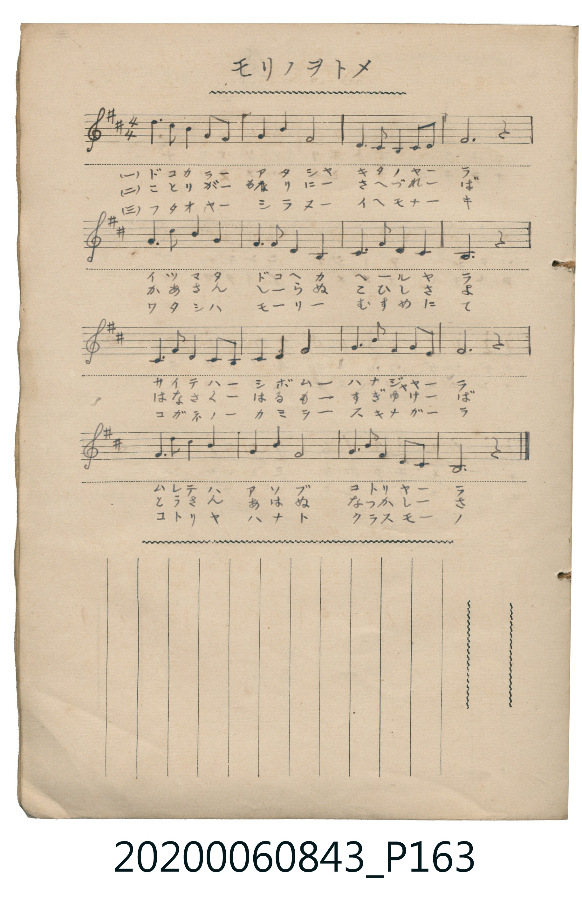

# モリノヲトメ

> Re:Shōka 使用 AI 協助辨識與重建樂譜，可能會有錯誤。歡迎回報。

- **鋼琴伴奏版**：<br><audio controls src="mori_no_otome.mp3"></audio>
- **NEUTRINO 歌聲合成版**：<br><audio controls src="mori_no_otome_neutrino.mp3"></audio>

- 日治時期公學校《唱歌帳》（典藏號 2020.006.0843・P163）
- 原載《小公唱材集》第 343 頁（大正 14 年 1 月 5 日抄）

## 說明


- 出處：《唱歌帳》（國立臺灣歷史博物館典藏號 2020.006.0843）第 P163.jpg 頁。
- 標註：（小公唱材集 343 頁ヨリ）14.1.5（大正 14 年 1 月 5 日抄錄）。
- 調性與拍號：ニ調（D 大調），4/4 拍，速度 != 96。

### 編曲說明（鋼琴伴奏版）：

1. 前奏 (Intro, 4 小節)：取末樂句溫暖抒情的旋律，描繪森林晨光與鳥鳴。
2. 主歌伴奏 (Song, 16 小節 × 3 段)：左手以柔和的分解和絃襯托森林少女的歌聲。


## 歌詞

```text
（TMD 檔案未包含歌詞註解）
```

## ABC

<div class="abc-score" data-abc-src="mori_no_otome.abc" aria-label="五線譜載入中"></div>

[下載 ABC 原始檔](mori_no_otome.abc)

## TMD 檔案連結

- [主旋律 TMD 檔案](mori_no_otome.tmd) [[在 TMD Studio 編輯](https://tmdlang.github.io/Tmd-TS/#tmd=s7IKdvYPcrWy4qpTUCpJTLdSSM7PyUlNLsnMz7MqzsjPTkzOyFeCS5bl55TmploBqXgDQ4RwcX5pUXJqfEFieqpVgKGZMboM3KT4vPyS1KT8_GyEioKi_LLUvMQ8oKrcxLzS4uSizIKS-OT8gkqEmtSyzJRUkIrUlMyS_KLMxBwkJ6UWFYMdC3FDSVFiHsQMoCBCVUlGKtDdeYklpUWpCFGgUemZeValeSDjSzLTMlNTkCVLMvLTixILMiqtMjKLQfYmJ-bEZyfmJSpxaWkpPG5e9Lh51ePmvsfNmx43dzxuXqigpcWlaKtgacZlb6vgwmVjom9iBzLu2fSlzzbtfjaz6dmc-U9b1zxdu-PZgoWPG7qeTtn4bG3P0x2bHzd0v9_T8bR1x4vp_S9mzlcwMjAy0DMwMNMzsDAxfty8GxSm7_d0gt32tG_-iz2dIN0b-kGGAc2YO-Hl7DagGc_XrFEwNjFWeLmgEWTckuXP1i5WMDRReLpzi4KhwrM5HQqmCiC3dLWADePS11KwpRbgUlBQeNww4dnsTc9nr3uxatWzGX2PGyaCRZt3P23f9WLm1Pd7ZmHx9Jzu56u7X7Tvet64-Nna7U_7Nz3tnfW8c-XLJStwhAfQ7SCPgsJEL6sgHeTbxw1NUJuerZj5YsVuoE0go1EDCBY0j5tXAOMNaIqhiZ6hnimBkHrZAwoshAUvVu1_1rD8RUf7s-5eoNNAfmruBgoCjXFRABoEZna-39MDjHwFoBog62XD_Ke7limAUwbUIMrDGwoUtPS5uILz89KtAjIT8_IdagxqqkEWKNgYmmnZgVnAWNZ4sqNBE-j6ToXHTZuBeDWQvfJx8x6FGiBnERDvB-LtQMElYJG1EJHmPpAIVFnzSgUDkGVwE3f1AE1snAzEK4DKu4B0D8zEJqgAyBqwSONUIN4BxEuBMjBljRvQTNzRCXIjUCnYOauQLAe7bSUQ98BMbFoCZM0A5UEg7oIJrkWYWKNgGKegC4RmQAiidRVMoLQxlK6Bi5iiycBgjYIRmDYEQogIhI9sBroeGDSAqQA7x8cQFIadYBFYHEDkQR6DsfbATQVFC1QUGBow1na4yiVIKtfC1YGiDF0Fiqlwu9BhPKprjUDxMxmiHxq_UNMae7C6tgnuRoRKhA-RVAKTAkQWkhxgurCaCkwhRLnWGOQzqLnQtIM3FJDCERH22P0F0Q9LajAVcD-iqF1L0LVo-RGciFuAeB7Y3ZAUAk4dIPuAKQQkMgNkyeNmUF4C504cGbEbiIH5DpTTmiaDA286WGMT0MTGNWABUF7dBJIAKwO5uANrDlyPVCD0g60EVnQgN4CyJCSjNQCNmAmkG8HRDDJ8GXLWg-QnRM6D5S8YhOUaE3h-guUvhAqIjDE8j8JUIlSg64FBLDkPHo-Q0IbGHjxnIcxEyaPAWICphKVlZJUQWVjUQFVi5DCQSlgqQYfYcl03xBxoZMLsh-RFFFOB8QiRg8QwVCU016Kq3ASVg8Q8zMwO8l0KznHroeZA0grM__1YTIXkHFgCgtnfgMWlM6FykIQF89MyslyKntu2QnNcG8iVyDXLHCBeAEvbQA-AMvjjph2PmxeDYhZ_BQjMLI1Ab4FrOJihIMEmYIYEVYRQEWBmaQRWp01Auxsn4q0AwZXDGqDGXlBxDnMmKI3NB2Jg_oWK7IRU1GCnrsHiRlj-MIbXUOh5DZbHELUZZj6F5D4zuAr03EhS_QeMAUjsQmIBGrvwFIOrjJ4DZy3AphKqHynSYIoorwKhSRwaw1DTGrE6GKoW5D1IFgax4NUiikpoIocmCJipE7GqJaEKBKYciK2Q1AMzDdEkQA5eROU8H86CFBPoKndCTYUkNpjP4AUOiWGL3iQF5TuQe8GZEtrwedy0F8ibBuaBiuEOaNFBICsC2ymNoPyFqAJBZSgog0LqP1AkAlMeuKoEV46Q5giOPIiwFblUAIqCXAU0FNQeBWVCSOUIUtKHrwo0RwsRmAqQGgiN2fiEZDZTPBmYhCoQmnlgoQ2LPSzFNVLTcy9c3TQs6qDpDRpSMJWU57oVEP3QyIS5BVvFBs9fiNwHrwqR1UFcB4t-mEpIBYqe42A2EnApco7DEQJILkAq5BCNRywVMDBlQeQgqQumEtH0RA5TWM7G7dJaLi5dOwVQ_zDaxzBWAc42QmIbg9nKXAA)]
- [鋼琴伴奏 TMD 檔案](mori_no_otome_piano.tmd) [[在 TMD Studio 編輯](https://tmdlang.github.io/Tmd-TS/#tmd=s7IKdvYPcrWy4qpTUCpJTLdSyC8qychPL0osyKi0ysgsLskvykxOzInPTsxLVIIrKs4vLUpOjS9ITE-1CjA0M0bIlGSk5qZapaaUJieWZObnKXFpaSk8bl70uHnV4-a-x82bHjd3PG5e-H5Px8vuPc8nbHmyZ8vTpf3POzve7-lU0NLiUrRVsDTjsrdVcOGyMdE3sQOZ-2z60mebdj-b2fRszvynrWuert3xbMHCxw1dT6dsfLa25-mOzY8buoEGPm3d8WJ6_4uZ8xWMDIwM9AwMzPQMLEyMHzfvBrkQaL4SF5e-loIttQCXgoLC44YJz2Zvej573YtVq57N6HvcMBEs2rz7afuuFzOnvt8zC4s753Q_X939on3X88bFz9Zuf9q_6WnvrOedK18uWYHDC0C3P1-zRgHkDb2sgnSFlwsaHzc0QW16sWr_s4blLzran3X3AnWCrGzufjl1O1AcaJmLwtMly8HMzvd7eoAhqgBUBmS9bJj_dNcyBXBwI8x6vn0F0DsQv2CNIqDpIKUKCoZ6Ck87e4HiChqeeSVF-ToKJgpPN_Q_X9-gCVTztH_aszmrn61oetq_9Nmu1c9mTXvWNelZc-vzWS3Ppnc_3QcMhp5n_f3Pd656tnjds3nTn80Eer0T6IeXm5e-3LwF6iAFBSM9hSc7dgMDD-IGBY3g_Lx0HQVDM6hdCoenKxgrPFu3FWzp9mXPOruf7F76bP6Up5N6gHY97Wh7sXwxiL21-cXS9c86Z0Cse7ph4tOlm0GOWdvzonET1DrKUwQUKGjpc3GBQ8UqIDMxLz_Iw6HGoKYa7CUbQzMtOzCrRsFUQRcIzYAQROsqmENpGISpAKmB0MYYKkzAtClcxghKG8JVwFjo0ACmgqsWxbU-yK41gTvWMF4h2jBWwTQeSJvGxyJEzEAiZvG5ICETENsEKIupDEgZQOwCxSH-gDGMQwsZiC8R_of5G-RzXCEDCQlDuP9hIYMwA10PZshgjyeYnQi7ICaZYIQ-umuM4e6GqUSoIBxP0MCBmoQ7xtF9iuleiCvM4CrQXUV-2AxgGkakK_xJGJ5IkdIrVAroWljChYsg0rcxiGUMTumoJsLV4jEPZ47AbhKmO7DlLSLcRoUMq2unAC4fFIAMUCBjo5W5AA)]

## 分析

```text
================================================================================
📊 TMD Song Profile: [ モリノヲトメ ]
================================================================================
⏱  Duration:       2:00 (120.0s), 48 measures total
🎼 Key & Tempo:    首調基準 D, != 96.0 BPM, <4/4>
   - 分析範圍：      由實際發聲的音符與和弦推測調性；播放脈絡另行呈現
🎤 人聲音域:    D4 (MIDI 62) – D5 (MIDI 74) [跨度: 12 個半音 / 1.0 個八度, 難度: easy]
   - 最低音:  D4 in [Song[L1] #1 @ m.3, 0:05]
   - 最高音: D5 in [Song[L1] #1 @ m.1, 0:00]
   - 適合: soprano, mezzo-soprano, contralto, tenor, baritone, bass
🏛  結構:      Song[L1] (40.0s) -> Song[L2] (40.0s) -> Song[L3] (40.0s)
⚡ 編曲密度:        Peak 1 軌道同時演奏
🗝  調性診斷：       D 大調（純淨自然大調，未偵測到可信轉調）
   - 風格氣質:    純淨自然大調（陽光明朗、易唱易記，無明顯調外色彩）
   - 轉調歷程:    全曲維持單一推測調性（未偵測到可信轉調）
   - 核心骨幹音:  F#, D, E, A, G
   - 調性數值:    D 大調 [相關度: 0.81, 穩定度: Moderate, 自然音純度: 100.0%]
   - 候選調性 (K-S): D 大調 (0.81), F# 小調 (0.69), B 小調 (0.63)
   - 五度圈歷程:   +2 -> +2 -> +2
   - 各段落調性細節:
     • [Song[L1] #1]: D 大調 (r: 0.81, 自然音純度: 100.0%)
     • [Song[L2] #1]: D 大調 (r: 0.81, 自然音純度: 100.0%)
     • [Song[L3] #1]: D 大調 (r: 0.81, 自然音純度: 100.0%)

  [ 五度圈游移軌跡 ]
               C  
         F            G  
      Bb              [D ]*
      Eb               A  
         Ab           E  
            Db       B  
               F# 
     (* = active key center)

  [ 十二半音累積音高分佈 ]
     C  :                            0.0%
     C# : ███                        3.3%
     D  : ██████████████████        21.2%
     D# :                            0.0%
     E  : █████████████             15.8%
     F  :                            0.0%
     F# : ████████████████████████  28.7%
     G  : ████████                   9.6%
     G# :                            0.0%
     A  : ███████████               12.9%
     A# :                            0.0%
     B  : ███████                    8.3%
--------------------------------------------------------------------------------
Assignment 軌道音域：
  - Piano         : D4 – D5 (12 個半音 / 1.0 個八度, 162 個音符)
================================================================================
```


## 原書掃描頁




