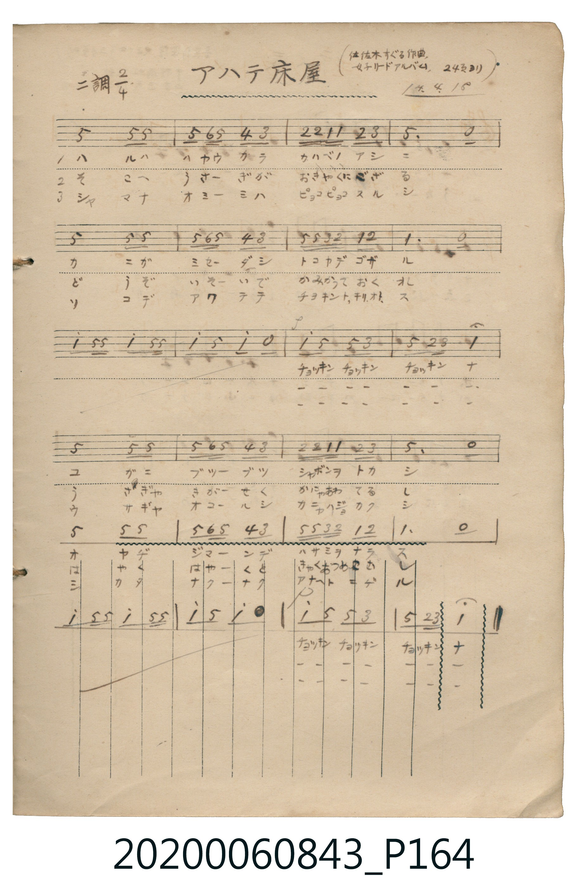

# アハテ床屋

> Re:Shōka 使用 AI 協助辨識與重建樂譜，可能會有錯誤。歡迎回報。

- **鋼琴伴奏版**：<br><audio controls src="awate_tokoya.mp3"></audio>

- 詞：北原白秋
- 曲：佐々木すぐる（原載《女子リードアルバム》第 24 頁，大正 14 年 4 月 15 日抄）
- 日治時期公學校《唱歌帳》（典藏號 2020.006.0843・P164）

## 說明


- 出處：日治時期公學校《唱歌帳》（典藏號 2020.006.0843- P164）
- 調性與拍號：調號 ?= D，拍號 <2/4>，速度 != 112


## 歌詞

```text
> [!NOTE]
> **原件資訊與抄本考證**（對應《唱歌帖》第 1 冊 `P164.jpg`）：
> - **曲名與眉批**：「アハテ床屋」，右上括弧註「（佐々木すぐる作曲、女子リードアルバム、24頁ヨリ）」及抄錄日期「`14. 4. 15`」（大正 14 年〔1925〕4 月 15 日）；左上標「`ニ調 2/4.`」。
> - **校勘備註（依 Editorial Policy A 校訂）**：
>   1. **第 1 小節第 3 節濁點漏標**：原抄作「シャ マ ナ」（漏標濁點），依 Policy A 復原為「ジャ マ ナ」（邪魔なお耳は）。
>   2. **原抄簡譜八分音符底線漏標**：第 10 小節末休止符 `0`、第 11 小節 `1^ 5 5 3_`（首三音漏八分底線）、第 16 及第 20 小節末休止符 `0`、第 22 小節 `1^_ 5 1^_ 0`（第 2 音 `5` 與末休止符 `0` 漏八分底線）、第 23 小節 `1^ 5 5 3`（全小節四個八分音符均漏底線），以及第 12、24 小節首音 `5`（漏八分底線），均依 `2/4` 拍時值與前段對應樂句復原正確節奏。
>   3. **原抄歷史假名與口語連音保留**：
>      - 第 7 小節第 2 節保留促音大字「かみかつておく」（`かつ` 合配一十六分音符）；第 3 節保留「チヨキント, キリオト」（末拍二個八分音符下各配二字 `キリ`、`オト`）。
>      - 第 15 小節第 3 節原抄明確作「カ ニャ ハ ジョ カ ク | シ」（即「蟹は恥をかくし」之口語拗音連讀「ハジョカク」，舊轉錄誤改為「ハジカク」）。
>      - 第 17 小節第 1 節保留歷史假名遣「オ ヤ ヂ」（親父，舊轉錄誤改現代假名「オヤジ」）。
>      - 第 19 小節第 2 節原抄作「きゃ く あ つ め こ む | し」（即「客はつめこむし」之口語連讀「きゃくぁ」，與「うさぎゃ」「かにゃ」同構，以 `くあ` 共配第 2 個十六分音符）。
>
> **（一）**
> ハルハハヤウカラ　カハベノアシニ
> カニガミセーダシ　トコヤデゴザル
> チョッキン　チョッキン　チョッキンナ
> コガニブツーブツ　シャボンヲトカシ
> オヤヂジマーンデ　ハサミヲナラス
> チョッキン　チョッキン　チョッキンナ
>
> **（二）**
> そこへうさーぎが　おきゃくにござる
> どうぞいそーいで　かみかつておくれ
> チョッキン　チョッキン　チョッキンナ
> うさぎゃきがーせく　かにゃあわてるし
> はやくはやーくと　きゃくあつめこむし
> チョッキン　チョッキン　チョッキンナ
>
> **（三）**
> ジャマナオミーミハ　ピョコピョコスルシ
> ソコデアワテテ　チヨキントキリオトス
> チョッキン　チョッキン　チョッキンナ
> ウサギャオコールシ　カニャハジョカクシ
> シカタナクーナク　アナヘトニゲル
> チョッキン　チョッキン　チョッキンナ
```

## ABC

<div class="abc-score" data-abc-src="awate_tokoya.abc" aria-label="五線譜載入中"></div>

[下載 ABC 原始檔](awate_tokoya.abc)

## TMD 檔案連結

- [主旋律 TMD 檔案](awate_tokoya.tmd) [[在 TMD Studio 編輯](https://tmdlang.github.io/Tmd-TS/#tmd=s7IKdvYPcrWy4qpTUCpJTLdSSM7PyUlNLsnMz7MqzsjPTkzOyFeCS5bl55TmploBqXgDQ4RwcX5pUXJqfEFieqpVgKGZCboM3KT4vPyS1KT8_GyEioKi_LLUvMQ8oKrcxLzS4uSizIKS-OT8gkqEmtSyzJRUkIri5MS8-LLUosy0zNQUJGelFhWDHQxxR0lRYh7EHKAgQlV-UUlGfnpRYkFGpVVGZnFJflFmcmJOfHZiXiJCUUlGKtCDiXmZuYk56KLl-UVIDgdqT8_MsypJzAT6Lh6IyxPjcxMz83IS84BO09JSeNy06HFz_-Pmtqe7up5u7FbQ0uJStFUwNDTisrdVcOGyMdI3sQOZ9mz60mebdj-b2fRszvynrWuert3xbMHCxw1dT6dsfLa25-mOzY8but_v6XjauuPF9P4XM-crGBkYGegZGJjpGViYGD9u3g0K8vd7OsFOe7Fy3vs9s572TH_aN__5zL3Pl3eDhZ_N3gQUfrJ3wuOG1mdzVjxunPm4ccLjJrC5ffNf7OkE2bd089O1Ex43r3rcvOdxcyfY-asfNwNFFgBd8HzNGgUjE4WXCxrf7-l5umT5s7WLFQxNFJ7u3KJgovBsToeCoakCyCddLWCncOlrKdhSC3ApKCjYKUQr-vmHuMZCOFpaQHc_2b3txeb2Fyu6XnS0Ay1-NmfNi4bmF2s7tbRA_trQ-6wd7C9oOE6D-sJQ4Wlbl0ICKNT0sgrSE4DuBYYNxFhdoMHAsHo6oRdo5PM5nc86d4IMm_W4oQctOh839IICon_zkx1dz7rXPN2z_MWK3UBlQJsxg_nJ3jlAUx83NOIN40YjE2DwPm5eAZQHOgpow9P-LqC_Xva0gEJ2znyg8QmGJnoKQGRomgB2QQdKVDxumGJoaWT6uGEqcpyAPTj76fZlIKeumAky5XFz94tV-xWASVAPZM7jhiYk_y9Y-LR7xtOmmUAPgXyzb66Ca0omKLsk5igE5OdkJlcqOCoAVb1Y0QQ0Ghw-EN0KCoZ6QAOggbyh__n6BhDbWAHIeLa_8eXuec_29ANdANYCjD-g34AhAw7b7Y-bFys8bp4HxF0Qj0GUQrSBfdADcgnc_qf7VoKSeNMusPYdGNpfNq16uXbK48ZVjxu7XjRsfty4HhykUH8qKBiBXApxw_MNC1-snfO0dfXTjraX8zc_X7Ps6a6pz7fPQnIs2EsGUD89m7P6yZ6Jz9YuAqpUSDAABmAjWB7mZ4UEwzgFUyA0jgcmro6Xy6Y92dEJNBhoHsQSiPFg90B0mikAYxqcwwjYYWSEZEc80AoQaQCyBSyrALRFIcE0QQGUIdBMUMBpvZExhsNBJj5tXQERfjp79tOGbpTwmdsOMg1mDihudi-FesHQCJySoUYCPQ91EyRK0VwAykJz20ERmwBMi0A3dvcCC8KnDXuAHnja2fts3VZINn62oulp_1JInAOT-_NFu0DuWtqPFKHGiAh9tnb70_5NTxvbIfn4af_iF6vmvWxYDHTJk_1zn0-FxClMIxDoKoBcbo6UZo1AaRai-Mn-ZqBGYD57unY6KLE1dj9u3A8mlzxuXAZMXo8bge4ApbkEiGiCwtMJHS9be5_saHja2_i0dS083CA5EZ4nIOaDzGwGZ_umtY-bNz9u7tAB1h1A5qrHTcByogOaHeasBgbOk109aFHxZEf30wktINuAUmunKyRAtIISDJAJ0g8q4JDCCe5dYOGAlkehoTejDxi-sIy5GpiluiG5qx_oLGBGWw6kgKJN6xVqgOR2aDHUC6ymel7M3wnMaM8alz5umgQOi_7HjcAw632ysxsSCc-6pwOdDYyKF-sawP7uhxgJNBFoIKRMfdHR9WJvJ7DQe7FqybMpO6FZHKISoQy7l5Cj0BARxMgJ4mXjYrDHVgF9tASImyAeeLFs1fOObVis79_3ZPdiiFaIPqA2kFNwO8ISPR2hFHWNvY-bmhWAQQPETUAMdENTI5CeDKQbQEEKDjF4kD5dtwgYpKC01tQIVARUgxakiMAEmwwO80ZYSLaDxdseN0593NgHkgWV9ZAkDAxJEPfphJ5ny4HtAFAOBiYekO4mYAJu3QhMUhAPgBIcRjKGeRxWG4Mqih0N4OoAIgSuK4FVG5AEIqDrl4Eir3nl44YGMAMoOPNxM9BNi8CFfzdUF0iq-3HTmsfN8x837QbXkkD1wETWAMoJTcDcseRxc_vjpi2Pm7YBzYfZBcw-yx83N0NzEEgxIZHmLpiNm8HWAdP4tMfNLWAbwQyQO0G10uPmOWD1m8AOAIbadphGcEoAph9QCp4H1ghUBgxxoF3AxLoV5AWQri6Qr5t2UuxU5KDeBWxnIIK6cS4oZTTugMY00CXAyG7sARkFKp3gyWL140ZgjTgN2CCBaVwJ1jLvcWMLyBCQRiBjOVgjtlKuqYcKAY6cHIFuA7oTZO9scCkKsRecNBuBAQt0MzDZAEWmw_Suf9wEdCFQHMwAaQSyV4A1wr3ZhJZbqBryO4AlOCLkwQ0PcOx3gdMDMMaByQBIgv3SPAVctAHNgTGadoIyBSIJ7QXLAtMzsB24Hti2BCGoMxDVAUplQIWEBLQXGKpbHzetAzkeaCzIDUBngxwGy56gIh-9dEY4eztYZD_Y10BnA_WCGSC9QI8AE_wMkFNBGRmY_inOpJR3IKBAQUufiys4Py_dKiwf2PVzqDGoqQZZoGBjaKYFjmUFbN0WUKkOLNxeLOxR0IC1a3QUYP0HTSwagPaADKtRqM5NqwW2p3TBEESDcA2QNAOzTIDYGCxiBISGQGgEF4HpAkEDkAjYSB9DYA0BrIkh4sDABZMgPkQcXKc1LQOJAitpkNxKiBy4IgfJzwTiPlDnFKxmO1RnN3bbjED10VyYbcA6CkTugOhpbAPiqVCZPjDZA5XpAmKkag5odeMUsIJpUMfgsM4YJAduy8P8Nw9MdkG1gers-VAZEI3wOSiDgcpyFGbTTngYgZsqGJbij_JdPeREOTGxDW5jg2NcFxzjNWAWjtgGxyPEz6BgA9ZWUD_PB7J3Q2UawDKw2OyABgWofdMOZG8By26DysLMwxbXoNQCidE2MAkKf5B4CzwdgNggcjlUphuI94NocFOmcRk4-kEKoFHTBEoUuOJ6L8w6oHNB3miH6lkEZK-Heg3sEDAJcjyoZAQ1j4FMkA9BPgWVjmAzQAUk1ABQzJMS1zs6QXH9ctpkYKfi_Z7u59O6gP0NkuMe2H0CRTqoWwZlwMV0IQywWxSqC2oR4iCMyPJGQDYsMSBneWjBCPYnzPOYYpgqQWEHCluIxWiyECmsgrjsBMUtkttAiWawug2Uwgah2_AmRGBfe_DUM-BMCcmeoDIHUv6APDgNiEGlAEgMVKRDeJDuILirOAfq603gLAoyAHchjCh8QHkcUsSAqhVIExGirbEXWruAhGeDSWjxAi5_QA1GIAXsTjWB6htI9Qd1bON07DaCyx-QSogHt4JJUIsI6lBgXQP1P7SWhZWuOLvEIDWgQousumbK4KhrQAUpxM9LwGQT1D87gGxQXQDLFvCiGhwEW4E0sDYCRze48Ie3OjDLYUR0Qwp4UKhBahRYjK6HisDEgA18qAysTYHecwaZAaoBCUU3LFZgsbUf6gdgewUccyCXg90Pj0dQRQSUbZ4BTsiwGngTVB9mTYo_c7euHa1lRmsZuritlotL104B1NmJ9jGMVYCzjZDYxmC2MhcA)]
- [鋼琴伴奏 TMD 檔案](awate_tokoya_piano.tmd) [[在 TMD Studio 編輯](https://tmdlang.github.io/Tmd-TS/#tmd=s7IKdvYPcrWy4tLSUnjctOhxc__j5ranu7qebux-v6fjZfee5xO2PNmz5enS_uedHe_3dCpoaXEp2ioYGhpx2dsquHDZGOmb2HHVKSg9m7702abdz2Y2PZsz_2nrmqdrdzxbsPBxQ9fTKRufre15umPz4waQiU9bd7yY3v9i5nwFIwMjAz0DAzM9AwsT48fNuwMMzUyAFiiBDHuxct77PbOe9kx_2jf_-cy9z5d3g4Wfzd4EFH6yd8LjhtZnc1Y8bpz5uHHC4yagJJdnXklRvlVAZmJefpCHQ41BTTWXAhDYGJpp2YFZNQqGcQq6CqZACGfAxXQhDAMgRhIDYWOwEIhlBGQbwhRx1aJY6YNspQXCxniFaMNYGIXMN8AiaxoPZJnGw-RBVgTn56VbheUnJ-Zg91J1blot2HEgCHMyyLlmYJYJ3ANGQGgIhEYoXoJBiJdARvoY1igA0wBU_HHzajAJ4kPEHzcvASaTZSDRJojcSogckAeRnwnEfaCkBFazHaqzG7ttRkC5xrkw2xong8kdED2NbUA8FSrTByZ7oDJdQNz7uKkZSAGtbARa3TgFrGAa1DE4rDMGye143LwY7r95YLILqm0VkD0fKgOiET6f8rh5OVDBZhRm0054GIF0g_yKaik0loiJIFByNAZHEiilgZMhdj-AIggc9BBngnz6uGkN1JnzgezdUJkGsAwsAjqgrgdGX3M7kL0FLLsNKgszD1v0gCIYEgltYBIUZCDxFnjUgdggcjlUphuI94Pox41A6xqXgWMMpAAamk2geMQVPXth1gGdC_JGO1TPIiB7PdRrYIeASZDjGx83rwAqWAtkgnwI8unax82rwGasAvEhBoAiC2v0gDjIEJtIdUEtoXIBrBAeR8QYCnb68sfNzWCnAt0M8TEWQQy1UL-CghXJXmB8DYi9wIijt700LQDBSQ8EITkLkstAbpoGxKC0DhIDlTUQHjjzg0qVx81zoA7dBE6IsFISe-mAyGKglAw2FFzeAUs7UNkGyUu90GIPJDwbTEIzETiXrYYUgk1A80EFIaRchjq2cTp2G8G5DKQS4sGtYHIdpFCEFoJQ_0OLf1gZAi7iuyH-BNoGKkhBBSFEDShr0rkQBOVwiDOXgMkmqBN2QMt1kBhKGQJ29VZIMQmOIXCpBK_BMAsIRAxBSh6QRyFFHSwS1kNFYGKPG1dAZWD1Ezh2QOVgUyOshmsCFc2EYggWkLAA3g_1A7DuAwc2rN5CBD2ohATKNs-AFILQqmETVB9mET9a_A3d4g_WNsTb4KV64UjdXEx8i5yk5DcS_Y2SHHB0RsChgqNHAu56gAWMQCyj-FxkMXjHBMQA9UygviBkFrIASDtaB4ioThI4CAh0lIa7_4Cxq2unAO5uKgAZoJiO9gGqhLONkNjGYLYyFwA)]

## 分析

```text
================================================================================
📊 TMD Song Profile: [ アハテ床屋 ]
================================================================================
⏱  Duration:       1:17 (77.1s), 72 measures total
🎼 Key & Tempo:    首調基準 D, != 112.0 BPM, <2/4>
   - 分析範圍：      由實際發聲的音符與和弦推測調性；播放脈絡另行呈現
🎤 人聲音域:    D4 (MIDI 62) – D5 (MIDI 74) [跨度: 12 個半音 / 1.0 個八度, 難度: easy]
   - 最低音:  D4 in [Song[L1] #1 @ m.3, 0:02]
   - 最高音: D5 in [Song[L1] #1 @ m.9, 0:08]
   - 適合: soprano, mezzo-soprano, contralto, tenor, baritone, bass
🏛  結構:      Song[L1] (25.7s) -> Song[L2] (25.7s) -> Song[L3] (25.7s)
⚡ 編曲密度:        Peak 1 軌道同時演奏
🗝  調性診斷：       D 大調（純淨自然大調，未偵測到可信轉調）
   - 風格氣質:    純淨自然大調（陽光明朗、易唱易記，無明顯調外色彩）
   - 轉調歷程:    全曲維持單一推測調性（未偵測到可信轉調）
   - 核心骨幹音:  A, D, F#, E, G
   - 調性數值:    D 大調 [相關度: 0.81, 穩定度: Moderate, 自然音純度: 100.0%]
   - 候選調性 (K-S): D 大調 (0.81), A 大調 (0.77), A 小調 (0.59)
   - 五度圈歷程:   +2 -> +2 -> +2
   - 各段落調性細節:
     • [Song[L1] #1]: D 大調 (r: 0.81, 自然音純度: 100.0%)
     • [Song[L2] #1]: D 大調 (r: 0.81, 自然音純度: 100.0%)
     • [Song[L3] #1]: D 大調 (r: 0.81, 自然音純度: 100.0%)

  [ 五度圈游移軌跡 ]
               C  
         F            G  
      Bb              [D ]*
      Eb               A  
         Ab           E  
            Db       B  
               F# 
     (* = active key center)

  [ 十二半音累積音高分佈 ]
     C  :                            0.0%
     C# :                            0.0%
     D  : ██████████████            26.7%
     D# :                            0.0%
     E  : █████                      8.9%
     F  :                            0.0%
     F# : ██████                    11.1%
     G  : ██                         4.4%
     G# :                            0.0%
     A  : ████████████████████████  46.7%
     A# :                            0.0%
     B  : █                          2.2%
--------------------------------------------------------------------------------
Assignment 軌道音域：
  - Vocal         : D4 – D5 (12 個半音 / 1.0 個八度, 282 個音符)
================================================================================
```


## 原書掃描頁




