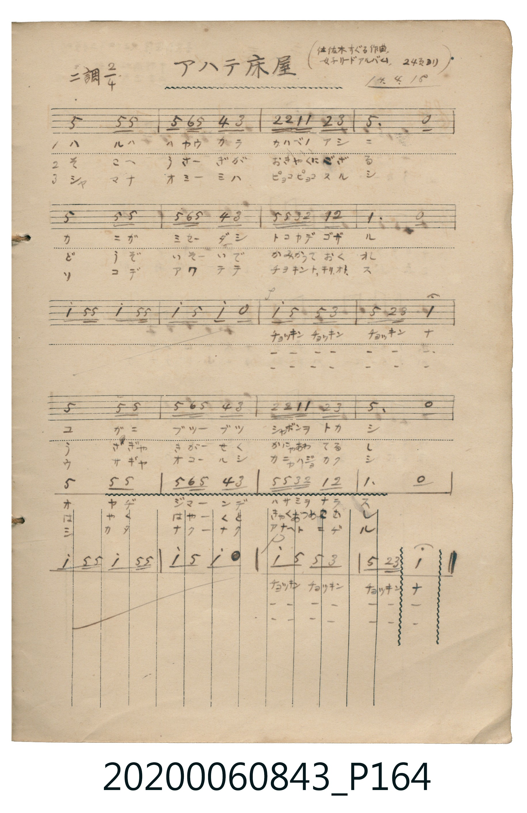

# アハテ床屋

<audio controls src="awate_tokoya.mp3"></audio>

- 作詞：北原白秋
- 作曲：佐々木すぐる（原載《女子リードアルバム》第 24 頁，大正 14 年 4 月 15 日抄）
- 日治時期公學校《唱歌帳》（典藏號 2020.006.0843・P164）

## 說明

【曲目說明】
・出處：《唱歌帳》（國立臺灣歷史博物館典藏號 2020.006.0843）第 P164.jpg 頁。
・標註：（佐々木すぐる作曲、女子リードアルバム 24 頁ヨリ）14.4.15（大正 14 年 4 月 15 日抄錄）。
・調性與拍號：ニ調（D 大調），2/4 拍。
・背景與曲風：北原白秋作詞、佐佐木すぐる作曲的日本經典童謠《あわて床屋》（慌張的理髮店）。
描寫春天河岸蘆葦叢中，螃蟹開了一家理髮店，小螃蟹吐泡泡當肥皂、老螃蟹得意地揮舞大螯剪刀，
結果慌慌張張把兔子客人自豪的長耳朵「チョッキンナ」剪了下來，惹得兔子大怒、螃蟹逃回洞裡的滑稽故事。
・版本說明：本檔案為原頁單聲部簡譜之忠實數位化版本（含「チョッキン」前之器樂間奏樂句）。
【原頁歌詞全文與中文語譯】（對應 P164.jpg）

・編曲說明（鋼琴伴奏版）：
1. 前奏 (Intro, 4 小節)：直接引用曲中經典的剪刀聲動機（`1^ - 5 5`），活靈活現地描繪理髮店開張。
2. 主歌伴奏 (Song, 24 小節 × 3 段)：左手以輕快俏皮的斷奏伴奏襯托螃蟹與兔子的滑稽互動。

## 跨冊／重複收錄參照

> 同詞異曲（北原白秋作詞〈あわて床屋〉；《新定兒童唱歌》二年級為山田耕筰作曲版，《唱歌帖》P164 為佐佐木すぐる作曲版）

- **[同詞異曲]** 《新定兒童唱歌》尋常科第二學年用（2020.006.0847.0002）：[**〈アワテトコヤ〉**](../../../shintei_jido_shoka/grade_2_2020.006.0847.0002/4_04_awate_tokoya/index.md)（`F` / `2/4` — [原始 TMD](../../../shintei_jido_shoka/grade_2_2020.006.0847.0002/4_04_awate_tokoya/awate_tokoya.tmd)）
- 總表：[跨冊重複與同名歌曲總索引](../../../duplicate_songs.md)

## 歌詞

```text
（一）ハルハハヤウカラ　カハベノアシニ
カニガミセーダシ　トコヤデゴザル
チョッキン　チョッキン　チョッキンナ
コガニブツーブツ　シャボンヲトカシ
オヤジジマーンデ　ハサミヲナラス
チョッキン　チョッキン　チョッキンナ
咔嚓、咔嚓、咔嚓吶！小螃蟹咕嚕咕嚕地化開肥皂泡，老爹得意洋洋地把大螯剪刀弄得咔嚓響，咔嚓、咔嚓、咔嚓吶！）

（二）そこへうさーぎが　おきゃくにござる
どうぞいそーいで　かみかっておくれ
チョッキン　チョッキン　チョッキンナ
うさぎゃきがーせく　かにゃあわてるし
はやくはやーくと　きゃくつめこむし
チョッキン　チョッキン　チョッキンナ
咔嚓、咔嚓、咔嚓吶！兔子心裡著急、螃蟹手忙腳亂，客人又一個勁兒催著快點快點，咔嚓、咔嚓、咔嚓吶！）

（三）ジャマナオミーミハ　ピョコピョコスルシ
ソコデアワテテ　チョキントキリオトス
チョッキン　チョッキン　チョッキンナ
ウサギャオコールシ　カニャハジカクシ
シカタナクーナク　アナヘトニゲル
チョッキン　チョッキン　チョッキンナ
咔嚓、咔嚓、咔嚓吶！兔子勃然大怒、螃蟹羞愧難當，無奈之下只好逃進洞裡去，咔嚓、咔嚓、咔嚓吶！）
```

## ABC

```abc
X:1
T:アハテ床屋
M:2/4
L:1/16
Q:1/4=112
K:D
V:V1 name="Piano" snm="Pia"
[V:V1]
A4 A2 A2 | A B A2 G2 F2 | E E D D E2 F2 | A6 z2 |
A4 A2 A2 | A B A2 G2 F2 | A A F E D2 E2 | D6 z2 |
d2 A A d2 A A | d2 A2 d2 z2 | !p! d2 A2 A2 F2 | A2 E F D4 |
!mf! A4 A2 A2 | A B A2 G2 F2 | E E D D E2 F2 | A6 z2 |
A4 A2 A2 | A B A2 G2 F2 | A A F E D2 E2 | D6 z2 |
d2 A A d2 A A | d2 A2 d2 z2 | !p! d2 A2 A2 F2 | A2 E F D4 |
```

## TMD 檔案連結

- [主旋律 TMD 檔案](awate_tokoya.tmd) [[在 TMD Studio 編輯](https://tmdlang.github.io/Tmd-TS/#tmd=s7IKdvYPcrWy4tLSUnjctOhxc__j5ranu7qebuxW0NLiUrRVMDQ04rK3VXDhsjHSN7HjqlNQejZ96bNNu5_NbHo2Z_7T1jVP1-54tmDh44aup1M2Plvb83TH5scN3e_3dDxt3fFiev-LmfMVjAyMDPQMDMz0DCxMjB837w4wNDN5v6dTCWTYk71zXqyc937PrKc905_2zX8-c-_z5d0wmWezNwFlnuyd8Lih9dmcFY8bZz5unPC4CWx63_wXezpBti7d_HTthMfNqx4373nc3An2xOrHzUCRBUB3PF-zRsHIROHlgsb3e3qeLln-bO1iBUMThac7tyiYKDyb06FgaKoA8k9XC9hBXPpaCrbUAlwKCgqPGyYAPfF89roXq1Y9m9H3uGEiWLR599P2XS9mTgX6DkvAzel-vrr7Rfuu542Ln63d_rR_09PeWc87V75csgJHmALdDvIoKFz1sgrSQd593NAEtenZipkvVuwG2gQ0GjMoIaH8uKERTzhCQ_Bx8wqgNNAuQxM9Ez1DU5BT8YXoyx5QoCIc8mLV_mcNy190tD_r7gV6AeT35m6gINAcFwWgSWBmJzCegAlNAagGSWdzz7OZ60E6Z296uWgFWmqBJCGgF4C-AyJM3z2f1QJy0Zw1z7dNBobg89VLX6wBJo6ux41Nj5v6HzcugyR4SOg_a-15umcrUMvzCW0vV697ums6whMKCs_6-5-uX_1sxtKnS1Y-27T56aYdL2a0vZi47Gn_oic71gLd_mJe84v5O19O636yq-3Jjoan67YhmdPzdEM_RMHTCROebV4IRM-nbnvRtPT5rCag-18AEUR23_RnLf1P52x41r_uRcc8UNjMW_-0c9XTjgagIRCXPN864dm8OUDXQhwMRM-6up62TgFG4tN1i57s2vWifdWLjauAHnk5dfuLhs3P5mx93NDzuBkYjcsfNzc_blr7uHnz4-auxw29QJPBru1-sq8NaP6zZpADoEYBI7hhEshtEH81ND-dPe_ZlnkvFi8Eheruic9X7H02tfXJLmDowWLreWcHMKwhCR4YVUD2s1VTni3seN60CxhnwIT0dNq6F42bXjaveL5h4Yu1c57s7H66f8HT9cueTd3xZG_v055pEBNA6WvCaiyOBrm4F6Rr5opnK5peTpv8dGk_kPG0fyk0qqA5D2IbMGsBk8fT1hXPprUDkxAwmkCMVfNerF0PzI4gSzb0PmvvhOceoBlgA0DZZQcwvDvBhSIwKwBJIFryuGnZ4yYgd-XjhgYwAyg483FzHyjHNG0HJmmI7Q1QBFLR_bhpzePm-Y-bdoMzF1BwO0iqueNxEzAKljxubn_ctOVx0zagNaia0T1OhEhzF5r9m8GWdz9unva4uQVsP5gBkgK6dvHj5jlgbZvAzlkNFETTDywQgH7eAULN88D6garbwTb3P27aCvIXSHMXKESadlLJ_cDAh0QRKAGBcxswLp5NXwnKQ3NWAHPey6YuYAKEZz5gekTOfKAM0Tjr-ZT5wGwELmN7XjbMfNo66dmM9UjZEVhI9kIy09NJU57OmgwqBVEZTydsAypD5NpJU5_Omgol52wAplSgXZDsC8zKIAc0ND7vgGbfZ1u6gQiUiYH5EikHP93TAspeYPNfzgcWeT34bUdOj7t6QOmxce7jxsmPG3c8bmx73DgVFCWNfY8be0CB2Qgs1HofNzU_bgSWa6sfN0553DgNWA6ixkrjSrDOeY8bW0BmgfQDGcvBUt2PG_eDycXAchFsHDCSwUUOVVMlxOVAZ4Oc2gtyPMgVs0G2QV0BTIlAKWgBDfTC48bpaEasf9wEdDZQGswA6QeyV4Cl4EEATLmNoMBqAgqi6adK2gQmK2BDCLnYfbKj6-W0BmBJCixSIUnvxWpg-bYamH5f7p73dOfqZx0TgQnh5YK1oGQ4YTkJyRBiy_5mYGJ_MXH6s4al8HL5WSfQipkvWjc_2dUESlBglzztBxVgTxu6n3YD9U562rQGqAvoEpAzwCRJSW8HsGYGtgqAhQCwyACWA13gkgGY94EFApAEx1vzFFBwgco0GKNpJ6joxChT9oIVAUs9YCNjPbDFCULw4IaGNbA0AjJWga0BsqlVsiC5Apistj5uWgfyEdASkIuAfgG5FlFugzwLzADA0g8oDkxn6B7ZDpbYDw4OoEeA-sEMkBTQa8AycQbI8aAKAFhEUqtwR06Az5fMBFa-yLU8MM5fbN8MIUGFVPdUYBJ4sqP3aeMcUOU-bQ-wEISmGmDLYf9MYEUKrBMh0Q7S1bgJtT3QSELa7G5-3rINrc3wfN-8Zy3LX85eDGzqAB3wvGXh06UdYEu7n_averp0L7BR8bJhE6RR8bQP2FIlIlUCHUR5Ax0KFLT0ubiC8_PSrQIyE_PyHWoMahSqwZ62MTTTsgOzgP0CDWDgaALbN_1AvBpM10B5S4Bdp2VADBJdCRIFs0AyM4G4D9SxAuLtYPXdCgYg--Bm7uoBmtk4F4gnA_EOkJrGNiAGFetACqi5sQcs2AXEoGINSAFNbgTa0DgFiKeB7UM3dUcn0FRwXgVaOQ-Iu8DKVgFZoBwLouA-AGVVoNxmFGbTTrAvQZq2I8yuUTBV0AVDEA3CIBEzMMsEiI3BIkZAaAiERnARmC4QNACJgEsVpEAFB1g3kF4DdhLQceCmEpDZAA-5DqgjgaHd3A5kbwHibWCZ1VjDdCU0JOeBg68FFMqQMAUxl4MFgTY27gfRwOoOSAHjEBzM4HBp6sEapnuhrmgHqwHGa_N6IAbaA8Qgt4DyK1BiLZAJUgZyNIgNDHlw6HeAte0kNUhNgdAYHKy64GCtAbNwBCmkQawJVGQAdxK8CMHgY1PRhXCdYRzYWaYIBlxMF8IA265QXVCLEAdhRMwbAdkw52LGPCixrQHHPsgl04AYVJfDmJAUCEnHoHYqkNoEDVaM1IkU9-AcBMo-oAwDiuleUD6CRP9sWAyDox_UzABSTUCjQNkKlI3BLmmcjjX6QfJbgRhUacCyFLjigBQKkKQKSc0QRwMNbdoBEWpaj5mfqnPTammWqUAJDlQ2gUsVkCvA7XdoygQnYLDzgP4BFweggAUmf2gRhpRGkQIWmNibQPkHEoBgHiRUQYG3AhLUiEIKZHkjpGhrasATqtuhAbQf7CagG8B1KYwJz2kgx82AxD64sNiEnvtHXGaq5eLStVMA1V0KQFqZCwA)]
- [鋼琴伴奏 TMD 檔案](awate_tokoya_piano.tmd) [[在 TMD Studio 編輯](https://tmdlang.github.io/Tmd-TS/#tmd=s7IKdvYPcrWy4tLSUnjctOhxc__j5ranu7qebux-v6fjZfee5xO2PNmz5enS_uedHe_3dCpoaXEp2ioYGhpx2dsquHDZGOmb2HHVKSg9m7702abdz2Y2PZsz_2nrmqdrdzxbsPBxQ9fTKRufre15umPz4waQiU9bd7yY3v9i5nwFIwMjAz0DAzM9AwsT48fNuwMMzUyAFiiBDHuyd86LlfPe75n1tGf60775z2fufb68GybzbPYmoMyTvRMeN7Q-m7PicePMx40THjcB5bn0tRRsqQW4FBQUHjdMANr2fPa6F6tWPZvR97hhIli0effT9l0vZk4FOgOLD-d0P1_d_aJ91_PGxc_Wbn_av-lp76znnStfLlmBw_NAXz9fs0YBFAB6WQXpCi8XND5uaILa9GLV_mcNy190tD_r7gXqBFnZ3A0UBNrkovB0yXIws_P9nh5gRCgA1QBZLxvmP921TAESTQiTnm9fAfQMxCdY4xZoNkipgoKhnsLTzl6guIKGZ15JUb6OgonC0w39z9c3aALVPJ-95Vnf0qd7pj6fAjLwyY61z7dNBnrt-ayWp52rnnY0vGjc9LR76rOVQMd2JBjGKegqmCqYJkBc-WzL7pdzO4Dk8_59T-dseNbf_3znqucT2l6uXvd01_SX07qf7tkKdbKCgpGewpMdu4GBC3GlgkZwfl66joIRzDUKh6crGCs8W7cV5Kyn25c96-x-snvpiz1Tn-5f_WR___NZ64BuejZtO1AvxIQXS9c_65zxYl7zi_k7gUH6tHXK07UTQGp2T3y-Yu-TXZOA7obaTnkCggIFLX0uLnAwWgVkJublB3k41BjUKFSDvWhjaKZlB2bVKMBCCsGAi-lCGAZAjCQGwsZgIRDLCMg2hCniqkWx0wfFTguElfEK0YaxMAqZb4BF1jQeyDKNh8mD7ABFCAFvVeem1YIdCIIwZ4OcbAZmmcA9YQSEhkBohOItGIR4C2IkMaaBws8YbCIoaMDhhsM0YsO9uqCWUNiDIMzYkedvlPSAK8mBgwVHujMBJTATYAIDBgqIaRSfiy35gRig9Ic3DSOZhaIRzEBL6UTlBnAwEMgRI8CLwEjWtVMAly0KQAYowrHRylwA)]

## 分析

```text
================================================================================
📊 TMD Song Profile: [ アハテ床屋 ]
================================================================================
⏱  Duration:       0:25 (25.7s), 24 measures total
🎼 Key & Tempo:    首調基準 D, != 112.0 BPM, <2/4>
   - 分析範圍：      由實際發聲的音符與和弦推測調性；播放脈絡另行呈現
🎤 人聲音域:    D4 (MIDI 62) – D5 (MIDI 74) [跨度: 12 個半音 / 1.0 個八度, 難度: easy]
   - 最低音:  D4 in [Song #1 @ m.3, 0:02]
   - 最高音: D5 in [Song #1 @ m.9, 0:08]
   - 適合: soprano, mezzo-soprano, contralto, tenor, baritone, bass
🏛  結構:      Song (25.7s)
⚡ 編曲密度:        Peak 1 軌道同時演奏
🗝  調性診斷：       D 大調（純淨自然大調，未偵測到可信轉調）
   - 風格氣質:    純淨自然大調（陽光明朗、易唱易記，無明顯調外色彩）
   - 轉調歷程:    全曲維持單一推測調性（未偵測到可信轉調）
   - 核心骨幹音:  A, D, F#, E, G
   - 調性數值:    D 大調 [相關度: 0.81, 穩定度: Moderate, 自然音純度: 100.0%]
   - 候選調性 (K-S): D 大調 (0.81), A 大調 (0.77), A 小調 (0.59)
   - 五度圈歷程:   +2
   - 各段落調性細節:
     • [Song #1]: D 大調 (r: 0.81, 自然音純度: 100.0%)

  [ 五度圈游移軌跡 ]
               C  
         F            G  
      Bb              [D ]*
      Eb               A  
         Ab           E  
            Db       B  
               F# 
     (* = active key center)

  [ 十二半音累積音高分佈 ]
     C  :                            0.0%
     C# :                            0.0%
     D  : ██████████████            26.7%
     D# :                            0.0%
     E  : █████                      8.9%
     F  :                            0.0%
     F# : ██████                    11.1%
     G  : ██                         4.4%
     G# :                            0.0%
     A  : ████████████████████████  46.7%
     A# :                            0.0%
     B  : █                          2.2%
--------------------------------------------------------------------------------
Assignment 軌道音域：
  - Piano         : D4 – D5 (12 個半音 / 1.0 個八度, 94 個音符)
================================================================================
```


## 原書掃描頁




