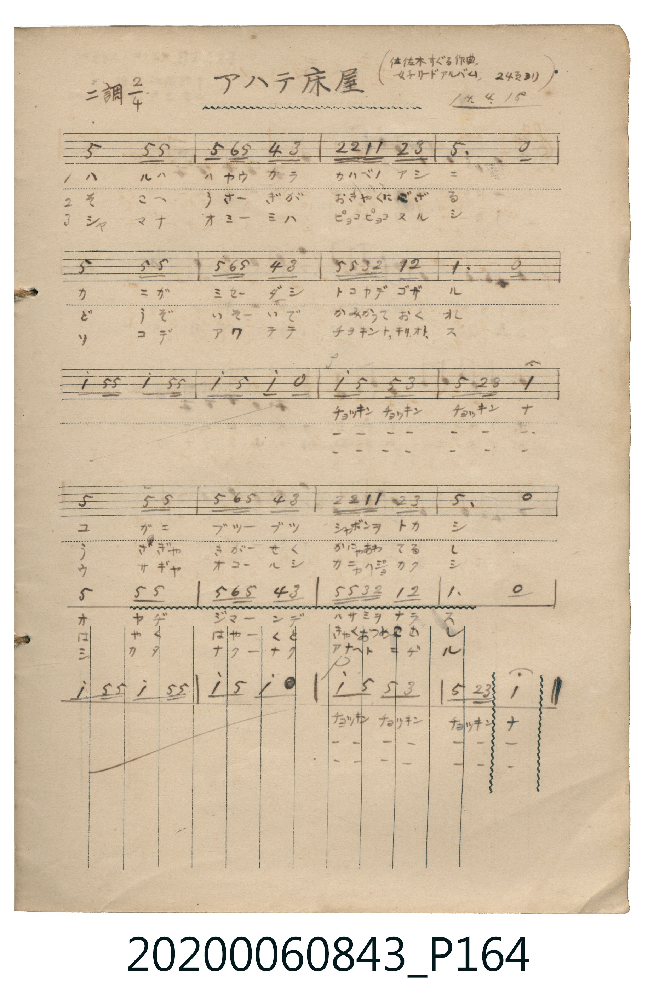

# アハテ床屋

> Re:Shōka 使用 AI 協助辨識與重建樂譜，可能會有錯誤。歡迎回報。

- **鋼琴伴奏版**：<br><audio controls src="awate_tokoya.mp3"></audio>

- 作詞：北原白秋
- 作曲：佐々木すぐる（原載《女子リードアルバム》第 24 頁，大正 14 年 4 月 15 日抄）
- 日治時期公學校《唱歌帳》（典藏號 2020.006.0843・P164）

## 說明


- 出處：《唱歌帳》（國立臺灣歷史博物館典藏號 2020.006.0843）第 P164.jpg 頁。
- 標註：（佐々木すぐる作曲、女子リードアルバム 24 頁ヨリ）14.4.15（大正 14 年 4 月 15 日抄錄）。
- 調性與拍號：ニ調（D 大調），2/4 拍。
- 背景與曲風：北原白秋作詞、佐佐木すぐる作曲的日本經典童謠《あわて床屋》（慌張的理髮店）。
描寫春天河岸蘆葦叢中，螃蟹開了一家理髮店，小螃蟹吐泡泡當肥皂、老螃蟹得意地揮舞大螯剪刀，
結果慌慌張張把兔子客人自豪的長耳朵「チョッキンナ」剪了下來，惹得兔子大怒、螃蟹逃回洞裡的滑稽故事。
- 版本說明：本檔案為原頁單聲部簡譜之忠實數位化版本（含「チョッキン」前之器樂間奏樂句）。
【原頁歌詞全文與中文語譯】（對應 P164.jpg）

### 編曲說明（鋼琴伴奏版）：

1. 前奏 (Intro, 4 小節)：直接引用曲中經典的剪刀聲動機（`1^ - 5 5`），活靈活現地描繪理髮店開張。
2. 主歌伴奏 (Song, 24 小節 × 3 段)：左手以輕快俏皮的斷奏伴奏襯托螃蟹與兔子的滑稽互動。


## 歌詞

```text
（一）ハルハハヤウカラ　カハベノアシニ
カニガミセーダシ　トコヤデゴザル
チョッキン　チョッキン　チョッキンナ
コガニブツーブツ　シャボンヲトカシ
オヤジジマーンデ　ハサミヲナラス
チョッキン　チョッキン　チョッキンナ
咔嚓、咔嚓、咔嚓吶！小螃蟹咕嚕咕嚕地化開肥皂泡，老爹得意洋洋地把大螯剪刀弄得咔嚓響，咔嚓、咔嚓、咔嚓吶！）

（二）そこへうさーぎが　おきゃくにござる
どうぞいそーいで　かみかっておくれ
チョッキン　チョッキン　チョッキンナ
うさぎゃきがーせく　かにゃあわてるし
はやくはやーくと　きゃくつめこむし
チョッキン　チョッキン　チョッキンナ
咔嚓、咔嚓、咔嚓吶！兔子心裡著急、螃蟹手忙腳亂，客人又一個勁兒催著快點快點，咔嚓、咔嚓、咔嚓吶！）

（三）ジャマナオミーミハ　ピョコピョコスルシ
ソコデアワテテ　チョキントキリオトス
チョッキン　チョッキン　チョッキンナ
ウサギャオコールシ　カニャハジカクシ
シカタナクーナク　アナヘトニゲル
チョッキン　チョッキン　チョッキンナ
咔嚓、咔嚓、咔嚓吶！兔子勃然大怒、螃蟹羞愧難當，無奈之下只好逃進洞裡去，咔嚓、咔嚓、咔嚓吶！）
```

## ABC

```abc
X:1
T:アハテ床屋
M:2/4
L:1/16
Q:1/4=112
K:D
V:V1 name="Piano" snm="Pia"
[V:V1]
A4 A2 A2 | A B A2 G2 F2 | E E D D E2 F2 | A6 z2 |
A4 A2 A2 | A B A2 G2 F2 | A A F E D2 E2 | D6 z2 |
d2 A A d2 A A | d2 A2 d2 z2 | !p! d2 A2 A2 F2 | A2 E F D4 |
!mf! A4 A2 A2 | A B A2 G2 F2 | E E D D E2 F2 | A6 z2 |
A4 A2 A2 | A B A2 G2 F2 | A A F E D2 E2 | D6 z2 |
d2 A A d2 A A | d2 A2 d2 z2 | !p! d2 A2 A2 F2 | A2 E F D4 |
```

## TMD 檔案連結

- [主旋律 TMD 檔案](awate_tokoya.tmd) [[在 TMD Studio 編輯](https://tmdlang.github.io/Tmd-TS/#tmd=s7IKdvYPcrWy4qpTUCpJTLdSSM7PyUlNLsnMz7MqzsjPTkzOyFeCS5bl55TmploBqXgDQ4RwcX5pUXJqfEFieqpVgKGZCboM3KT4vPyS1KT8_GyEioKi_LLUvMQ8oKrcxLzS4uSizIKS-OT8gkqEmtSyzJRUkIrUlMyS_KLMxBwkJ6UWFYMdC3FDSVFiHsQMoCBCVUlGKtDd5flFSDYDDUrPzLMqScwEOi8eiMsT43MTM_NyEvNSlLi0tBQeNy163Nz_uLnt6a6upxu7FbS0uBRtFQwNjbjsbRVcuGyM9E3sQKY9m7702abdz2Y2PZsz_2nrmqdrdzxbsPBxQ9fTKRufre15umPz44bu93s6nrbueDG9_8XM-QpGBkYGegYGZnoGFibGj5t3g8Ls_Z5OsNOe7J3zYuW893tmPe2Z_rRv_vOZe58v74bJPJu9CSjzZO-Exw2tz-aseNw483HjhMdNYNP75r_Y0wmydenmp2snPG5e9bh5z-PmTrAnVj9uBoosALrj-Zo1CkYmCi8XNL7f0_N0yfJnaxcrGJooPN25RcFE4dmcDgVDUwWQf7pawA7i0tdSsKUW4FJQUHjcMAHoieez171YterZjL7HDRPBos27n7bvejFzKtB3WAJuTvfz1d0v2nc9b1z8bO32p_2bnvbOet658uWSFTjCFOh2kEdB4aqXVZAO8u7jhiaoTc9WzHyxYjfQJqDRmEEJCeXHDY14whEago-bVwClgXYZmuiZ6BmagpyKL0Rf9oACFeGQF6v2P2tY_qKj_Vl3L9ALIL83dwMFgea4KABNAjM7gfEETGgKQDVIOpt7ns1cD9I5e9PLRSvQUgskCQG9APQdEGH67vmsFpCL5qx5vm0yMASfr176Yg0wcXQ9bmx63NT_uHEZJMFDQv9Za8_TPVuBWp5PaHu5et3TXdMRnlBQeNbf_3T96mczlj5dsvLZps1PN-14MaPtxcRlT_sXPdmxFuj2F_OaX8zf-XJa95NdbU92NDxdtw3JnJ6nG_ohCp5OmPBs80Igej5124umpc9nNQHd_wKIILL7pj9r6X86Z8Oz_nUvOuaBwmbe-qedq552NAANgbjk-dYJz-bNAboW4mAgetbV9bR1CjASn65b9GTXrhftq15sXAX0yMup2180bH42Z-vjhp7HzcBoXP64uflx09rHzZsfN3c9bugFmgx2bfeTfW1A8581gxwANQoYwQ2TQG6D-Kuh-ensec-2zHuxeCEoVHdPfL5i77OprU92AUMPFlvPOzuAYQ1J8MCoArKfrZrybGHH86ZdwDgDJqSn09a9aNz0snnF8w0LX6yd82Rn99P9C56uX_Zs6o4ne3uf9kyDmABKXxNWY3E0yMW9IF0zVzxb0fRy2uSnS_uBjKf9S6FRBc15ENuAWQuYPJ62rng2rR2YhIDRBGKsmvdi7XpgdgRZsqH3WXsnPPcAzQAbAMouO4Dh3QkuFIFZAUgC0ZLHTcseNwG5Kx83NIAZQMGZj5v7QDmmaTswSUNsb4AikIrux01rHjfPf9y0G5y5gILbQVLNHY-bgFGw5HFz--OmLY-btgGtQdWM7nEiRJq70OzfDLa8-3HztMfNLWD7wQyQFNC1ix83zwFr2wR2zmqgIJp-YIEA9PMOEGqeB9YPVN0Otrn_cdNWkL9AmrtAIdK0k0ruBwY-JIpACQic24Bx8Wz6SlAemrMCmPNeNnUBEyA88wHTI3LmA2WIxlnPp8wHZiNwGdvzsmHm09ZJz2asR8qOwEKyF5KZnk6a8nTWZFApiMp4OmEbUBki106a-nTWVCg5ZwMwpQLtgmRfYFYGOaCh8XkHNPs-29INRKBMDMyXSDn46Z4WUPYCm_9yPrDI68FvO3J63NUDSo-Ncx83Tn7cuONxY9vjxqmgKGnse9zYAwrMRmCh1vu4qflxI7BcW_24ccrjxmnAchA1VhpXgnXOe9zYAjILpB_IWA6W6n7cuB9MLgaWi2DjgJEMLnKomiohLgc6G-TUXpDjQa6YDbIN6gpgSgRKQQtooBceN05HM2L94yags4HSYAZIP5C9AiwFDwJgym0EBVYTUBBNP1XSJjBZARtCyMXukx1dL6c1AEtSYJEKSXovVgPLt9XA9Pty97ynO1c_65gITAgvF6wFJcMJy0lIhhBb9jcDE_uLidOfNSyFl8vPOoFWzHzRuvnJriZQggK75Gk_qAB72tD9tBuod9LTpjVAXUCXgJwBJklKejuANTOwVQAsBIBFBrAc6AKXDMC8DywQgCQ43pqngIILVKbBGE07QUUnRpmyF6wIWOoBGxnrgS1OEIIHNzSsgaURkLEKbA2QTa2SBckVwGS19XHTOpCPgJaAXAT0C8i1iHIb5FlgBgCWfkBxYDpD98h2sMR-cHAAPQLUD2aApIBeA5aJM0COB1UAwCKSWoU7cgJ8vmQmsPJFruWBcf5i-2YICSqkuqcCk8CTHb1PG-eAKvdpe4CFIDTVAFsO-2cCK1JgnQiJdpCuxk2o7YFGEtJmd_Pzlm1obYbn--Y9a1n-cvZiYFMH6IDnLQufLu0AW9r9tH_V06V7gY2Klw2bII2Kp33AlioRqRLoIMob6FCgoKXPxRWcn5duFZCZmJfvUGNQo1AN9rSNoZmWHZgF7BdoAANHE9i-6Qfi1WC6BspbAuw6LQNikOhKkCiYBZKZCcR9oI4VEG8Hq-9WMADZBzdzVw_QzMa5QDwZiHeA1DS2ATGoWAdSQM2NPWDBLiAGFWtACmhyI9CGxilAPA1sH7qpOzqBpoLzKtDKeUDcBVa2CsgC5VgQBfcBKKsC5TajMJt2gn0J0rQdYXaNgqmCLhiCaBAGiZiBWSZAbAwWMQJCQyA0govAdIGgAUgEXKogBSo4wLqB9Bqwk4COAzeVgMwGeMh1QB0JDO3mdiB7CxBvA8usxhqmK6EhOQ8cfC2gUIaEKYi5HCwItLFxP4gGVndAChiH4GAGh0tTD9Yw3Qt1RTtYDTBem9cDMdAeIAa5BZRfgRJrgUyQMpCjQWxgyINDvwOsbSepQWoKhMbgYNUFB2sNmIUjSCENYk2gIgO4k-BFCAYfm4ouhOsM48DOMkUw4GK6EAbYdoXqglqEOAgjYt4IyIY5FzPmQYltDTj2QS6ZBsSguhzGhKRASDoGtVOB1CZosGKkTqS4B-cgUPYBZRhQTPeC8hEk-mfDYhgc_aBmBpBqAhoFylagbAx2SeN0rNEPkt8KxKBKA5alwBUHpFCAJFVIaoY4Gmho0w6IUNN6zPxUnZtWS7NMBUpwoLIJXKqAXAFuv0NTJjgBg50H9A-4OAAFLDD5Q4swpDSKFLDAxN4Eyj-QAATzIKEKCrwVkKBGFFIgyxshRVtTA55Q3Q4NoP1gNwHdAK5LYUx4TgM5bgYk9sGFxSb03D_iMlMtF5eunQKo7lIA0spcAA)]
- [鋼琴伴奏 TMD 檔案](awate_tokoya_piano.tmd) [[在 TMD Studio 編輯](https://tmdlang.github.io/Tmd-TS/#tmd=s7IKdvYPcrWy4tLSUnjctOhxc__j5ranu7qebux-v6fjZfee5xO2PNmz5enS_uedHe_3dCpoaXEp2ioYGhpx2dsquHDZGOmb2HHVKSg9m7702abdz2Y2PZsz_2nrmqdrdzxbsPBxQ9fTKRufre15umPz4waQiU9bd7yY3v9i5nwFIwMjAz0DAzM9AwsT48fNuwMMzUyAFiiBDHuyd86LlfPe75n1tGf60775z2fufb68GybzbPYmoMyTvRMeN7Q-m7PicePMx40THjcB5bn0tRRsqQW4FBQUHjdMANr2fPa6F6tWPZvR97hhIli0effT9l0vZk4FOgOLD-d0P1_d_aJ91_PGxc_Wbn_av-lp76znnStfLlmBw_NAXz9fs0YBFAB6WQXpCi8XND5uaILa9GLV_mcNy190tD_r7gXqBFnZ3A0UBNrkovB0yXIws_P9nh5gRCgA1QBZLxvmP921TAESTQiTnm9fAfQMxCdY4xZoNkipgoKhnsLTzl6guIKGZ15JUb6OgonC0w39z9c3aALVPJ-95Vnf0qd7pj6fAjLwyY61z7dNBnrt-ayWp52rnnY0vGjc9LR76rOVQMd2JBjGKegqmCqYJkBc-WzL7pdzO4Dk8_59T-dseNbf_3znqucT2l6uXvd01_SX07qf7tkKdbKCgpGewpMdu4GBC3GlgkZwfl66joIRzDUKh6crGCs8W7cV5Kyn25c96-x-snvpiz1Tn-5f_WR___NZ64BuejZtO1AvxIQXS9c_65zxYl7zi_k7gUH6tHXK07UTQGp2T3y-Yu-TXZOA7obaTnkCggIFLX0uLnAwWgVkJublB3k41BjUKFSDvWhjaKZlB2bVKMBCCsGAi-lCGAZAjCQGwsZgIRDLCMg2hCniqkWx0wfFTguElfEK0YaxMAqZb4BF1jQeyDKNh8mD7ABFCAFvVeem1YIdCIIwZ4OcbAZmmcA9YQSEhkBohOItGIR4C2IkMaaBws8YbCIoaMDhhsM0YsO9uqCWUNiDIMzYkedvlPSAK8mBgwVHujMBJTATYAIDBgqIaRSfiy35gRig9Ic3DSOZhaIRzEBL6UTlBnAwEMgRI8CLwEjWtVMAly0KQAYowrHRylwA)]

## 分析

```text
================================================================================
📊 TMD Song Profile: [ アハテ床屋 ]
================================================================================
⏱  Duration:       0:25 (25.7s), 24 measures total
🎼 Key & Tempo:    首調基準 D, != 112.0 BPM, <2/4>
   - 分析範圍：      由實際發聲的音符與和弦推測調性；播放脈絡另行呈現
🎤 人聲音域:    D4 (MIDI 62) – D5 (MIDI 74) [跨度: 12 個半音 / 1.0 個八度, 難度: easy]
   - 最低音:  D4 in [Song #1 @ m.3, 0:02]
   - 最高音: D5 in [Song #1 @ m.9, 0:08]
   - 適合: soprano, mezzo-soprano, contralto, tenor, baritone, bass
🏛  結構:      Song (25.7s)
⚡ 編曲密度:        Peak 1 軌道同時演奏
🗝  調性診斷：       D 大調（純淨自然大調，未偵測到可信轉調）
   - 風格氣質:    純淨自然大調（陽光明朗、易唱易記，無明顯調外色彩）
   - 轉調歷程:    全曲維持單一推測調性（未偵測到可信轉調）
   - 核心骨幹音:  A, D, F#, E, G
   - 調性數值:    D 大調 [相關度: 0.81, 穩定度: Moderate, 自然音純度: 100.0%]
   - 候選調性 (K-S): D 大調 (0.81), A 大調 (0.77), A 小調 (0.59)
   - 五度圈歷程:   +2
   - 各段落調性細節:
     • [Song #1]: D 大調 (r: 0.81, 自然音純度: 100.0%)

  [ 五度圈游移軌跡 ]
               C  
         F            G  
      Bb              [D ]*
      Eb               A  
         Ab           E  
            Db       B  
               F# 
     (* = active key center)

  [ 十二半音累積音高分佈 ]
     C  :                            0.0%
     C# :                            0.0%
     D  : ██████████████            26.7%
     D# :                            0.0%
     E  : █████                      8.9%
     F  :                            0.0%
     F# : ██████                    11.1%
     G  : ██                         4.4%
     G# :                            0.0%
     A  : ████████████████████████  46.7%
     A# :                            0.0%
     B  : █                          2.2%
--------------------------------------------------------------------------------
Assignment 軌道音域：
  - Piano         : D4 – D5 (12 個半音 / 1.0 個八度, 94 個音符)
================================================================================
```


## 原書掃描頁




