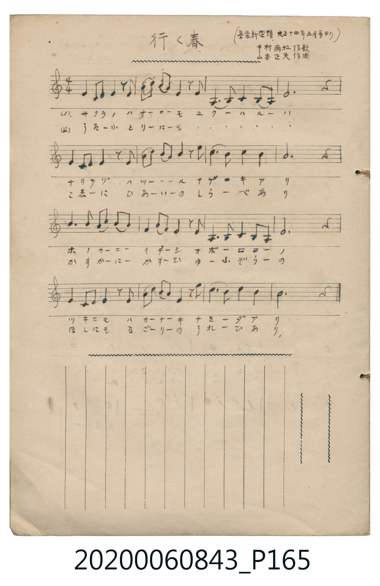

# 行く春

<audio controls src="yuku_haru.mp3"></audio>

- 作曲：山本正夫（原載《音楽新潮》大正 14 年 5 月號）
- 日治時期公學校《唱歌帳》（典藏號 2020.006.0843・P165）
- 作歌：中村雨紅

## 說明

【曲目說明】
・出處：《唱歌帳》（國立臺灣歷史博物館典藏號 2020.006.0843）第 P165.jpg 頁。
・標註：（音楽新潮 大正十四年五月号ヨリ）中村雨紅作歌 山本正夫作曲。
・調性與拍號：イ短調（C 大調關係小調 A 小調），4/4 拍，原譜為手抄五線譜。
・背景與曲風：由《夕焼小焼》著名詩人中村雨紅作詞、山本正夫作曲的抒情童謠藝術歌曲。
以哀婉的 A 自然小調（日本陰音階色彩）旋律，吟詠落櫻飄零、暮春將逝的嘆息與朦朧夜空裡的淚光。
・版本說明：本檔案由原頁手抄五線譜轉譯為 TMD 簡譜。
【原頁歌詞全文與中文語譯】（對應 P165.jpg）

・編曲說明（鋼琴伴奏版）：
1. 前奏 (Intro, 4 小節)：取末樂句靜謐哀婉的旋律，營造暮春落櫻與朧月夜色。
2. 主歌伴奏 (Song, 16 小節 × 2 段)：左手以柔和的分解小調和聲支撐抒情線條。

## 歌詞

```text
（一）サクラノハナーニーモ　ユクーハルーハ
チリテゾマツーーーール　ナゲーキアリ
ホノカーニーイデーシ　オボーロヨーノ
ツキニモハカーナーキ　ナミーダアリ
朦朧春夜裡隱約浮現的月亮，也泛著一抹無常淒楚的淚光。）

（二）うたーふとりーにーも　ゆくーはるーは
こゑーにひあーいーの　しらーべあり
かすかーにーかすーむ　ゆーふぞらーの
ほしにもなごーりーの　うれーひあり
微茫霞霧籠罩的暮色天空中，連星辰也懷著依依惜別的愁緒。）
```

## ABC

```abc
X:1
T:行く春
M:4/4
L:1/16
Q:1/4=84
K:Am
V:V1 name="Piano" snm="Pia"
[V:V1]
E4 C2 D2 E4 z2 E2 | A3 B c3 A E4 z2 E2 | A,6 B,2 C4 B,2 A,2 | E12 z4 |
E4 C2 D2 E4 z2 E2 | A3 B c3 B A4 z2 c2 | d6 B2 c4 B4 | A12 z4 |
A6 B2 c3 d c2 B2 | A4 B3 A E4 z2 E2 | A,6 B,2 C4 B,2 A,2 | E12 z4 |
E4 C2 D2 E4 z2 E2 | A3 B c3 A E4 z2 c2 | d6 B2 c4 B4 | A12 z4 |
```

## TMD 檔案連結

- [主旋律 TMD 檔案](yuku_haru.tmd) [[在 TMD Studio 編輯](https://tmdlang.github.io/Tmd-TS/#tmd=s7IKdvYPcrWy4qpTUCpJTLdSSM7PyUlNLsnMz7MqzsjPTkzOyFeCS5bl55TmploBqXgDQ4RwcX5pUXJqfEFieqpVgKGZKboM3KT4vPyS1KT8_GyEioKi_LLUvMQ8oKrcxLzS4uSizIKS-OT8gkqEmtSyzJRUkIrUlMyS_KLMxBwkJ6UWFYMdC3FDSVFiHsQMoCBCVUlGKtDd5amJQEYRunBxamJxfl6xEpeWlsKLhT2PG_ufzViqoKXFpWirYGHCZW-r4MyVnVppq-CYy2Vjom9iB9L_bPrSZ5t2P5vZ9GzO_Keta56u3fFswcLHDV1Pp2x8trbn6Y7Njxu63-_peNq648X0_hcz5ysYGRgZ6BkYmOkZWJgYP27eDQqo93s6wY55sncOUNP7PbOe7Fj7bO7El7NXPN_SCpeZvQko83Tjxmdz1jxbu_jpktUgc_vmv9jTCbTv5fzNz5bufTZtw7O964BWPl2yHKhGwdBE4enOLQqmCs_mdAAtB9vDpa-lYEstwKWgoPC4YQLQbc9nr3uxatWzGX2PGyaCRZt3P23f9WLmVKCjsYTHnO7nq7tftO963rj42drtT_s3Pe2d9bxz5cslK3AEFdDtz9esUQAFl15WQbrCywWNjxuaoDY9WzHzxYrdQJuARiOHhAIkHJ72Nj6dPRsYEk92TQGGxNP-7Y-bVzxuXgU0EzmkIcGvgBzEkHBHWPRi1f5nDctfdLQ_6-4FB-isx01Lns9fCxQHWu0Msg_IfDl9zpP9TU839APZCo4KEAbQsvd7eoDpRgGoF8gCRd3aOc-bdj3r7H7W1QJ02vPts4AiSJY19zybuR5k2exNLxetAFr2fMpGUFgumfq8ZQ_QVCAJDM4XE6c_ndD7YuXKJ7t2oXnnxcp5jxsaMT30fFbLs65Jz5pbn69e-mLNghfT575YOBnod4RfFRSe7F76dHLD05WdQMVAT7xoX_W8ZRvMKx2gdD9nzcuZG4DB_XJW34vOTU_3rgR68dn07qf7gDHc83TC_BcrF7yYsPfZ6t0vF7e8nL0N6JJns9YB89TTDe0vG-YCjX06o-1ZI9iDc5Y9m7P86ZI5z1fuerF4Ich522c9bQUmbFhYPO_sANoHSWHAgAD5Z9WUZws7gCECDEhgYkALxRd7O1-sXQ8MXYUQXxeF5xsWQkMWmmChetb2AEPoaeuKZ9Paga4ABR6QsWoeUCcwFYOS6YbeZ-2d8EQH9B_YAKDMkx0NQN7jpq2Pm9Y_bl75uLnvcXP_4-aux817Hjd3g8lFjxsaHjcvAysAcoGyqyEMiBsaoKi5EZgSHze3PW7a97h53uPmFrAiOFoNVtP1uGkTiNu09nHTIqB6NCNmg-xvghgPtrxpyePmdjBjO0hBE9CCOWDZteCUD2T0oRnRAjIbpBlofD_MLLB3gOIQJzTPBwsCjYM5ARgQkOAClUwbNr5sWAyM7RddG5_snP90zgpgJD_t2w2KTGCcL1kJjFhQumjvBqYFYIoAJg1Q2uyZBkqSm5c-nTP_RUPP86kzn-zoBgbui8ZNkNTxfs9sSHqEpBGwUXOARr2ctfH5lpZnW9c9798HsmJOx5Nd64DmA61-tnk2ME8ADXnWtfN5y8KnO3Y82z7p2dJZyMkKOSp3AYvczseNbY8bwR5s3Pq4ccXjJrDfG8Hh0NQEDkSgAmAkAgXXP24Ch3LjetRAbJz8uGkiVFvjpseNTWA2OEIbgaUyUMH0x02dYO5OkGxTF5r-7seNM0Ek3GaICMgJYAVAJ0AdOA9m0Do0I3aDLAFqBrq5cdXjxilgzRC_QJwATGg9YC7YgRAnYIlHYGE9ZSMoj27of7l5Kb4InboHGFnAvPN0xzZgsD9r2gQsNkBqZm8CFxXQ6Hu6b92LntUv58x7OWf5840Lnu9dCVIzax2o5FiyEpjvgSYATQNZPWP-i30bQPHYvh0Uj_vmAtGz5jlPO5aCtLQ0Pt8-CRqDQHMpr8OgQEFLn4srOD8v3SogMzEv36HGoEahGux2G0MzLTswC1h1agDTlaYCMOMD8XpgybQSiPuAuF-hBkiCAhpIgWIQSC0C4mUgcXARAFYEKQTAavsVDEB2ws3d1QM0t7ENiEHJEEgBrWhcAdTcBVYOEgHrBUYtELeBBMHpEUgBHQJOkWCx9QhzaxSMFXTB0BCIjYAYxjeAsmsUzMB8cwXDODDDDJuSeKgQWCWIAzIOzgFLI6xChyBzQLAGnOGQwrC5EYhXATHQz037gPQ8sEcRBSAotECBCg5CUPkHpNYC8SKwulVYw28yUB6UB0GhBcSbgLgJHn4go4HUOiCeDjYUlIeAnJ0wVcCwpiTwzKECECVgwRoFI4gcNMBg4jAOOGTg2ogPu9mQdAcuqGEpDuSBJUAOqOQHMrcD8Sqw30FlP5AChh249AeL9WENvm4gngmikRIcKFGBxSHGNsBSHzyRzoOFJEjlOuQQRPYXkteBQQJmgYQQiiDBQc8E2AJJUM1A34EzKzgTw4IUkpfB8pAcCMmWzSD_40uBu8GpC5z8QDm1ERwF4IIYlL4QKRAchuCyGDmdUpgCUUOPqimwlotL104BVEIqAGllLgA)]
- [鋼琴伴奏 TMD 檔案](yuku_haru_piano.tmd) [[在 TMD Studio 編輯](https://tmdlang.github.io/Tmd-TS/#tmd=s7IKdvYPcrWy4tLSUnixsOdxY_-zGUvf7-l42b3n-YQtT_Zsebq0_3lnx_s9nQpaWlyKtgoWJlz2tgrOXNmplbYKjrlcNib6JnZcdQpKz6YvfbZp97OZTc_mzH_auubp2h3PFix83ND1dMrGZ2t7nu7Y_LihG2jw09YdL6b3v5g5X8HIwMhAz8DATM_AwsT4cfPuAEMzU6A9SiDDnuydA9T0fs-sJzvWPps78eXsFc-3tMJlZm8CyjzduPHZnDXP1i5-umS1EheXvpaCLbUAl4KCwuOGCUB7ns9e92LVqmcz-h43TASLNu9-2r7rxcypQAdg8duc7ueru1-073reuPjZ2u1P-zc97Z31vHPlyyUrcHgb6N_na9YogLyul1WQrvByQePjhiaoTS9W7X_WsPxFR_uz7l6gTpCVTUuez18LFAda5qjwdEM_mNn5fk8PMBYUgMqArJcN85_uWqYAjiqEWc-3rwB6B-IXrNELNB2kVEHBUE_haWcvUFxBwzOvpChfR8EEZNPz9Q2aoFDvn_ZszupnK5qe9i99OXfOizUTnk5ueLqy8_mslmfTu5_uAwZDz_P2-S8bFjybtQ6YlF5M2Pts9W6QH-Ysfzan4-mSOS86N0GdpaBgpKfwZMduYBBCXKKgEZyfl66jYGgGtVHh8HQFI4Vn67aCrd6-7Fln95PdS5_Nn_J0Ug_QxqcdbS-WL4YEA1DkReOmZ1PWP5s04VnXpGfNrc-3z3q2aC7ULsoTBRQoaOlzcYEDxiogMzEvP8jDocagRqEa7CEbQzMtOzCrRsFYQRcMDYHYCIhhfAMou0bBDMw3VzCMAzPMUJSABWsUjCByEGgOE4dxQBBmDiYEGQNWwVWL4mQfFCebwF1sFh-vEG0WnxurYAxiGYNYyKIIFtBdQKYRQiWmQgOItaAIpW1AQZXEI4cTiAMyDs4BSyOswh1SZDrJHB4JVI87aNxgNwpoBZgFEkIoghg_CIOJtkkckdaokcKxi8LTO4gBSuM0yjrEGUvYMnq5Fxj8unYK4EJGAcgARQUyrcwFAA)]

## 分析

```text
================================================================================
📊 TMD Song Profile: [ 行く春 ]
================================================================================
⏱  Duration:       0:45 (45.7s), 16 measures total
🎼 Key & Tempo:    首調基準 C, != 84.0 BPM, <4/4>
   - 分析範圍：      由實際發聲的音符與和弦推測調性；播放脈絡另行呈現
🎤 人聲音域:    A3 (MIDI 57) – D5 (MIDI 74) [跨度: 17 個半音 / 1.4 個八度, 難度: challenging]
   - 最低音:  A3 in [Song #1 @ m.3, 0:05]
   - 最高音: D5 in [Song #1 @ m.7, 0:17]
   - 適合: soprano, mezzo-soprano, contralto, tenor, baritone, bass
🏛  結構:      Song (45.7s)
⚡ 編曲密度:        Peak 1 軌道同時演奏
🗝  調性診斷：       A 小調（純淨自然小調，未偵測到可信轉調）
   - 風格氣質:    純淨自然小調（陰鬱抒情、旋律集中，無明顯調外色彩）
   - 轉調歷程:    全曲維持單一推測調性（未偵測到可信轉調）
   - 核心骨幹音:  E, A, C, B, D
   - 調性數值:    A 小調 [相關度: 0.85, 穩定度: High, 自然音純度: 100.0%]
   - 候選調性 (K-S): A 小調 (0.85), A 大調 (0.70), E 大調 (0.58)
   - 五度圈歷程:   +3
   - 各段落調性細節:
     • [Song #1]: A 小調 (r: 0.85, 自然音純度: 100.0%)

  [ 五度圈游移軌跡 ]
               C  
         F            G  
      Bb               D  
      Eb              [A ]*
         Ab           E  
            Db       B  
               F# 
     (* = active key center)

  [ 十二半音累積音高分佈 ]
     C  : ██████████████            17.7%
     C# :                            0.0%
     D  : ███████                    8.4%
     D# :                            0.0%
     E  : ████████████████████████  31.0%
     F  :                            0.0%
     F# :                            0.0%
     G  :                            0.0%
     G# :                            0.0%
     A  : ███████████████████████   29.2%
     A# :                            0.0%
     B  : ███████████               13.7%
--------------------------------------------------------------------------------
Assignment 軌道音域：
  - Piano         : A3 – D5 (17 個半音 / 1.4 個八度, 66 個音符)
================================================================================
```


## 原書掃描頁




