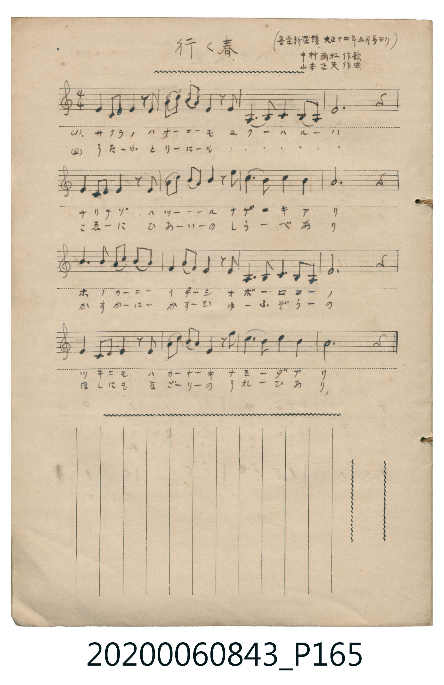

# 行く春

> Re:Shōka 使用 AI 協助辨識與重建樂譜，可能會有錯誤。歡迎回報。

- **鋼琴伴奏版**：<br><audio controls src="yuku_haru.mp3"></audio>

- 作曲：山本正夫（原載《音楽新潮》大正 14 年 5 月號）
- 日治時期公學校《唱歌帳》（典藏號 2020.006.0843・P165）
- 作歌：中村雨紅

## 說明


- 出處：《唱歌帳》（國立臺灣歷史博物館典藏號 2020.006.0843）第 P165.jpg 頁。
- 標註：（音楽新潮 大正十四年五月号ヨリ）中村雨紅作歌 山本正夫作曲。
- 調性與拍號：イ短調（C 大調關係小調 A 小調），4/4 拍，原譜為手抄五線譜。
- 背景與曲風：由《夕焼小焼》著名詩人中村雨紅作詞、山本正夫作曲的抒情童謠藝術歌曲。
以哀婉的 A 自然小調（日本陰音階色彩）旋律，吟詠落櫻飄零、暮春將逝的嘆息與朦朧夜空裡的淚光。
- 版本說明：本檔案由原頁手抄五線譜轉譯為 TMD 簡譜。
【原頁歌詞全文與中文語譯】（對應 P165.jpg）

### 編曲說明（鋼琴伴奏版）：

1. 前奏 (Intro, 4 小節)：取末樂句靜謐哀婉的旋律，營造暮春落櫻與朧月夜色。
2. 主歌伴奏 (Song, 16 小節 × 2 段)：左手以柔和的分解小調和聲支撐抒情線條。


## 歌詞

```text
（一）サクラノハナーニーモ　ユクーハルーハ
チリテゾマツーーーール　ナゲーキアリ
ホノカーニーイデーシ　オボーロヨーノ
ツキニモハカーナーキ　ナミーダアリ
朦朧春夜裡隱約浮現的月亮，也泛著一抹無常淒楚的淚光。）

（二）うたーふとりーにーも　ゆくーはるーは
こゑーにひあーいーの　しらーべあり
かすかーにーかすーむ　ゆーふぞらーの
ほしにもなごーりーの　うれーひあり
微茫霞霧籠罩的暮色天空中，連星辰也懷著依依惜別的愁緒。）
```

## ABC

<div class="abc-score" data-abc-src="yuku_haru.abc" aria-label="五線譜載入中"></div>

[下載 ABC 原始檔](yuku_haru.abc)

## TMD 檔案連結

- [主旋律 TMD 檔案](yuku_haru.tmd) [[在 TMD Studio 編輯](https://tmdlang.github.io/Tmd-TS/#tmd=s7IKdvYPcrWy4qpTUCpJTLdSSM7PyUlNLsnMz7MqzsjPTkzOyFeCS5bl55TmploBqXgDQ4RwcX5pUXJqfEFieqpVgKGZKboM3KT4vPyS1KT8_GyEioKi_LLUvMQ8oKrcxLzS4uSizIKS-OT8gkqEmtSyzJRUkIrUlMyS_KLMxBwkJ6UWFYMdC3FDSVFiHsQMoCBCVUlGKtDd5amJQEYRunBxamJxfl4xQhhoRXpmnlVJYibQ4fFAXJ4Yn5uYmZeTmJeixKWlpfBiYc_jxv5nM5YqaGlxKdoqWJhw2dsqOHNlp1baKjjmctmY6JvYgYx7Nn3ps027n81sejZn_tPWNU_X7ni2YOHjhq6nUzY-W9vzdMfmxw3d7_d0PG3d8WJ6_4uZ8xWMDIwM9AwMzPQMLEyMHzfvBgXn-z2dYLc92TsHqOn9nllPdqx9Nnfiy9krnm9phcvM3gSUebpx47M5a56tXfx0yWqQuX3zX-zpBNr3cv7mZ0v3Ppu24dnedUArny5ZDlSjYGii8HTnFgVThWdzOoCWg-3h0tdSsKUW4FJQUHjcMAHotuez171YterZjL7HDRPBos27n7bvejFzKtDRWMJjTvfz1d0v2nc9b1z8bO32p_2bnvbOet658uWSFTiCCuj252vWKICCSy-rIF3h5YLGxw1NUJuerZj5YsVuoE1Ao5FDQgESDk97G5_Ong0MiSe7pgBD4mn_9sfNKx43rwKaiRzSkOBXQA5iSLgjLHqxav-zhuUvOtqfdfeCA3TW46Ylz-evBYoDrXYG2Qdkvpw-58n-pqcb-oFsBUcFCANo2fs9PcB0owDUC2SBom7tnOdNu551dj_ragE67fn2WUARJMuae57NXA-ybPaml4tWAC17PmUjKCyXTH3esgdoKpAEBueLidOfTuh9sXLlk1270LzzYuW8xw2NmB56PqvlWdekZ82tz1cvfbFmwYvpc18snAz0O8KvCgpPdi99Ornh6cpOoGKgJ160r3resg3mlQ5Qup-z5uXMDcDgfjmr70Xnpqd7VwK9-Gx699N9wBjueTph_ouVC15M2Pts9e6Xi1tezt4GdMmzWeuAeerphvaXDXOBxj6d0fasEezBOcuezVn-dMmc5yt3vVi8EOS87bOetgITNiwsnnd2AO2DpDBgQID8s2rKs4UdwBABBiQwMaCF4ou9nS_WrgeGrkKIr4vC8w0LoSELTbBQPWt7gCH0tHXFs2ntQFeAAg_IWDUPqBOYikHJdEPvs_ZOeKID-g9sAFDmyY4GIO9x09bHTesfN6983Nz3uLn_cXPX4-Y9j5u7weSixw0Nj5uXgRUAuUDZ1RAGxEuNwAT4uLntcdO-x83zHje3gOXgaDVYc9fjpk0gbtPax02LgOohOmeDbGuCGAa2qmnJ4-Z2MGM7SFsT0Nw5YNm14HQOZPRBdLaATALpARrWDzMC7GagOMTC5vlgQaApMAuBvoWECaj42bDxZcNiYJS-6Nr4ZOf8p3NWAGPyad9uUIwBI3bJSmDsgSK_vRsY4cBoB8Y_KAH2TAOlu81Ln86Z_6Kh5_nUmU92dAND8EXjJkgSeL9nNiTRQRIC2Kg5QKNeztr4fEvLs63rnvfvA1kxp-PJrnVA84FWP9s8G5jwgYY869r5vGXh0x07nm2f9GzpLOS0gxxfu4DlaufjxrbHjWAPNm593LjicRPY743gcGhqAocdUAEwpoCC6x83gQO3cT047BonP26aCFXduOlxYxOYDY61RmCJ2_C4cfrjpk4wdydItqkLoq37ceNMEAm3ByICsrABaiHUOfNg-tdBdO4GGQnUA3RY46rHjVPAeiAOhlgITDs9YC7YORALsUQWsNidshGU2zb0v9y8FF-sTd0DjBFgLni6YxswbJ81bQIWACA1szeBMz00jp7uW_eiZ_XLOfNezln-fOOC53tXgtTMWgcqA5asBOZgoAlA00BWz5j_Yt8GUGS1bwdF1r65QPSsec7TjqUgLS2Nz7dPgkYT0FzKayMoUNDS5-IKzs9LtwrITMzLd6gxqKkGO93G0EzLDswC1oEawLSjqQDMwUC8Hpg3VgJxHxD3K9QASVA4AylQvAGpRUC8DCQOzstgRZDcDFbbr2AAshJu7q4eoLmNbUAMSmpACmhF4wqg5i6wcpAIWC8wZoG4DSQITnNACugQcKoDi61HmFujYKygC4aGQGwExDC-AZRdo2AG5psrGMaBGWbYlMRDhcAqQRyQcXAOWBphFToEmQOCNeBMhRSGzY1AvAqIgX5u2gek54E9iijSQKEFClRwEIJKNCC1FogXgdWtwhp-k4HyoAwHCi0g3gTETfDwAxkNpNYB8XSwoaCcA-TshKkChjUlgWcOFYAoAQvWKBhB5KABBhOHccAhA9dGfNjNhqQ7cGEMS3EgDywBckCFOpC5HYhXgf0OKtaBFDDswAU7WKwPa_B1A_FMcPmDSHCgRAUWhxjbAEt98EQ6DxaSIJXrkEMQ2V9IXgcGCZgFEkIoggQHPRNgCyRBNQN9B86s4EwMC1JIXgbLQ3IgJFs2g_yPLwXuBqcucPID5dRGcBSAy2FQ-kKkQHAYgoti5HRKYQpEDT2qpsBaLi5dOwVQAakApJW5AA)]
- [鋼琴伴奏 TMD 檔案](yuku_haru_piano.tmd) [[在 TMD Studio 編輯](https://tmdlang.github.io/Tmd-TS/#tmd=s7IKdvYPcrWy4tLSUnixsOdxY_-zGUvf7-l42b3n-YQtT_Zsebq0_3lnx_s9nQpaWlyKtgoWJlz2tgrOXNmplbYKjrlcNib6JnZcdQpKz6YvfbZp97OZTc_mzH_auubp2h3PFix83ND1dMrGZ2t7nu7Y_LihG2jw09YdL6b3v5g5X8HIwMhAz8DATM_AwsT4cfPuAEMzU6A9SiDDnuydA9T0fs-sJzvWPps78eXsFc-3tMJlZm8CyjzduPHZnDXP1i5-umS1EheXvpaCLbUAl4KCwuOGCUB7ns9e92LVqmcz-h43TASLNu9-2r7rxcypQAdg8duc7ueru1-073reuPjZ2u1P-zc97Z31vHPlyyUrcHgb6N_na9YogLyul1WQrvByQePjhiaoTS9W7X_WsPxFR_uz7l6gTpCVTUuez18LFAda5qjwdEM_mNn5fk8PMBYUgMqArJcN85_uWqYAjiqEWc-3rwB6B-IXrNELNB2kVEHBUE_haWcvUFxBwzOvpChfR8EEZNPz9Q2aoFDvn_ZszupnK5qe9i99OXfOizUTnk5ueLqy8_mslmfTu5_uAwZDz_P2-S8bFjybtQ6YlF5M2Pts9W6QH-Ysfzan4-mSOS86N0GdpaBgpKfwZMduYBBCXKKgEZyfl66jYGgGtVHh8HQFI4Vn67aCrd6-7Fln95PdS5_Nn_J0Ug_QxqcdbS-WL4YEA1DkReOmZ1PWP5s04VnXpGfNrc-3z3q2aC7ULsoTBRQoaOlzcYEDxiogMzEvP8jDocagphrsHxtDMy07MKtGwVhBFwwNgdgIiGF8Ayi7RsEMzDdXMIwDM8xQlIAFaxSMIHIQaA4Th3FAEGYOJgQZA1bBVYviYh9kF5vAHWwWH68QbRafG6tgDGIZg1jIoggW0FlAphFCJaZCA4itoOikaTBBlcQjhxKIAzIOzgFLI6zCHU5kOskcHgVUjzlo1GA3CmgFmAUSQiiCGD8Ig4m2CRyR1KiQvrGLwlM7iAFK4TTKOMQZS9gyerkXGPq6dgrgEkYByADFBDKtzAUA)]

## 分析

```text
================================================================================
📊 TMD Song Profile: [ 行く春 ]
================================================================================
⏱  Duration:       0:45 (45.7s), 16 measures total
🎼 Key & Tempo:    首調基準 C, != 84.0 BPM, <4/4>
   - 分析範圍：      由實際發聲的音符與和弦推測調性；播放脈絡另行呈現
🎤 人聲音域:    A3 (MIDI 57) – D5 (MIDI 74) [跨度: 17 個半音 / 1.4 個八度, 難度: challenging]
   - 最低音:  A3 in [Song #1 @ m.3, 0:05]
   - 最高音: D5 in [Song #1 @ m.7, 0:17]
   - 適合: soprano, mezzo-soprano, contralto, tenor, baritone, bass
🏛  結構:      Song (45.7s)
⚡ 編曲密度:        Peak 1 軌道同時演奏
🗝  調性診斷：       A 小調（純淨自然小調，未偵測到可信轉調）
   - 風格氣質:    純淨自然小調（陰鬱抒情、旋律集中，無明顯調外色彩）
   - 轉調歷程:    全曲維持單一推測調性（未偵測到可信轉調）
   - 核心骨幹音:  E, A, C, B, D
   - 調性數值:    A 小調 [相關度: 0.85, 穩定度: High, 自然音純度: 100.0%]
   - 候選調性 (K-S): A 小調 (0.85), A 大調 (0.70), E 大調 (0.58)
   - 五度圈歷程:   +3
   - 各段落調性細節:
     • [Song #1]: A 小調 (r: 0.85, 自然音純度: 100.0%)

  [ 五度圈游移軌跡 ]
               C  
         F            G  
      Bb               D  
      Eb              [A ]*
         Ab           E  
            Db       B  
               F# 
     (* = active key center)

  [ 十二半音累積音高分佈 ]
     C  : ██████████████            17.7%
     C# :                            0.0%
     D  : ███████                    8.4%
     D# :                            0.0%
     E  : ████████████████████████  31.0%
     F  :                            0.0%
     F# :                            0.0%
     G  :                            0.0%
     G# :                            0.0%
     A  : ███████████████████████   29.2%
     A# :                            0.0%
     B  : ███████████               13.7%
--------------------------------------------------------------------------------
Assignment 軌道音域：
  - Piano         : A3 – D5 (17 個半音 / 1.4 個八度, 66 個音符)
================================================================================
```


## 原書掃描頁




