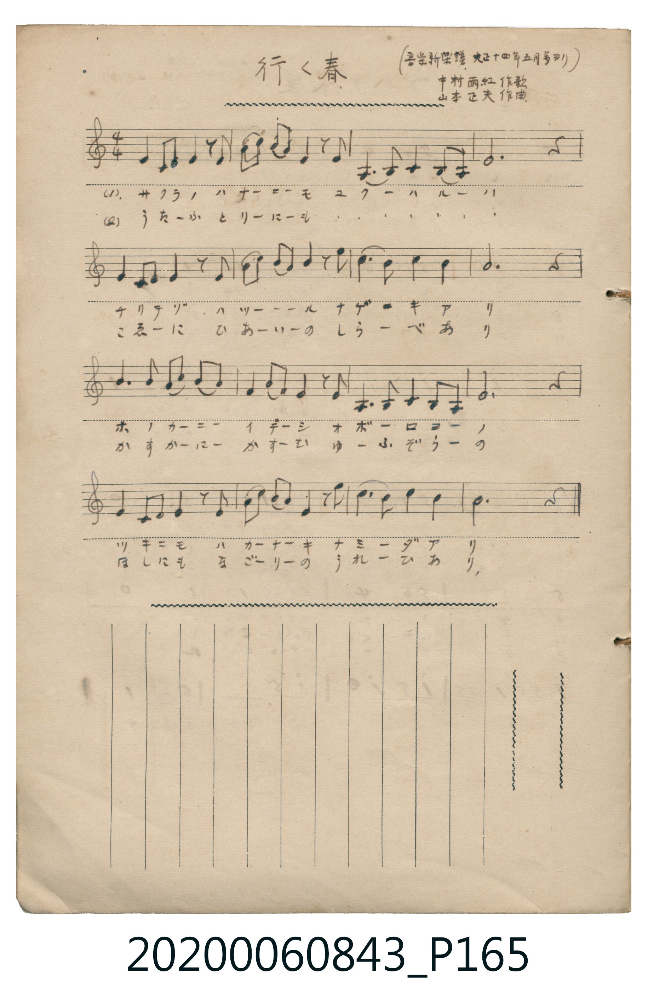

# 行く春

> Re:Shōka 使用 AI 協助辨識與重建樂譜，可能會有錯誤。歡迎回報。

- **鋼琴伴奏版**：<br><audio controls src="yuku_haru.mp3"></audio>

- 作曲：山本正夫（原載《音楽新潮》大正 14 年 5 月號）
- 日治時期公學校《唱歌帳》（典藏號 2020.006.0843・P165）
- 作歌：中村雨紅

## 說明


- 出處：《唱歌帳》（國立臺灣歷史博物館典藏號 2020.006.0843）第 P165.jpg 頁。
- 標註：（音楽新潮 大正十四年五月号ヨリ）中村雨紅作歌 山本正夫作曲。
- 調性與拍號：イ短調（C 大調關係小調 A 小調），4/4 拍，原譜為手抄五線譜。
- 背景與曲風：由《夕焼小焼》著名詩人中村雨紅作詞、山本正夫作曲的抒情童謠藝術歌曲。
以哀婉的 A 自然小調（日本陰音階色彩）旋律，吟詠落櫻飄零、暮春將逝的嘆息與朦朧夜空裡的淚光。
- 版本說明：本檔案由原頁手抄五線譜轉譯為 TMD 簡譜。
【原頁歌詞全文與中文語譯】（對應 P165.jpg）

### 編曲說明（鋼琴伴奏版）：

1. 前奏 (Intro, 4 小節)：取末樂句靜謐哀婉的旋律，營造暮春落櫻與朧月夜色。
2. 主歌伴奏 (Song, 16 小節 × 2 段)：左手以柔和的分解小調和聲支撐抒情線條。


## 歌詞

```text
（一）サクラノハナーニーモ　ユクーハルーハ
チリテゾマツーーーール　ナゲーキアリ
ホノカーニーイデーシ　オボーロヨーノ
ツキニモハカーナーキ　ナミーダアリ
朦朧春夜裡隱約浮現的月亮，也泛著一抹無常淒楚的淚光。）

（二）うたーふとりーにーも　ゆくーはるーは
こゑーにひあーいーの　しらーべあり
かすかーにーかすーむ　ゆーふぞらーの
ほしにもなごーりーの　うれーひあり
微茫霞霧籠罩的暮色天空中，連星辰也懷著依依惜別的愁緒。）
```

## ABC

<div class="abc-score" data-abc-src="yuku_haru.abc" aria-label="五線譜載入中"></div>

[下載 ABC 原始檔](yuku_haru.abc)

## TMD 檔案連結

- [主旋律 TMD 檔案](yuku_haru.tmd) [[在 TMD Studio 編輯](https://tmdlang.github.io/Tmd-TS/#tmd=s7IKdvYPcrWy4qpTUCpJTLdSSM7PyUlNLsnMz7MqzsjPTkzOyFeCS5bl55TmploBqXgDQ4RwcX5pUXJqfEFieqpVgKGZKboM3KT4vPyS1KT8_GyEioKi_LLUvMQ8oKrcxLzS4uSizIKS-OT8gkqEmtSyzJRUkIrUlMyS_KLMxBwkJ6UWFYMdC3FDSVFiHsQMoCBCVUlGKtDd5amJQEYRunBxamJxfl4xQhhoRXpmnlVJYibQ4fFAXJ4Yn5uYmZeTmJeCrKokIz-9KLEgo9IqI7MY5LDkxJz47MS8RCUuLS2FFwt7Hjf2P5uxVEFLi0vRVsHChMveVsGZKzu10lbBMZfLxkTfxA5k2rPpS59t2v1sZtOzOfOftq55unbHswULHzd0PZ2y8dnanqc7Nj9u6H6_p-Np644X0_tfzJyvYGRgZKBnYGCmZ2BhYvy4eTcozN_v6QQ77cneOUBN7_fMerJj7bO5E1_OXvF8SytcZvYmoMzTjRufzVnzbO3ip0tWg8ztm_9iTyfQvpfzNz9buvfZtA3P9q4DWvl0yXKgGgVDE4WnO7comCo8m9MBtBxsD5e-loIttQCXgoLC44YJQLc9n73uxapVz2b0PW6YCBZt3v20fdeLmVOBjsYSHnO6n6_uftG-63nj4mdrtz_t3_S0d9bzzpUvl6zAEVRAtz9fs0YBFFx6WQXpCi8XND5uaILa9GzFzBcrdgNtAhqNHBIKkHB42tv4dPZsYEg82TUFGBJP-7c_bl7xuHkV0EzkkIYEvwJyEEPCHWHRi1X7nzUsf9HR_qy7Fxygsx43LXk-fy1QHGi1M8g-IPPl9DlP9jc93dAPZCs4KkAYQMve7-kBphsFoF4gCxR1a-c8b9r1rLP7WVcL0GnPt88CiiBZ1tzzbOZ6kGWzN71ctAJo2fMpG0FhuWTq85Y9QFOBJDA4X0yc_nRC74uVK5_s2oXmnRcr5z1uaMT00PNZLc-6Jj1rbn2-eumLNQteTJ_7YuFkoN8RflVQeLJ76dPJDU9XdgIVAz3xon3V85ZtMK90gNL9nDUvZ24ABvfLWX0vOjc93bsS6MVn07uf7gPGcM_TCfNfrFzwYsLeZ6t3v1zc8nL2NqBLns1aB8xTTze0v2yYCzT26Yy2Z41gD85Z9mzO8qdL5jxfuevF4oUg522f9bQVmLBhYfG8swNoHySFAQMC5J9VU54t7ACGCDAggYkBLRRf7O18sXY9MHQVQnxdFJ5vWAgNWWiChepZ2wMMoaetK55Nawe6AhR4QMaqeUCdwFQMSqYbep-1d8ITHdB_YAOAMk92NAB5j5u2Pm5a_7h55ePmvsfN_Y-bux4373nc3A0mFz1uaHjcvAysAMgFyq6GMCBeagQmwMfNbY-b9j1unve4uQUsB0erwZq7HjdtAnGb1j5uWgRUD9E5G2RbE8QwsFVNSx43t4MZ20HamoDmzgHLrgWncyCjD6KzBWQSSA_QsH6YEWA3A8UhFjbPBwsCTYFZCPQtJExAxc-GjS8bFgOj9EXXxic75z-dswIYk0_7doNiDBixS1YCYw8U-e3dwAgHRjsw_kEJsGcaKN1tXvp0zvwXDT3Pp858sqMbGIIvGjdBksD7PbMhiQ6SEMBGzQEa9XLWxudbWp5tXfe8fx_IijkdT3atA5oPtPrZ5tnAhA805FnXzuctC5_u2PFs-6RnS2chpx3k-NoFLFc7Hze2PW4Ee7Bx6-PGFY-bwH5vBIdDUxM47IAKgDEFFFz_uAkcuI3rwWHXOPlx00So6sZNjxubwGxwrDUCS9yGx43THzd1grk7QbJNXRBt3Y8bZ4JIuD0QEZCFDVALoc6ZB9O_DqJzN8hIoB6gwxpXPW6cAtYDcTDEQmDa6QFzwc6BWIglsoDF7pSNoNy2of_l5qX4Ym3qHmCMAHPB0x3bgGH7rGkTsAAAqZm9CZzpoXH0dN-6Fz2rX86Z93LO8ucbFzzfuxKkZtY6UBmwZCUwBwNNAJoGsnrG_Bf7NoAiq307KLL2zQWiZ81znnYsBWlpaXy-fRI0moDmUl4bQYGClj4XV3B-XrpVQGZiXr5DjUFNNdjpNoZmWnZgFrAO1ACmHU0FYA4G4vXAvLESiPuAuF-hBkiCwhlIgeINSC0C4mUgcXBeBiuC5Gaw2n4FA5CVcHN39QDNbWwDYlBSA1JAKxpXADV3gZWDRMB6gTELxG0gQXCaA1JAh4BTHVhsPcLcGgVjBV0wNARiIyCG8Q2g7BoFMzDfXMEwDswww6YkHioEVgnigIyDc8DSCKvQIcgcEKwBZyqkMGxuBOJVQAz0c9M-ID0P7FFEkQYKLVCggoMQVKIBqbVAvAisbhXW8JsMlAdlOFBoAfEmIG6Chx_IaCC1Doingw0F5RwgZydMFTCsKQk8c6gARAlYsEbBCCIHDTCYOIwDDhm4NuLDbjYk3YELY1iKA3lgCZADKtSBzO1AvArsd1CxDqSAYQcu2MFifViDrxuIZ4LLH0SCAyUqsDjE2AZY6oMn0nmwkASpXIccgsj-QvI6MEjALJAQQhEkOOiZAFsgCaoZ6DtwZgVnYliQQvIyWB6SAyHZshnkf3wpcDc4dYGTHyinNoKjAFwOg9IXIgWCwxBcFCOnUwpTIGroUTUF1nJx6dopgApIBSCtzAUA)]
- [鋼琴伴奏 TMD 檔案](yuku_haru_piano.tmd) [[在 TMD Studio 編輯](https://tmdlang.github.io/Tmd-TS/#tmd=s7IKdvYPcrWy4qpTUCpJTLdSyC8qychPL0osyKi0ysgsLskvykxOzInPTsxLVIIrKs4vLUpOjS9ITE-1CjA0M0XIlGSk5qZaFacmFufnFStxaWkpvFjY87ix_9mMpe_3dLzs3vN8wpYne7Y8Xdr_vLPj_Z5OBS0tLkVbBQsTLntbBWeu7NRKWwXHXC4bE30TO5Chz6YvfbZp97OZTc_mzH_auubp2h3PFix83ND1dMrGZ2t7nu7Y_LihG2jw09YdL6b3v5g5X8HIwMhAz8DATM_AwsT4cfNukPOA9oBd-GTvHKCm93tmPdmx9tnciS9nr3i-pRUuM3sTUObpxo3P5qx5tnbx0yWrlbi49LUUbKkFuBQUFB43TADa83z2uherVj2b0fe4YSJYtHn30_ZdL2ZOBToAi9_mdD9f3f2ifdfzxsXP1m5_2r_pae-s550rXy5ZgcPbQP8-X7NGAeR1vayCdIWXCxofNzRBbXqxav-zhuUvOtqfdfcCdYKsbFryfP5aoDjQMkeFpxv6wczO93t6gLGgAFQGZL1smP901zIFcFQhzHq-fQXQOxC_YI1eoOkgpQoKhnoKTzt7geIKGp55JUX5OgomIJuer2_QBIV6_7Rnc1Y_W9H0tH_py7lzXqyZ8HRyw9OVnc9ntTyb3v10HzAYep63z3_ZsODZrHXApPRiwt5nq3eD_DBn-bM5HU-XzHnRuQnqLAUFIz2FJzt2A4MQ4hIFjeD8vHQdBUMzqI0Kh6crGCk8W7cVbPX2Zc86u5_sXvps_pSnk3qANj7taHuxfDEkGIAiLxo3PZuy_tmkCc-6Jj1rbn2-fdazRXOhdlGeKKBAQUufiwscMFYBmYl5-UEeDjUGNdVg_9gYmmnZgVk1CsYKumBoCMRGQAzjG0DZNQpmYL65gmEcmGGGogQsWKNgBJGDQHOYOIwDgjBzMCHIGLAKrloUF_sgu9gE7mCz-HiFaLP43FgFYxDLGMRCFkWwgM4CMo0QKjEVGkBsBUUnTYMJqiQeOZRAHJBxcA5YGmEV7nAi00nm8CigesxBowa7UUArwCyQEEIRxPhBGEy0TeCIpEaF9I1dFJ7aQQxQCqdRxiHOWMKW0cu9wNDXtVMAlzAKQAYoJpBpZS4A)]

## 分析

```text
================================================================================
📊 TMD Song Profile: [ 行く春 ]
================================================================================
⏱  Duration:       0:45 (45.7s), 16 measures total
🎼 Key & Tempo:    首調基準 C, != 84.0 BPM, <4/4>
   - 分析範圍：      由實際發聲的音符與和弦推測調性；播放脈絡另行呈現
🎤 人聲音域:    A3 (MIDI 57) – D5 (MIDI 74) [跨度: 17 個半音 / 1.4 個八度, 難度: challenging]
   - 最低音:  A3 in [Song #1 @ m.3, 0:05]
   - 最高音: D5 in [Song #1 @ m.7, 0:17]
   - 適合: soprano, mezzo-soprano, contralto, tenor, baritone, bass
🏛  結構:      Song (45.7s)
⚡ 編曲密度:        Peak 1 軌道同時演奏
🗝  調性診斷：       A 小調（純淨自然小調，未偵測到可信轉調）
   - 風格氣質:    純淨自然小調（陰鬱抒情、旋律集中，無明顯調外色彩）
   - 轉調歷程:    全曲維持單一推測調性（未偵測到可信轉調）
   - 核心骨幹音:  E, A, C, B, D
   - 調性數值:    A 小調 [相關度: 0.85, 穩定度: High, 自然音純度: 100.0%]
   - 候選調性 (K-S): A 小調 (0.85), A 大調 (0.70), E 大調 (0.58)
   - 五度圈歷程:   +3
   - 各段落調性細節:
     • [Song #1]: A 小調 (r: 0.85, 自然音純度: 100.0%)

  [ 五度圈游移軌跡 ]
               C  
         F            G  
      Bb               D  
      Eb              [A ]*
         Ab           E  
            Db       B  
               F# 
     (* = active key center)

  [ 十二半音累積音高分佈 ]
     C  : ██████████████            17.7%
     C# :                            0.0%
     D  : ███████                    8.4%
     D# :                            0.0%
     E  : ████████████████████████  31.0%
     F  :                            0.0%
     F# :                            0.0%
     G  :                            0.0%
     G# :                            0.0%
     A  : ███████████████████████   29.2%
     A# :                            0.0%
     B  : ███████████               13.7%
--------------------------------------------------------------------------------
Assignment 軌道音域：
  - Piano         : A3 – D5 (17 個半音 / 1.4 個八度, 66 個音符)
================================================================================
```


## 原書掃描頁




