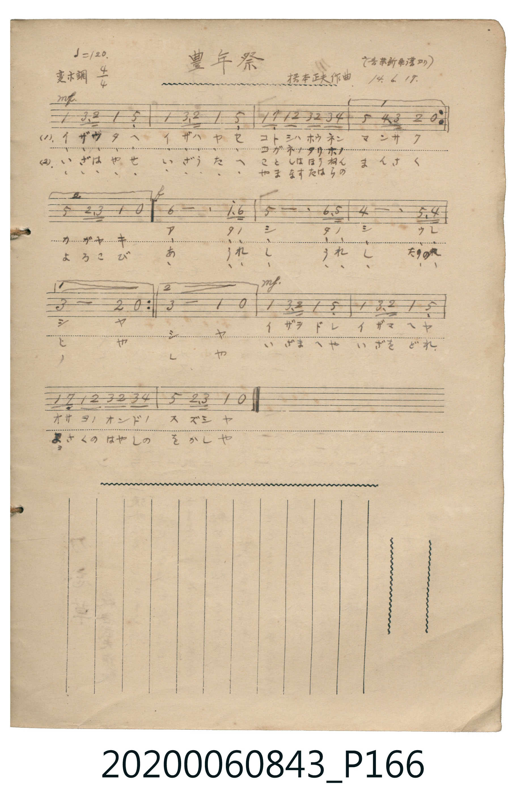

# 豊年祭

<audio controls src="honensai.mp3"></audio>

- 作曲：橋本正夫（原載《音楽新潮》，大正 14 年 6 月 17 日抄）
- 日治時期公學校《唱歌帳》（典藏號 2020.006.0843・P166）

## 說明

【曲目說明】
・出處：《唱歌帳》（國立臺灣歷史博物館典藏號 2020.006.0843）第 P166.jpg 頁。
・標註：（音楽新潮ヨリ）橋本正夫作曲 14.6.17.（大正 14 年 6 月 17 日抄錄）。
・調性與拍號：變ホ調（Eb 大調），4/4 拍，速度 ♩=120。
・背景與曲風：歡慶秋收的祭典歌謠。前段與後段以輕快富有彈性的附點節奏呼喚眾人高歌起舞，
中段（f）以寬廣的附點二分音符長音（「アータノシータノシーウレシヤ」）抒發豐收喜悅。
・版本說明：本檔案依原頁反覆記號與一、二房子（1, 2 括弧）完整展開為 20 小節。
【原頁歌詞全文與中文語譯】（對應 P166.jpg）

・編曲說明（鋼琴伴奏版）：
1. 前奏 (Intro, 4 小節)：取末樂句熱鬧的祭典音頭旋律，帶出秋收慶典氣氛。
2. 主歌伴奏 (Song, 20 小節 × 2 段)：左手以富有祭典節奏感的伴奏襯托歌唱。

## 歌詞

```text
（一）イザウタヘ　イザハヤセ　コトシハホウネン　マンサク
イザウタヘ　イザハヤセ　コガネノタリホノ　カガヤキ
アータノシータノシーウレシヤ　アータノシータノシーウレシヤ
イザヲドレ　イザマヘヤ　オサヲノオンドノ　スズシヤ
來歌唱吧！來吆喝助興吧！金黃飽滿的稻穗閃耀光芒！
啊，多麼快樂、多麼快樂、多麼歡喜呀！
來跳舞吧！來起舞吧！領唱的音頭歌聲多麼清亮動聽呀！）

（二）いざはやせ　いざうたへ　ことしはほうねん　まんさく
いざはやせ　いざうたへ　やまなすたはらの　よろこび
あーうれしーうれしーたのしや　あーうれしーうれしーたのしや
いざまへや　いざをどれ　よさくのはやしの　をかしや
來吆喝助興吧！來歌唱吧！堆積如山的米袋令人喜悅！
啊，多麼歡喜、多麼歡喜、多麼快樂呀！
來起舞吧！來跳舞吧！與作吹奏的伴奏樂聲多麼有趣呀！）
```

## ABC

```abc
X:1
T:豊年祭
M:4/4
L:1/16
Q:1/4=120
K:Eb
V:V1 name="Piano" snm="Pia"
[V:V1]
!mf! E4 G3 F E4 B,4 | E4 G3 F E4 B,4 | E2 D2 E2 F2 G2 F2 G2 A2 | B4 A3 G F4 z4 |
E4 G3 F E4 B,4 | E4 G3 F E4 B,4 | E2 D2 E2 F2 G2 F2 G2 A2 | B4 F3 G E4 z4 |
!f! c12 e3 c | B12 c3 B | A12 B3 A | G8 F4 z4 |
c12 e3 c | B12 c3 B | A12 B3 A | G8 E4 z4 |
!mf! E4 G3 F E4 B,4 | E4 G3 F E4 B,4 | E2 D2 E2 F2 G2 F2 G2 A2 | B4 F3 G E4 z4 |
```

## TMD 檔案連結

- [主旋律 TMD 檔案](honensai.tmd) [[在 TMD Studio 編輯](https://tmdlang.github.io/Tmd-TS/#tmd=s7IKdvYPcrWy4tLSUnixsevpzi3Pl65V0NLiUrRVMDQy4LK3VXDV4bIx0Tex46pTUHo2femzTbufzWx6Nmf-09Y1T9fueLZg4eOGrqdTNj5b2_N0x-bHDd3v93Q8bd3xYnr_i5nzFYwMjAz0DAzM9AwsTIwfN-8OMDQze7-nUwlk2JO9c57N3vR-z6xnK7ufzVnzbO3ip0tWg3T3zX-xpxNo6sv5m58t3fts2oZne9eBDe55umQ5UJmCoYkC0KUKZgrP5nQoGJorgJzV1QI2l0tfS8GWWoBLQUHhccMEoCufz173YtWqZzP6HjdMBIs2737avuvFzKlA52Px_5zu56u7X7Tvet64-Nna7U_7Nz3tnfW8c-XLJStwBA3Q7c_XrFEABY9eVkG6wssFjY8bmqA2PVsx88WK3UCbgEajhEnzisfNq4BakQMQEqrAINIz0zM01wO5Bl-gvewBhRvCrher9j9rWP6io_1Zdy_QlUBLX6zretw8GygONMo1SQFoGpjdCYwOYLJQAKoDsl42zH-6a5nCo5krbYHJBsm45p5nM9eDjJu96eWiFaDIXrvwWeu258u7n03Z9nxWCzC5AYMEGHgv1iwAanva2fts3Vag-qf7eoCMJ7uXvtgz9en-1U_X9zyb0_l0bwfQcUBdL2e2vNw97_n6hqdL-59O3PN02qznc_Y92bXr5eoZIKO2bn_RMQ_oKpAjFBSe7FgLNAro-jSgq4EmPl2_5unuxXBTnuzqedrRBgzX52uWvZy6HcgAKn3c0PO4adHj5j2Pm_Y_bu573LQdg73scfMaMHvJ4wZgEHQ-65r0fOaeFxsnAD32dNqcZ02tiGB43tkBjCBICgKFATCyVk15trDjyb65wNQOjOyn_b0vlrW9WDEDGOZA3z_Z0fC4oRHosmcd-5-unQB0kKGOghEwrNc83bMcaNfTdT3Ppm55unHqy2ndz5t2AdOSwtMN_cDwAFkJTbUQg0HBsXLe09YVz6a1gw1eC2Ksmvdi7XpgUgaljg29z9o74SkPaDjYAKAM0BGgpNG05HHTNpB3Qb6f8bihASrS3A_yetNusMjmx80d4MAACs4Gh03v42Zgbmh43DwPxGja-rhpPcRhQDeCEZHmNq0BmwUMdqCyVSDTgWyQ1GqwFFDlWjRziY82EhRjc3vzpsfNnSAVCBGgZ2fAjF4F8jVIDdA4oMOBQQRUDHH7zsdNuxDmAsMaEiPApPFkXxuoJJmy8ekEYEQ3ArlPJ7Q9nTb3adfKFx0dUMHdoIL62Yz1wMQGZIByJDjVAaWgKZ4IQ162T3y5u_nl4r3Pdu8H5cMVu5-vnP5yWvOLhoanrZ0vuibBTXs6tQtc9M56uWsPMCs-W9EETJtYucC8DUz5TycC0w3CJS-2bwbmRrhLIJkT6oYFM4COBOXE-ZtfLlgLSquNm6BG7Wh9smvd0-6pLxr3QgxETpm7ekAps7HlceO0x43rHzcBGbNBAQsVaXvcOP9x4w6wyOTHjSseN04HKWvcDZZa-7hpMlhqH4jROPVxYz9q7BJjLkhq3-PGVY8bZ4IFgYqBDgJWU0ApYE7oBVu8Gc3cJlCiAprS1ANyETobaMo6EBtoNCmKsbod6LQdMIPAIk2THjeuBOmHOBDsa7AREF8CwwfidqCyboS5aCkTS1JES2lEpEyChjxd0PZ8Ze_TZU1PN4LSxvONm18s6n6yewmwfIeUq1hTJiTtoSVFtISKnjKRkiJaQgUVlXvnPJ2wE1jBAN3wZM8WIANoAiJ9zul8sW0xImUCTaS8vQEFClr6XFzB-XnpVgGZiXn5DjUGNQrVYFfbGJpp2YFZwGYOpK4ERhGo5WCo8GzNQmBgAAttWJ0BrKFnAcslBWDBBMTLgHg_sC6aoVADZEFFm_uBGMTeDRbdDOR1AOntUJnZEH3NvUC8GaSieR6YBSzYgHg9yJ0gtwBdl5tWC3SCLhgag0kjON80HsqoIVaJOYgLYhhB1cJoE7ASU6hiEA8kDpIFQQOYIeByAiOIgPUnJIgQ1SpZQdS0BhokfVD1qyBBBeSDVKyGqgDpATalYUFE99CBhIox3BTM0IE3jPAmIFANCfUoxIOgqhGbACilrIEIgL2PSB3AxGEGtR0dGsaBKTMkh6NDiFZToApIhGNCiE4ToApI0CEg7qSB4nmcSYNyzw-Qx3HHOqRljZzwmzcBcSfcAzBRUF6fAfYMSBSYyEG5HqwWlPBBiR5UXoD0QUJiJxDvwhL7A1I24E79tVxcunYKoOJVAUgrcwEA)]
- [鋼琴伴奏 TMD 檔案](honensai_piano.tmd) [[在 TMD Studio 編輯](https://tmdlang.github.io/Tmd-TS/#tmd=s7IKdvYPcrWy4tLSUnixsevpzi3Pl659v6fjZfee5xO2PNmz5enS_uedHe_3dCpoaXEp2ioYGhlw2dsquOpw2Zjom9hx1SkoPZu-9Nmm3c9mNj2bM_9p65qna3c8W7DwcUPX0ykbn63tebpj8-OGbqCRT1t3vJje_2LmfAUjAyMDPQMDMz0DCxPjx827AwzNzIA2KIEMe7J3zrPZm97vmfVsZfezOWuerV38dMlqJS4ufS0FW2oBLgUFhccNE4D2PJ-97sWqVc9m9D1umAgWbd79tH3Xi5lTgQ7A4oM53c9Xd79o3_W8cfGztduf9m962jvreefKl0tW4PAc0FfP16xRAHlQL6sgXeHlgsbHDU1Qm16s2v-sYfmLjvZn3b1AnUArX6zretw8GygOtMw1SeHpkuVgduf7PT3AwFYAqgOyXjbMf7prmQIkLhCmPd--AughiG-wRiDQfJBSBQVDPYWnnb1AcQUNz7ySonwdBROFpxv6n69v0ASqedo_7dmc1c9WND3tX_q8bePLNcufz2oBJgqgD1_O3_xywdpn07uf7gMGBzBctgED6_ny7mdTtj1r3QZU8GzD4mcbZkPdpKBgpKfwZMduYAhCnKGgEZyfl64DDCGodQqHpysYKTxbtxVs7_Zlzzq7n-xe-nR9z7M5nRAbgYqAGp-1zAe6AWLIi6Xrn3XOAMXKlI1QiyhPEFCgoKXPxQUOEquAzMS8_CAPhxqDGoVqsG9sDM207MCsGgVDBV0wNAaTRnC-aTyUQbQScxAXxDCCqoXRJmAlplDFIFGQOMwUA5ghXLUoLvZBcbEJwsHxCtGGsTAKk28SD2SZxCOJmIJETCEiBhB7QLFHIGCqc9Nq6R86IB5IHBJKyKEz6KILGkzAUDKDiqFDwzgwZYZkHDqEaDUFxRsOFRCdJkAVEA8hIK4wGiDn4AyhAUlIeLMZIvnjymUQR5Of1UAMUF6jVp5FJDa4WjgD0zwjkJRRfC7EHWBz4IpQXUapaajOozDQEOWTrp0CuChUADJAkYVMK3MBAA)]

## 分析

```text
================================================================================
📊 TMD Song Profile: [ 豊年祭 ]
================================================================================
⏱  Duration:       0:40 (40.0s), 20 measures total
🎼 Key & Tempo:    首調基準 E,, != 120.0 BPM, <4/4>
   - 分析範圍：      由實際發聲的音符與和弦推測調性；播放脈絡另行呈現
🎤 人聲音域:    A#3 (MIDI 58) – D#5 (MIDI 75) [跨度: 17 個半音 / 1.4 個八度, 難度: challenging]
   - 最低音:  A#3 in [Song #1 @ m.1, 0:01]
   - 最高音: D#5 in [Song #1 @ m.9, 0:17]
   - 適合: soprano, mezzo-soprano, contralto, tenor, baritone, bass
🏛  結構:      Song (40.0s)
⚡ 編曲密度:        Peak 1 軌道同時演奏
🗝  調性診斷：       D# 大調（純淨自然大調，未偵測到可信轉調）
   - 風格氣質:    純淨自然大調（陽光明朗、易唱易記，無明顯調外色彩）
   - 轉調歷程:    全曲維持單一推測調性（未偵測到可信轉調）
   - 核心骨幹音:  D#, A#, G, G#, C
   - 調性數值:    D# 大調 [相關度: 0.98, 穩定度: High, 自然音純度: 100.0%]
   - 候選調性 (K-S): D# 大調 (0.98), A# 大調 (0.65), C 小調 (0.64)
   - 五度圈歷程:   -3
   - 各段落調性細節:
     • [Song #1]: D# 大調 (r: 0.98, 自然音純度: 100.0%)

  [ 五度圈游移軌跡 ]
               C  
         F            G  
      Bb               D  
     [Eb]*              A  
         Ab           E  
            Db       B  
               F# 
     (* = active key center)

  [ 十二半音累積音高分佈 ]
     C  : ██████████                10.7%
     C# :                            0.0%
     D  : ██                         2.0%
     D# : ████████████████████████  26.0%
     E  :                            0.0%
     F  : ██████████                10.7%
     F# :                            0.0%
     G  : ███████████████           16.3%
     G# : ███████████               11.7%
     A  :                            0.0%
     A# : █████████████████████     22.7%
     B  :                            0.0%
--------------------------------------------------------------------------------
Assignment 軌道音域：
  - Piano         : A#3 – D#5 (17 個半音 / 1.4 個八度, 88 個音符)
================================================================================
```


## 原書掃描頁




