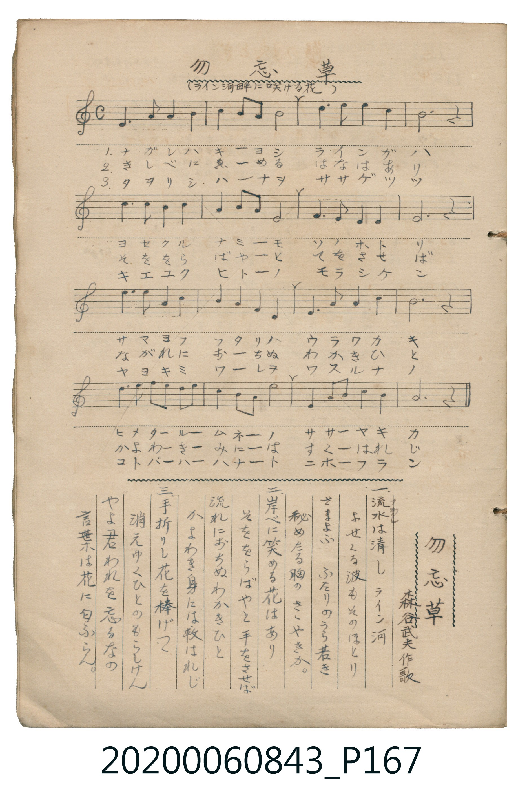

# 勿忘草

> Re:Shōka 使用 AI 協助辨識與重建樂譜，可能會有錯誤。歡迎回報。

- **鋼琴伴奏版**：<br><audio controls src="wasurenagusa.mp3"></audio>

- 日治時期公學校《唱歌帳》（典藏號 2020.006.0843・P167）
- 作歌：森谷武夫（副標題：ライン河畔に咲ける花）

## 說明


- 出處：《唱歌帳》（國立臺灣歷史博物館典藏號 2020.006.0843）第 P167.jpg 頁。
- 標註：副題「（ライン河畔に咲ける花）」，下方抄錄三節完整漢字假名歌詞並署名「森谷武夫 作歌」。
- 調性與拍號：ハ長調（C 大調），4/4 拍（C），原譜為手抄五線譜。
- 背景與曲風：取材自歐洲著名的萊茵河「勿忘草（Vergissmeinnicht / Forget-me-not）」傳說：
年輕騎士與戀人漫步於清澈的萊茵河畔，為替戀人摘取岸邊盛開的藍色小花而不慎落入急流，
臨終前將花束拋向岸上，留下一句「請別忘記我（われを忘るな）」，自此該花便被稱為「勿忘草」。
旋律優美動人，具典型德國浪漫民謠風格。
- 版本說明：本檔案由原頁手抄五線譜轉譯為 TMD 簡譜。
【原頁歌詞全文與中文語譯】（對應 P167.jpg）

### 編曲說明（鋼琴伴奏版）：

1. 前奏 (Intro, 4 小節)：取末樂句溫柔深情的德國浪漫民謠旋律，描繪萊茵河清波與藍色勿忘草。
2. 主歌伴奏 (Song, 16 小節 × 3 段)：左手以流暢的分解和絃伴奏，呼應萊茵河水的律動。


## 歌詞

```text
（一）流れ（ナガレ）は清し　ライン河（ガハ）
よせくる波も　そのほとり
さまよふふたりの　うら若き
秘めたる胸の　さゝやきか。
漫步河畔的年少兩人，那是深藏心底的溫柔低語嗎？）

（二）岸べに笑める　花はあり
そををらばやと　手をさせば
流れにおちぬ　わかきひと
かよわき身には　救はれじ
年輕人卻失足跌入急流之中，纖弱的身軀再也無法獲救。）

（三）手折りし花を　捧げつつ
消えゆくひとの　もらしけん
やよ君われを　忘るなの
言葉は花に　匂ふらん。
「啊，請你不要忘記我！」這句話語至今仍隨花香芬芳流傳。）
```

## ABC

<div class="abc-score" data-abc-src="wasurenagusa.abc" aria-label="五線譜載入中"></div>

[下載 ABC 原始檔](wasurenagusa.abc)

## TMD 檔案連結

- [主旋律 TMD 檔案](wasurenagusa.tmd) [[在 TMD Studio 編輯](https://tmdlang.github.io/Tmd-TS/#tmd=s7IKdvYPcrWy4qpTUCpJTLdSSM7PyUlNLsnMz7MqzsjPTkzOyFeCS5bl55TmploBqXgDQ4RwcX5pUXJqfEFieqpVgKGZOboM3KT4vPyS1KT8_GyEioKi_LLUvMQ8oKrcxLzS4uSizIKS-OT8gkqEmtSyzJRUkIrUlMyS_KLMxBwkJ6UWFYMdC3FDSVFiHsQMoCBCVUlGKtDdBTmJeSUIQaBJ6Zl5ViWJmUD3xQNxeWJ8bmJmHlBVCrKqkoz89KLEgoxKq4zMYpD9yYk58dmJeYlKXFpaCk-79z_dP-NFb6eClhaXoq2CpRmXva2CM5eNib6JHciUZ9OXPtu0-9nMpmdz5j9tXfN07Y5nCxY-buh6OmXjs7U9T3dsftzQ_X5Px9PWHS-m97-YOV_ByMDIQM_AwEzPwMLE-HHzblCQvt_TCXbSk71zgJre75n1bPG6Fxu2P1u77OmS1SDdneufrZj5ciFI6nHzysdNSx43b362afPzqVMeN65-OmnT48aJj5u6X3RtBJvEpa-lYEstwKWgoPC4YcKz2Zuez173YtWqZzP6HjdMBIs2737avuvFzKkgV2H6eE7389XdL9p3PW9c_Gzt9qf9m572znreufLlkhU4AgPo9udr1iiAAkQvqyBd4eWCxscNTVCbgP5_sWI30CZgWAAD4nEDMCw6CIbF44be93t6nuzofjZt57Oulpc9LU92dD5f3_B0Xc-zqVue7Vn0dO30p43tTyf0Ap3-YuW8JzuWPd-7CcgFmo8cBwqQmAEah3DRi1X7nzUsf9HR_qy7F-gXcNT0v5y6HSgOdJqzwtMly8HMTqALgKlFAagMJA4ReNo3_8XaOc-bdj3r7AY67MmuKc-3zwKKIBnf3PNs5nqQ8bM3vVy0AuTz_mnP5k540b7q2doJz7ZsejFxOtChz2e1vJjQ9aJnKzAIgI6Gp1egVWGpRemZxcW5qZl5eZnJGSUK-gpu-UXpqSW6uam6wLwKCZ-nTZuBsQo0HmSvgsLTnVte7Jn6ckXf08WrQZZ3NDzZtevZntXP1i59Nm3Psx2tz_Z1INsJDHagd0Aemb0fqnjiDKBLn27a8bKp6_ns2S-ndYPUT-990bnp6YZ-YLy8aADGSO-z1r4XE_Y-bV36rGHps62NQEMgDnjRvuL51qannb1PN7QDFT-bO_9Zd_fTCROBBj7Z0QWya-pMYIQ-2dHwtH8p0McvVnc_7VgK8vSKGc86JoJSRVP_46aex02TgILAlPC4Eeg7aEoAB96SFys3AU1-sm__i0Wrn6_YCHQ8csghIllB4dn07qf7up-2rHq-r-9p91Sg70Bx17odmIKfzgNKbQem8mdbV4HCZ8PEF2sWACPq2YI9iEh83tnxbM4aSK4BZes5a56tmvJsYcfzKRuBKQCYwNGi_8Xezhdr1wMdpBDi66LwfMNCaJKAZkKoHnBSfdq64tm0dmAUPdmxFsRYNQ-oE5gzQVlvQ--z9k54RgL6HmwAUAYYakAeMLiBAQTOP12Pm9Y8bl4DCqDG9cDYfdw4_XFDA3K-AgcoUE0_yBiQM5o6HjfOftwIDOPuZ5sXPW5qAmlonPu4cd3jxt2PG1c8buoCq2uc-rhxH1j1VjCaD5QAKQKpbnvc1Pmie-njxl6Q0ufLgfHUCFbR_aJ5B0zR1MdNcx83tQAVPW7shoYp0DUQnwJDE54Gn23YAvQSJG0C4wfoKmCcAFMxKGNOnA5UAEw77_fMhkYpJC2DUy4wYQLT-9MNE5-2roTE7cumxc9mrH-2fSOwgHq6v_nprqlANc92rX42f8qTvX1Aq59OB0YkMLMjgnQXMCQ7gTY8btwJLICerwGWPsDgBTq4AZjIgKH6uLEJHiRA_0wCI2BwbwD7bQVQHTARgARBAQYM2A0gpZAoApr3uBEYaAsfN64BBQkwYQNDAhQewFJuBcRIoFZwim_sfbELqBqIgKmg4dnUiSAGyIgZ6OEGCRBQ7ty2-9mUfaByZN86oLtfdKwB5VRgnpuzFRSMaxc_2bMDlECbN79Y1gjMjk_XNQMzN6g0ndkEz6-QAgMYek97dz9dsvHFts0vtgOzCDRbP9kJzKlrQbl217SnezaCzN-1-sXuhqdtvU92zn_esvDZ5qnPezeBnNsANBMpoQJLsE5w7gCmDWAQTAcFJjCQgF7rXf64ERhaS4AIHFTbgEkMGARtoDQJDhhoAgKmTFA4TwdXCJMhabcFGFpPJ8yGFxFAdfBSAqgNpOjFioYXE0HZARx9q0EqeppAKRhoWNNkLOnw5eoZLzo6gcH4YtkqkIvBQYQckk97NwNDD-hOYPiAClFg-ty_BBgsQDWgcJsw4eWcTU92tT2b0_B0Xw8w1b1o3AQvj0El01RQsQcs557sXQAsOEFxgSjtgFVk78uGmcCy8MXKjSAntW9-srvrye7el7NWAB3wctnMF11rXnRtBsYFsKSHBjLQXMobBlCgoKXPxRWcn5duFZCZmJfvUGNQUw12uo2hmZYdmAVsjmgASx5NYInYBYyDNUAahPsVaoC8tUDWHiBeAWRvB4k0rwSylgDpzWC1IJF-BQOQNXCzdvUAzWrsBeLpQLwTiFeDzZoIMaupEYi7QSKN64F4FZRuAqvpQjNrRyfQrKb9QJ2bgBioFuqKfqi7gC4GyoB0boVikLoWsJoWhFk1CqYKunAIYpshsUGwRsEwDso0BjGMQARcCAZrIOIwCOaAlcN5aGahQwOYEnBWQg57UAjvBmJgWDSDwwvst_lQfy4C-3EvkNUHxLOBuAOsZhXWsJ8LVDsJijvBIb0BlLsgZjWuAIssg8g3TgXi2VA12MIemAKagG5rBqlfD7YTqAtoO8RdfWCRRdB0sR2IN4JFNiOHPTyE4KFrghLWaCELFQPyYZGECH5c0WiOVQVRIQ9KNc3zIDHQPBXsemCYgNMcML1BfNgE9D3Ih83A2GmCpOa1WEMelJp7gLJADEn1jaBYBIX6QiAG55cmYNpt7IbmEHDaBcYIlpBvBuUyUKoA5cH5YHeB0gYo1EH5E6wT7B5gDgOmGFB6AYn0URDy8GQLC05Y8KIGK1gZXD9cE1rmICrwwYkJGDRN-yE-Ww2iQN5YAMTAAEIkMkgGhwgAQwYYKiDB1VhjARi6TcAUCqxGwEHfCzW0ERinwFiBCILTcuNMIIaqAgVlD1hwBtaMACzwwMl-AsQNYF2woggayc3gYg1IArMoRACYkoDpBneOAEcHWoGDrRwBRQgoMlAiFDVmELECNwCRK4gokGq5uHTtFEB1hQKQVuYCAA)]
- [鋼琴伴奏 TMD 檔案](wasurenagusa_piano.tmd) [[在 TMD Studio 編輯](https://tmdlang.github.io/Tmd-TS/#tmd=s7IKdvYPcrWy4qpTUCpJTLdSyC8qychPL0osyKi0ysgsLskvykxOzInPTsxLVIIrKs4vLUpOjS9ITE-1CjA0M0fIlGSk5qZapaaUJieWZObnKXFpaSk87d7_dP-MF72d7_d0vOze83zClid7tjxd2v-8s-P9nk4FLS0uRVsFSzMue1sFZy4bE30TO5Bxz6YvfbZp97OZTc_mzH_auubp2h3PFix83ND1dMrGZ2t7nu7Y_LihG2jg09YdL6b3v5g5X8HIwMhAz8DATM_AwsT4cfNukMOA5oPd9mTvHKCm93tmPVu87sWG7c_WLnu6ZLUSF5e-loIttQCXgoLC44YJz2Zvej573YtVq57N6HvcMBEs2rz7afuuFzOnAh2AxQdzup-v7n7Rvut54-Jna7c_7d_0tHfW886VL5eswOE5oK-er1mjAPKgXlZBusLLBY2PG5qgNr1Ytf9Zw_IXHe3PunuBOkFWNve_nLodKA60zFnh6ZLlYCYwNnqAYa0AVAZkvWyY_3TXMgVwRCDMer59BdA7EL9gjTyg6SClCgqGegpPO3uB4goannklRfk6CiYKTzf0P1_foAlU87R_2rM5q5-taHrav_TZrtXP5k95tn3js-bW57Nanu7bDgyAZ1tXPduz-tmGiS_WLHg2vfvpPmDA9Dzr73--c9WLCV0verY-27T52Y7WZ5sXAT32Ynrvi85N8FQFda6CgpGewpMdu4FBC3GhgkZwfl66joKhGdQlCoenKxgrPFu3Feyk7cuedXY_2b302dbGZ7MWgVzS0fZi-eKnk3qeb22GmAB0w9OJe561dyLcsGEL2M3dT7unQu2lPOFAgYKWPhcXOPCsAjIT8_KDPBxqDGqqwX6zsdCyAzNqFIzjFHQVTOJAtFGcgiGY1AWKA1m6CuYKZhAFIFijYAokgeIQpSBZuEIYNAAJcdWiWOyDbLEJ3GLDeIVow1gF03ggbRofCxQxAzHN4nNjFYxBLGMQC2gpTAGSSqheIGUAsQ4UNVi8aWgGtw7kdhgEsc2Q2BDfwT0C9jHYhyh-g6gCi8MgmAMPILgUWqAgQ1AAgZUgBz8MwuICiYdmKVQMyIe5H-EyXD4ERROmCio6Cu5ZmE0wm1FtBCuD64drQgtSotwFdg5aNGELfZCDQI5B8RCqyxCughuACDAiohEl8eFP6iagBGyCloBBFDGJHMUkuD4jkHIjUEZBMhxuBkIWzQbcBsKVITIjAddimEWdHK1rpwAuQxSADFAAY6OVuQA)]

## 分析

```text
================================================================================
📊 TMD Song Profile: [ 勿忘草 ]
================================================================================
⏱  Duration:       0:40 (40.0s), 16 measures total
🎼 Key & Tempo:    首調基準 C, != 96.0 BPM, <4/4>
   - 分析範圍：      由實際發聲的音符與和弦推測調性；播放脈絡另行呈現
🎤 人聲音域:    G4 (MIDI 67) – F5 (MIDI 77) [跨度: 10 個半音 / 0.8 個八度, 難度: easy]
   - 最低音:  G4 in [Song #1 @ m.1, 0:00]
   - 最高音: F5 in [Song #1 @ m.5, 0:11]
   - 適合: soprano, mezzo-soprano, contralto, tenor, baritone, bass
🏛  結構:      Song (40.0s)
⚡ 編曲密度:        Peak 1 軌道同時演奏
🗝  調性診斷：       C 大調（純淨自然大調，未偵測到可信轉調）
   - 風格氣質:    純淨自然大調（陽光明朗、易唱易記，無明顯調外色彩）
   - 轉調歷程:    全曲維持單一推測調性（未偵測到可信轉調）
   - 核心骨幹音:  C, E, D, G, A
   - 調性數值:    C 大調 [相關度: 0.85, 穩定度: Moderate, 自然音純度: 100.0%]
   - 候選調性 (K-S): C 大調 (0.85), G 大調 (0.74), E 小調 (0.70)
   - 五度圈歷程:   +0
   - 各段落調性細節:
     • [Song #1]: C 大調 (r: 0.85, 自然音純度: 100.0%)

  [ 五度圈游移軌跡 ]
              [C ]*
         F            G  
      Bb               D  
      Eb               A  
         Ab           E  
            Db       B  
               F# 
     (* = active key center)

  [ 十二半音累積音高分佈 ]
     C  : ████████████████████████  22.5%
     C# :                            0.0%
     D  : ████████████████████      18.7%
     D# :                            0.0%
     E  : ████████████████████████  22.1%
     F  : ████                       4.2%
     F# :                            0.0%
     G  : ███████████████████       17.5%
     G# :                            0.0%
     A  : ██████████                 9.2%
     A# :                            0.0%
     B  : ██████                     5.8%
--------------------------------------------------------------------------------
Assignment 軌道音域：
  - Piano         : G4 – F5 (10 個半音 / 0.8 個八度, 55 個音符)
================================================================================
```


## 原書掃描頁




