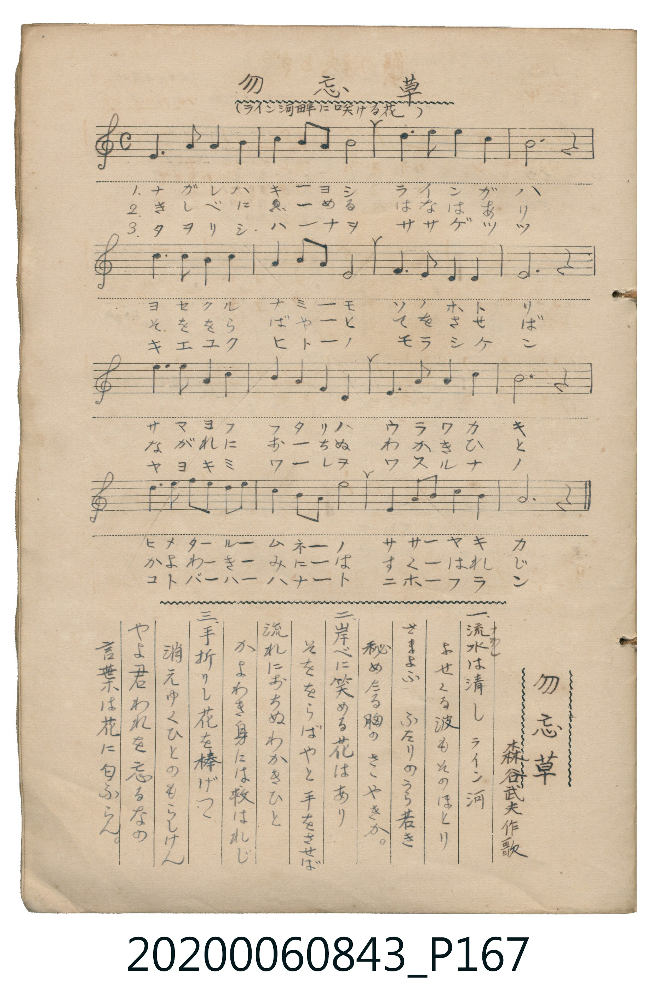

# 勿忘草

> Re:Shoka 使用 AI 協助辨識與重建樂譜，可能會有錯誤。歡迎回報。

<audio controls src="wasurenagusa.mp3"></audio>

- 日治時期公學校《唱歌帳》（典藏號 2020.006.0843・P167）
- 作歌：森谷武夫（副標題：ライン河畔に咲ける花）

## 說明

【曲目說明】
・出處：《唱歌帳》（國立臺灣歷史博物館典藏號 2020.006.0843）第 P167.jpg 頁。
・標註：副題「（ライン河畔に咲ける花）」，下方抄錄三節完整漢字假名歌詞並署名「森谷武夫 作歌」。
・調性與拍號：ハ長調（C 大調），4/4 拍（C），原譜為手抄五線譜。
・背景與曲風：取材自歐洲著名的萊茵河「勿忘草（Vergissmeinnicht / Forget-me-not）」傳說：
年輕騎士與戀人漫步於清澈的萊茵河畔，為替戀人摘取岸邊盛開的藍色小花而不慎落入急流，
臨終前將花束拋向岸上，留下一句「請別忘記我（われを忘るな）」，自此該花便被稱為「勿忘草」。
旋律優美動人，具典型德國浪漫民謠風格。
・版本說明：本檔案由原頁手抄五線譜轉譯為 TMD 簡譜。
【原頁歌詞全文與中文語譯】（對應 P167.jpg）

・編曲說明（鋼琴伴奏版）：
1. 前奏 (Intro, 4 小節)：取末樂句溫柔深情的德國浪漫民謠旋律，描繪萊茵河清波與藍色勿忘草。
2. 主歌伴奏 (Song, 16 小節 × 3 段)：左手以流暢的分解和絃伴奏，呼應萊茵河水的律動。

## 歌詞

```text
（一）流れ（ナガレ）は清し　ライン河（ガハ）
よせくる波も　そのほとり
さまよふふたりの　うら若き
秘めたる胸の　さゝやきか。
漫步河畔的年少兩人，那是深藏心底的溫柔低語嗎？）

（二）岸べに笑める　花はあり
そををらばやと　手をさせば
流れにおちぬ　わかきひと
かよわき身には　救はれじ
年輕人卻失足跌入急流之中，纖弱的身軀再也無法獲救。）

（三）手折りし花を　捧げつつ
消えゆくひとの　もらしけん
やよ君われを　忘るなの
言葉は花に　匂ふらん。
「啊，請你不要忘記我！」這句話語至今仍隨花香芬芳流傳。）
```

## ABC

```abc
X:1
T:勿忘草
M:4/4
L:1/16
Q:1/4=96
K:C
V:V1 name="Piano" snm="Pia"
[V:V1]
G6 G2 A4 G4 | c4 e2 d2 c8 | d6 d2 e4 d4 | c12 z4 |
e6 e2 f4 e4 | d4 e3 d A8 | G6 G2 A4 B4 | G12 z4 |
e6 e2 f4 e4 | d4 c4 B4 A4 | G6 c2 e4 c4 | d12 z4 |
e4 f2 e2 d2 c2 d4 | c4 B2 A2 e8 | G4 c2 e2 d4 B4 | c12 z4 |
```

## TMD 檔案連結

- [主旋律 TMD 檔案](wasurenagusa.tmd) [[在 TMD Studio 編輯](https://tmdlang.github.io/Tmd-TS/#tmd=s7IKdvYPcrWy4qpTUCpJTLdSSM7PyUlNLsnMz7MqzsjPTkzOyFeCS5bl55TmploBqXgDQ4RwcX5pUXJqfEFieqpVgKGZOboM3KT4vPyS1KT8_GyEioKi_LLUvMQ8oKrcxLzS4uSizIKS-OT8gkqEmtSyzJRUkIrUlMyS_KLMxBwkJ6UWFYMdC3FDSVFiHsQMoCBCVUlGKtDdBTmJeSVKXFpaCk-79z_dP-NFb6eClhaXoq2CpRmXva2CM5eNib6JHUjXs-lLn23a_Wxm07M585-2rnm6dsezBQsfN3Q9nbLx2dqepzs2P27ofr-n42nrjhfT-1_MnK9gZGBkoGdgYKZnYGFi_Lh5Nygc3u_pBDvhyd45QE3v98x6tnjdiw3bn61d9nTJapDuzvXPVsx8uRAk9bh55eOmJY-bNz_btPn51CmPG1c_nbTpcePEx03dL7o2gk3i0tdSsKUW4FJQUHjcMOHZ7E3PZ697sWrVsxl9jxsmgkWbdz9t3_Vi5lSQqzB9PKf7-eruF-27njcufrZ2-9P-TU97Zz3vXPlyyQocgQF0-_M1axRAAaKXVZCu8HJB4-OGJqhNQP-_WLEbaBMwLIAB8bgBGBYdBMPicUPv-z09T3Z0P5u281lXy8uelic7Op-vb3i6rufZ1C3P9ix6unb608b2pxN6gU5_sXLekx3Lnu_dBOQCzUeOAwVIzACNQ7joxar9zxqWv-hof9bdC_QLOGr6X07dDhQHOs1Z4emS5WBmJ9AFwNSiAFQGEocIPO2b_2LtnOdNu551dgMd9mTXlOfbZwFFkIxv7nk2cz3I-NmbXi5aAfJ5_7Rncye8aF_1bO2EZ1s2vZg4HejQ57NaXkzoetGzFRgEQEfD0yvQqrDUovTM4uLc1My8vMzkjBIFfQW3_KL01BLd3FRdYAaDhM_Tps3AWAUaD7JXQeHpzi0v9kx9uaLv6eLVIMs7Gp7s2vVsz-pna5c-m7bn2Y7WZ_s6kO0EBjvQOyCPzN4PVTxxBtClTzfteNnU9Xz27JfTukHqp_e-6Nz0dEM_MF5eNABjpPdZa9-LCXufti591rD02dZGoCEQB7xoX_F8a9PTzt6nG9qBip_Nnf-su_vphIlAA5_s6ALZNXUmMEKf7Gh42r8U6OMXq7ufdiwFeXrFjGcdE0Gpoqn_cVPP46ZJQEFgSnjcCPQdNCWAA2_Ji5WbgCY_2bf_xaLVz1dsBDoeOeQQkayg8Gx699N93U9bVj3f1_e0eyrQd6C4a90OTMFP5wGltgNT-bOtq0Dhs2HiizULgBH1bMEeRCQ-7-x4NmcNJNeAsvWcNc9WTXm2sOP5lI3AFABM4GjR_2Jv54u164EOUgjxdVF4vmEhNElAMyFUDzipPm1d8WxaOzCKnuxYC2KsmgfUCcyZoKy3ofdZeyc8IwF9DzYAKAMMNSAPGNzAAALnn67HTWseN68BBVDjemDsPm6c_rihATlfgQMUqKYfZAzYGQ1Q1NTxuHH240ZgYHc_27zocVMTSLBx7uPGdY8bdz9uXPG4qQtVQ-PUx437wNq2gtF8oAqQapBU2-OmzhfdSx839qLoeb4cGIWNYKXdL5p3wFRPfdw093FTC1D148ZuaHADHQoJBGBAw5Pnsw1bgL6FJFtg1AHdCYwuYAIH5dmJ04EKgMnq_Z7Z0NiGJHNwogamWWBWeLph4tPWlZBof9m0-NmM9c-2bwSWXU_3Nz_dNRWo5tmu1c_mT3mytw9o9dPpwDgGlgOI0N4FDOROoA2PG3cCy6bna4AFEzDkgQ5uAKY_YIA_bmzCDCSgxyaBETBKNoA9uQIoDkwoIEFQEALDfAOKHkh8Am143AgMz4WPG9eAo6cfFDagEAIWiSvQLAEaBs4njb0vdgG1AREw7TQ8mzoRxACZNQM9SCFhBcrT23Y_m7IPVPrsWwf00ouONaD8Dcypc7aCQnjt4id7doCSdfPmF8sagZn46bpmYJEAKoNnNsFzOaSYAQbs097dT5dsfLFt84vtwIwFLQye7ATm77WgvL5r2tM9G0Hm71r9YnfD07beJzvnP29Z-Gzz1Oe9m0DObQCaiZS8geVeJzhPAZMNMCymg8IZGGxAr_Uuf9wIDL8lQIQaeNuA6REYFm2glAwOKmgiA6ZnUBRMB9cnk9GSfgsw_J5OmA0vaoCC8NIGqB9F9YsVDS8mgvIXONJXg5T2NIEyAND4pslYUu_L1TNedHQCQ_jFslUgz4BDDzmQn_ZuBgYs0OXAoAOVysBUvX8JMMSAakBBOmHCyzmbnuxqezan4em-HmBafdG4CV7Ag4q6qaByFFhwPtm7AFgSg6IJUXwC69zelw0zgYXri5UbQU5q3_xkd9eT3b0vZ60AOuDlspkvuta86NoMjCZg1QENf6C5lLc0oEBBS5-LKzg_L90qIDMxL9-hxqBGoRrsdhtDMy07MAvYwNEAlmWawDK2SwFYPAFpEO5XqAHy1gJZe4B4BZC9HSTSvBLIWgKkN4PVgkT6FQxA9sDN2tUDNKuxF4inA_FOIF4NNmsixKymRiDuBok0rgfiVVC6CaymC82sHZ1As5r2A3VuAmKgWqgr-qHuAroYKAPSuRWKQepawGpaEGbVKJgq6MIhiG2GxAbBGgXDOCjTGMQwAhFwIRisgYjDIJgDVg7noZmFDg1gSsDZDDnsQSG8G4iBYdEMDi-w3-ZD_bkI7Me9QFYfEM8G4g6wmlVYw34uUO0kKO4Eh_QGIKsFYlbjCrDIMoh841Qgng1Vgy3sgSmgCei2ZpD69WA7gbqAtkPc1QcWWQRNF9uBeCNYZDNy2MNDCB66JihhjRayUDEgHxZJiODHFY3mWFUQFfKgVNM8DxIDzVPBrgeGCTjNAdMbxIdNQN-DfNgMjJ0mSGpeizXkQam5BygLxJBU3wiKRVCoLwRicH5pAqbdxm5oDgGnXWCMYAn5ZlAuA6UKUB6cD3YXKG2AQh2UP8E6we4B5jBgigGlF5BIHwUhD0-2sOCEBS9qsIKVwfXDNaFlDqICH5yYgEHTtB_is9UgCuSNBUAMDCBEIoNkcIgAMGSAoQISXI01FoCh2wRMocAKBRz0vVBDG4FxCowViCA4LTfOBGKoKlBQ9oAFZ2DNCMACD5zsJ0DcANYFK4qgkdwMLtaAJDCLQgSAKQmYbnDnCHB0oBU42MoRUISAIgMlQlFjBhErcAMQuYKIAqmWi0vXTgFUWSgAaWUuAA)]
- [鋼琴伴奏 TMD 檔案](wasurenagusa_piano.tmd) [[在 TMD Studio 編輯](https://tmdlang.github.io/Tmd-TS/#tmd=s7IKdvYPcrWy4tLSUnjavf_p_hkvejvf7-l42b3n-YQtT_Zsebq0_3lnx_s9nQpaWlyKtgqWZlz2tgrOXDYm-iZ2XHUKSs-mL322afezmU3P5sx_2rrm6dodzxYsfNzQ9XTKxmdre57u2Py4oRto4NPWHS-m97-YOV_ByMDIQM_AwEzPwMLE-HHz7gBDM3Og-Uogw57snQPU9H7PrGeL173YsP3Z2mVPl6xW4uLS11KwpRbgUlBQeNww4dnsTc9nr3uxatWzGX2PGyaCRZt3P23f9WLmVKADsPhgTvfz1d0v2nc9b1z8bO32p_2bnvbOet658uWSFTg8B_TV8zVrFEAe1MsqSFd4uaDxcUMT1KYXq_Y_a1j-oqP9WXcvUCfIyub-l1O3A8WBljkrPF2yHMwExkYPMKwVgMqArJcN85_uWqYAjgiEWc-3rwB6B-IXrJEHNB2kVEHBUE_haWcvUFxBwzOvpChfR8FE4emG_ufrGzSBap72T3s2Z_WzFU1P-5c-27X62fwpz7ZvfNbc-nxWy9N924EB8Gzrqmd7Vj_bMPHFmgXPpnc_3QcMmJ5n_f3Pd656MaHrRc_WZ5s2P9vR-mzzIqDHXkzvfdG5CZ6qoM5VUDDSU3iyYzcwaCEuVNAIzs9L11EwNIO6ROHwdAVjhWfrtoKdtH3Zs87uJ7uXPtva-GzWIpBLOtpeLF_8dFLP863NEBOAbng6cc-z9k6EGzZsAbu5-2n3VKi9lCccKFDQ0ufiAgeeVUBmYl5-kIdDjUGNQjXYczaGZlp2YFaNgnGcgi4YmoAYYJ4RiDCEs0CwBsIHQXMgNoMpRYY1CqZQFlgtwiiYLjSD0KEBTAlXLYrTfVCcbgJ3uWG8QrRhrIJpPJA2jY8FipiBmGbxubEKxiCWMYgFdBVMAZJKqF4gZQCxDxS7BEIK5jsQBLFBgQBjo3kNLRhRQwkeJiAI5sCDElt44w4mtAiEWwyOSTgPzVKoGJAPcz_CZbh8iIg8ZBVUdBRK4gJBmM2oNiLSFYomtCAlyl2DK7UjUh-BxG4CSsImaEkYRBGTzFFMguszAik3AmUVJMPhZiBk0WzAbSBcGSI7EnAthlnUydO6dgrgYkQByACFMDZamQsA)]

## 分析

```text
================================================================================
📊 TMD Song Profile: [ 勿忘草 ]
================================================================================
⏱  Duration:       0:40 (40.0s), 16 measures total
🎼 Key & Tempo:    首調基準 C, != 96.0 BPM, <4/4>
   - 分析範圍：      由實際發聲的音符與和弦推測調性；播放脈絡另行呈現
🎤 人聲音域:    G4 (MIDI 67) – F5 (MIDI 77) [跨度: 10 個半音 / 0.8 個八度, 難度: easy]
   - 最低音:  G4 in [Song #1 @ m.1, 0:00]
   - 最高音: F5 in [Song #1 @ m.5, 0:11]
   - 適合: soprano, mezzo-soprano, contralto, tenor, baritone, bass
🏛  結構:      Song (40.0s)
⚡ 編曲密度:        Peak 1 軌道同時演奏
🗝  調性診斷：       C 大調（純淨自然大調，未偵測到可信轉調）
   - 風格氣質:    純淨自然大調（陽光明朗、易唱易記，無明顯調外色彩）
   - 轉調歷程:    全曲維持單一推測調性（未偵測到可信轉調）
   - 核心骨幹音:  C, E, D, G, A
   - 調性數值:    C 大調 [相關度: 0.85, 穩定度: Moderate, 自然音純度: 100.0%]
   - 候選調性 (K-S): C 大調 (0.85), G 大調 (0.74), E 小調 (0.70)
   - 五度圈歷程:   +0
   - 各段落調性細節:
     • [Song #1]: C 大調 (r: 0.85, 自然音純度: 100.0%)

  [ 五度圈游移軌跡 ]
              [C ]*
         F            G  
      Bb               D  
      Eb               A  
         Ab           E  
            Db       B  
               F# 
     (* = active key center)

  [ 十二半音累積音高分佈 ]
     C  : ████████████████████████  22.5%
     C# :                            0.0%
     D  : ████████████████████      18.7%
     D# :                            0.0%
     E  : ████████████████████████  22.1%
     F  : ████                       4.2%
     F# :                            0.0%
     G  : ███████████████████       17.5%
     G# :                            0.0%
     A  : ██████████                 9.2%
     A# :                            0.0%
     B  : ██████                     5.8%
--------------------------------------------------------------------------------
Assignment 軌道音域：
  - Piano         : G4 – F5 (10 個半音 / 0.8 個八度, 55 個音符)
================================================================================
```


## 原書掃描頁




