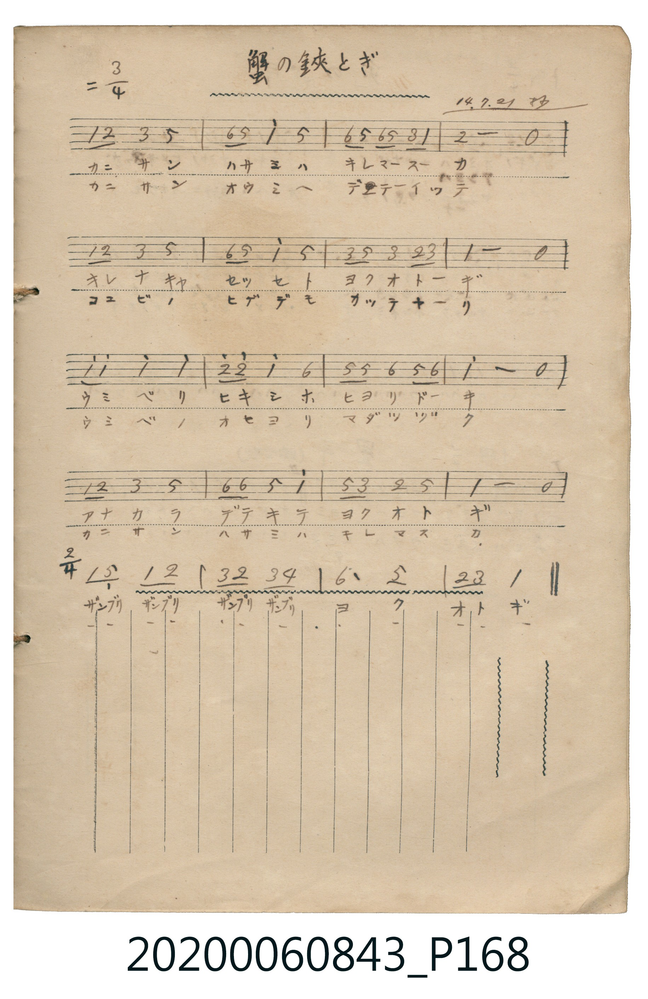

# 蟹の鋏とぎ

> Re:Shōka 使用 AI 協助辨識與重建樂譜，可能會有錯誤。歡迎回報。

<audio controls src="kani_no_hasamitogi.mp3"></audio>

- 日治時期公學校《唱歌帳》（典藏號 2020.006.0843・P168）
- 大正 14 年 7 月 21 日抄

## 說明


### 編曲說明（鋼琴伴奏版）：

1. 前奏 (Intro, 4 小節)：以 3/4 拍輕快華爾滋律動引出螃蟹磨鉗子的海邊情景。
2. 主歌伴奏 (PartA 16 小節 3/4 拍 + PartB 4 小節 2/4 拍)：忠實呈現原譜末行變拍之俏皮設計。


## 歌詞

```text
（TMD 檔案未包含歌詞註解）
```

## ABC

```abc
X:1
T:蟹の鋏とぎ
M:3/4
L:1/16
Q:1/4=112
K:D
V:V1 name="Piano" snm="Pia"
[V:V1]
D2 E2 F4 A4 | B2 A2 d4 A4 | B2 A2 B2 A2 F2 D2 | E8 z4 |
D2 E2 F4 A4 | B2 A2 d4 A4 | F2 A2 F4 E2 F2 | D8 z4 |
d2 d2 d4 d4 | e2 e2 d4 B4 | A2 A2 B4 A2 B2 | d8 z4 |
D2 E2 F4 A4 | B2 B2 A4 d4 | A2 F2 E4 A4 | D8 z4 |
[M:2/4] D2 A,2 D2 E2 | F2 E2 F2 G2 | B6 A2 | E2 F2 D4 |
```

## TMD 檔案連結

- [主旋律 TMD 檔案](kani_no_hasamitogi.tmd) [[在 TMD Studio 編輯](https://tmdlang.github.io/Tmd-TS/#tmd=s7IKdvYPcrWy4qpTUCpJTLdSSM7PyUlNLsnMz7MqzsjPTkzOyFeCS5bl55TmploBqXgDQ4RwcX5pUXJqfEFieqpVgKGZBboM3KT4vPyS1KT8_GyEioKi_LLUvMQ8oKrcxLzS4uSizIKS-OT8gkqEmtSyzJRUkIrUlMyS_KLMxBwkJ6UWFYMdC3FDSVFiHsQMoCBCVUlGKtDdiXmZuch6gUalZ-ZZleaBjC_JTMtMTVHi0tJSeDF_5-PGdS-7-x83rnjc2KegpcWlaKtgaGjEZW-r4MJlY6xvYgcy5Nn0pc827X42s-nZnPlPW9c8Xbvj2YKFjxu6nk7Z-Gxtz9Mdmx83dL_f0_G0dceL6f0vZs5XMDIwMtAzMDDTM7AwMX7cvBsUWO_3dIJd9HTJ8mdrFysYmig83blFwVzh2ZwOBSNDBZAdXS1KXFz6Wgq21AJcCgoKjxsmPJu96fnsdS9WrXo2o-9xw0SwaPPup-27Xsyc-n7PLCw-mdP9fHX3i_ZdzxsXP1u7_Wn_pqe9s553rny5ZAUOTwJ993zNGgWQR_WyCtIVXi5ofNzQBLXp2YqZL1bsBtpkaKJnrgfybFcLyBZ8IfGyB6ikE2HGi1X7nzUsf9HR_qy7F2g7yNnN3UBBoDkuCkCTwMzO93t6nnb2Pp09-8XCHqAMyEmGjxomG5opPN3Q_3x9A8iZTbsUgBGrADQHqPrZnNVISs2Bao0MEGpf7AUrN4IoR3JMc8-zmetBjpm96eWiFUDHPOvvf7p-9bOt2182db1saHi2d93TpXufLln5bMNiYLoBWvRiXjMwuT3dN-_ZlnnPV2553rEGGP5P9rUppGTmZKYDk2VOJdAVjxtnP25cDCaBpnY-X7wC5LV56592rnra0fB8Vsvz1UtfrFkAdYkCMMhAzn--qvF5y7bnUzbCPAZx94s9U5_uXw3UBPMAyIKGnsdN2x43b37cPO1x8yoFYjnNKx43rQeKrXrc3PG4ad3jBqBhoNCGOmPFwqcNi4G-f7Z1FdCeZ52TgWED9fGcFUDBF10bXyxeCPTOy87pT9dOAHlkyvyn3VOBwfx0aT8iYJ93djybswaSUkGhOmfNs1VTni3sAPrmad98YKJ6Om3di8ZNL5tXPN-w8MXaOU92dj_dv-Dp-mXPpu54srf3ac80iAmg1DVhNSROodGpkFBtAwwHu9oEhRfrusChAU5e0DwCMR6YCV6snPe0dcWzae1ALzzZsRbEWDXvxdr1wIwDMnVD77P2Tng6B5oBNgAo82QHKMU8bloNTJePm7aCwq6h4XFzP5g9H8QAcpvWPm5e87h53uPmPY-bdoLJ1RAHNEARVEUXmLEYLLL7cXMzmATGHtBEUExAIwKkfx2a_mVg22YCYw2sehLIoKbtj5tnQ7lA_UCp5k6w5rVomheBbQZ6YSVYdfvj5jawQ9rQbcawFpFYSOZCzAWJIxkNDFFIuAOTATQltXYAEw0wzT3ZuwCYgCBZ4mX3pKcdK59OB6aW-U-XNT2bN-fJjt6nSxZAxEHFwYaNT7uXAPPB0zkbQFly6V5gKgTGFShrTVj-fk8jNAUj5VyQ4bDMC0y1IENg2RaUiGE5F49pT2esfDp1GRA9bmgkyAaZj80o5LS1C1hEYaQtYHBBY3sGLLb2gKIKFLFLQGmmuQ0tkjY_bgLG_uTHzcBqAJI2NoG1LQLLAk0H6XncDNQMNGgVroQF1gyyHJgkwYkJZBYwSQPJlsfNrcDIRNNJXJYA5geMzEDHVPW0YwMwEQAj-Gnf7qc7VwMLjRdzlwHLqif71wGT2ss1vS_XzMJMMcC08mw7sJqcAU8xL5taQGVeT-PzXT0vJk5_OnERovQnlIKpnHqAZlHehoACBS19Lq7g_Lx0q4DMxLx8hxqDGoVqsHttLLTswAxgy0UD6ARNYDWxGliYdwPprUB6s0INkOyH8uaD2UCRprVA1hogBhWGQC6oNASLr1YwAFkGN3FXD1YTm0BV1DKoiTPAdoAyAJAC5QCg3BIgsxks3oYwsUbBUMFIwVhBV8EUiGsUzIC0YRwKF4SNgcpqgAp1wdAAJAfOi8h-hLm_C8QGltVgR-0GWwqhO8CWrwDywDUnSATmx3VY_bgZiIHKmycDcR9Y8ySgyCaQz4B4ETR0wBYA_QTJp2Blq4j2oDHYc7pgJSCl-DwIC9yZYBtgzgF6u2k7kD0bJgLyIbiJAKpSoDGLzXfIxoF9B45BUEBBDAAZNw-IG4C4BYhbwWrWo3gtDop0IQQwiuJACMwxAwuYgmMQ5F0ziAZ8PlwEjT5QoK6EJCFI0IIjtw0z_vBEHklJHpTe0RM7ZsyB4g7uU1C8gRIkRBJ7zEGag8DWH6LFNwt3ow5kPx45qM-hEQX0O8jnULdCm1Jwd5vGgx0PSl8gL5iAnQ9ynyk4G4GyE8idtVxcunYKoFJEAUgrcwEA)]
- [鋼琴伴奏 TMD 檔案](kani_no_hasamitogi_piano.tmd) [[在 TMD Studio 編輯](https://tmdlang.github.io/Tmd-TS/#tmd=s7IKdvYPcrWy4tLSUngxf-fjxnUvu_sfN6543Nj3fk_Hy-49zydsebJny9Ol_c87O97v6VTQ0uJStFUwNDTisrdVcOGyMdY3seOqU1B6Nn3ps027n81sejZn_tPWNU_X7ni2YOHjhq6nUzY-W9vzdMfmxw3dQBOftu54Mb3_xcz5CkYGRgZ6BgZmegYWJsaPm3cHGJpZAC1Q4uLS11KwpRbgUlBQeNww4dnsTc9nr3uxatWzGX2PGyaCRZt3P23f9WLm1Pd7ZmFx55zu56u7X7Tvet64-Nna7U_7Nz3tnfW8c-XLJStweAHo9udr1iiAvKGXVZCu8HJB4-OGJqhNL1btf9aw_EVH-7PuXqBOkJXN3UBBoE0uCk-XLAczO9_v6QEGpwJIzd5OBSMIEyj4smH-013LFCDhjjD0-fYVQH9BPIU1soDWgJQqKBjqKTzt7AWKK2h45pUU5esomCg83dD_fH2DJlDNk91LFWD27pn6dP_qF_3rn3fse7a7--m-7qfdU58CBYEhNa8ZmECeL17xsnP607UTns9qebZ1-8umrmfNrc9mroe6SkHBSE_hyY7dwKCEOERBIyCxqMRRwdAMaiHMJgVtBZCME9wlMP-CXPR0_4Kn65c9ndjxvH_f0775L9bOeTZn9YuFPS_WdQFVPNnZ_WR___NZ616sWPtiRQfUasrTChQoaOlzcYGDySogMzEvP8jDocagRqEa7D8bCy07MKNGwVDBSMFYQVfBFIhrFMyAEMQyjANzTYFSRnBJQyAJggYgHlctivE-KMabIIyPV4g2jAXjGgWTeCDPJD4WJAo0HMQzBfLABFypAcRscICT5nRTiLMRXBA2BiqrAXsC4XQitBuDteqClaD7HKo9DorgoWUUB0Jgjhk0-EBuABlpBtFA2BGkBD9SEJER_DgiAxT8lEQdFr1w1SBDSNVMappxwpdmqm2A2dOuFh72pvHgCABFNygaTMBRAApjU3CaAaUdpLCGGo0a1jiMhrgLSmHykX2FFkhAEah3glKLU0t8U0tSi_D7CVR5wSwGJQ4YxGoI9pSCzRCwdl07BXAuVwAyIGUglOEEYiAMxy6vzAUA)]

## 分析

```text
================================================================================
📊 TMD Song Profile: [ 蟹の鋏とぎ ]
================================================================================
⏱  Duration:       0:30 (30.0s), 20 measures total
🎼 Key & Tempo:    首調基準 D, != 112.0 BPM, <3/4>
   - 分析範圍：      由實際發聲的音符與和弦推測調性；播放脈絡另行呈現
🎤 人聲音域:    A3 (MIDI 57) – E5 (MIDI 76) [跨度: 19 個半音 / 1.6 個八度, 難度: challenging]
   - 最低音:  A3 in [Song #1 @ m.17, 0:25]
   - 最高音: E5 in [Song #1 @ m.10, 0:14]
   - 適合: soprano, mezzo-soprano, contralto, tenor, baritone, bass
🏛  結構:      Song (30.0s)
⚡ 編曲密度:        Peak 1 軌道同時演奏
🗝  調性診斷：       D 大調（純淨自然大調，未偵測到可信轉調）
   - 風格氣質:    純淨自然大調（陽光明朗、易唱易記，無明顯調外色彩）
   - 轉調歷程:    全曲維持單一推測調性（未偵測到可信轉調）
   - 核心骨幹音:  D, A, E, F#, B
   - 調性數值:    D 大調 [相關度: 0.92, 穩定度: High, 自然音純度: 100.0%]
   - 候選調性 (K-S): D 大調 (0.92), A 大調 (0.70), B 小調 (0.62)
   - 五度圈歷程:   +2
   - 各段落調性細節:
     • [Song #1]: D 大調 (r: 0.92, 自然音純度: 100.0%)

  [ 五度圈游移軌跡 ]
               C  
         F            G  
      Bb              [D ]*
      Eb               A  
         Ab           E  
            Db       B  
               F# 
     (* = active key center)

  [ 十二半音累積音高分佈 ]
     C  :                            0.0%
     C# :                            0.0%
     D  : ████████████████████████  32.7%
     D# :                            0.0%
     E  : ███████████               14.4%
     F  :                            0.0%
     F# : ███████████               14.4%
     G  : █                          1.0%
     G# :                            0.0%
     A  : ██████████████████        24.0%
     A# :                            0.0%
     B  : ██████████                13.5%
--------------------------------------------------------------------------------
Assignment 軌道音域：
  - Piano         : A3 – E5 (19 個半音 / 1.6 個八度, 69 個音符)
================================================================================
```


## 原書掃描頁




