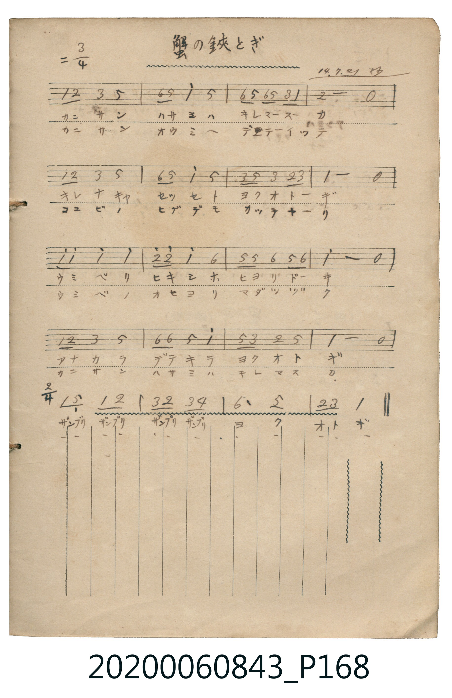

# 蟹の鋏とぎ

> Re:Shōka 使用 AI 協助辨識與重建樂譜，可能會有錯誤。歡迎回報。

- **鋼琴伴奏版**：<br><audio controls src="kani_no_hasamitogi.mp3"></audio>
- **NEUTRINO 歌聲合成版**：<br><audio controls src="kani_no_hasamitogi_neutrino.mp3"></audio>

- 日治時期公學校《唱歌帳》（典藏號 2020.006.0843・P168）
- 大正 14 年 7 月 21 日抄

## 說明


- 出處：《唱歌帳》（國立臺灣歷史博物館典藏號 2020.006.0843）第 P168.jpg 頁。
- 標註：14.7.21 抄（大正 14 年 7 月 21 日抄錄）。
- 調性與拍號：ニ調（D 大調），前四行（第 1–16 小節）為 3/4 拍，末行（第 17–20 小節）轉為 2/4 拍。

### 編曲說明（鋼琴伴奏版）：

1. 前奏 (Intro, 4 小節)：以 3/4 拍輕快華爾滋律動引出螃蟹磨鉗子的海邊情景。
2. 主歌伴奏 (PartA 16 小節 3/4 拍 + PartB 4 小節 2/4 拍)：右手主旋律附雙段歌詞對位，呈現原譜末行變拍之俏皮設計。


## 歌詞

```text
（TMD 檔案未包含歌詞註解）
```

## ABC

<div class="abc-score" data-abc-src="kani_no_hasamitogi.abc" aria-label="五線譜載入中"></div>

[下載 ABC 原始檔](kani_no_hasamitogi.abc)

## TMD 檔案連結

- [主旋律 TMD 檔案](kani_no_hasamitogi.tmd) [[在 TMD Studio 編輯](https://tmdlang.github.io/Tmd-TS/#tmd=s7IKdvYPcrWy4qpTUCpJTLdSSM7PyUlNLsnMz7MqzsjPTkzOyFeCS5bl55TmploBqXgDQ4RwcX5pUXJqfEFieqpVgKGZBboM3KT4vPyS1KT8_GyEioKi_LLUvMQ8oKrcxLzS4uSizIKS-OT8gkqEmtSyzJRUkIrUlMyS_KLMxBwkJ6UWFYMdC3FDSVFiHsQMoCBCVUlGKtDdiXmZuch6gUalZ-ZZleaBjC_JTMtMTUGWLMnITy9KLMiotMrILAbZm5yYE5-dmJeoxKWlpfBi_s7Hjetedvc_blzxuLFPQUuLS9FWwdDQiMveVsGFy8ZY38QOZNiz6Uufbdr9bGbTsznzn7auebp2x7MFCx83dD2dsvHZ2p6nOzY_buh-v6fjaeuOF9P7X8ycr2BkYGSgZ2BgpmdgYWL8uHk3KETf7-kEu-zpkuXP1i5WMDRReLpzi4K5wrM5HQpGhgogO7palLi49LUUbKkFuBQUFB43THg2e9Pz2eterFr1bEbf44aJYNHm3U_bd72YOfX9nllYfDKn-_nq7hftu543Ln62dvvT_k1Pe2c971z5cskKHJ4E-u75mjUKII_qZRWkK7xc0Pi4oQlq07MVM1-s2A20ydBEz1wP5NmuFpAt-ELiZQ9QSSfCjBer9j9rWP6io_1Zdy_QdpCzm7uBgkBzXBSAJoGZne_39Dzt7H06e_aLhT1AGZCTDB81TDY0U3i6of_5-gaQM5t2KQAjVgFoDlD1szmrkZSaA9UaGSDUvtgLVm4EUQ51DOXRAgUKWvpcXMH5eelWAZmJefkONQY11SALFGwstOzADGBa0Hiyo0FT4XHTamAgdAPprUB6s0INkOyH8uaD2UCRprVA1hognve4eQ-QuxNEgcRXKxiA7IKbuKsHq4lNq4B4GdTEGWA72sEmNbdBDFwCZDaDxdsQJtYoGCoYKRgr6CqYAnGNghmQNoxD4YKwMVBZDVChLhgagOTA2n0MIS6EuUUX7BqQTmQfgkT7IaIIX4JEm3ZCRVdDTY5HmGyE02Qkn4JEZ0Dtawfz2sDmIvsV2WT0eIG5pgvEfty8GGz8brBmCN0BNmQFkLceYnFzByxe1mGNl81ADFTePBmI-8CaJwFFNoHd97h5EdS3YAuAbnvcvARqXPMqoiPFGBwhumAlIKXYIwXhNVCAgD0HCT2E90Dh1QENPYQXwaIgV0GUr8MRNQiPgjT0QY1BeBYkuggevTAPg0TBXoYoB9mGO3ZgqXkmWCXMeKDHmrYD2bNhIiC3A-UfN3fComYt1qhBNg4cNeCEBAoOiAEg4-YBcQMQtwBxK1jNepR4iYMiXQgBzBNxIATmmIEFTMFZBhRXZhAN2KMH4RhQkIDCAdV_INHZCFGoE0GiYF_CMhP2uEE1HBo3SL5FthLhY5BoK8Lw9XjjZhE4aUGidiU0_4FTNDjhtWFmGzx5hqTSEVxqoJWLmBkGlGXgcQTKLqCyCyKJK8MgfAQKiJXQ4EH4Cla6YMktBLIKtctHWPhBqj9gNQer40D1atM2oBWPm6eBswQyB2QOHjmon6AJBegnkH-g4VttA7TArhYe1qbx4AAHFUWgYDcBBznIfabgWgJUW6CG7Tawv4GWwTIapgg4WYL8jO4G1LCk1KRaLi5dOwVQvR3tYxirAGcbgdnKXAA)]
- [鋼琴伴奏 TMD 檔案](kani_no_hasamitogi_piano.tmd) [[在 TMD Studio 編輯](https://tmdlang.github.io/Tmd-TS/#tmd=s7IKdvYPcrWy4qpTUCpJTLdSyC8qychPL0osyKi0ysgsLskvykxOzInPTsxLVIIrKs4vLUpOjS9ITE-1CjA0s0DIlGSk5qZapaaUJieWZObnKXFpaSm8mL_zceO6l939jxtXPG7se7-n42X3nucTtjzZs-Xp0v7nnR3v93QqaGlxKdoqGBoacdnbKrhw2Rjrm9iBTH02femzTbufzWx6Nmf-09Y1T9fueLZg4eOGrqdTNj5b2_N0x-bHDd1AE5-27ngxvf_FzPkKRgZGBnoGBmZ6BhYmxo-bd4PcB7QA7MSnS5Y_W7tYwdBE4enOLQrmCs_mdCgYGSqA7OhqUeLi0tdSsKUW4FJQUHjcMOHZ7E3PZ697sWrVsxl9jxsmgkWbdz9t3_Vi5tT3e2Zh8cmc7ueru1-073reuPjZ2u1P-zc97Z31vHPlyyUrcHgS6Lvna9YogDyql1WQrvByQePjhiaoTc9WzHyxYjfQJkMTPXM9kGe7WkC24AuJlz1AJZ0IM16s2v-sYfmLjvZn3b1A20HObu4GCgLNcVEAmgRmdr7f0wOMNAWQmr2dCkYQJlDwZcP8p7uWKUBiF2Ho8-0rgGEDCRisSQJoDUipgoKhnsLTzl6guIKGZ15JUb6OAtDVG_qfr2_QBKp5snupAszePVOf7l_9on_98459z3Z3P93X_bR76lOgIDC05zUDk-HzxStedk5_unbC81ktz7Zuf9nU9ay59dnM9VBXKSgY6Sk82bEbGB0QhyhoBCQWlTgqGJpBLYTZpKCtAJJxgrsE5l-Qi572b37W2Q0yZzrIDS9ntrycPfPZuq1AY1-snPd0Q--TvaBweTqx43n_vqd981-snfNszuoXC3terOsCGvFkZ_eT_f3PZ617sWLtixUdULdRniChQEFLn4sLHI5WAZmJeflBHg41BjXVYP_bWGjZgRk1CoYKRgrGCroKpkBco2AGhCCWYRyYawqUMoJLGgJJEDQA8bhqUUz3QTbdBGF6vEK0YSwY1yiYxAN5JvGxIFGg2SCeKZAHJuBKDSBGg-MDj8OBOVjjyY4GTYXHTauBqawbSG8F0puBBj1u7ofy5oPZQJGmtUDWGiCe97h5D5C7E0SBxFcD7QOGE9zEXT1YTWxaBcTLoCbOANvRDjapuQ1i4BIgsxks3oYwETNwTSEBi-CCsDFQWQ04mBGBC9LuYwhxIcwtumDXgHQi-xAk2g8RRfgSJNq0Eyq6GmpyPMJkI5wmI_kUJDoDal87mNcGNhfZr8gmo8cLzDVdIPbj5sVg43eDNUPoDrAhK4C89RCLmztg8bIOa7xsBmKg8ubJQNwH1jwJKLIJ7L7HzYugvgVbAHTb4-YlUOOaVxEdKcbgCNEFK0FP8YhIQXgNFCBgz0FCD-E9UHh1QEMP4UWwKMhVEOXrcEQNwqMgDX1QYxCeBYkugkcvzMMgUbCXIcpBtuGOHVhqnglWCTMe6LGm7UD2bJgIyO1A-cfNnbCoWYs1apCNA0cNOCGBggNiAMi4eUDcAMQtQNwKVrMeJV7ioAhe_BjFgRCYYwYWMAVnGVBcmUE0YI8ehGNAQQIKB1T_gURnI0ShTgSJgn0Jy0zY4wbVcGjcIPkW2UqEj0GirQjD1-ONm0XgpAWJ2pXQ_AdO0eCE14aZbfDkGZJKR3CpgVYuUlBFIGIE4SNQQKyEBg_CV7DSBUtuIZBVqF0-otY9pFdrOCo5ULVGSZWIRS9cNcgQUjWTWhc74amLq22AjSK7WljKg7ZxkNuGsx43bQNGzuPmaeDCBJkDigE8ctDUAM1iwNQASglIKdM0Hpw8QQU3KJGagBMoKDZNQeUHuG5FTYnbwKkEaAGsWMIUAWdiUApBtxc15VFqEmrIoqQ0bCELjxUohclHjlO0JAIUgUZmUGpxaolvaklqEZYYhaXwanC3DGYvKDNDHYyuG2v-wKlb104B3GRUADLAmSzaB-hMKMcJxkHYgaTOCFkdhKPMBQA)]

## 分析

```text
================================================================================
📊 TMD Song Profile: [ 蟹の鋏とぎ ]
================================================================================
⏱  Duration:       1:00 (60.0s), 48 measures total
🎼 Key & Tempo:    首調基準 D, != 112.0 BPM, <3/4>
   - 分析範圍：      由實際發聲的音符與和弦推測調性；播放脈絡另行呈現
🎤 人聲音域:    A3 (MIDI 57) – E5 (MIDI 76) [跨度: 19 個半音 / 1.6 個八度, 難度: challenging]
   - 最低音:  A3 in [Song[L1] #1 @ m.17, 0:25]
   - 最高音: E5 in [Song[L1] #1 @ m.10, 0:14]
   - 適合: soprano, mezzo-soprano, contralto, tenor, baritone, bass
🏛  結構:      Song[L1] (30.0s) -> Song[L2] (30.0s)
⚡ 編曲密度:        Peak 1 軌道同時演奏
🗝  調性診斷：       D 大調（純淨自然大調，未偵測到可信轉調）
   - 風格氣質:    純淨自然大調（陽光明朗、易唱易記，無明顯調外色彩）
   - 轉調歷程:    全曲維持單一推測調性（未偵測到可信轉調）
   - 核心骨幹音:  D, A, E, F#, B
   - 調性數值:    D 大調 [相關度: 0.92, 穩定度: High, 自然音純度: 100.0%]
   - 候選調性 (K-S): D 大調 (0.92), A 大調 (0.70), B 小調 (0.62)
   - 五度圈歷程:   +2 -> +2
   - 各段落調性細節:
     • [Song[L1] #1]: D 大調 (r: 0.92, 自然音純度: 100.0%)
     • [Song[L2] #1]: D 大調 (r: 0.92, 自然音純度: 100.0%)

  [ 五度圈游移軌跡 ]
               C  
         F            G  
      Bb              [D ]*
      Eb               A  
         Ab           E  
            Db       B  
               F# 
     (* = active key center)

  [ 十二半音累積音高分佈 ]
     C  :                            0.0%
     C# :                            0.0%
     D  : ████████████████████████  32.7%
     D# :                            0.0%
     E  : ███████████               14.4%
     F  :                            0.0%
     F# : ███████████               14.4%
     G  : █                          1.0%
     G# :                            0.0%
     A  : ██████████████████        24.0%
     A# :                            0.0%
     B  : ██████████                13.5%
--------------------------------------------------------------------------------
Assignment 軌道音域：
  - Piano         : A3 – E5 (19 個半音 / 1.6 個八度, 138 個音符)
================================================================================
```


## 原書掃描頁




