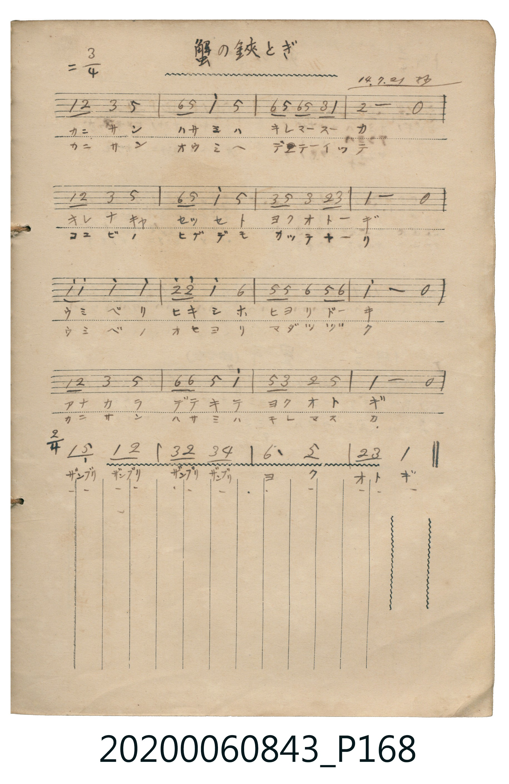

# 蟹の鋏とぎ

<audio controls src="kani_no_hasamitogi.mp3"></audio>

- 日治時期公學校《唱歌帳》（典藏號 2020.006.0843・P168）
- 大正 14 年 7 月 21 日抄

## 說明

・編曲說明（鋼琴伴奏版）：
1. 前奏 (Intro, 4 小節)：以 3/4 拍輕快華爾滋律動引出螃蟹磨鉗子的海邊情景。
2. 主歌伴奏 (PartA 16 小節 3/4 拍 + PartB 4 小節 2/4 拍)：忠實呈現原譜末行變拍之俏皮設計。

## 歌詞

```text
（TMD 檔案未包含歌詞註解）
```

## ABC

```abc
X:1
T:蟹の鋏とぎ
M:3/4
L:1/16
Q:1/4=112
K:D
V:V1 name="Piano" snm="Pia"
[V:V1]
D2 E2 F4 A4 | B2 A2 d4 A4 | B2 A2 B2 A2 F2 D2 | E8 z4 |
D2 E2 F4 A4 | B2 A2 d4 A4 | F2 A2 F4 E2 F2 | D8 z4 |
d2 d2 d4 d4 | e2 e2 d4 B4 | A2 A2 B4 A2 B2 | d8 z4 |
D2 E2 F4 A4 | B2 B2 A4 d4 | A2 F2 E4 A4 | D8 z4 |
[M:2/4] D2 A,2 D2 E2 | F2 E2 F2 G2 | B6 A2 | E2 F2 D4 |
```

## TMD 檔案連結

- [主旋律 TMD 檔案](kani_no_hasamitogi.tmd) [[在 TMD Studio 編輯](https://tmdlang.github.io/Tmd-TS/#tmd=s7IKdvYPcrWy4tLSUngxf-fjxnUvu_sfN6543NinoKXFpWirYGhoxGVvq-DCZWOsb2LHVaeg9Gz60mebdj-b2fRszvynrWuert3xbMHCxw1dT6dsfLa25-mOzY8but_v6XjauuPF9P4XM-crGBkYGegZGJjpGViYGD9u3h1gaGbxfk-nEsiwp0uWP1u7WMHQROHpzi0K5grP5nQoGBkqgOzoalHi4tLXUrClFuBSUFB43DDh2exNz2eve7Fq1bMZfY8bJoJFm3c_bd_1YubU93tmYfHJnO7nq7tftO963rj42drtT_s3Pe2d9bxz5cslK3B4Eui752vWKIA8qpdVkK7wckHj44YmqE3PVsx8sWI30CZDEz1zPZBnu1pAtuALiZc9QCWdCDNerNr_rGH5i472Z929QNtBzm7uBgoCzXFRAJoEZna-39PztLP36ezZLxb2AGVATjJ81DDZ0Ezh6Yb-5-sbQM5s2qUAjFgFoDlA1c_mrEZSag5Ua2SAUPtiL1i5EUQ5kmOae57NXA9yzOxNLxetADrmWX__0_Wrn23d_rKp62VDw7O9654u3ft0ycpnGxYD0w3QohfzmoHJ7em-ec-2zHu-csvzjjXA8H-yr00hJTMnMz01rySnEuiKx42zHzcuBpNAUzufL14B8tq89U87Vz3taHg-q-X56qUv1iyAukQBGGQg5z9f1fi8ZdvzKRthHoO4-8WeqU_3rwZqgnkAZEFDz-OmbY-bNz9unva4eZUCsZzmFY-b1gPFVj1u7njctO5xA9AwUGhDnbFi4dOGxUDfP9u6CmjPs87JwLCB-njOCqDgi66NLxYvBHrnZef0p2sngDwyZf7T7qnAYH66tB8RsM87O57NWQNJqaBQnbPm2aopzxZ2AH3ztG8-MFE9nbbuReOml80rnm9Y-GLtnCc7u5_uX_B0_bJnU3c82dv7tGcaxARQ6pqwGhKn0OhUSKi2AYaDXW2Cwot1XeDQACcvaB6BGA_MBC9WznvauuLZtHagF57sWAtirJr3Yu16YMYBmbqh91l7JzydA80AGwCUebIDlGIeN60GpsvHTVtBYdfQ8Li5H8yeD2IAuU1rHzevedw873HznsdNO8HkaogDGqAIqqILzFgMFtn9uLkZTAJjD2giKCagEQHSvw5N_zKwbTOBsQZWPQlkUNP2x82zoVygfqBUcydY81o0zYvANgO9sBKsuv1xcxvYIW3oNmNYi0gsJHMh5oLEkYwGhigk3IHJAJqSWjuAiQaY5p7sXQBMQJAs8bJ70tOOlU-nA1PL_KfLmp7Nm_NkR-_TJQsg4qDiYMPGp91LgPng6ZwNoCy5dC8wFQLjCpS1Jix_v6cRmoKRci7IcFjmBaZakCGwbAtKxLCci8e0pzNWPp26DIgeNzQSZIPMx2YUctraBSyiMNIWMLigsT0DFlt7QFEFitgloDTT3IYWSZsfNwFjf_LjZmA1AEkbm8DaFoFlgaaD9DxuBmoGGrQKV8ICawZZDkyS4MQEMguYpIFky-PmVmBkoukkLksA8wNGZqBjqnrasQGYCIAR_LRv99Odq4GFxou5y4Bl1ZP964BJ7eWa3pdrZmGmGGBaebYdWE3OgKeYl00toDKvp_H5rp4XE6c_nbgIUfoTSsFUTj1AsyhvQ0CBgpY-F1dwfl66VUBmYl6-Q41BjUI12L02Flp2YAaw5aIBdIImsJpYDSzMu4H0ViC9WaEGSPZDefPBbKBI01ogaw0QgwpDIBdUGoLFVysYgCyDm7irB6uJTaAqahnUxBlgO0AZAEiBcgBQbgmQ2QwWb0OYWKNgqGCkYKygq2AKxDUKZkDaMA6FC8LGQGU1QIW6YGgAkgPnRWQ_wtzfBWIDy2qwo3aDLYXQHWDLVwB54JoTJALz4zqsftwMxEDlzZOBuA-seRJQZBPIZ0C8CBo6YAuAfoLkU7CyVUR70BjsOV2wEpBSfB6EBe5MsA0w5wC93bQdyJ4NEwH5ENxEAFUp0JjF5jtk48C-A8cgKKAgBoCMmwfEDUDcAsStYDXrUbwWB0W6EAIYRXEgBOaYgQVMwTEI8q4ZRAM-Hy6CRh8oUFdCkhAkaMGR24YZf3gij6QkD0rv6IkdM-ZAcQf3KSjeQAkSIok95iDNQWDrD9Him4W7UQeyH48c1OfQiAL6HeRzqFuhTSm4u03jwY4HpS-QF0zAzge5zxScjUDZCeTOWi4uXTsFUCmiAKSVuQA)]
- [鋼琴伴奏 TMD 檔案](kani_no_hasamitogi_piano.tmd) [[在 TMD Studio 編輯](https://tmdlang.github.io/Tmd-TS/#tmd=s7IKdvYPcrWy4tLSUngxf-fjxnUvu_sfN6543Nj3fk_Hy-49zydsebJny9Ol_c87O97v6VTQ0uJStFUwNDTisrdVcOGyMdY3seOqU1B6Nn3ps027n81sejZn_tPWNU_X7ni2YOHjhq6nUzY-W9vzdMfmxw3dQBOftu54Mb3_xcz5CkYGRgZ6BgZmegYWJsaPm3cHGJpZAC1Q4uLS11KwpRbgUlBQeNww4dnsTc9nr3uxatWzGX2PGyaCRZt3P23f9WLm1Pd7ZmFx55zu56u7X7Tvet64-Nna7U_7Nz3tnfW8c-XLJStweAHo9udr1iiAvKGXVZCu8HJB4-OGJqhNL1btf9aw_EVH-7PuXqBOkJXN3UBBoE0uCk-XLAczO9_v6QEGpwJIzd5OBSMIEyj4smH-013LFCDhjjD0-fYVQH9BPIU1soDWgJQqKBjqKTzt7AWKK2h45pUU5esomCg83dD_fH2DJlDNk91LFWD27pn6dP_qF_3rn3fse7a7--m-7qfdU58CBYEhNa8ZmECeL17xsnP607UTns9qebZ1-8umrmfNrc9mroe6SkHBSE_hyY7dwKCEOERBIyCxqMRRwdAMaiHMJgVtBZCME9wlMP-CXPR0_4Kn65c9ndjxvH_f0775L9bOeTZn9YuFPS_WdQFVPNnZ_WR___NZ616sWPtiRQfUasrTChQoaOlzcYGDySogMzEvP8jDocagRqEa7D8bCy07MKNGwVDBSMFYQVfBFIhrFMyAEMQyjANzTYFSRnBJQyAJggYgHlctivE-KMabIIyPV4g2jAXjGgWTeCDPJD4WJAo0HMQzBfLABFypAcRscICT5nRTiLMRXBA2BiqrAXsC4XQitBuDteqClaD7HKo9DorgoWUUB0Jgjhk0-EBuABlpBtFA2BGkBD9SEJER_DgiAxT8lEQdFr1w1SBDSNVMappxwpdmqm2A2dOuFh72pvHgCABFNygaTMBRAApjU3CaAaUdpLCGGo0a1jiMhrgLSmHykX2FFkhAEah3glKLU0t8U0tSi_D7CVR5wSwGJQ4YxGoI9pSCzRCwdl07BXAuVwAyIGUglOEEYiAMxy6vzAUA)]

## 分析

```text
================================================================================
📊 TMD Song Profile: [ 蟹の鋏とぎ ]
================================================================================
⏱  Duration:       0:30 (30.0s), 20 measures total
🎼 Key & Tempo:    首調基準 D, != 112.0 BPM, <3/4>
   - 分析範圍：      由實際發聲的音符與和弦推測調性；播放脈絡另行呈現
🎤 人聲音域:    A3 (MIDI 57) – E5 (MIDI 76) [跨度: 19 個半音 / 1.6 個八度, 難度: challenging]
   - 最低音:  A3 in [Song #1 @ m.17, 0:25]
   - 最高音: E5 in [Song #1 @ m.10, 0:14]
   - 適合: soprano, mezzo-soprano, contralto, tenor, baritone, bass
🏛  結構:      Song (30.0s)
⚡ 編曲密度:        Peak 1 軌道同時演奏
🗝  調性診斷：       D 大調（純淨自然大調，未偵測到可信轉調）
   - 風格氣質:    純淨自然大調（陽光明朗、易唱易記，無明顯調外色彩）
   - 轉調歷程:    全曲維持單一推測調性（未偵測到可信轉調）
   - 核心骨幹音:  D, A, E, F#, B
   - 調性數值:    D 大調 [相關度: 0.92, 穩定度: High, 自然音純度: 100.0%]
   - 候選調性 (K-S): D 大調 (0.92), A 大調 (0.70), B 小調 (0.62)
   - 五度圈歷程:   +2
   - 各段落調性細節:
     • [Song #1]: D 大調 (r: 0.92, 自然音純度: 100.0%)

  [ 五度圈游移軌跡 ]
               C  
         F            G  
      Bb              [D ]*
      Eb               A  
         Ab           E  
            Db       B  
               F# 
     (* = active key center)

  [ 十二半音累積音高分佈 ]
     C  :                            0.0%
     C# :                            0.0%
     D  : ████████████████████████  32.7%
     D# :                            0.0%
     E  : ███████████               14.4%
     F  :                            0.0%
     F# : ███████████               14.4%
     G  : █                          1.0%
     G# :                            0.0%
     A  : ██████████████████        24.0%
     A# :                            0.0%
     B  : ██████████                13.5%
--------------------------------------------------------------------------------
Assignment 軌道音域：
  - Piano         : A3 – E5 (19 個半音 / 1.6 個八度, 69 個音符)
================================================================================
```


## 原書掃描頁




