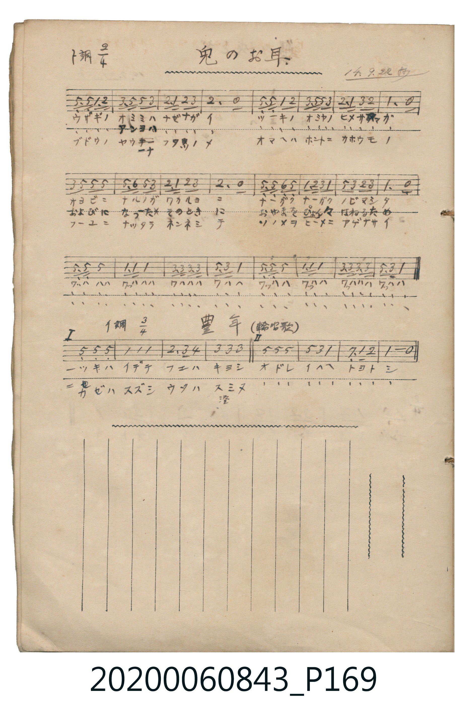

# 豊年 (輪唱歌)

> Re:Shōka 使用 AI 協助辨識與重建樂譜，可能會有錯誤。歡迎回報。

- **鋼琴伴奏版**：<br><audio controls src="honen.mp3"></audio>

- 日治時期公學校《唱歌帳》第一冊（典藏號 2020.006.0843・P169.jpg 下半）

## 說明


- 出處：日治時期公學校《唱歌帳》第一冊（典藏號 2020.006.0843- P169.jpg 下半）
- 調性與拍號：調號 ?= A，拍號 <3/4>，速度 != 108


## 歌詞

```text
> [!NOTE]
> **原頁資訊與歌詞全文**（對應 `P169.jpg` 下半）：
> - **標題與調拍**：標註「`イ調 3/4`」「`豊年 (輪唱歌)`」。
> - **二部輪唱結構**：全曲共 8 小節，分為「`I`」（第 1–4 小節）與「`II`」（第 5–8 小節）兩樂句：
>   當第一聲部唱完前 4 小節進入「`II`」時，第二聲部自「`I`」進入，兩聲部形成三度與五度和諧對位。
> - **字面校勘**：第 6 小節歌詞抄作「`イ ハ ヘ`」（「祝へ」，舊轉錄誤植為「イヘヘ」）；第 4 小節第 2 段「`ス ミ ヌ`」下方旁註漢字「`澄`」。
>
> **一、**
> ［I］ツキハ　イデテ　フエハ　キヨシ
> ［II］オドレ　イハヘ　トヨト　シ
>
> **二、**
> ［I］カゼハ　スズシ　ウタハ　スミヌ（澄）
> ［II］オドレ　イハヘ　トヨト　シ
```

## ABC

<div class="abc-score" data-abc-src="honen.abc" aria-label="五線譜載入中"></div>

[下載 ABC 原始檔](honen.abc)

## TMD 檔案連結

- [主旋律 TMD 檔案](honen.tmd) [[在 TMD Studio 編輯](https://tmdlang.github.io/Tmd-TS/#tmd=s7IKdvYPcrWy4qpTUCpJTLdSSM7PyUlNLsnMz7MqzsjPTkzOyFeCS5bl55TmploBqXgDQ4RwcX5pUXJqfEFieqpVgKGZZRK6FNyo-Lz8ktSk_PxshIqCovyy1LzEPKCq3MS80uLkosyCkvjk_IJKhJrUssyUVJCK4uTEvPiy1KLMtMzUFCR3pRYVg10McUhJUWIexBygIEJVflFJRn56UWJBRqVVRmZxSX5RZnJiTnx2Yl4iQlFaflGuFdAWZI0lGalAXyemA9WX5pSUFqWiSxWnJhbn5xUjW5WZnplnVZoHcncJ1LVaWgovNnY93blFQePFnlVPp2x8trZHU0FLi0vRVsHQwILL3lbBkcvGWN_EDmTOs-lLn23a_Wxm07M585-2rnm6dsezBQsfN3RB9D3dsflxQ_fzNWue7Gh42tb1fk_H09YdL6b3v5g5X8HIwMhAz8DATM_AwsT4cfNuUJToZRWkKzzZ0f20F6i2U4mLS19LwZZagEtBQcFOIVrRzz_ENRbC0dJ62jf_5YLGF5vbX6zoetHRDnTzi5XznraueDatXUsL5N4Nvc_aOxUSYK5LQDjv_Z5ZEFN0geY8WzHz5cIeoAkvVu1_1t0L0jsLKPZixe7HDT0Jj5uWAMUVgIGW8LihFySCGcQQmSaEkU929bxsXgFR8HzrhGfLu8Gmghw3e9PT1o0KFgpPN_Q_X9_wfk_P04625027QAZ7gswBOhwY6AqGjxomm8AVdQJdB1aBrMQUqARhTufT1pXPVjQ97V8K95yCwvOp2yAx-KJxE9BBQNc8XdfztLNXAWb0ywagc5YijAamBqCTQHp29UD0vGhfBXcbRDXIza0roSbuXfSsY8KTHZ1Pdy0DuvHJrilAxtNJPS9WLwcG_5O9qMHydO30l3MXAVPZ0-4Z4AABecMM6hRI_D3ranmydw404BUeN_cD8Qyop4Giz5fOfdy4A8wFxljXi72dL3taXqxa8mxJLyQQgbqAGkAIpAYY0bNBdsC8C2IbKTxbtxViwU6g4fOBGMhu6AUmjmfTdj6b3giM-Gd7FgHdClL0bF8LcuzC0h4wSB83NAJzFpj_fs9uz_d79j5ubnnctBbo5scNDWB3tD9ubgOxm6c-bloBEwcqWPG4aTtCJ1hr06rHzZ2Pm9fAtPaDvQDU2gFSDiRB4hBNcDfs6sHihqbVj5v2wOza-RgYKE3bwexlj5v2I8Sb5wO9DQxToP-AwUS2YyjP2lCgoKXPxeWRn5eaZxWWn5mcauhQY1BTDbJCwcZCC-xnhRoF03hgOkIQNQqGQBKGa4BRqwuExsDoBvGMwWwIrgEb4GNYA4ztFiAfGA0gEpi8QCpBSQ3EaweTbRCx5qlg04Axh6QOomsFWHw7wlwjkNxqsOgeFHN3gsV2IdQD6WVQc_ejqwOmRRDZAzYX5mOQX6EYwgN5B-Jdc1AYgDggf0PCAgQNUP3btApsaieYXIPiX5DtwKiF-rcD4i6g7yBskDqQm0EQHNpIfqWemVB_ghwNgyTw4N6EBAVMDdE8uJfI1V-LkmqNsKbaoeq30UwHVjgMMx0w1eraKYATbrSPYawCgmME5ihzAQA)]
- [鋼琴伴奏 TMD 檔案](honen_piano.tmd) [[在 TMD Studio 編輯](https://tmdlang.github.io/Tmd-TS/#tmd=s7IKdvYPcrWy4tLSUnixsevpzi0KGi_2rHo6ZeOztT2a7_d0vOze83zClid7tjxd2v-8s-P9nk4FLS0uRVsFQwMLLntbBUcuG2N9EzuuOgWlZ9OXPtu0-9nMpmdz5j9tXfN07Y5nCxY-buiCGPZ0x-bHDd3P16x5sqPhaVsX0OinrTteTO9_MXO-gpGBkYGegYGZnoGFifHj5t0BhmaWelkF6QpPdnQ_7QWq7VTi4vLMKynKtwrITMzLD_JwqDGoqeZSAAIbCy07MKNGwVRBF44hPGMgNgTzzOOBFIhjBOaCBEHQAMTjqkUx3QfZdBO46YbxCqZghMI0jY9XMEIRNoAY6JGfl5qH37kgJyEIiKNguAbsUJAPTMA8kE9guAZsgI9hjcLj5hYg_3HTWhDZ3A9W-bhpCZjXDibbIGLNU8GmPW5agaQOomsFWHw7wlwjkNxqsOgeFHN3gsV2IdQD6WVQc_ejq2ueDyZ7wOZSGkFw_zatApvaCSbXoPgXZPvj5hlQ_3ZA3AX0HYQNUgdyMwiCQxvJr9QzE-pPkKNhkAQe3JuQoICpIZoH9xK5-lGTrRHWVDtU_Taa6cAKh2GmQ021OEpvzHIaufg2AVLI4sQU-ebx8dpAilRtIAqtqtC1UwBXPwpABtgn0T6GsUgcIzBHmQsA)]

## 分析

```text
================================================================================
📊 TMD Song Profile: [ 豊年 輪唱歌 ]
================================================================================
⏱  Duration:       0:40 (40.0s), 24 measures total
🎼 Key & Tempo:    首調基準 A, != 108.0 BPM, <3/4>
   - 分析範圍：      由實際發聲的音符與和弦推測調性；播放脈絡另行呈現
🎤 人聲音域:    E4 (MIDI 64) – E5 (MIDI 76) [跨度: 12 個半音 / 1.0 個八度, 難度: easy]
   - 最低音:  E4 in [Honen[L1] #1 @ m.1, 0:00]
   - 最高音: E5 in [Honen[L1] #1 @ m.5, 0:06]
   - 適合: soprano, mezzo-soprano, contralto, tenor, baritone, bass
🏛  結構:      Honen[L1] (20.0s) -> Honen[L2] (20.0s)
⚡ 編曲密度:        Peak 2 軌道同時演奏
🗝  調性診斷：       A 大調（純淨自然大調，未偵測到可信轉調）
   - 風格氣質:    純淨自然大調（陽光明朗、易唱易記，無明顯調外色彩）
   - 轉調歷程:    全曲維持單一推測調性（未偵測到可信轉調）
   - 核心骨幹音:  E, A, C#, B, G#
   - 調性數值:    A 大調 [相關度: 0.89, 穩定度: High, 自然音純度: 100.0%]
   - 候選調性 (K-S): A 大調 (0.89), E 大調 (0.76), C# 小調 (0.71)
   - 五度圈歷程:   +3 -> +3
   - 各段落調性細節:
     • [Honen[L1] #1]: A 大調 (r: 0.89, 自然音純度: 100.0%)
     • [Honen[L2] #1]: A 大調 (r: 0.89, 自然音純度: 100.0%)

  [ 五度圈游移軌跡 ]
               C  
         F            G  
      Bb               D  
      Eb              [A ]*
         Ab           E  
            Db       B  
               F# 
     (* = active key center)

  [ 十二半音累積音高分佈 ]
     C  :                            0.0%
     C# : ███████████████           19.6%
     D  : ███                        4.3%
     D# :                            0.0%
     E  : ████████████████████████  30.4%
     F  :                            0.0%
     F# :                            0.0%
     G  :                            0.0%
     G# : █████                      6.5%
     A  : ██████████████████████    28.3%
     A# :                            0.0%
     B  : █████████                 10.9%
--------------------------------------------------------------------------------
Assignment 軌道音域：
  - Voice1        : E4 – E5 (12 個半音 / 1.0 個八度, 44 個音符)
  - Voice2        : E4 – E5 (12 個半音 / 1.0 個八度, 44 個音符)
================================================================================
```


## 原書掃描頁




