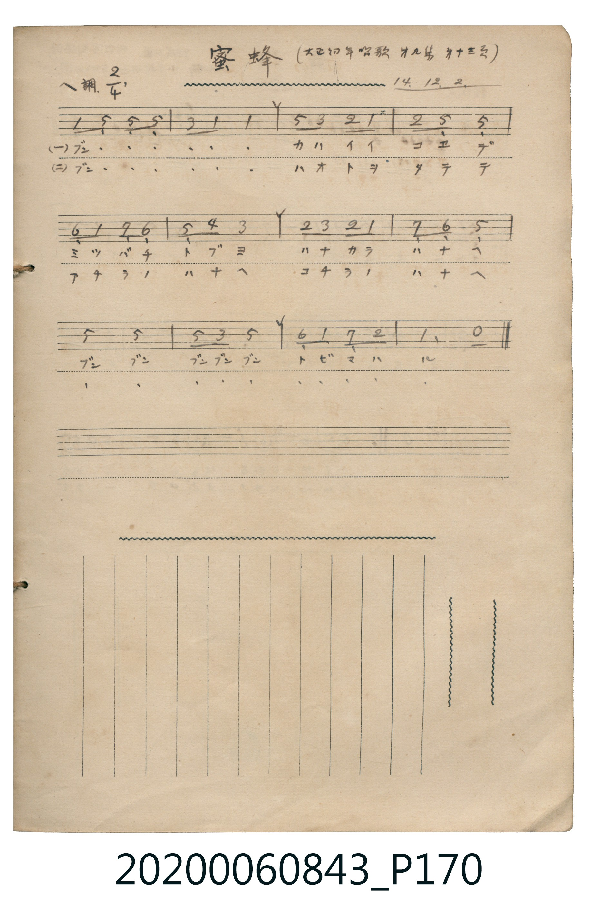

# 蜜蜂

> Re:Shōka 使用 AI 協助辨識與重建樂譜，可能會有錯誤。歡迎回報。

- **鋼琴伴奏版**：<br><audio controls src="mitsubachi.mp3"></audio>

- 日治時期公學校《唱歌帳》（典藏號 2020.006.0843・P170）
- 原載《大正幼年唱歌》第九集第 23 頁（大正 14 年 12 月 2 日抄）

## 說明


- 出處：《唱歌帳》（國立臺灣歷史博物館典藏號 2020.006.0843）第 P170.jpg 頁。
- 標註：（大正幼年唱歌 第九集 廿三頁）14.12.2.（大正 14 年 12 月 2 日抄錄）。
- 調性與拍號：ヘ調（F 大調），2/4 拍。
- 背景與曲風：改編自波希米亞／德國著名童謠《Summ, summ, summ, Bienchen summ herum》（霍夫曼- 馮- 法勒斯雷本作詞）。
本頁抄錄自《大正幼年唱歌》第九集之版本，前四小節獨特地由主音與低音屬音展開（`1 5_ 5_ 5_ | 3 1 1 -`），
中段與末段描繪蜜蜂「ブンブン」從這朵花飛向那朵花採蜜的可愛模樣。
- 版本說明：本檔案忠實依原頁手抄簡譜數位化。
【原頁歌詞全文與中文語譯】（對應 P170.jpg）

### 編曲說明（鋼琴伴奏版）：

1. 前奏 (Intro, 4 小節)：取末樂句「ブンブン トビマハル」旋律，輕快地引出蜜蜂飛舞情景。
2. 主歌伴奏 (Song, 12 小節 × 2 段)：左手以輕巧的八分音符伴奏襯托童謠旋律。


## 歌詞

```text
（一）ブン・・・　・・・　カハイイ　コエデ
ミツバチ　トブヨ　ハナカラ　ハナヘ
ブン　ブン　ブンブンブン　トビマハル
從花朵飛向花朵，嗡嗡、嗡嗡嗡地到處飛舞。）

（二）ブン・・・　・・・　ハオトヲ　タテテ
アチラノ　ハナヘ　コチラノ　ハナヘ
ブン　ブン　ブンブンブン　トビマハル
飛向那邊的花朵、飛向這邊的花朵，嗡嗡、嗡嗡嗡地到處飛舞。）
```

## ABC

<div class="abc-score" data-abc-src="mitsubachi.abc" aria-label="五線譜載入中"></div>

[下載 ABC 原始檔](mitsubachi.abc)

## TMD 檔案連結

- [主旋律 TMD 檔案](mitsubachi.tmd) [[在 TMD Studio 編輯](https://tmdlang.github.io/Tmd-TS/#tmd=s7IKdvYPcrWy4qpTUCpJTLdSSM7PyUlNLsnMz7MqzsjPTkzOyFeCS5bl55TmploBqXgDQ4RwcX5pUXJqfEFieqpVgKG5AboM3KT4vPyS1KT8_GyEioKi_LLUvMQ8oKrcxLzS4uSizIKS-OT8gkqEmtSyzJRUkIrUlMyS_KLMxBwkJ6UWFYMdC3FDSVFiHsQMoCBCVUlGKtDdiXmZuch6gUalZ-ZZ5aZmZmXGl6RWlKA6DSpdkpgJdH88EJcnxucmZublJOalIKsqychPL0osyKi0ysgsBrkvOTEnPjsxL1GJS0tL4cWcOS_mNCloaXEp2ioYGhpx2dsquHHZGOmb2IHMeDZ96bNNu5_NbHo2Z_7T1jVP1-54tmDh44aup1M2Plvb83TH5scN3e_3dDxt3fFiev-LmfMVjAyMDPQMDMz0DCxMjB837wYF-Ps9nWAHPe2b_2JPJ0j3kuXP1i5-unPP051bICYBjXm-Zs2TnXNfzm4DMhSMjBVeLmgEmQxWqmBoogBUq2BopPBsTocCkAS6q6sFbDCXvpaCLbUAl4KCwuOGCc9mb3o-e92LVauezeh73DARLNq8-2n7rhczp77fMwtLAMzpfr66-0X7rueNi5-t3f60f9PT3lnPO1e-XLICR9gA3Q7yKCh89LIK0kHefdzQBLXp2YqZL1bsBtoEDwHkwFKAB5XC0937n-zoBAdVp6GJnqGRnpEeoVB72QMKOIRlL1btf9aw_EVH-7PuXqAzQf5rngEUBJrjpgA0CczsfL-nB5goFIBqkHQ29zybuR6kc_aml4tWAHU-m7Lz-fYVL9pXPdu86OmOnucbNz_ZNe_9nv6n-7YDg-jFxOlPJ_Q-X730xZoFwDAMLs3N1VEoRiKdMoEZKSM1D8xVyEgtKs2FhO_LOb1Pl6x-NnsP0NaXy9aBgmjz1Kfdk55NW_9y9vZnc9Y82TvnxUqgTTB_KQC9vAYYLhD_Ah1EMNk92dn9vLMDqAvo06edvU9nz366of_5-obnvSued-58OmfD8ykbn-zY_XL-ZqCHn-ztAzKeblwDJqe-nAZyZIKhgmk8FNUoGCsYAqFuAiTsIG56smPts3VbQQE2ZzWQ8ay___nOVZAs-Lih53HztMfNm6FkQ-_TffNeNsx8Nmfri66NLxfPfjph4sumxRDus76FQF3PZ7U87V__rGX2sxULn61YjIgXiD8gyRcUKXPWPFs15dnCjqf7Fzxdv-zJvrnAnAgKm85uYPA837Dwxdo5z6bueLK392nPNJAp0FwAVbW2BxiyT1tXPJvWDvI50AtAxqp5L9auB2YNUGLb0PusvROekoH-BRsAlHmyowEUI1Bv7YaihgYUdtPqx839j5uWgBCIu_lx04rHze0Qr8x_3NzyuHnC42Zg5gBq6wCbtQLM7n_c3AXWvBLBbZ4B0QYJQaAoKgMlfCHGTX7cPA-seTXUzRCfAUPt6fSFEASMPUgUPZ-yAhLewIB_0bgJGPXAaHm-f8rTaZve75kNiWFgpIHiZ85WSIxB2KAUBTbqcUMj3FhginrasQFYoABVvuiYBwx35JDb1UM45EDBtgrsi03gkNv_uLkNiMBB0LQIFGbAsGkGFmCI4IGGMDYp2oQcsLx42j31-f7WF20Nz2fuARWhoJADlijQAIOn7JdNXaBwBQcYMJyg4g0zkcVJCEig0ZRXB1CgoKXPxRWcn5duFZCZmJfvUGNQUw12vY2Flh2YAayDNICpXRMagqBMCMc16Lym1UBWP5BeAsYgEaCOphVA0XaQVXADd_UQZyDYsFVAugOIN4EN3A9ktYEx1MAaYGGEWToBWaZAthGQXQMkIbJAUXA6RPbVfCBuAeIJQNwIthNk1zQgXgFzQXMX1GsrkUWaZ2B6qWkR2BSQSmAiRFMNDQ6c8nD_mMUDXW0eD6KBvohXMAF6BOQhI7iHIJJYfAQMN9TABVMge5D5SMIgz04G4nlgp4BEVisYIJxiCrQBhCGhCWHBnGcEDnpdIDQAuqKWi0vXTgGUlhSAtDIXAA)]
- [鋼琴伴奏 TMD 檔案](mitsubachi_piano.tmd) [[在 TMD Studio 編輯](https://tmdlang.github.io/Tmd-TS/#tmd=s7IKdvYPcrWy4qpTUCpJTLdSyC8qychPL0osyKi0ysgsLskvykxOzInPTsxLVIIrKs4vLUpOjS9ITE-1CjA0N0DIlGSk5qZapaaUJieWZObnKXFpaSm8mDPnxZym93s6XnbveT5hy5M9W54u7X_e2fF-T6eClhaXoq2CoaERl72tghuXjZG-iR3IsGfTlz7btPvZzKZnc-Y_bV3zdO2OZwsWPm7oejpl47O1PU93bH7c0A008WnrjhfT-1_MnK9gZGBkoGdgYKZnYGFi_Lh5N8hZQAvALnvaN__Fnk6Q7iXLn61d_HTnnqc7t0BMAhrzfM2aJzvnvpzdBmQoGBkrvFzQqMTFpa-lYEstwKWgoPC4YcKz2Zuez173YtWqZzP6HjdMBIs2737avuvFzKnv98zC4rs53c9Xd79o3_W8cfGztduf9m962jvreefKl0tW4PA40McgX4A8r5dVkA7yy-OGJqhNL1btf9aw_EVH-7PuXqBOkJXNM4CCQJvcFIBBA2Z2vt_TA4wEBaAaIOtlw_ynu5YpQKIIYdLz7SuAnoH4BGu8As0GKVVQMNRTeNrZCxRX0PDMKynK11EwUXi6of_5-gZNoJqn_dOezVn9bEXT0_6ljxt6HjdPe9y8GUICrel43Dz5cfO8x839j5tXP27ofTa9--k-YLj0vNgz9en-1U_nbHgKZACDD5y-Xi6e_aJj3rPm1mcz10NdqqBgpKfwZMduYJhCHKegEZyfl66jYGgEdYTC4ekKRgrP1m0Fu2b7smed3U92LwWZv33581ktT1tXP-1oezl_8_M1yyAmvFi6_lnnjOerl75YswDiHqhdlKcSKFDQ0ufiAoeVVUBmYl5-kIdDjUFNNdg_NhZadmBGjYKpgi4Yg1jGUJZZvIKhgnk80Ec1QIYuEBoo1HDVohjng904w3iFaMNYGIXJN4kHskziYxVMQQxTIANZDdQaUODidbQhUDsU1QBdbQh2JcQHRkB2DZCEyAJFoVpgfgLSQIXxwORjDNZjBNcDkUTRRFLgIFxNZtjAgwRTBBFaULPwhyPp5lEl3nTtFMApRAHIAIUGMq3MBQA)]

## 分析

```text
================================================================================
📊 TMD Song Profile: [ 蜜蜂 ]
================================================================================
⏱  Duration:       0:12 (12.9s), 12 measures total
🎼 Key & Tempo:    首調基準 F, != 112.0 BPM, <2/4>
   - 分析範圍：      由實際發聲的音符與和弦推測調性；播放脈絡另行呈現
🎤 人聲音域:    C4 (MIDI 60) – C5 (MIDI 72) [跨度: 12 個半音 / 1.0 個八度, 難度: easy]
   - 最低音:  C4 in [Song #1 @ m.1, 0:00]
   - 最高音: C5 in [Song #1 @ m.3, 0:02]
   - 適合: soprano, mezzo-soprano, contralto, tenor, baritone, bass
🏛  結構:      Song (12.9s)
⚡ 編曲密度:        Peak 1 軌道同時演奏
🗝  調性診斷：       C 調性不明確（純淨自然大調，未偵測到可信轉調）
   - 風格氣質:    純淨自然大調（陽光明朗、易唱易記，無明顯調外色彩）
   - 轉調歷程:    全曲維持單一推測調性（未偵測到可信轉調）
   - 核心骨幹音:  C, F, A, G, D
   - 調性數值:    C 調性不明確 [相關度: 0.86, 穩定度: Ambiguous, 自然音純度: 97.9%]
   - 候選調性 (K-S): C 大調 (0.86), F 大調 (0.85), A 小調 (0.66)
   - 五度圈歷程:   +0
   - 各段落調性細節:
     • [Song #1]: C 調性不明確 (r: 0.86, 自然音純度: 97.9%, 調外音: A#)

  [ 五度圈游移軌跡 ]
              [C ]*
         F            G  
      Bb               D  
      Eb               A  
         Ab           E  
            Db       B  
               F# 
     (* = active key center)

  [ 十二半音累積音高分佈 ]
     C  : ████████████████████████  36.2%
     C# :                            0.0%
     D  : ██████                     8.5%
     D# :                            0.0%
     E  : ████                       6.4%
     F  : ████████████████          23.4%
     F# :                            0.0%
     G  : ███████                   10.6%
     G# :                            0.0%
     A  : ████████                  12.8%
     A# : █                          2.1%
     B  :                            0.0%
--------------------------------------------------------------------------------
Assignment 軌道音域：
  - Piano         : C4 – C5 (12 個半音 / 1.0 個八度, 38 個音符)
================================================================================
```


## 原書掃描頁




