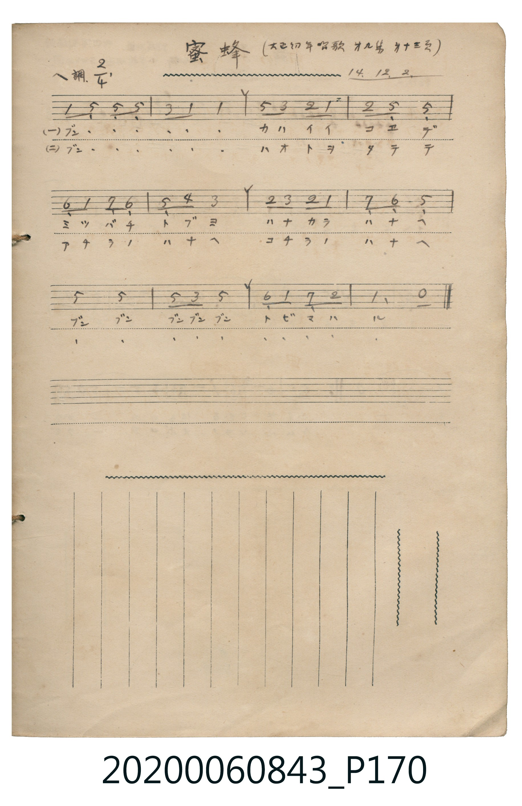

# 蜜蜂

> Re:Shōka 使用 AI 協助辨識與重建樂譜，可能會有錯誤。歡迎回報。

- **鋼琴伴奏版**：<br><audio controls src="mitsubachi.mp3"></audio>

- 日治時期公學校《唱歌帳》（典藏號 2020.006.0843・P170）
- 原載《大正幼年唱歌》第九集第 23 頁（大正 14 年 12 月 2 日抄）

## 說明


- 出處：《唱歌帳》（國立臺灣歷史博物館典藏號 2020.006.0843）第 P170.jpg 頁。
- 標註：（大正幼年唱歌 第九集 廿三頁）14.12.2.（大正 14 年 12 月 2 日抄錄）。
- 調性與拍號：ヘ調（F 大調），2/4 拍。
- 背景與曲風：改編自波希米亞／德國著名童謠《Summ, summ, summ, Bienchen summ herum》（霍夫曼- 馮- 法勒斯雷本作詞）。
本頁抄錄自《大正幼年唱歌》第九集之版本，前四小節獨特地由主音與低音屬音展開（`1 5_ 5_ 5_ | 3 1 1 -`），
中段與末段描繪蜜蜂「ブンブン」從這朵花飛向那朵花採蜜的可愛模樣。
- 版本說明：本檔案忠實依原頁手抄簡譜數位化。
【原頁歌詞全文與中文語譯】（對應 P170.jpg）

### 編曲說明（鋼琴伴奏版）：

1. 前奏 (Intro, 4 小節)：取末樂句「ブンブン トビマハル」旋律，輕快地引出蜜蜂飛舞情景。
2. 主歌伴奏 (Song, 12 小節 × 2 段)：左手以輕巧的八分音符伴奏襯托童謠旋律。


## 歌詞

```text
（一）ブン・・・　・・・　カハイイ　コエデ
ミツバチ　トブヨ　ハナカラ　ハナヘ
ブン　ブン　ブンブンブン　トビマハル
從花朵飛向花朵，嗡嗡、嗡嗡嗡地到處飛舞。）

（二）ブン・・・　・・・　ハオトヲ　タテテ
アチラノ　ハナヘ　コチラノ　ハナヘ
ブン　ブン　ブンブンブン　トビマハル
飛向那邊的花朵、飛向這邊的花朵，嗡嗡、嗡嗡嗡地到處飛舞。）
```

## ABC

<div class="abc-score" data-abc-src="mitsubachi.abc" aria-label="五線譜載入中"></div>

[下載 ABC 原始檔](mitsubachi.abc)

## TMD 檔案連結

- [主旋律 TMD 檔案](mitsubachi.tmd) [[在 TMD Studio 編輯](https://tmdlang.github.io/Tmd-TS/#tmd=s7IKdvYPcrWy4qpTUCpJTLdSSM7PyUlNLsnMz7MqzsjPTkzOyFeCS5bl55TmploBqXgDQ4RwcX5pUXJqfEFieqpVgKG5AboM3KT4vPyS1KT8_GyEioKi_LLUvMQ8oKrcxLzS4uSizIKS-OT8gkqEmtSyzJRUkIrUlMyS_KLMxBwkJ6UWFYMdC3FDSVFiHsQMoCBCVUlGKtDdiXmZuch6gUalZ-ZZ5aZmZmXGl6RWlKA6DSpdkpgJdH88EJcnxucmZublJOalKHFpaSm8mDPnxZwmBS0tLkVbBUNDIy57WwU3LhsjfRM7kCHPpi99tmn3s5lNz-bMf9q65unaHc8WLHzc0PV0ysZna3ue7tj8uKH7_Z6Op607XkzvfzFzvoKRgZGBnoGBmZ6BhYnx4-bdoLB8v6cT7KKnffNf7OkE6V6y_NnaxU937nm6cwvEJKAxz9esebJz7svZbUCGgpGxwssFjSCTwUoVDE0UgGoVDI0Uns3pUACSQHd1tYAN5tLXUrClFuBSUFB43DDh2exNz2eve7Fq1bMZfY8bJoJFm3c_bd_1YubU93tmYQmAOd3PV3e_aN_1vHHxs7Xbn_Zveto763nnypdLVuAIG6DbQR4FhY9eVkE6yLuPG5qgNj1bMfPFit1Am-AhgBxYCvCgUni6e_-THZ3goOo0NNEzNNIz0iMUai97QAGHsOzFqv3PGpa_6Gh_1t0LdCbIf80zgIJAc9wUgCaBmZ3v9_QAE4UCUA2SzuaeZzPXg3TO3vRy0QqgzmdTdj7fvuJF-6pnmxc93dHzfOPmJ7vmvd_T_3TfdmAQvZg4_emE3uerl75YswAYhsGlubk6CsVIpFMmMI9kpOaBuQoZqUWluZDwfTmn9-mS1c9m7wHa-nLZOlAQbZ76tHvSs2nrX87e_mzOmid757xYCbQJ5i8FoJfXAMMF4l-ggwgmuyc7u593dgB1AX36tLP36ezZTzf0P1_f8Lx3xfPOnU_nbHg-ZeOTHbtfzt8M9PCTvX1AxtONa8Dk1JfTQI5MMFQwjYeiGgVjBUMg1E2AhB3ETU92rH22bisowOasBjKe9fc_37kKkgUfN_Q8bp72uHkzlGzofbpv3suGmc_mbH3RtfHl4tlPJ0x82bQYwn3WtxCo6_mslqf965-1zH62YuGzFYsR8QLxByT5giJlzppnq6Y8W9jxdP-Cp-uXPdk3F5gTQWHT2Q0MnucbFr5YO-fZ1B1P9vY-7ZkGMgWaC6Cq1vYAQ_Zp64pn09pBPgd6AchYNe_F2vXArAFKbBt6n7V3wlMy0L9gA4AyT3Y0gGIE6q3dUNTQgMJuWv24uf9x0xIQAnE3P25a8bi5HeKV-Y-bWx43T3jcDMwcQG0dYLNWgNn9j5u7wJpXIrjNMyDaICEIFEVloIQvxLjJj5vngTWvhroZ4jNgqD2dvhCCgLEHiaLnU1ZAwhsY8C8aNwGjHhgtz_dPeTpt0_s9syExDIw0UPzM2QqJMQgblKLARj1uaIQbC0xRTzs2AAsUoMoXHfOA4Y4ccrt6CIccKNhWgX2xCRxy-x83twEROAiaFoHCDBg2zcACDBE80BDGJkWbkAOWF0-7pz7f3_qireH5zD2gIhQUcsASBRpg8JT9sqkLFK7gAAOGE1S8YSayOAkBCTSa8uoAChS09Lm4gvPz0q0CMhPz8h1qDGqqwa63sdCyAzOAdZAGMLVrQkMQlAnhuAad17QayOoH0kvAGCQC1NG0AijaDrIKbuCuHuIMBBu2Ckh3APEmsIH7gaw2MIYaWAMsjDBLJyDLFMg2ArJrgCREFigKTofIvpoPxC1APAGIG8F2guyaBsQrYC5o7oJ6bSWySPMMTC81LQKbAlIJTIRoqqHBgVMe7h-zeKCrzeNBNNAX8QomQI-APGQE9xBEEouPgOGGGrhgCmQPMh9JGOTZyUA8D-wUkMhqBQOEU0yBNoAwJDQhLJjzjMBBrwuEBkBX1HJx6dopgNKSApBW5gIA)]
- [鋼琴伴奏 TMD 檔案](mitsubachi_piano.tmd) [[在 TMD Studio 編輯](https://tmdlang.github.io/Tmd-TS/#tmd=s7IKdvYPcrWy4tLSUngxZ86LOU3v93S87N7zfMKWJ3u2PF3a_7yz4_2eTgUtLS5FWwVDQyMue1sFNy4bI30TO646BaVn05c-27T72cymZ3PmP21d83TtjmcLFj5u6Ho6ZeOztT1Pd2x-3NANNPFp644X0_tfzJyvYGRgZKBnYGCmZ2BhYvy4eXeAobkB0AIlkGFP--a_2NMJ0r1k-bO1i5_u3PN05xaISUBjnq9Z82Tn3Jez24AMBSNjhZcLGpW4uPS1FGypBbgUFBQeN0x4NnvT89nrXqxa9WxG3-OGiWDR5t1P23e9mDn1_Z5ZWHw3p_v56u4X7bueNy5-tnb70_5NT3tnPe9c-XLJChweB_oY5AuQ5_WyCtJBfnnc0AS16cWq_c8alr_oaH_W3QvUCbKyeQZQEGiTmwIwaMDMzvd7eoCRoABUA2S9bJj_dNcyBUgUIUx6vn0F0DMQn2CNV6DZIKUKCoZ6Ck87e4HiChqeeSVF-ToKJgpPN_Q_X9-gCVTztH_aszmrn61oetq_9HFDz-PmaY-bN0NIoDUdj5snP26e97i5_3Hz6scNvc-mdz_dBwyXnhd7pj7dv_rpnA1PgQxg8IHT18vFs190zHvW3Pps5nqoSxUUjPQUnuzYDQxTiOMUNILz89J1FAyNoI5QODxdwUjh2bqtYNdsX_ass_vJ7qUg87cvfz6r5Wnr6qcdbS_nb36-ZhnEhBdL1z_rnPF89dIXaxZA3AO1i_JUAgUKWvpcXOCwsgrITMzLD_JwqDGoqQb7x8ZCyw7MqFEwVdAFYxDLGMoyi1cwVDCPB_qoBsjQBUIDhRquWhTjfLAbZxivEG0YC6Mw-SbxQJZJfKyCKYhhCmQgq4FaAwpcvI42BGqHohqgqw3BroT4wAjIrgGSEFmgKFQLzE9AGqgwHph8jMF6jOB6IJIomkgKHISryQwbeJBgiiBCC2oW_nAk3TyqxJuunQI4hSgAGaDQQKaVuQA)]

## 分析

```text
================================================================================
📊 TMD Song Profile: [ 蜜蜂 ]
================================================================================
⏱  Duration:       0:12 (12.9s), 12 measures total
🎼 Key & Tempo:    首調基準 F, != 112.0 BPM, <2/4>
   - 分析範圍：      由實際發聲的音符與和弦推測調性；播放脈絡另行呈現
🎤 人聲音域:    C4 (MIDI 60) – C5 (MIDI 72) [跨度: 12 個半音 / 1.0 個八度, 難度: easy]
   - 最低音:  C4 in [Song #1 @ m.1, 0:00]
   - 最高音: C5 in [Song #1 @ m.3, 0:02]
   - 適合: soprano, mezzo-soprano, contralto, tenor, baritone, bass
🏛  結構:      Song (12.9s)
⚡ 編曲密度:        Peak 1 軌道同時演奏
🗝  調性診斷：       C 調性不明確（純淨自然大調，未偵測到可信轉調）
   - 風格氣質:    純淨自然大調（陽光明朗、易唱易記，無明顯調外色彩）
   - 轉調歷程:    全曲維持單一推測調性（未偵測到可信轉調）
   - 核心骨幹音:  C, F, A, G, D
   - 調性數值:    C 調性不明確 [相關度: 0.86, 穩定度: Ambiguous, 自然音純度: 97.9%]
   - 候選調性 (K-S): C 大調 (0.86), F 大調 (0.85), A 小調 (0.66)
   - 五度圈歷程:   +0
   - 各段落調性細節:
     • [Song #1]: C 調性不明確 (r: 0.86, 自然音純度: 97.9%, 調外音: A#)

  [ 五度圈游移軌跡 ]
              [C ]*
         F            G  
      Bb               D  
      Eb               A  
         Ab           E  
            Db       B  
               F# 
     (* = active key center)

  [ 十二半音累積音高分佈 ]
     C  : ████████████████████████  36.2%
     C# :                            0.0%
     D  : ██████                     8.5%
     D# :                            0.0%
     E  : ████                       6.4%
     F  : ████████████████          23.4%
     F# :                            0.0%
     G  : ███████                   10.6%
     G# :                            0.0%
     A  : ████████                  12.8%
     A# : █                          2.1%
     B  :                            0.0%
--------------------------------------------------------------------------------
Assignment 軌道音域：
  - Piano         : C4 – C5 (12 個半音 / 1.0 個八度, 38 個音符)
================================================================================
```


## 原書掃描頁




