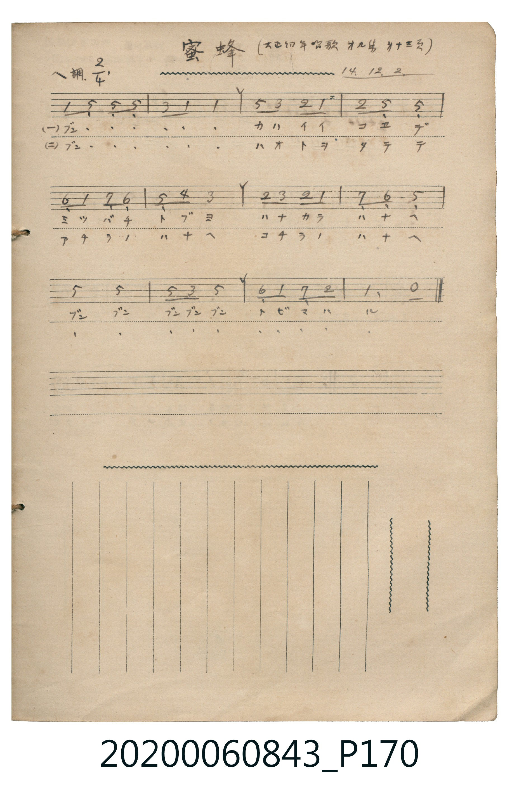

# 蜜蜂

<audio controls src="mitsubachi.mp3"></audio>

- 日治時期公學校《唱歌帳》（典藏號 2020.006.0843・P170）
- 原載《大正幼年唱歌》第九集第 23 頁（大正 14 年 12 月 2 日抄）

## 說明

【曲目說明】
・出處：《唱歌帳》（國立臺灣歷史博物館典藏號 2020.006.0843）第 P170.jpg 頁。
・標註：（大正幼年唱歌 第九集 廿三頁）14.12.2.（大正 14 年 12 月 2 日抄錄）。
・調性與拍號：ヘ調（F 大調），2/4 拍。
・背景與曲風：改編自波希米亞／德國著名童謠《Summ, summ, summ, Bienchen summ herum》（霍夫曼・馮・法勒斯雷本作詞）。
本頁抄錄自《大正幼年唱歌》第九集之版本，前四小節獨特地由主音與低音屬音展開（`1 5_ 5_ 5_ | 3 1 1 -`），
中段與末段描繪蜜蜂「ブンブン」從這朵花飛向那朵花採蜜的可愛模樣。
・版本說明：本檔案忠實依原頁手抄簡譜數位化。
【原頁歌詞全文與中文語譯】（對應 P170.jpg）

・編曲說明（鋼琴伴奏版）：
1. 前奏 (Intro, 4 小節)：取末樂句「ブンブン トビマハル」旋律，輕快地引出蜜蜂飛舞情景。
2. 主歌伴奏 (Song, 12 小節 × 2 段)：左手以輕巧的八分音符伴奏襯托童謠旋律。

## 歌詞

```text
（一）ブン・・・　・・・　カハイイ　コエデ
ミツバチ　トブヨ　ハナカラ　ハナヘ
ブン　ブン　ブンブンブン　トビマハル
從花朵飛向花朵，嗡嗡、嗡嗡嗡地到處飛舞。）

（二）ブン・・・　・・・　ハオトヲ　タテテ
アチラノ　ハナヘ　コチラノ　ハナヘ
ブン　ブン　ブンブンブン　トビマハル
飛向那邊的花朵、飛向這邊的花朵，嗡嗡、嗡嗡嗡地到處飛舞。）
```

## ABC

```abc
X:1
T:蜜蜂
M:2/4
L:1/16
Q:1/4=112
K:F
V:V1 name="Piano" snm="Pia"
[V:V1]
F2 C2 C2 C2 | A2 F2 F4 | c2 A2 G2 F2 | G2 C2 C4 |
D2 F2 E2 D2 | C2 B2 A4 | G2 A2 G2 F2 | E2 D2 C4 |
c4 c4 | c2 A2 c4 | D2 F2 E2 G2 | F6 z2 |
```

## TMD 檔案連結

- [主旋律 TMD 檔案](mitsubachi.tmd) [[在 TMD Studio 編輯](https://tmdlang.github.io/Tmd-TS/#tmd=s7IKdvYPcrWy4tLSUngxZ86LOU0KWlpcirYKhoZGXPa2Cm5cNkb6JnZcdQpKz6YvfbZp97OZTc_mzH_auubp2h3PFix83ND1dMrGZ2t7nu7Y_Lih-_2ejqetO15M738xc76CkYGRgZ6BgZmegYWJ8ePm3QGG5gbv93QqgQx72jf_xZ5OkO4ly5-tXfx0556nO7dATAIa83zNmic7576c3QZkKBgZK7xc0AgyGaxUwdBEAahWwdBI4dmcDgUgCXRXVwvYYC59LQVbagEuBQWFxw0Tns3e9Hz2uherVj2b0fe4YSJYtHn30_ZdL2ZOfb9nFpYAmNP9fHX3i_ZdzxsXP1u7_Wn_pqe9s553rny5ZAWOsAG6HeRRUPjoZRWkg7z7uKEJatOzFTNfrNgNtAkeAsiBpQAPKoWnu_c_2dEJDqpOQxM9QyM9Iz1CofayBxRwCMterNr_rGH5i472Z929QGeC_Nc8AygINMdNAWgSmNn5fk8PMFEoANUg6WzueTZzPUjn7E0vF60A6nw2Zefz7StetK96tnnR0x09zzdufrJr3vs9_U_3bQcG0YuJ059O6H2-eumLNQuAYRhcmpuro1CMRDplpuYlZ6TmgbkKGalFpbmQ8H05p_fpktXPZu8B2vpy2TpQEG2e-rR70rNp61_O3v5szpone-e8WAm0CeYvBaCX1wDDBeJfoIMIJrsnO7ufd3YAdQF9-rSz9-ns2U839D9f3_C8d8Xzzp1P52x4PmXjkx27X87fDPTwk719QMbTjWvA5NSX00COTDBUMI2HohoFYwVDINRNgIQdxE1Pdqx9tm4rKMDmrAYynvX3P9-5CpIFHzf0PG6e9rh5M5Rs6H26b97LhpnP5mx90bXx5eLZTydMfNm0GMJ91rcQqOv5rJan_euftcx-tmLhsxWLEfEC8Qck-YIiZc6aZ6umPFvY8XT_gqfrlz3ZNxeYE0Fh09kNDJ7nGxa-WDvn2dQdT_b2Pu2ZBjIFmgugqtb2AEP2aeuKZ9PaQT4HegHIWDXvxdr1wKwBSmwbep-1d8JTMtC_YAOAMk92NIBiBOqt3VDU0IDCblr9uLn_cdMSEAJxNz9uWvG4uR3ihgYoap7_uLnlcfOEx83AXALkdoANXQFm9z9u7gKbshLBbZ6Bph8SphgMlBCHmDv5cfM8sCmrob6A-BUYjk-nL4QgYHxCIu35lBWQGABGxYvGTcDEAIyo5_unPJ226f2e2ZA4B0YjKMbmbIXEIYQNSmNgox43NMKNBaaxpx0bgEUMUOWLjnnAmEAOy109hMMSFJCrwL7YBA7L_Y-b24AINSyaFoFCERhazcCyDRFg0MDHJkXjsASWKU-7pz7f3_qireH5zD2gYhYUlsBSBxqE8NT_sqkLFNLgIASGHFS8YSayOAlBCzSa8ioDChS09Lm4gvPz0q0CMhPz8h1qDGoUqsHOt7HQsgMzgBWVBjBLaAKzKCiQQDkVjmvQeU2rgax-IL0EjEEiQB1NK4Ci7SC74Abu6iHOQLBhq4B0BxBvAhu4H8hqA2OogTXAEguzCAOyTIFsIyC7BkhCZIGi4KSJ7Kv5QNwCxBOAuBFsJ8iuaUC8AuaC5i6o11YiizTPwPRS0yKwKSCVwOSIphoaHDjl4f4xiwe62jweRAN9Ea9gAvQIyENGcA9BJLH4CBhuqIELpkD2IPORhEGenQzE88BOAYmsVjBAOMUUaAMIQ0ITwoI5zwgc9LpAaAB0RS0Xl66dAigxKQBpZS4A)]
- [鋼琴伴奏 TMD 檔案](mitsubachi_piano.tmd) [[在 TMD Studio 編輯](https://tmdlang.github.io/Tmd-TS/#tmd=s7IKdvYPcrWy4tLSUngxZ86LOU3v93S87N7zfMKWJ3u2PF3a_7yz4_2eTgUtLS5FWwVDQyMue1sFNy4bI30TO646BaVn05c-27T72cymZ3PmP21d83TtjmcLFj5u6Ho6ZeOztT1Pd2x-3NANNPFp644X0_tfzJyvYGRgZKBnYGCmZ2BhYvy4eXeAobkB0AIlkGFP--a_2NMJ0r1k-bO1i5_u3PN05xaISUBjnq9Z82Tn3Jez24AMBSNjhZcLGpW4uPS1FGypBbgUFBQeN0x4NnvT89nrXqxa9WxG3-OGiWDR5t1P23e9mDn1_Z5ZWHw3p_v56u4X7bueNy5-tnb70_5NT3tnPe9c-XLJChweB_oY5AuQ5_WyCtJBfnnc0AS16cWq_c8alr_oaH_W3QvUCbKyeQZQEGiTmwIwaMDMzvd7eoCRoABUA2S9bJj_dNcyBUgUIUx6vn0F0DMQn2CNV6DZIKUKCoZ6Ck87e4HiChqeeSVF-ToKJgpPN_Q_X9-gCVTztH_aszmrn61oetq_9HFDz-PmaY-bN0NIoDUdj5snP26e97i5_3Hz6scNvc-mdz_dBwyXnhd7pj7dv_rpnA1PgQxg8IHT18vFs190zHvW3Pps5nqoSxUUjPQUnuzYDQxTiOMUNILz89J1FAyNoI5QODxdwUjh2bqtYNdsX_ass_vJ7qUg87cvfz6r5Wnr6qcdbS_nb36-ZhnEhBdL1z_rnPF89dIXaxZA3AO1i_JUAgUKWvpcXOCwsgrITMzLD_JwqDGoUagGe8jGQssOzKhRMFXQBWMQyxjKMotXMFQwjwd6qQbI0AVCA4UarloU83xwmGcYrxBtGAujMPkm8UCWSXysgimIYQpkIKuB2gMKXvzONgTqh6IaoLsNwe6E-MEIyK4BkhBZoChUC8xXQBqoMB6YgozBeozgeiCSKJpICh6Es8kNHXigYIogwgtqFv6QJN08qsScrp0COJEoABmg4ECmlbkA)]

## 分析

```text
================================================================================
📊 TMD Song Profile: [ 蜜蜂 ]
================================================================================
⏱  Duration:       0:12 (12.9s), 12 measures total
🎼 Key & Tempo:    首調基準 F, != 112.0 BPM, <2/4>
   - 分析範圍：      由實際發聲的音符與和弦推測調性；播放脈絡另行呈現
🎤 人聲音域:    C4 (MIDI 60) – C5 (MIDI 72) [跨度: 12 個半音 / 1.0 個八度, 難度: easy]
   - 最低音:  C4 in [Song #1 @ m.1, 0:00]
   - 最高音: C5 in [Song #1 @ m.3, 0:02]
   - 適合: soprano, mezzo-soprano, contralto, tenor, baritone, bass
🏛  結構:      Song (12.9s)
⚡ 編曲密度:        Peak 1 軌道同時演奏
🗝  調性診斷：       C 調性不明確（純淨自然大調，未偵測到可信轉調）
   - 風格氣質:    純淨自然大調（陽光明朗、易唱易記，無明顯調外色彩）
   - 轉調歷程:    全曲維持單一推測調性（未偵測到可信轉調）
   - 核心骨幹音:  C, F, A, G, D
   - 調性數值:    C 調性不明確 [相關度: 0.86, 穩定度: Ambiguous, 自然音純度: 97.9%]
   - 候選調性 (K-S): C 大調 (0.86), F 大調 (0.85), A 小調 (0.66)
   - 五度圈歷程:   +0
   - 各段落調性細節:
     • [Song #1]: C 調性不明確 (r: 0.86, 自然音純度: 97.9%, 調外音: A#)

  [ 五度圈游移軌跡 ]
              [C ]*
         F            G  
      Bb               D  
      Eb               A  
         Ab           E  
            Db       B  
               F# 
     (* = active key center)

  [ 十二半音累積音高分佈 ]
     C  : ████████████████████████  36.2%
     C# :                            0.0%
     D  : ██████                     8.5%
     D# :                            0.0%
     E  : ████                       6.4%
     F  : ████████████████          23.4%
     F# :                            0.0%
     G  : ███████                   10.6%
     G# :                            0.0%
     A  : ████████                  12.8%
     A# : █                          2.1%
     B  :                            0.0%
--------------------------------------------------------------------------------
Assignment 軌道音域：
  - Piano         : C4 – C5 (12 個半音 / 1.0 個八度, 38 個音符)
================================================================================
```


## 原書掃描頁




