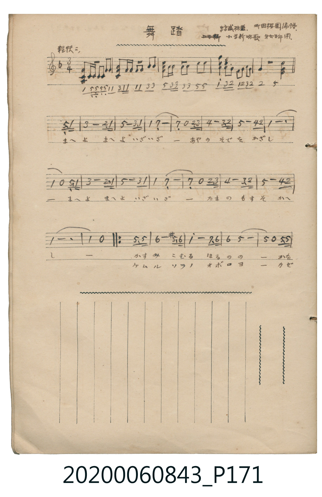
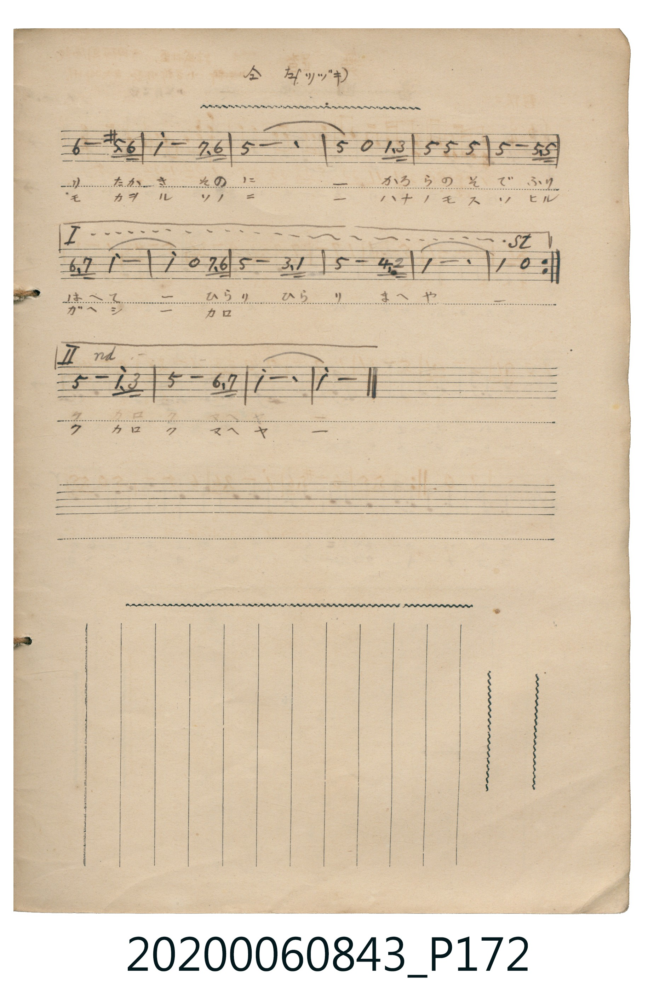

# 舞踏

> Re:Shōka 使用 AI 協助辨識與重建樂譜，可能會有錯誤。歡迎回報。

- **鋼琴伴奏版**：<br><audio controls src="buto.mp3"></audio>

- 日治時期公學校《唱歌帳》（典藏號 2020.006.0843・P171–P172）
- 編譜：町田櫻園（粋盛林堂《小学新唱歌》第 10 頁）

## 說明


- 出處：《唱歌帳》（國立臺灣歷史博物館典藏號 2020.006.0843）第 P171.jpg – P172.jpg 頁。
- 標註：粋盛林堂、町田櫻園編譜、小学新唱歌 拾頁ヨリ；P172 標註「仝 右 (ツヾキ)」。
- 調性與拍號：ヘ調（F 大調，1♭），3/4 拍，速度標示「軽快ニ」（!= 132）。
- 背景與曲風：華麗輕快的圓舞曲（Waltz）風格唱歌。第 1–4 小節為五線譜與簡譜對照之器樂前奏，
主歌以第 3 拍弱起拍（附點八分音符＋十六分音符）帶動三拍子旋轉舞步，
中後段加入升五音（`5'`，即 C#5）的半音鄰音裝飾，展現大正時期新唱歌活潑洋風的色彩。
- 版本說明：本檔案完整合併 P171.jpg 與 P172.jpg，包含 4 小節原譜前奏、前段（A）與後段反覆（B1 一房子、B2 二房子）。

### 編曲說明（鋼琴伴奏版）：

1. 前奏 (第 1–4 小節)：忠實採用原頁五線譜與簡譜記載之 4 小節器樂前奏。
2. 主歌伴奏 (第 5–36 小節)：左手以標準圓舞曲（Waltz）低音與和絃伴奏型支撐全曲。


## 歌詞

```text
【原頁歌詞全文與中文語譯】（對應 P171.jpg – P172.jpg）

［前段（一・二共通導唱）］
まへよ　まへよ　いざいざー　あやの　そでを　かざしー
まへよ　まへよ　いざいざー　たまの　もすそ　かへしー
起舞吧、起舞吧，來吧來吧！翻飛華美裙擺！）

［後段（一）］
かすみ　こむる　はるののー　かをり　たかき　そのにー
かろらの　そで　ふりはへてー　ひらり　ひらり　まへやー
揮動輕羅衣袖，翩翩輕盈地起舞吧！）

［後段（二）］
ケムル　ソラノ　オボロヨー　カゼモ　カヲル　ソノニー
ハナノ　モスソ　ヒルガヘシー　カロク　カロク　マヘヤー
翻飛花朵般的裙擺，輕盈地、輕盈地起舞吧！）
```

## ABC

<div class="abc-score" data-abc-src="buto.abc" aria-label="五線譜載入中"></div>

[下載 ABC 原始檔](buto.abc)

## TMD 檔案連結

- [主旋律 TMD 檔案](buto.tmd) [[在 TMD Studio 編輯](https://tmdlang.github.io/Tmd-TS/#tmd=s7IKdvYPcrWy4qpTUCpJTLdSSM7PyUlNLsnMz7MqzsjPTkzOyFeCS5bl55TmploBqXgDQ4RwcX5pUXJqfEFieqpVgKE5hgzcpPi8_JLUpPz8bISKgqL8stS8xDygqtzEvNLi5KLMgpL45PyCSoSa1LLMlFSQitSUzJL8oszEHCQnpRYVgx0LcUNJUWIexAygIEIVUFN6Zp5VSWIm0CnxQFyeGJ-bmJmXk5iXosSlpaXwomPeix39ClpaXIq2CobGRlz2tgpuXDbG-iZ2IEOeTV_6bNPuZzObns2Z_7R1zdO1O54tWPi4oevplI3P1vY83bH5cUP3-z0dT1t3vJje_2LmfAUjAyMDPQMDMz0DCxPjx827QcHyqGEykDJ6v6cT7LDn21e8WDvn_Z5Zz6fsej5lw7PVu5_OmQQ05Pmm7uezZz-bN_3pgiaQFRv6n65d9mzaBohdQIuer1mjYGig8HJBI9goLn0tBVtqAS4FBYXHDROezd70fPa6F6tWPZvR97hhIli0effT9l0vZk4FuhiLz-d0P1_d_aJ91_PGxc_Wbn_av-lp76znnStfLlmBI1CAbgd5BBQwelkF6QrA0AFxjMAcoN8eNzRBrX22YuaLFbtBAYUSMo3I4QYJTKAgWnApPOveBzKsecXj5lXv98wG2aAAMfBxQ8-T3XMVnvZvVtB43NzyuHnf46a1mo8behE2v1i1_1nD8hcd7c-6e4EeAPm8eQZQEOhhN4WnS5aDmT2Gj2auBfoGyAImF6CFvUDWy4b5T3ctA1r0fMkuoEUvdu99un_14-ZuoPFAzZA0BtSDZFVzz7OZ60FWzd70ctEKoFUv-te_3DX9xZ6pQJ3PZ7U8nTMZmEiBskD94Yk5JVVA7UCFzxbsgSWMJnDCAIajiQIwFJ6vb3jetOvJrinPt88CBg3Q5OcbFgIZTzf0Pm9d_mRn99OZK56taHra2ft0aT_QxSB3KCg82bEbaNaT3UtBZhmDPPN0z8YXW7eDfdXxcmbLy93znrauftrR9nL-5udrlr3f0_20t_Fp61okkc6nO7Y97Z76ZEcnSPvaCc-md7_Y2wly_NqlSBatfbqv59m6rU-7FjxtXfq0tx3oVKAJQFsSTNUTgOqe9m5WcFY2BaUToO97u4CSL1s2AMkXi-e-XLwPpGLj1Of9-4Dx8GztYkjehMf7sy27n-2d-GxLNzCIgNpfdG56unclIrSfd3Y8m7MGkr6BQQ1kP1s15dnCjqfrep5N3fJ0QseTvVsRSRMYdvCkCbK2p_XphNUKsFB-2jcfFKzgcAQlwM5eoK-A3nAEuhyoE-rL_t4Xy9qAok6GQK83POvYDwwYoGonI4Unu3ogXGh6gGZBoLHAhAv0youVwBBf8WxaO9AwYKiBGKvmvVi7HpgvQRlvQ--z9k7s2QhoINi093t2w10FtBzof6CdT1s3vmyY9XRDHzDAwKl3L8TihseN-x437njc1IHBbnncOA1KNu8BizQ9bgJy14HZcx83Ln_cNAnM7garnA5URoah88EKwIY2NT1unAkyGmroDoShQL9AwgGUVbZuByavpxOWA0MUzgbG1JN9bUAGhHy_p_Hl6hkvOjqfb9v3fF8rKFEsXPxi0TRgoQBJkUQa8nz_7peLZwMz5_N9fS8Wz3w2eRdQEDmkwfENCWm0cAV6AOiZ_WD25MdNQO8BywMgez2IAfQwEEGDoBsUkE1dsOAAygJLJUgYA5UBCxJEuAKV9j5u6kSJBRBjK0g_0GhQmC2DmbsJpBJqLjIbEiHAMhAjaJ_OWfFsxtKXc-Y937jg-d6VoKwITJjtwFqh8UXXmhddm18uW_qyuREUnF0bgQXxi8UL4Xn8Wf86YDkALMGA4Q0L7J7n-1cCEUhwNrDW2IAU0thDcVcPaig2bXzcvOBx82owe-_j5pWPm4GOAbJXPW6e87h5LbioB_u2afXjpj2PmxdB2c2bkHT1gcpiRCg29z9u7oIaBNTQtBOkCMSeBNLTtAZY7D9u2o4wF2hNEzADorKb54GUNS_BHorPW2cCQ_HF_u0vZy8ChtazOcufzel4ugRcZ-1bByymnuycDyw4X0yc_nLZzGcbFmMNUWji69r4bM7WFx1rQGqgSbAHHqKgmMEVukAjKG8jQIGClj4XV3B-XrpVQGZiXr5DjUGNQjXYmTaGZlp2YBawaYJcPCpowApNUDE6YTWokoFXVrAKB9SsmLIRUu1ogiwBGVSjYKigC4am8QgEEgPhGqBOEAsEISIgPgjXKJiCWSAIEQHxQRhoYhxYyAiowQhMA00E2WCoUANOhmDXg8tNcMUKbCkAq69ZkMwC1A4swBTQOKBSDMRpbAFiUHkG4gBJAyAXVFSC5dYBMSiXgnVNAnJAhSVYZjpYMUIL2Gx4AIAcjwyNYI6FuRsBIUpBUrBQM0dXUoMQMkAx0Bjoe4iFJlhNNcJmIUQpSApmITpEyMCswxvaRrDQJi2QQVUHLJDBdQeYMxcSyGAj0AJZA1IqI6WzYRfMUBIplFFqqB54c0TBU6G4BFzYAhP5fmBQgeoocLB3AzmgSgqefkEVFVKwg6orsMIuSBxAFPZCEvo6MGc1WtoGVVuIQDdD84apOpgyg-VSZGgOl4LpgngRORBgIpiBQIl96Pbgtg8SCbA4BoY5pIYGp0VQaCwHYlAFDeaA6mggBaqkkQIIVD3DwxSFA88NwAyAkpTBVSNSUoa5Cp3G9Ak8fKAhY44ZDEghA_MlPGTQ7INBRP5Al6F2QgY1EnrgDWkFT0-FvBRoSm4GpjxwOwEcUH1ADqihAOasBWJQYwER6uAmA5i7CMxp3gTmQI3oA3OAmQFZC7jpMJJSMigMwW0kcBrcC-SAGklgDqidBKRADSWUMAWGNEh6PRoH3GACK1yCEqaDJgFDNRjHYZGD2YMlnLHYCIMwm2u4arm4dO0UQO0nBSCtzAUA)]
- [鋼琴伴奏 TMD 檔案](buto_piano.tmd) [[在 TMD Studio 編輯](https://tmdlang.github.io/Tmd-TS/#tmd=s7IKdvYPcrWy4tLSUnjRMe_Fjv73ezpedu95PmHLkz1bni7tf97Z8X5Pp4KWFpeirYKhsRGXva2CG5eNsb6JHVedgtKz6Uufbdr9bGbTsznzn7auebp2x7MFCx83dD2dsvHZ2p6nOzY_bugGmvi0dceL6f0vZs5XMDIwMtAzMDDTM7AwMX7cvDvA0NzwUcNkIGUEtEcJZObz7SterJ3zfs-s51N2PZ-y4dnq3U_nTAIa8nxT9_PZs5_Nm_50QRPIig39T9cuezZtA8QuoEXP16xRMDRQeLmgEWwUl76Wgi21AJeCgsLjhgnPZm96Pnvdi1Wrns3oe9wwESzavPtp-64XM6cCXYzF53O6n6_uftG-63nj4mdrtz_t3_S0d9bzzpUvl6zAEShAt4M8AgoYvayCdAVg6IA4RmAO0G-PG5qg1r5Ytf9Zw_IXHe3PunuBxoDsb54BFARa66bwdMlyMLPz_Z4eYGwpANUAWS8b5j_dtUwBEpdAdS927326f_XjZqBTOxEGA2MA6FGIL7GmB6BVIKUKCoZ6Ck87e4HiChrg0Ac61kQBGDPP1zdoAhU93b_g6fplz_oWPp-y4mnffKDrn-ya8nz7LGD8Ap39fMNCEGPFjBd7Op_s7FaA6Xw6c8WzFU0Qc6GOUlAw0lN4smM3MGgh7oDYZwq0z9gM2cLty551dj_ZvfTZipnPdk17OmcyMFUD_QL0RXhiTkkV0O1P9va9nL8ZaP3TST3PtzZDjHs6r_vZlPXPJk142gryOtRWypMNFCho6XNxBefnpVsFZCbm5Qd5ONQY1ChUg31mY2imZQdm1SgYKuiCoWk8AoHEQLhGwRjMAkGICIgPwjUKpmAWCEJEQHwQBpoYBxYyAmowAtNAE0E2GCrUQO0EqUeGRjB5mFIEhCgFScEcao6upAYhZIBioDHcQhOsphphsxCiFCQFsxAdImRg1g1_D0JJmHVmaDpM1cGUGSz2kaE5XAqmC2Iasn0wEerah24Pbvsg_kUEJ0wencY0E-5SqBvNMR2E5EaYfXA3otkHg4hEgS4zGnuDP_agGozjsMjB7MHidSw2wiDM5hquWuRC3QelUDdBlOnxCtGGsWCMj2MaD-SZxscCjYd5hQjFYAKrZpxKoHxshg8Kq01Aqk1AqkEEJp-Wugm5HKfpOEJu1OeEfA7MQrp2CqBcpACklbkA)]

## 分析

```text
================================================================================
📊 TMD Song Profile: [ 舞踏 ]
================================================================================
⏱  Duration:       1:10 (70.9s), 52 measures total
🎼 Key & Tempo:    首調基準 F, != 132.0 BPM, <3/4>
   - 分析範圍：      由實際發聲的音符與和弦推測調性；播放脈絡另行呈現
🎤 人聲音域:    C4 (MIDI 60) – A5 (MIDI 81) [跨度: 21 個半音 / 1.8 個八度, 難度: difficult]
   - 最低音:  C4 in [Song #1 @ m.1, 0:00]
   - 最高音: A5 in [Song #1 @ m.49, 1:06]
   - 適合: soprano, mezzo-soprano, tenor, baritone
🏛  結構:      Song (70.9s)
⚡ 編曲密度:        Peak 1 軌道同時演奏
🗝  調性診斷：       F 大調（純淨自然大調，未偵測到可信轉調）
   - 風格氣質:    純淨自然大調（陽光明朗、易唱易記，無明顯調外色彩）
   - 轉調歷程:    全曲維持單一推測調性（未偵測到可信轉調）
   - 核心骨幹音:  C, F, D, A, E
   - 調性數值:    F 大調 [相關度: 0.87, 穩定度: High, 自然音純度: 97.9%]
   - 候選調性 (K-S): F 大調 (0.87), C 大調 (0.74), A 小調 (0.57)
   - 五度圈歷程:   -1
   - 各段落調性細節:
     • [Song #1]: F 大調 (r: 0.87, 自然音純度: 97.9%, 調外音: C#)

  [ 五度圈游移軌跡 ]
               C  
        [F ]*          G  
      Bb               D  
      Eb               A  
         Ab           E  
            Db       B  
               F# 
     (* = active key center)

  [ 十二半音累積音高分佈 ]
     C  : ████████████████████████  34.7%
     C# : █                          2.1%
     D  : ███████                   10.2%
     D# :                            0.0%
     E  : █████                      7.8%
     F  : ████████████████████      28.6%
     F# :                            0.0%
     G  : ██                         3.5%
     G# :                            0.0%
     A  : ██████                     8.7%
     A# : ███                        4.3%
     B  :                            0.0%
--------------------------------------------------------------------------------
Assignment 軌道音域：
  - Piano         : C4 – A5 (21 個半音 / 1.8 個八度, 156 個音符)
================================================================================
```


## 原書掃描頁






