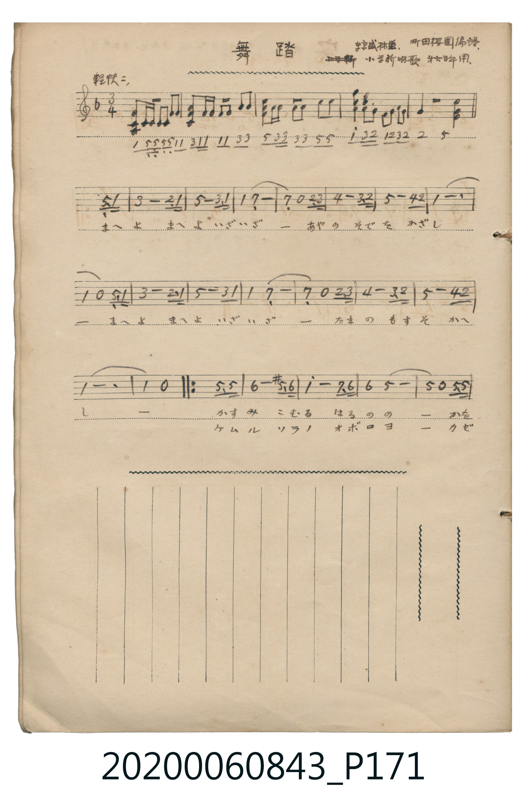
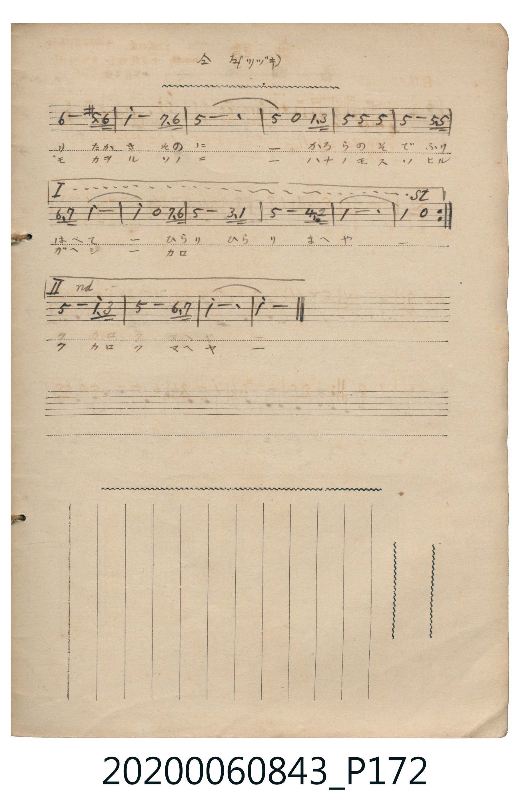

# 舞踏

> Re:Shōka 使用 AI 協助辨識與重建樂譜，可能會有錯誤。歡迎回報。

- **鋼琴伴奏版**：<br><audio controls src="buto.mp3"></audio>

- 日治時期公學校《唱歌帳》（典藏號 2020.006.0843・P171–P172）
- 編譜：町田櫻園（東京盛林堂《小學新唱歌》第 10 頁）

## 說明

> [!NOTE]
> **原件資訊與雙抄本互校考證**（對應《唱歌帖》第 1 冊 `P171.jpg`–`P172.jpg`，互校同帖第 3 冊楊金土重抄本〈無題・三拍子曲〉`P040.jpg`–`P041.jpg`）：
> - **標題與出處註記**：`P171.jpg` 頁頂標「舞踏」，右上註「東京盛林堂、町田櫻園編譜、／~~日本新~~ 小学新唱歌 拾頁ヨリ」（「東京」二字連筆直書，舊轉錄誤認作「粋盛林堂」）；`P172.jpg` 頁頂標「仝 右（ツヾキ）」。
> - **調性與拍號**：ヘ長調四分之三拍子（F 大調 3/4 拍，1 個降記號 `?= F`），速度標示「軽快ニ」。
> - **校勘備註（依 Editorial Policy A 並互校 `P040.jpg`–`P041.jpg` 校訂）**：
>   1. **前奏第 4–5 小節與弱起銜接**：`P171.jpg` 第一行五線譜附簡譜共 5 小節（舊轉錄遺漏第 5 小節），其中第 4 小節五線譜與簡譜明確記為附點四分音符加二個十六分音符再接四個十六分音符（`1^. 32 1232` = `1^ - - - - - 3 2 1 2 3 2`），第 5 小節第 1 拍為前奏收束音 `2`（G4）、第 2 拍休止、第 3 拍由伴奏 `5` 與人聲弱起 `5_ - - 1`（「ま へ」）同時進入。
>   2. **前段（A 段）四處 `5` 八度正讀**：前段第 2、6、10、14 小節首音於 `P171.jpg` 與 `P040.jpg` 兩份抄本上均為無低音點之中音 `5`（C5，僅前奏末拍與第 8 小節末拍弱起 `5_. 1__` 標有低音點 `5_` = C4），修正舊轉錄誤降八度之 `5_`。
>   3. **一、二房子（`I st` / `II nd`）括號範圍正誤**：`P172.jpg` 第 2 行楊金土誤將一房子括號 `I --- st` 自該行小節 1（`6. 7__ 1^ -`）一路拉長跨滿整行 6 小節；然檢視該行第 2 小節末拍（`7. 6__`）譜下，楊氏本人已抄入第 2 節歌詞「カ ロ」，緊接下一行 `II nd` 首音「ク」（「カ ロ | ク カ ロ | ク マ ヘ | ヤ ー」），且互校第 3 冊 `P040.jpg` 第 6 行末至 `P041.jpg` 第 1 行，一房子括號 `1...st` 正確始於最後 4 小節（`| 5 - 3. 1__ | 5 - 4. 2__ | 1 - . | 1 0 :||`）。依 Policy A 復原正確之 4 小節一、二房子結構。
>   4. **二房子（`II nd`）第 1 小節音高**：`P172.jpg` 第 3 行第 1 小節與 `P041.jpg` 第 2 行第 1 小節均明確記為 `5 - 1^. 3__`（`1^` = F5 有高音點，`3` = A4 無高音點），修正舊轉錄臆加高音點之 `3^`。
>
> **［前段（導唱）］**
> まへよ　まへよ　いざいざー　あやの　そでを　かざしー
> まへよ　まへよ　いざいざー　たまの　もすそ　かへしー
>
> **［後段（一）］**
> かすみ　こむる　はるののー　かをり　たかき　そのにー
> かろらの　そで　ふりはへてー　ひらり　ひらり　まへやー
>
> **［後段（二）］**
> ケムル　ソラノ　オボロヨー　カゼモ　カヲル　ソノニー
> ハナノ　モスソ　ヒルガヘシー　カロク　カロク　マヘヤー


## 歌詞

```text
（TMD 檔案未包含歌詞註解）
```

## ABC

<div class="abc-score" data-abc-src="buto.abc" aria-label="五線譜載入中"></div>

[下載 ABC 原始檔](buto.abc)

## TMD 檔案連結

- [主旋律 TMD 檔案](buto.tmd) [[在 TMD Studio 編輯](https://tmdlang.github.io/Tmd-TS/#tmd=s7IKdvYPcrWy4qpTUCpJTLdSSM7PyUlNLsnMz7MqzsjPTkzOyFeCS5bl55TmploBqXgDQ4RwcX5pUXJqfEFieqpVgKE5hgzcpPi8_JLUpPz8bISKgqL8stS8xDygqtzEvNLi5KLMgpL45PyCSoSa1LLMlFSQiuLkxLz4stSizLTM1BQkZ6UWFYMdDHFHSVFiHsQcoCBCVX5RSUZ-elFiQUalVUZmcUl-UWZyYk58dmJeIkJRSUYq0IPFqYnF-XnF6MK5pcWZycgGZqZn5lmVJGYC_RcPxOWJ8bmJmXk5iXlAx2lpKbzomPdiR7-ClhaXoq2CobERl72tghuXjbG-iR3IkGfTlz7btPvZzKZnc-Y_bV3zdO2OZwsWPm7oejpl47O1PU93bH7c0P1-T8fT1h0vpve_mDlfwcjAyEDPwMBMz8DCxPhx825QWD9qmAykjN7v6QQ77Pn2FS_Wznm_Z9bzKbueT9nwbPXup3MmAQ15Nnfjk11rns-e_Wze9KcLmkC2bOgH2ThtA8Q6oF3P16xRMDRQeLmgEWwal76Wgi21AJeCgoKdQrSin3-IayyEo6X1tG_-k93bXmxuf7Gi60VH-8vZM591tTybs-bJrknAkHjR0PxibaeWFigINvQ-a-9ECpppMOcqPG3rUkgABYReVkF6AjA0QBwjMOf9nh6ISU8ngLSA1BuD1D9b2vWyfeLTOfNftvdCLHzc0PG8ZeHLhT3AQH2yo_NZd-_TtROezd70uKEzIcDAxABhtoEJxCJgCAEDGeIRXaBXnq2YCdQO9MTT9l0vZk59sWL3ixUzQG6fhXAcKGRfLmgCKn3cAFQKShuPG3qBrnzav_nJji6gHqA4RkQ1IsckJHqBgu_39NfVgRLQnDXAKKyrUwBH5zJ4dCo8694HtO5x84rHzavAtnTADQdyn-zqebp2-suGxc_Xtj2fveXZ7B1AZ7zo6Hqxt_NlT8uLVUterOp9shdoUc_zTd1IjgGaA_T3bEQYo_jpye65CkC_gOxqbnncvO9x01qgeqCuxw1NiKB6sWr_s4blwKACBjMwVYMD6XHzjJdTtwNlns6e_bSj7cnObng0AE1zU3i6ZDlQUgGYc4AeAwUZMOIbul_O7AWGMihnJIByFiRSel42zH-6axnQRc-X7AIF9O69T_evftzcje4OUMLonvG0aSYw4IGWPNk3V8E1JRNULCTmKATk52QmVyo4KjzZsQySiICpDGtKUAAl1RVNQLvBPoGYr6BgqAdK4J29T5f2gxKeCVCPKSiSnq9vAKWSPRtfbN3-smvOs76l6KkEqPzJjoYXC4GJd8rz7bOA8f1yZsvzDQuBjKetGxVgpgCdDI-wl427nu0B24OQBQXF09ZtT3asBdsPFYebCXQExMxnM_qeL9oFDMfnTbuAFr3cPQ8SBy_nb36-ZtnTrgWgtNLQ_bS38WnrWoR4Wy_Q6SCVGFJAhyUYxukpGBspGBoZGyUo2CoA-cAgh0FjBaAMEANpaJQhuxySrYGxDHQPJPyeTdn2bO58oOEKCSANHe4m4FTVCFJpBFL5ZM_EZ2sXQUWMwXqnbHyyZwtQr0KCaQKwHG5_smvXi8ZNkGAHisWDHWIIMg2YRB437lN43LgDkryBhQWwSH7ZsOlp61J4elFQMILG57N1W4GaHBXAdCcwAIC5HWzJ09bVoGS3dvGLdQ3gKIUoBjsS6DQzIDY0ABGwqHi5bBrQT8-m7UEqv0BORUpoQENXPtm9F1oq7uh6OrcdGCrAourJ3j6gXmBcgXPKWnDYmIJ842wKivbmVmjIzVkNymTAqAa6wgJqL0QQERR6Cobx8cBkvGLmszmdcINBMqCocwYFNqgk3b8O5DekIgKY-yB-BroBrBoptIxBoQVMxUD_ApPPs479kIyc4KlQXJKgoK-Q4OmpkJcCiv1n3WuAGfj5-panc3pBFqxaAs8P0BIGEs3A_AAvt4GKnm5oBxoPMRhiBNBMBV1dXbAFL9pXvVi5CagF4mMFQ5DdZnoK5vHxCqCkCLIYlMe2r3_W3QkqeLaveLZ7_7OpW4BaFMzgWWj285Ztz1YterFsGsQ0iEuQQxFkrrmeghkwAIFGAnPTkx3AKhvk0mcbgKEPrMl2Pd2-CRh_wMQE0Q3Surbnxcp5oHTXtFrhcfNaSCXwfHsXMEcB9UMyPyyIFCDJBKx6Pbwgh-pUqFEAigIxCq95HhDPAPGalwDxHlix3fNkxxRIWQavCpHTGkjQDBzOc1a_aAcmKEQRB8mTQCmwIWjBbqinpwcKdGDsAQuSp8u7gUn62ZyGp_t64KUOKJhqgDkcmPfBqQ3oNhDHRE_BCMwxBHL0wLSBglVNDSgsgYkJVCLDy-Gn-1YCmwsQO0AJDl6goSay51snPFsOLOrhKRFoBzAloqRBWNKDNiAgmRGY6FcjKmykpGcM8jeyUlgWRQobcPJEVgPMqMjlKjB7gIobUKEITimgAhKUudxMFYB5DmgxJM8BQzfBGCTuaKIAao8gxLHlwPY2YOEMVwPOhMZx8EwIa2O937MbXmo93dAHbB2ATdsLbJSCVQDLPlDR1wRMVQ2o7JbHjdOgJCgNAUWaHjcBuevA7LmPG5c_bpoEZneDVU4HKiPdzPlgBWAzm5oeN84EmQw1cweSmcje2dcD8Q4w6tH9AtQFNGE_2ITJj5uAZgLTApC9HsQA2gJEUHu7QY5v6oK5ASgLbB1A_AVUBmwvwP0CVNn7uKkTxeMgxlaQdqDJIHcugxm7CaQSaiwyGxIIwEYRHu_sAmYvFO80bXzcvOBx82pw4Ox93LzycXMfmL3qcfMcUMEBat2B7W1a_bhpz-NmYB0IZjdvQtLVB2r7wL3T3P-4uQtqDlB9006QGhB7EkhL0xpgyfG4aTvCWKAtoHIHld08D6SseQnUWMq7B1CgoKXPxeVfkJqXmZduFZCZmJfvUGNQUw2yQ8HG0EwLHG4KwH4JsCgAFrbwNsPTmSuerWiC1HkKGrDaFNGS0gQZDNIKKWpAENgEgCOQGAjXADM7iAWCEBEQH4ShhRcYQkRAfBAGmoijbQOUMoKKGsAshdI1XLUIf4blA7uhDjXaJtg8it4yArduQF2gKRuhbUhwQwXhP5hVcCuhTR2gnSAFPpgqQK0fCL0D4rBgSP_fEeYyrDGAGXeQYkbBEFZ_okUEMHXvBTUtwdGBNeYhHgAFLjKEhCHQ_fDQQ4Q1TAYWqeYQzyJgDZwF8y3EOGNEcACLJjRNKAGCVb4FSk8DyUN5ED4h64GFKIRuagE6AeplEzRtEI-BEhC6lyEqQTIwL6NDTCsxUwCwKEPTBSzWoPRysJcnYch3Q2mIl6cTbTtq6hohcTwfbge94hhK4oviJmjKa5wJ9hEkwpF9DIticIiQFMUwnUCTkQoQJ1ILEHBN-GTH7perpwC7jliLEUgBAixJYI00aNlCqFQxQ_OFqTqYMkMvv0HQHC4F04UeRQQjwBAUgvvRdAGbJBC6qQGc5iChhiy_HirfDY4BWAxixiWeOABmXagbjEAdgNXodjTthdDNK8EdhD4M-VVQ-Tlg-bUw8eYVhN0A7IZA6D2IdE9ewKMHOG5LIXkEntdBAd_UhaYLkSEhAduLIQ8r_daB5dEDDY-X4cHeixLsi9BtgAVN8yZwsOKOlj6wPHrSwOOC5n4o3YUIdFjwodOYAQtPt9CIMseMFUw74fGEFOadMPcgJVtYEQMK0-VopgLbzxAaGFsgeWjSBxY-wNY0QRcAG9dQ3Z0o4Q5LzogYALZwEa6AhjKSK5ohNR0oRkDya6C8GUD2dsKugMcqsO8NKvhc81KALTpDEss9eI9aATQ8oqAB69rqKGAWcsC-OXD4BNRpBw38AzuheEs93LUpbSodLDkPKZ6wyqNWw7BqlrDlwM4RhG5egBz2RqSGPWxkQAE8LIAz8Hd0gsZkwCGP3KQlVO2gBzM0cwGLKwwpWP7DUi5ihgJ6aCBFASQjIQUxciLFJg8cLoLQsCEj0i0HBr-unQK0Q6MAZMK6EEhsp2gfw1gQH5pJUKWMkKSAzTc7BWUuAA)]
- [鋼琴伴奏 TMD 檔案](buto_piano.tmd) [[在 TMD Studio 編輯](https://tmdlang.github.io/Tmd-TS/#tmd=s7IKdvYPcrWy4tLSUnjRMe_Fjv73ezpedu95PmHLkz1bni7tf97Z8X5Pp4KWFpeirYKhsRGXva2CG5eNsb6JHVedgtKz6Uufbdr9bGbTsznzn7auebp2x7MFCx83dD2dsvHZ2p6nOzY_bugGmvi0dceL6f0vZs5XMDIwMtAzMDDTM7AwMX7cvDvA0NzwUcNkIGUEtEcJZObz7SterJ3zfs-s51N2PZ-y4dnq3U_nTAIa8mzuxie71jyfPfvZvOlPFzSBbNnQD7Jx2gaIdUC7nq9Zo2BooPByQSPYNC7_gtS8zLx0q4DMxLz8IA-HGoOaai4FILAxNNOyA7NqFAwVdMHQNB6BQGIgXKNgDGaBIEQExAfhGgVTMAsEISIgPggDTYyDGgmCxgpGQI1GYLoGiCGiBjBLoXQNVy3CuWH5yYk5DjXaJlhcC9MINyAeTBkCTQAp8MFU8bhxH5TegWoNOFR8kEPFBBEo8QrRhrFgTDTHND4eaGm0aTyQA7InODW5JDM_zxF_8IOCDhlCQgjoH3jYIEISJgOLMnOI5xGwBs6C-R5inDEieB43daBpQgkgrPItUHoaSB7Kg_AJWf-4sQlCN7UAnQD1sgmaNojHQMkD3csQlSAZmJfRIaaVmCniceM6NF2PG-dC6eVgL0_CkO-G0hAvTyfadtTUNkLieD7cDnrFMZTEF8VN0JTXOBPsI0iEI_sYFsXgECEpimE6gSZjZnT8JQqQwmSDigxIuQEtREAkxG_AIhOswDwWIggmkfno5ZEB2NiBsRQRFk74Cz0ztEA2VQdTZuiVBwiaw6VgutBTEMH0YQiK4P1ouh43TobQTQ3gLAGJVGT59VD5bnACgSUwzKSGJ4kASxaoG4yAZjSvRrejaS-Ebl4JsqO5D0N-FVR-Dlh-LUy8eQVhNzRBbHvctAeRLckLePQAx20pJAvDiyJQwDd1oelClBeQgO3FkIcVzuvA8uiBhsfL8GDvRQn2Reg2wIKmeRM4WHFHSx9YHj1p4HFBcz-U7kIEOiz40GnMgIWnW2hEmWPGCqad8HhCCvNOmHuQki2sBASF6XI0Ux83boXQwNgCyUOTPrBsfNy4jKALHjduguruRAl3WHJGxMDjpp0IV0BDGckVzZCKGBQjIPk1UN4MIHs7YVfAY3UttrIIR7lsAiraTIDFIIiBnYuzeMWvF2_JDC1RUYpgMBNSwMKNAhMQPqyEBvrMNS8F2II1xF_I4m5b0KYKxpLRkZIFVnnURgms0UHY8sdNGyF08wIsAUJEDUx8hQYx2Yi0oIbmWmA5iCEFy9hYClxM_6L7GymwITkUKTCRUz82-eZ5UHoGuExbQobl6MFBfEDjCmeQ6WBzde0UoP0yBSAT1qJCYjtF-wA1AfnQqEaVMkKSAjaH7RSUuQA)]

## 分析

```text
================================================================================
📊 TMD Song Profile: [ 舞踏 ]
================================================================================
⏱  Duration:       1:12 (72.3s), 53 measures total
🎼 Key & Tempo:    首調基準 F, != 132.0 BPM, <3/4>
   - 分析範圍：      由實際發聲的音符與和弦推測調性；播放脈絡另行呈現
🎤 人聲音域:    C4 (MIDI 60) – F5 (MIDI 77) [跨度: 17 個半音 / 1.4 個八度, 難度: challenging]
   - 最低音:  C4 in [Opening #1 @ m.5, 0:06]
   - 最高音: F5 in [SectionB[L1] #1 @ m.23, 0:29]
   - 適合: soprano, mezzo-soprano, contralto, tenor, baritone, bass
🏛  結構:      Opening (6.8s) -> SectionA (21.8s) -> SectionB[L1] (16.4s) -> Ending1 (5.5s) -> SectionB[L2] (16.4s) -> Ending2 (5.5s)
⚡ 編曲密度:        Peak 2 軌道同時演奏
🗝  調性診斷：       F 大調（純淨自然大調，未偵測到可信轉調）
   - 風格氣質:    純淨自然大調（陽光明朗、易唱易記，無明顯調外色彩）
   - 轉調歷程:    全曲維持單一推測調性（未偵測到可信轉調）
   - 核心骨幹音:  C, F, D, A, E
   - 調性數值:    F 大調 [相關度: 0.88, 穩定度: High, 自然音純度: 98.0%]
   - 候選調性 (K-S): F 大調 (0.88), C 大調 (0.74), F 小調 (0.57)
   - 五度圈歷程:   -1 -> -1 -> +0 -> -1 -> +0 -> -1
   - 各段落調性細節:
     • [Opening #1]: F 大調 (r: 0.89, 自然音純度: 100.0%)
     • [SectionA #1]: F 大調 (r: 0.90, 自然音純度: 100.0%)
     • [SectionB[L1] #1]: C 調性不明確 (r: 0.69, 自然音純度: 95.5%, 調外音: C#)
     • [Ending1 #1]: F 大調 (r: 0.85, 自然音純度: 100.0%)
     • [SectionB[L2] #1]: C 調性不明確 (r: 0.69, 自然音純度: 95.5%, 調外音: C#)
     • [Ending2 #1]: F 大調 (r: 0.85, 自然音純度: 100.0%)

  [ 五度圈游移軌跡 ]
              [C ]*
        [F ]*          G  
      Bb               D  
      Eb               A  
         Ab           E  
            Db       B  
               F# 
     (* = active key center)

  [ 十二半音累積音高分佈 ]
     C  : ████████████████████████  34.7%
     C# : █                          2.0%
     D  : ███████                   10.0%
     D# :                            0.0%
     E  : █████                      7.7%
     F  : ████████████████████      28.7%
     F# :                            0.0%
     G  : ███                        4.1%
     G# :                            0.0%
     A  : ██████                     8.5%
     A# : ███                        4.3%
     B  :                            0.0%
--------------------------------------------------------------------------------
Assignment 軌道音域：
  - Piano         : C4 – F5 (17 個半音 / 1.4 個八度, 30 個音符)
  - Vocal         : C4 – F5 (17 個半音 / 1.4 個八度, 116 個音符)
================================================================================
```


## 原書掃描頁






