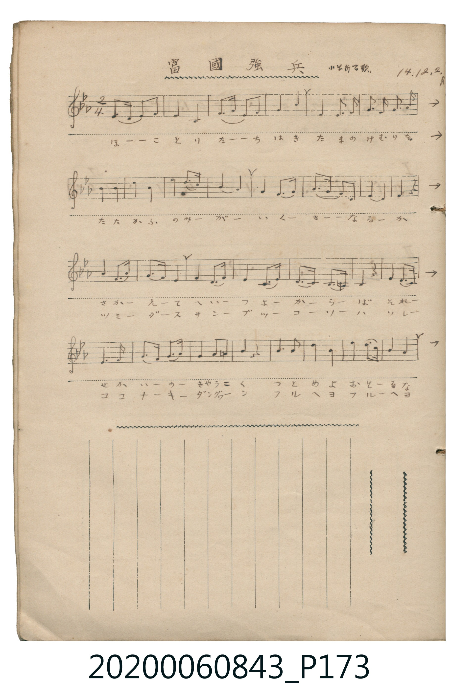
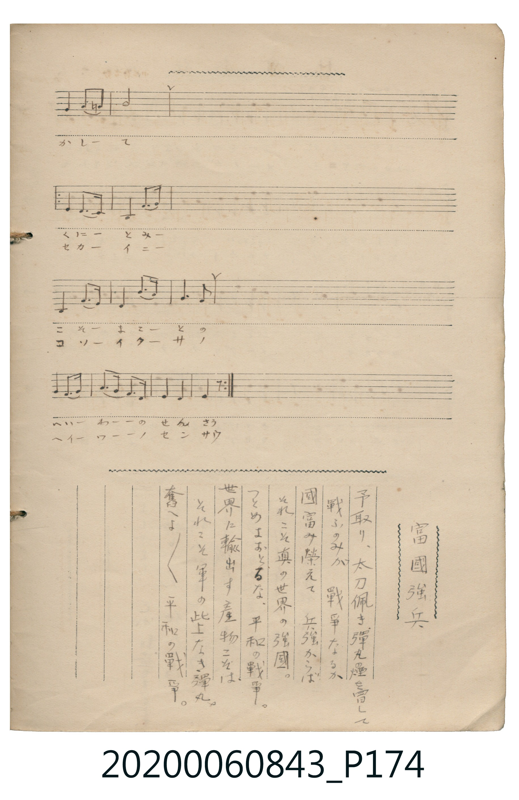

# 富國強兵

> Re:Shōka 使用 AI 協助辨識與重建樂譜，可能會有錯誤。歡迎回報。

- **鋼琴伴奏版**：<br><audio controls src="fukoku_kyohei.mp3"></audio>

- 日治時期公學校《唱歌帳》（典藏號 2020.006.0843・P173–P174）
- 原載《小学新唱歌》（大正 14 年 12 月 2 日抄，署名 K）

## 說明


- 出處：《唱歌帳》（國立臺灣歷史博物館典藏號 2020.006.0843）第 P173.jpg – P174.jpg 跨頁。
- 標註：小学新唱歌 14.12.2. K（大正 14 年 12 月 2 日抄錄）。
- 調性與拍號：變ホ長調（Eb 大調，3♭），2/4 拍，原譜為左右跨頁之手抄五線譜（P173 各行右端以 `→` 接續至 P174 同行）。
- 背景與曲風：體現大正時期「實業與和平競爭」思潮之教材歌曲。歌詞指出真正的戰爭並非僅是手執刀矛、冒著彈煙交戰；
若能富國榮民、向世界輸出優良產物，這才是無上的彈丸與「平和の戰爭（和平的戰爭）」。
- 版本說明：本檔案完整接合 P173 與 P174 跨頁五線譜，並依原譜反覆記號（第 17–40 小節反覆演唱第二段歌詞）展開為 64 小節。

### 編曲說明（鋼琴伴奏版）：

1. 前奏 (Intro, 4 小節)：取曲末「平和の戰爭」樂句，以莊重有力的大調進行曲風格導入。
2. 主歌伴奏 (Song, 64 小節)：左手以穩健的進行曲低音與和絃交替伴奏。


## 歌詞

```text
【原頁歌詞全文與中文語譯】（對應 P173.jpg – P174.jpg）

［前段（第 1–16 小節）］
矛（ほこ）取り、太刀（たち）佩（は）き、彈丸（たま）の煙（けむり）を冒（おか）して
戰（たたか）ふのみが　戰爭（いくさ）なるか

［後段・第一回（第 17–40 小節）］
國（くに）富（と）み榮（さか）えて　兵（へい）強（つよ）からば
それこそ真（まこと）の　世界の強國（きやうこく）。
つとめよおとるな、平和（へいわ）の戰爭（せんさう）。
努力吧、切莫落後，在這場和平的戰爭中！）

［後段・第二回（第 17–40 小節反覆）］
世界に輸出（つみだ）す　産物（さんぶつ）こそは、
それこそ無上の（このうへなき）　彈丸（だんぐわん）。
奮（ふる）へよ奮（ふる）へよ　平和の戰爭。
奮發吧、奮發吧，在這場和平的戰爭中！）
```

## ABC

<div class="abc-score" data-abc-src="fukoku_kyohei.abc" aria-label="五線譜載入中"></div>

[下載 ABC 原始檔](fukoku_kyohei.abc)

## TMD 檔案連結

- [主旋律 TMD 檔案](fukoku_kyohei.tmd) [[在 TMD Studio 編輯](https://tmdlang.github.io/Tmd-TS/#tmd=s7IKdvYPcrWy4qpTUCpJTLdSSM7PyUlNLsnMz7MqzsjPTkzOyFeCS5bl55TmploBqXgDQ4RwcX5pUXJqfEFieqpVgKG5MboM3KT4vPyS1KT8_GyEioKi_LLUvMQ8oKrcxLzS4uSizIKS-OT8gkqEmtSyzJRUkIrUlMyS_KLMxBwkJ6UWFYMdC3FDSVFiHsQMoCBCFVBTemaeVUliJtAp8UBcnhifm5iZl5OYl6LEpaWl8HR9z9M53U_3bH_aulVBS4tL0VbB0NCMy95WwVWHy8ZI38QOZNaz6Uufbdr9bGbTsznzn7auebp2x7MFCx83dD2dsvHZ2p6nOzY_buh-v6fjaeuOF9P7X8ycr2BkYGSgZ2BgpmdgYWL8uHk3KHQeNUwGUibv93SC3fe0b_6LPZ0gQzb0P1277Nm0DRDToEYtWf5s7WIFQxOFpzu3KBgaKTyb06EAJIEO6Wp5v6fn-d5NTyf0KniDTePS11KwpRbgUlBQeNww4dnsTc9nr3uxatWzGX2PGyaCRZt3P23f9WLm1Pd7ZmHx_Jzu56u7X7Tvet64-Nna7U_7Nz3tnfW8c-XLJStwhAvQ7c_XrFEAhY1eVkG6AjCAQBwTMOfF9hUvFzQ-bmiC2vxsxcwXK3YDbUYLLmAQ6Rka6RnpgcICf7C97AGGHDDEYUa-WLX_WcPyFx3tz7p7gY4Dmv1iXdfj5tkvp24HSgFNc01SABoIZvcYP5q5FqgbyAImCgWgDiALFIVr5zxv2vV0-7Kn_ZshTn6ys_tZZzfQuie7pjzfPguoAGgSyI8KTye0vFjYA1T4fPX6J7uXKiQ8apuUoPCsb-nzXT0v2jeD_Q5U1ANUhOrO5p5nM9eD3Dl708tFK4DufLl6yvP-fRDPQlLl44aep-uXPVu6Fqjs6aSepzuBlmx73rH2cUPvs4a5z_auAzlr6sxncycAwwxoDtB0IOPFynnPetqBkfp8znygUc9ntTzr2ADU9WTHspdz5z1tbn02Yz3QM0_nb3_a0fB8_uzHDY1P2ya9mDj96d6O560zn-xaAlT_fs9skEMVFF50L33RvBeSo54tW_dsw0SQ-gkTn-yY9nxqz4s9O4AWPW1Z9aJz_fMpi4ApAxiCLxtmPuvsBdryvGXhkx1dQAcATX6yYwfQFyAf7dwM9MvjxnUQV4HiF-I1mDvBwdSLCKnnnR3P5qyBJFpgMAHZz1ZNebaw4-m6nmdTtwBD-umEDnB6UwBaAAlvaKQh4qoH6Pkn--ZC4vZpf--LZW0vVswAp48OUHI1NAemUxMDBWA6fL6-AaLg2Z4pwNQIlH2yq-fZuq2QkAU67unGqS-ndQMTiIIZMGbBGkCOhWYxoBVAqyGKn7aueDatHeiqJzvWghir5r1Yux6Y70B-3tD7rL0TezYB2gE27f2e3U-B4bhuK8yRQEWGZlArwcl2L0gZMAqBCh437n7cOBnkvP5pj5u6QJG0ZBUwgsFS8x83LgRKPdkLjB4gdz0oiBuBQdwIiRiYmn1g8XXARAAWmfi4qQFoFEiwaRIwiYAFux43AgsGoLLpjxuXgawHJxaIfiCCyG0FmvK4cf_jRmDB1wCP58eNLY8b-x83AosaoJpVj5u6geohHu2AhA0oesEpE5hbISnzResGoKshXoEn1GfLe0FpdeFcoEtfLJz7snvSy5nbX85cDEp7sxe_bJz8tH_VszmdoHS4YjEwKT7tX_20cRbEHU-nAxMRMNoRQbwPFLugdAaM6R0NT2cD4xhLmkCENzAjgD0D9MlqUHivB2ZsIBeYhYG-2g_MI2DuVFhYANnLgKEArIrA4juAoQDStWc7mLvkcVMHWFn34yYguQGcihrnPm4C5pDJQAYwD4PV7QNzIXasAxoHyX5ANqiWgzqo93ETMIDbwCr7kQoboCWNKx43NQKtAscfkA0M-VWg4ATnRbi7HjeBtSFlzceNsx83AY0D-qYNYSJyfAGD-sWyRlB1u24bMCheLJ76fGcjMBBAprdufdo1G-jA57OBKbTnZRMoLkDFArhcgvgAWj5APQEtc552rQJpnLAcZEhH-4u-1S8m7AXGE6h0nrMCGK1PF2xBKzSAOez9nkZc0bqrB1e0QrI6InJh4boaUrJB4wiUlBeAg2YmMOyfT1kMLujAsQwKnW1ANWBZUIwBsxfQ2RjxCC4KgUEL1gYUAeYPYEwBQ30VMOLAQduAlBkXgM2dAIwQIAMR8E-XQvRvBcYg2MIdwDjFKggyDrWgxRZ3EyYCiyjkkhwYnkCvAUty5PgCVmMvV89AK8wRkbV03fOZe6CRBWMTFVNAzZS3bKBAQUufiys4Py_dKiAzMS_focagphrsPhtDMy07MAvYnoIUp7Cy1AKetSFVOVhcAVhRKwDrcEhFAhcCp5BZoEK2eQ8w_hRqgLG7QgFYOoJZ88GiC8Hs9UDcCxEFYmC-XQfmgApTkHpgUQrmdwExMBdOB-oE85eBfAByZg3QQl0gNALTRkBco2AMFtGFyoBEQOK6QHEQDZKtUTCBypnC1EBNg-mF6YCpNIXSZkARmB4zIDZRBxsHE4LBGnDGQg1ES9QKCRGKRshBBqoYwF4EencrmLEOiPfDPN4DY7QAcT-MMxXEAGYOEAdYWkFFuxGBBHIqzMmQIMEUMYcFWxyGTxHewh9KRlAZQ3iYI-mFixhgBhK4-IEUObBaBRIc_UB_rIZ5CJiEECExFRxGUE4HJACWgTk7QMEDk1kCDBGwLCRMQcqAVQeUvwERQqheAnkAlnzQPQkLMxO4Lpi3EQEECziIuClGojRC0gsRMY8HRUo8ziAClopAl8OjfzK4vIRy9oEEkAMJkolmg9MAOLFAgmcdTA207gObA-L34wsHuKNgDkYEDSQgkL2HHhCwOIeLo6UUUCDiyU_YwgEYo0BPglJ6Iyhu4eXDCqjvmrphWQElJQArB0ggwMKmCeJ3UDpqw5dTYPkCRgO9D8kh8Kxijk0f1gBAeNcES3DC1CJECGQVcE2NVCnPety0G-gxWIZpAgZVMyyPNANLjGZQ0QvmNEBywk6wsq1Agc0wmWkgpTADwKKPm_bCJPEmlEGWYZr2Ah28Bu4TJG-AwqVpPYwD8n0fTA2E1QzsA4P8vRYpuEAGbHjcvB7M3zyEMkwzMIU3rwY7ewYQg7MORAzmO4QwkNW0BCYMDiFY2ADTFdDX0PBqQqp_B2uGqeXi0rVTADVyFIC0MhcA)]
- [鋼琴伴奏 TMD 檔案](fukoku_kyohei_piano.tmd) [[在 TMD Studio 編輯](https://tmdlang.github.io/Tmd-TS/#tmd=s7IKdvYPcrWy4tLSUni6vufpnO6ne7Y_bd36fk_Hy-49zydsebJny9Ol_c87O97v6VTQ0uJStFUwNDTjsrdVcNXhsjHSN7HjqlNQejZ96bNNu5_NbHo2Z_7T1jVP1-54tmDh44aup1M2Plvb83TH5scN3UAjn7bueDG9_8XM-QpGBkYGegYGZnoGFibGj5t3BxiaGz9qmAykTIAWKYHMfNo3_8WeTpAhG_qfrl32bNoGiGlAo5S4uPS1FGypBbgUFBQeN0x4NnvT89nrXqxa9WxG3-OGiWDR5t1P23e9mDn1_Z5ZWLwzp_v56u4X7bueNy5-tnb70_5NT3tnPe9c-XLJChw-Bfrt-Zo1CiDf6mUVpCsAvQzimIA5L7aveLmg8XFDE9TmF6v2P2tY_qKj_Vl3L9AkoBNerOt63Dz75dTtQCmg_a5JCk-XLAezO9_v6QFGhgJQKZD1smH-013LFCBxhTDw-fYVQD9CPIg1goFWgJQqKBjqKTzt7AWKK2h45pUU5esomCgAo-H5-gZNoJqn_dOA5jybs_pxQ8_TnZufTup53LjuWceG5x1rHzf0PlvR9LR_KdAVT3YvfdHX9bK999mczqdds5_PaoG49mXDphcLe4AmvFy04tmCPU839D1tXQp1pYKCkZ7Ckx27gcEMcZiCRnB-XrqOghmKA7Yve9bZDTT_-cqVTxuXAk2Gm_lkb9_L-ZuBgQZ01fOtzU92LXk2ez_EKKgVlKcXKFDQ0ufiAgePVUBmYl5-kIdDjUFNNdgbNoZmWnZgVo2CkYIuGBqDSROgiCmUBRExAooYQtXA1CJEDGAiXLUotvkg22YBt8w0Pl4h2jQ-FsEAGgVkGcbCqBoFE5CUCS41BhCrQMGO318QFxqBaZC7a6D-0YW7HeZ3YzANkgVaDpWDhAHIXxDTYHphOmAqTaG0GTzcQGxg6KmDjYMJwSDMOJASmFKIUzBFzGHOjcOwAd04XK4zgsoYIsUzXC9cBBGH2EwD6UWNf4T5MOeCUg0stcB0w0yDuRkibooRD6D0BdMLETGPB4VHPNGugyvFTLAQ5yFbiu481OSPSAIwjyAyBNaIRXcd7miE0UDHQSIUHrPm2PRROXeOxuxwjVmUwhBHsYtexKLzsRXLWIphVNOwqYUzkMw0AjGMUMVADFBJDjEQm3a8RmJ3OMJAPC7E62eijcNZZyG5Fk0NkVFhDDLAGGgAnAHKBkCmWXxuLJiFz10IlVDtQBYprsMMYTwBR17E4mkCYPUyQitV2xCjMTtcYxZYIOraKYDbogpABqhwBNHKXAA)]

## 分析

```text
================================================================================
📊 TMD Song Profile: [ 富國強兵 ]
================================================================================
⏱  Duration:       1:06 (66.2s), 64 measures total
🎼 Key & Tempo:    首調基準 E,, != 116.0 BPM, <2/4>
   - 分析範圍：      由實際發聲的音符與和弦推測調性；播放脈絡另行呈現
🎤 人聲音域:    C4 (MIDI 60) – D#5 (MIDI 75) [跨度: 15 個半音 / 1.2 個八度, 難度: moderate]
   - 最低音:  C4 in [Song #1 @ m.24, 0:23]
   - 最高音: D#5 in [Song #1 @ m.11, 0:10]
   - 適合: soprano, mezzo-soprano, contralto, tenor, baritone, bass
🏛  結構:      Song (66.2s)
⚡ 編曲密度:        Peak 1 軌道同時演奏
🗝  調性診斷：       C 小調（純淨自然小調，未偵測到可信轉調）
   - 風格氣質:    純淨自然小調（陰鬱抒情、旋律集中，無明顯調外色彩）
   - 轉調歷程:    全曲維持單一推測調性（未偵測到可信轉調）
   - 核心骨幹音:  G, C, F, D#, A#
   - 調性數值:    C 小調 [相關度: 0.78, 穩定度: Moderate, 自然音純度: 98.8%]
   - 候選調性 (K-S): C 小調 (0.78), D# 大調 (0.72), G 小調 (0.67)
   - 五度圈歷程:   +0
   - 各段落調性細節:
     • [Song #1]: C 小調 (r: 0.78, 自然音純度: 98.8%, 調外音: A)

  [ 五度圈游移軌跡 ]
              [C ]*
         F            G  
      Bb               D  
      Eb               A  
         Ab           E  
            Db       B  
               F# 
     (* = active key center)

  [ 十二半音累積音高分佈 ]
     C  : █████████████████         17.4%
     C# :                            0.0%
     D  : █████                      5.0%
     D# : ███████████████           15.5%
     E  :                            0.0%
     F  : ████████████████          16.7%
     F# :                            0.0%
     G  : ████████████████████████  24.8%
     G# : ███████                    7.2%
     A  : █                          1.2%
     A# : ████████████              12.2%
     B  :                            0.0%
--------------------------------------------------------------------------------
Assignment 軌道音域：
  - Piano         : C4 – D#5 (15 個半音 / 1.2 個八度, 166 個音符)
================================================================================
```


## 原書掃描頁






