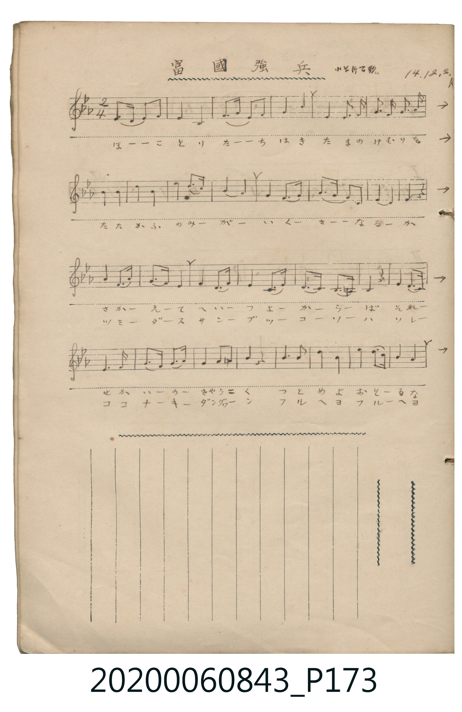
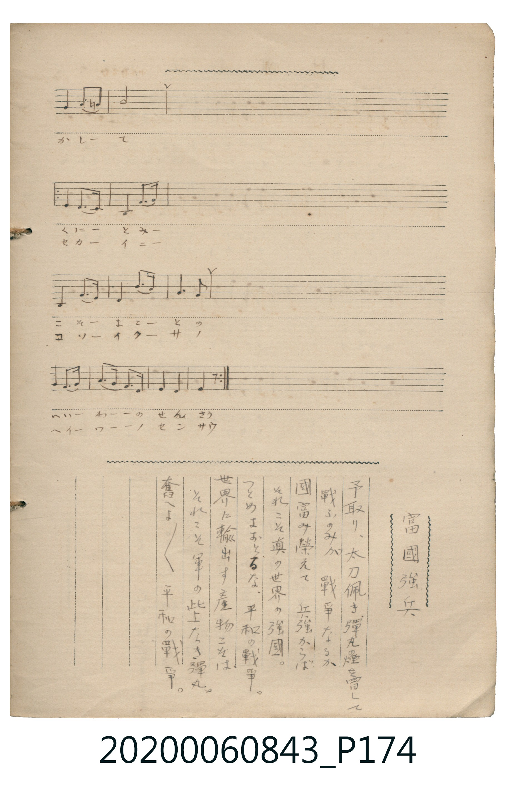

# 富國強兵

<audio controls src="fukoku_kyohei.mp3"></audio>

- 日治時期公學校《唱歌帳》（典藏號 2020.006.0843・P173–P174）
- 原載《小学新唱歌》（大正 14 年 12 月 2 日抄，署名 K）

## 說明

【曲目說明】
・出處：《唱歌帳》（國立臺灣歷史博物館典藏號 2020.006.0843）第 P173.jpg – P174.jpg 跨頁。
・標註：小学新唱歌 14.12.2. K（大正 14 年 12 月 2 日抄錄）。
・調性與拍號：變ホ長調（Eb 大調，3♭），2/4 拍，原譜為左右跨頁之手抄五線譜（P173 各行右端以 `→` 接續至 P174 同行）。
・背景與曲風：體現大正時期「實業與和平競爭」思潮之教材歌曲。歌詞指出真正的戰爭並非僅是手執刀矛、冒著彈煙交戰；
若能富國榮民、向世界輸出優良產物，這才是無上的彈丸與「平和の戰爭（和平的戰爭）」。
・版本說明：本檔案完整接合 P173 與 P174 跨頁五線譜，並依原譜反覆記號（第 17–40 小節反覆演唱第二段歌詞）展開為 64 小節。

・編曲說明（鋼琴伴奏版）：
1. 前奏 (Intro, 4 小節)：取曲末「平和の戰爭」樂句，以莊重有力的大調進行曲風格導入。
2. 主歌伴奏 (Song, 64 小節)：左手以穩健的進行曲低音與和絃交替伴奏。

## 歌詞

```text
【原頁歌詞全文與中文語譯】（對應 P173.jpg – P174.jpg）

［前段（第 1–16 小節）］
矛（ほこ）取り、太刀（たち）佩（は）き、彈丸（たま）の煙（けむり）を冒（おか）して
戰（たたか）ふのみが　戰爭（いくさ）なるか

［後段・第一回（第 17–40 小節）］
國（くに）富（と）み榮（さか）えて　兵（へい）強（つよ）からば
それこそ真（まこと）の　世界の強國（きやうこく）。
つとめよおとるな、平和（へいわ）の戰爭（せんさう）。
努力吧、切莫落後，在這場和平的戰爭中！）

［後段・第二回（第 17–40 小節反覆）］
世界に輸出（つみだ）す　産物（さんぶつ）こそは、
それこそ無上の（このうへなき）　彈丸（だんぐわん）。
奮（ふる）へよ奮（ふる）へよ　平和の戰爭。
奮發吧、奮發吧，在這場和平的戰爭中！）
```

## ABC

```abc
X:1
T:富國強兵
M:2/4
L:1/16
Q:1/4=116
K:Eb
V:V1 name="Piano" snm="Pia"
[V:V1]
E3 F E2 F2 | G4 E4 | F3 G F2 G2 | A4 B4 |
G4 F3 G | A3 B A3 c | B4 c2 =A2 | B8 |
c4 c4 | c4 c4 | d4 e3 c | B8 |
G4 F3 G | A3 F G3 E | F8 | F4 z4 |
G4 F3 E | E4 F3 G | A4 c3 A | G3 F G4 |
B4 G3 B | G4 E3 F | G3 F E3 D | C4 z4 |
G4 F3 E | C4 G3 F | E4 c3 B | G4 G4 |
F4 G4 | A3 F G3 A | B4 c2 =A2 | B4 z4 |
c4 c4 | d4 d4 | e4 e3 d | c4 c4 |
F4 G3 A | B3 A G3 F | E4 F4 | E4 z4 |
G4 F3 E | E4 F3 G | A4 c3 A | G3 F G4 |
B4 G3 B | G4 E3 F | G3 F E3 D | C4 z4 |
G4 F3 E | C4 G3 F | E4 c3 B | G4 G4 |
F4 G4 | A3 F G3 A | B4 c2 =A2 | B4 z4 |
c4 c4 | d4 d4 | e4 e3 d | c4 c4 |
F4 G3 A | B3 A G3 F | E4 F4 | E4 z4 |
```

## TMD 檔案連結

- [主旋律 TMD 檔案](fukoku_kyohei.tmd) [[在 TMD Studio 編輯](https://tmdlang.github.io/Tmd-TS/#tmd=s7IKdvYPcrWy4qpTUCpJTLdSSM7PyUlNLsnMz7MqzsjPTkzOyFeCS5bl55TmploBqXgDQ4RwcX5pUXJqfEFieqpVgKG5MboM3KT4vPyS1KT8_GyEioKi_LLUvMQ8oKrcxLzS4uSizIKS-OT8gkqEmtSyzJRUkIrUlMyS_KLMxBwkJ6UWFYMdC3FDSVFiHsQMoKASl5aWwtP1PU_ndD_ds_1p61YFLS0uRVsFQ0MzLntbBVcdLhsjfRM7kFnPpi99tmn3s5lNz-bMf9q65unaHc8WLHzc0PV0ysZna3ue7tj8uKH7_Z6Op607XkzvfzFzvoKRgZGBnoGBmZ6BhYnx4-bdIH8_apgMpEze7-kEu-9p3_wXezpBhmzof7p22bNpGyCmQY1asvzZ2sUKhiYKT3duUTA0Ung2p0MBSAId0tXyfk_P872bnk7oVfAGm8alr6VgSy3ApaCg8LhhwrPZm57PXvdi1apnM_oeN0wEizbvftq-68XMqe_3zMLi-Tndz1d3v2jf9bxx8bO125_2b3raO-t558qXS1bgCBeg25-vWaMAChu9rIJ0BWAAgTgmYM6L7SteLmh83NAEtfnZipkvVuwG2owWXMAg0jM00jPSA4UF_mB72QMMOWCIw4x8sWr_s4blLzran3X3Ah0HNPvFuq7HzbNfTt0OlAKa5pqkADQQzO4xfjRzLVA3kAVMFApAHUAWKArXznnetOvp9mVP-zdDnPxkZ_ezzm6gdU92TXm-fRZQAdAkkB8Vnk5oebGwB6jw-er1T3YvVUh41DYpQeFZ39Lnu3petG8G-x2oqAeoCNWdzT3PZq4HuXP2ppeLVgDd-XL1lOf9-yCehaTKxw09T9cve7Z0LVDZ00k9T3cCLdn2vGPt44beZw1zn-1dB3LW1JnP5k4AhhnQHKDpQMaLlfOe9bQDI_X5nPlAo57PannWsQGo68mOZS_nznva3PpsxnqgZ57O3_60o-H5_NmPGxqftk16MXH6070dz1tnPtm1BKj-_Z7ZIIcqKLzoXvqieS8kRz1btu7Zhokg9RMmPtkx7fnUnhd7dgAtetqy6kXn-udTFgFTBjAEXzbMfNbZC7TlecvCJzu6gA4Amvxkxw6gL0A-2rkZ6JfHjesgrgLFL8RrMHeCg6kXEVLPOzuezVkDSbTAYAKyn62a8mxhx9N1Pc-mbgGG9NMJHeD0pgC0ABLe0EhDxFUP0PNP9s2FxO3T_t4Xy9perJgBTh8doORqaA5MpyYGCsB0-Hx9A0TBsz1TgKkRKPtkV8-zdVshIQt03NONU19O6wYmEAUzYMyCNYAcC81iQCuAVkMUP21d8WxaO9BVT3asBTFWzXuxdj0w34H8vKH3WXsn9mwCtANs2vs9u58Cw3HdVpgjgYoMzaBWgpPtXoiloFgEqnncuPtx42SQC_unPW7qAsXTklXAOAZLzX_cuBAo9WQvMIaA3PWgUG4EhnIjJG5gavaBxdcB0wFYZOLjpgagUSDBpknAVAIW7HrcCCwbgMqmP25cBnUBOMlAjAAiiPRWoEGPG_c_bgQWfyAFkNh-3NjyuLH_cSOwwAGqWfW4qRuoHuLdDkgIgSIZnD6BeRaSPl-0bgA6HOIbeHJ9trwXlGIXzgU69sXCuS-7J72cuf3lzMWgFDh78cvGyU_7Vz2b0wlKjSsWAxPk0_7VTxtnQdzxdDowKQEjHxHQ-0BxDEptwPje0fB0NjCmsaQMlFAH5giwf4CeWQ0K9fXAHA7kAvMy0GP7gZkFzJ0KCw4gexlIVysoPh837gAGBEjXnu1g7pLHTR1gZd2Pm4DkBqgdjxvnPm4C5pbJQAYwP4OV7gNzIdasA6qBZEUgG1TjQd3U-7gJGMxtYJX9SAUPyMQlQM2PmxqBFoLjEsgGRsEqULiCsybcdY-bwDqRcurjxtmPm4AmAv3UhjAUOeKAYf5iWSOo9l23DRggLxZPfb6zERgUINNbtz7tmg104_PZwNTa87IJFCmgUgJcTEE8AS0uoP6AFkFPu1aBNE5YDjKko_1F3-oXE_YCIwxUWM9ZAYzfpwu2oJUhwAz3fk8jrvjd1YMrfiE5HyWWYaG7GlLWQSMLlKwXgENnJij_TVkMLvrA0Q0KoG1ANWBZULwBcxvQ5dgiFFw-AgMYrBMoAswuwCgDhv0qYAyCA7gBKXsuABs9ARgtQAZKnD5dCjFiKzAqwdbuAEYuVkGQYtQCGFskTpgILLqQS3hgwAI9CCzhkSMOWL29XD0DrZBHxNrSdc9n7oHGGoxNVJQBNVPe4oECBS19Lq7g_Lx0q4DMxLx8hxqDGoVqsANtDM207MAsYEMLUs7CClkLeG6H1PFgcQVgDa4ArNwhNQxcCJxWZoGK3uY9wDhUqFEA5igFYJkJZs0Hiy4Es9cDcS9EFIiBmXgdmAMqYkHqgQUsmN8FxMD8OB2oE8xfBvICyJk1QAt1gdAITBsBcY2CMVhEFyoDEgGJ6wLFQTRItkbBBCpnClMDNQ2mF6YDptIUSpsBRWB6zIDYRB1sHEwIBmvAWQw1EC1RaypEKBohBxmorgB7EejdrWDGOiDeD_N4D4zRAsT9MM5UEAOYQUAcYLkFFe1GBBLIqTAnQ4IEU8QcFmxxGD5FeAt_KBlBZQzhYY6kFy5igBlI4IIIUvjAKhpIcPQD_bEa5iFgEkKExFRwGEE5HZAAWAbm7AAFD0xmCTBEwLKQMAUpA1YlUP4GRAihegnkAVjyQfckLMxM4Lpg3kYEECzgIOKmGInSCEkvRMQ8HhQp8TiDCFgyAl0Oj_7JIAEYZx9IADmQIJloNjgNgBMLJHjWwdRAK0KwOSB-P75wgDsK5mBE0EACAtl76AEBi3O4OFpKAQUinvyELRyAMQr0JCilN4LiFl4-rID6rqkblhVQUgKwgoAEAixsmiB-B6WjNnw5BZYvYDTQ-5AcAs8q5tj0YQ0AhHdNsAQnTC1ChEBWAdfZSNXzrMdNu4Eeg2WYJmBQNcPySDOwxGgGFb1gTgMkJ-wEK9sKFNgMk5kGUgozACz6uGkvTBJvQhlkGaZpL9DBa-A-QfIGKFya1sM4IN_3wdRAWM3AzjHI32uRggtkwIbHzevB_M1DKMM0A1N482qws2cAMTjrQMRgvkMIA1lNS2DC4BCChQ0wXQF9DQ2vJqT6d7BmmFouLl07BVArRwFIK3MBAA)]
- [鋼琴伴奏 TMD 檔案](fukoku_kyohei_piano.tmd) [[在 TMD Studio 編輯](https://tmdlang.github.io/Tmd-TS/#tmd=s7IKdvYPcrWy4tLSUni6vufpnO6ne7Y_bd36fk_Hy-49zydsebJny9Ol_c87O97v6VTQ0uJStFUwNDTjsrdVcNXhsjHSN7HjqlNQejZ96bNNu5_NbHo2Z_7T1jVP1-54tmDh44aup1M2Plvb83TH5scN3UAjn7bueDG9_8XM-QpGBkYGegYGZnoGFibGj5t3BxiaGz9qmAykTIAWKYHMfNo3_8WeTpAhG_qfrl32bNoGiGlAo5S4uPS1FGypBbgUFBQeN0x4NnvT89nrXqxa9WxG3-OGiWDR5t1P23e9mDn1_Z5ZWLwzp_v56u4X7bueNy5-tnb70_5NT3tnPe9c-XLJChw-Bfrt-Zo1CiDf6mUVpCsAvQzimIA5L7aveLmg8XFDE9TmF6v2P2tY_qKj_Vl3L9AkoBNerOt63Dz75dTtQCmg_a5JCk-XLAezO9_v6QFGhgJQKZD1smH-013LFCBxhTDw-fYVQD9CPIg1goFWgJQqKBjqKTzt7AWKK2h45pUU5esomCgAo-H5-gZNoJqn_dOA5jybs_pxQ8_TnZufTup53LjuWceG5x1rHzf0PlvR9LR_KdAVT3YvfdHX9bK999mczqdds5_PaoG49mXDphcLe4AmvFy04tmCPU839D1tXQp1pYKCkZ7Ckx27gcEMcZiCRnB-XrqOghmKA7Yve9bZDTT_-cqVTxuXAk2Gm_lkb9_L-ZuBgQZ01fOtzU92LXk2ez_EKKgVlKcXKFDQ0ufiAgePVUBmYl5-kIdDjUGNQjXYHzaGZlp2YFaNgpGCLhgag0kToIgplAURMQKKGELVwNQiRAxgIly1KNb5oFhnAbfNND5eIdo0PhbBAJoFZBnGwqgaBROQlAkuNQYQu0ABT8BnEDcagWmQy2ugPtKFux7me2MwDZIF2g6Vg4QCyGcQ02B6YTpgKk2htBk85EBsYPipg42DCcEgzDiQEphSiFMwRcxhzo3DsAHdOFyuM4LKGCLFNFwvXAQRi9hMA-lFTQEI82HOBaUbWHqB6YaZBnMzRNwUIx5AKQymFyJiHg8Kj3iiXQdXiplkIc5DthTdeagZAJEEYB5BZAmsEYvuOtzRCKOBjoNEKDxmzbHpo3L-HI3Z4RqzKKUhroIXvZBF52MrmLEUxKimYVMLZyCZaQRiGKGKgRigshxiIDbteI3E7nCEgXhciNfPRBuHs9ZCci2aGiKjwhhkgDHQADgDlA-ATLP43FgwC5-7ECqh2oEsUlyHGcJ4Ao68iMXTCMDqZYRWqrYiRmN2uMYssETUtVMAN0cVgAxQ6QiilbkA)]

## 分析

```text
================================================================================
📊 TMD Song Profile: [ 富國強兵 ]
================================================================================
⏱  Duration:       1:06 (66.2s), 64 measures total
🎼 Key & Tempo:    首調基準 E,, != 116.0 BPM, <2/4>
   - 分析範圍：      由實際發聲的音符與和弦推測調性；播放脈絡另行呈現
🎤 人聲音域:    C4 (MIDI 60) – D#5 (MIDI 75) [跨度: 15 個半音 / 1.2 個八度, 難度: moderate]
   - 最低音:  C4 in [Song #1 @ m.24, 0:23]
   - 最高音: D#5 in [Song #1 @ m.11, 0:10]
   - 適合: soprano, mezzo-soprano, contralto, tenor, baritone, bass
🏛  結構:      Song (66.2s)
⚡ 編曲密度:        Peak 1 軌道同時演奏
🗝  調性診斷：       C 小調（純淨自然小調，未偵測到可信轉調）
   - 風格氣質:    純淨自然小調（陰鬱抒情、旋律集中，無明顯調外色彩）
   - 轉調歷程:    全曲維持單一推測調性（未偵測到可信轉調）
   - 核心骨幹音:  G, C, F, D#, A#
   - 調性數值:    C 小調 [相關度: 0.78, 穩定度: Moderate, 自然音純度: 98.8%]
   - 候選調性 (K-S): C 小調 (0.78), D# 大調 (0.72), G 小調 (0.67)
   - 五度圈歷程:   +0
   - 各段落調性細節:
     • [Song #1]: C 小調 (r: 0.78, 自然音純度: 98.8%, 調外音: A)

  [ 五度圈游移軌跡 ]
              [C ]*
         F            G  
      Bb               D  
      Eb               A  
         Ab           E  
            Db       B  
               F# 
     (* = active key center)

  [ 十二半音累積音高分佈 ]
     C  : █████████████████         17.4%
     C# :                            0.0%
     D  : █████                      5.0%
     D# : ███████████████           15.5%
     E  :                            0.0%
     F  : ████████████████          16.7%
     F# :                            0.0%
     G  : ████████████████████████  24.8%
     G# : ███████                    7.2%
     A  : █                          1.2%
     A# : ████████████              12.2%
     B  :                            0.0%
--------------------------------------------------------------------------------
Assignment 軌道音域：
  - Piano         : C4 – D#5 (15 個半音 / 1.2 個八度, 166 個音符)
================================================================================
```


## 原書掃描頁






