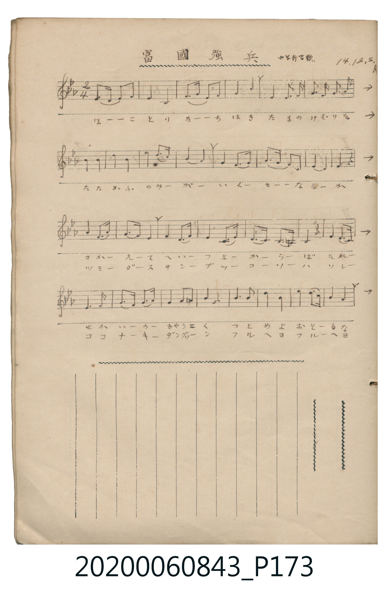
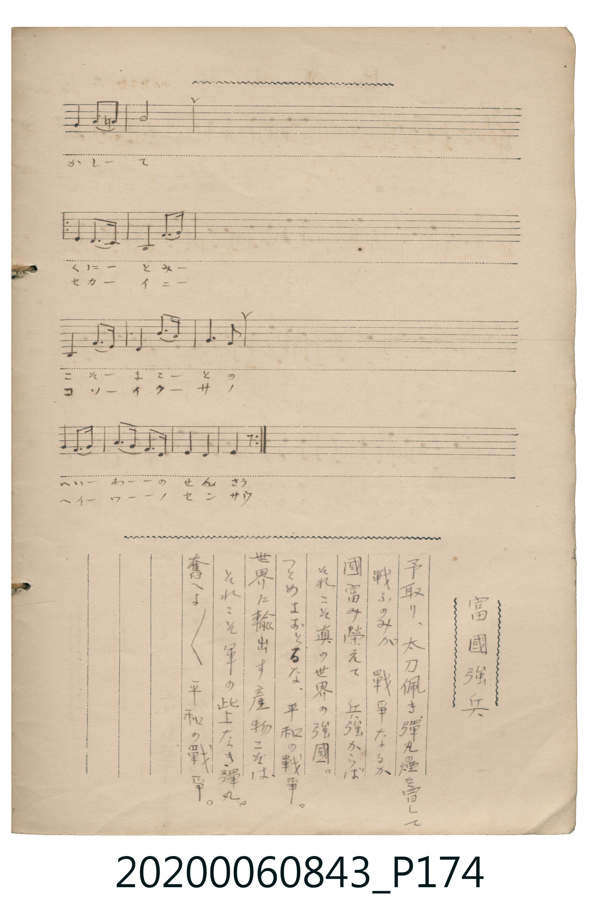

# 富國強兵

> Re:Shōka 使用 AI 協助辨識與重建樂譜，可能會有錯誤。歡迎[回報](https://github.com/TMDLang/reshoka/issues)。

- **鋼琴伴奏版**：<br><audio controls src="fukoku_kyohei.mp3"></audio>
- **NEUTRINO 歌聲合成版**：<br><audio controls src="fukoku_kyohei_neutrino.mp3"></audio>

- 日治時期公學校《唱歌帳》（典藏號 2020.006.0843・P173–P174）
- 14.12.2.K 抄（大正 14 年 12 月 2 日）

## 說明


- 出處：《唱歌帳》（國立臺灣歷史博物館典藏號 2020.006.0843）第 P173.jpg–P174.jpg 頁。
- 標註：14.12.2.K 抄（大正 14 年 12 月 2 日抄錄）。
- 調性與拍號：變ホ調（E♭ 大調），2/4 拍，速度 != 116。

### 編曲說明（鋼琴伴奏版）：

1. 前奏 (Intro, 4 小節)：取曲末「平和の戰爭」樂句，以莊重有力的大調進行曲風格導入。
2. 主歌伴奏 (Song, 64 小節)：左手以穩健的進行曲低音與和絃交替伴奏。


## 歌詞

```text
（TMD 檔案未包含歌詞註解）
```

## ABC

<div class="abc-score" data-abc-src="fukoku_kyohei.abc" aria-label="五線譜載入中"></div>

[下載 ABC 原始檔](fukoku_kyohei.abc)

## TMD 檔案連結

- [主旋律 TMD 檔案](fukoku_kyohei.tmd) [[在 TMD Studio 編輯](https://tmdlang.github.io/Tmd-TS/#tmd=s7IKdvYPcrWy4qpTUCpJTLdSSM7PyUlNLsnMz7MqzsjPTkzOyFeCS5bl55TmploBqXgDQ4RwcX5pUXJqfEFieqpVgKG5MU4ZE3QZuB3xefklqUn5-dkIFQVF-WWpeYl5QFW5iXmlxclFmQUl8cn5BZUINallmSmpIBWpKZkl-UWZiTlIjk0tKgZ7A-KGkqLEPIgZQEGEqpKMVKCPcjNzMksSi5BMBhqWnplnVZoHsqAkMy0zNQVZsiQjP70osSCj0iojsxhkc3JiTnx2Yl6iEpeWlsLT9T1P53Q_3bP9aetWBS0tLkVbBUNDMy57WwVXHS4bI30TO5BRz6YvfbZp97OZTc_mzH_auubp2h3PFix83ND1dMrGZ2t7nu7Y_Lih-_2ejqetO15M738xc76CkYGRgZ6BgZmegYWJ8ePm3aCwftQwGRSw7_d0gp1naKJnaKRnpOet8KyrBaR5yfJnaxcrGJooPN25RcHQSOHZnA4FIDl9KVgHl76Wgi21AJeCgsLjhgnPZm96Pnvdi1Wrns3oe9wwESzavPtp-64XM6e-3zMLiwfndD9f3f2ifdfzxsXP1m5_2r_pae-s550rXy5ZgcPvQLc_X7NGAeR_vayCdGgYgJgKLxc0Pm5oglr6bMXMFyt2Ay0lPliA8i97gEo6Eaa8WLX_WcPyFx3tz7p7gU4BGvdiXdfj5tlAcaBRro9mrlUAmgfmdb7f0wOMXgWgSiDrZcP8p7uWKUBiH2oe5cEMBQpa-lxcwfl56VYBmYl5-Q41BjXVIAsUbAzNtOzALGDkPu3sfbZuKyiwDIGhZKHwdEP_8_UNQGeDwk4BLK7wYmGPwqO2SaDgNEEIgT0z63Hj7sfNex43TlaoUXjcuELhcVMXmDUfLLoQzF4PxL0QUSDe97hxHZgz8XFTA0j946ZJYH4XEHc_bpwO1AnmLwP5AOTMGqCFukBoBKaNgLhGwRgsoguVAYmAxHWB4iAaJFujYAKVM4WpAZvmYwgyfDdYBORukKuBLKC7QXpAboSoBjkDZjbIJxD1EL-AWCB1IJl9MPVAbyHbg3AjzGUwF5lCaTOgCMxtZkBsog42EiYEg8jOngizDBh0EBoc3MAQhDgBHIZQ9nSQDNwToPCEeQpZHGELZpKwBCYJQzMsacIIOQHMB4UFyHHAyNsKZqwD4v2waOyBMVqAuB_GmQpiPG5cBXZ9N0y0GxHloACBBQwkEjBFzKEswziM8MQWePCYhbMgdsJEtyKJwuIS6BEo3YMj2PDHtRFUxhCeQpH0wkUMsLi2Be6Cfig9FckFoKADBhyU3Y3dbUhi8XAb4NG8rwcYzcBYBUbokx0NT2fPg0VoP9DE1bAoAWZpRFxOBccylNMBicJlYM4OkIthMkuATgPLQlIFSFlTJ4y_ARHHqIEGCiJYdkYPRlism8B1wQIWNdAgQQUKktUQGu4LtOiEewgmDgvKDpRAXoZcDEBdDUtiEPtNMQojIyQ3QkTM40HJFxYF2CJ7B9wdkGhHhCRUvKkDRRzq2qZOJLduIBDhjxvnAnXAsyOo5JsL4-wDCSBHOaSIng1LW5C4BQrD1PQ-bmp53NgGNgcS8HhiFe51WLAgIhoSrciBiC1a58KDoQclGCbDgw2iAuEdmDhEBchPKLkaI1JhORFuO1r-BSU8PGU1tjidDXcErIhBZGtwGQmPOXDl2ITI8G1wpyOnaWwxCsxpEK81NYLTCKweXQENCWAJAS1kUXJoE7gcRorlJkgsgvJ3G74yGFbiwmhgRELKXnghbI5NH1KowFM0PE9CXA-LYEg6h_gcVCUjqwV5ByS-CiZOIBoRkWaCJenB1CJEiMqZTf0oJQSoroPENCIQkeMR6hdiC-JdPcCC-Gl_74tlbdDiuGk30GRYcdwEjPBmWAncDKxRm0ENLTCnAVLO7gQr2_q4eTNMYhpIJUw_WPRx016YJN58S2FpDHQ5LFZRSmOgJ2DxBy3H4P6BiUMqaKCnkMMa6De6lMZNsIYAMBBR3DcNLo5SSjdBVTXtRbgVGLAESmOw6jUIIxCRAorkpvUwzlagsj6YGgirGdi7AMXiWqS4Bxmw4XHzejB_My1LY6DDYcGwBkswQAICa3Q3rYfS4GYi0C8wc2hfGiMcB7cWHJBwBwBDE8qGpDmEZzaARUFORxbHEqPNwOKzeTVY1QwgBpfLEDFYPCGEgaymJTBhcFzDYhmU3cEFCSjmm5A6QTQojYGug4UKJIdC_DgDLopURmOoBakDicPbVrQvjREugyYqWIKH5bo-eKmDCESYDlD_B-YXzHxZy8Wla6cA6i8rAGllLgA)]
- [鋼琴伴奏 TMD 檔案](fukoku_kyohei_piano.tmd) [[在 TMD Studio 編輯](https://tmdlang.github.io/Tmd-TS/#tmd=s7IKdvYPcrWy4qpTUCpJTLdSyC8qychPL0osyKi0ysgsLskvykxOzInPTsxLVIIrKs4vLUpOjS9ITE-1CjA0N9YFEiYI6ZKM1NxUq9SU0uTEksz8PCUuLS2Fp-t7ns7pfrpn-9PWre_3dLzs3vN8wpYne7Y8Xdr_vLPj_Z5OBS0tLkVbBUNDMy57WwVXHS4bI30TO5CZz6YvfbZp97OZTc_mzH_auubp2h3PFix83ND1dMrGZ2t7nu7Y_LihG2jk09YdL6b3v5g5X8HIwMhAz8DATM_AwsT4cfNukBMfNUwGORJoEdidT_vmv9jTCTJkQ__TtcueTdsAMQ1olBIXl76Wgi21AJeCgsLjhgnPZm96Pnvdi1Wrns3oe9wwESzavPtp-64XM6e-3zMLi3fmdD9f3f2ifdfzxsXP1m5_2r_pae-s550rXy5ZgcOnQL89X7NGAeRbvayCdAWgl0EcEzDnxfYVLxc0Pm5ogtr8YtX-Zw3LX3S0P-vuBZoEdMKLdV2Pm2e_nLodKAW03zVJ4emS5WB25_s9PcDIUAAqBbJeNsx_umuZAiSuEAY-374C6EeIB7FGMNAKkFIFBUM9haedvUBxBQ3PvJKifB0FEwVgNDxf36AJVPO0fxrQnGdzVj9u6Hm6c_PTST2PG9c969jwvGPt44beZyuanvYvBbriye6lL_q6Xrb3PpvT-bRr9vNZLRDXvmzY9GJhD9CEl4tWPFuw5-mGvqetS6GuVFAw0lN4smM3MJghDlPQCM7PS9dRMENxwPZlzzq7geY_X7nyaeNSoMlwM5_s7Xs5fzMw0ICuer61-cmuJc9m74cYBbWC8vQCBQpa-lxc4OCxCshMzMsP8nCoMaipBnvDxtBMyw7MqlEwUtAFQ2MwaQIUMYWyICJGQBFDqBqYWoSIAUyEqxbFNh9k2yzglpnGxytEm8bHIhhAo4Asw1gYVaNgApIywaXGAGIVKNjx-wviQiMwDXJ3DdQ_unC3w_xuDKZBskDLoXKQMAD5C2IaTC9MB0ylKZQ2g4cbiA0MPXWwcTAhGIQZB1ICUwpxCqaIOcy5cRg2oBuHy3VGUBlDpHiG64WLIOIQm2kgvajxjzAf5lxQqoGlFphumGkwN0PETTHiAZS-YHohIubxoPCIJ9p1cKWYCRbiPGRL0Z2HmvwRSQDmEUSGwBqx6K7DHY0wGug4SITCY9Ycmz4q587RmB2uMYtSGOIodtGLWHQ-tmIZSzGMaho2tXAGkplGIIYRqhiIASrJIQZi047XSOwORxiIx4V4_Uy0cTjrLCTXoqkhMiqMQQYYAw2AM0DZAMg0i8-NBbPwuQuhEqodyCLFdZghjCfgyItYPE0ArF5GaKVqG2I0ZodrzAILRF07BXBbVAHIABWOIFqZCwA)]

## 分析

```text
================================================================================
📊 TMD Song Profile: [ 富國強兵 ]
================================================================================
⏱  Duration:       1:06 (66.2s), 64 measures total
🎼 Key & Tempo:    首調基準 E,, != 116.0 BPM, <2/4>
   - 分析範圍：      由實際發聲的音符與和弦推測調性；播放脈絡另行呈現
🎤 人聲音域:    C4 (MIDI 60) – D#5 (MIDI 75) [跨度: 15 個半音 / 1.2 個八度, 難度: moderate]
   - 最低音:  C4 in [Song #1 @ m.24, 0:23]
   - 最高音: D#5 in [Song #1 @ m.11, 0:10]
   - 適合: soprano, mezzo-soprano, contralto, tenor, baritone, bass
🏛  結構:      Song (66.2s)
⚡ 編曲密度:        Peak 1 軌道同時演奏
🗝  調性診斷：       C 小調（純淨自然小調，未偵測到可信轉調）
   - 風格氣質:    純淨自然小調（陰鬱抒情、旋律集中，無明顯調外色彩）
   - 轉調歷程:    全曲維持單一推測調性（未偵測到可信轉調）
   - 核心骨幹音:  G, C, F, D#, A#
   - 調性數值:    C 小調 [相關度: 0.78, 穩定度: Moderate, 自然音純度: 98.8%]
   - 候選調性 (K-S): C 小調 (0.78), D# 大調 (0.72), G 小調 (0.67)
   - 五度圈歷程:   +0
   - 各段落調性細節:
     • [Song #1]: C 小調 (r: 0.78, 自然音純度: 98.8%, 調外音: A)

  [ 五度圈游移軌跡 ]
              [C ]*
         F            G  
      Bb               D  
      Eb               A  
         Ab           E  
            Db       B  
               F# 
     (* = active key center)

  [ 十二半音累積音高分佈 ]
     C  : █████████████████         17.4%
     C# :                            0.0%
     D  : █████                      5.0%
     D# : ███████████████           15.5%
     E  :                            0.0%
     F  : ████████████████          16.7%
     F# :                            0.0%
     G  : ████████████████████████  24.8%
     G# : ███████                    7.2%
     A  : █                          1.2%
     A# : ████████████              12.2%
     B  :                            0.0%
--------------------------------------------------------------------------------
Assignment 軌道音域：
  - Piano         : C4 – D#5 (15 個半音 / 1.2 個八度, 166 個音符)
================================================================================
```


## 原書掃描頁






