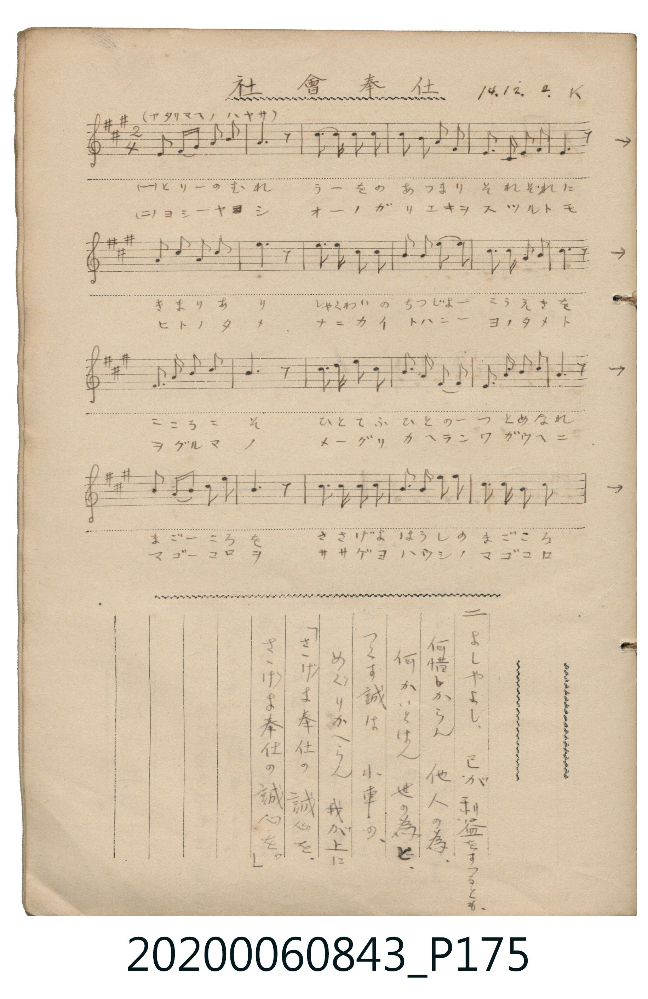

# 社會奉仕

> Re:Shōka 使用 AI 協助辨識與重建樂譜，可能會有錯誤。歡迎回報。

- **鋼琴伴奏版**：<br><audio controls src="shakai_hoshi.mp3"></audio>

- 日治時期公學校《唱歌帳》（典藏號 2020.006.0843・P175–P176）
- 14.12.2.K 抄（大正 14 年 12 月 2 日）

## 說明


- 出處：《唱歌帳》（國立臺灣歷史博物館典藏號 2020.006.0843）第 P175.jpg–P176.jpg 頁。
- 標註：14.12.2.K 抄（大正 14 年 12 月 2 日抄錄）。
- 調性與拍號：イ調（A 大調），2/4 拍，速度 != 108。

### 編曲說明（鋼琴伴奏版）：

1. 前奏 (Intro, 4 小節)：取曲末「さゝげよ奉仕の誠心を」樂句，端莊明朗地揭開序幕。
2. 主歌伴奏 (Song, 30 小節 × 2 段)：左手以穩健和諧的大調伴奏支撐全曲。


## 歌詞

```text
（TMD 檔案未包含歌詞註解）
```

## ABC

<div class="abc-score" data-abc-src="shakai_hoshi.abc" aria-label="五線譜載入中"></div>

[下載 ABC 原始檔](shakai_hoshi.abc)

## TMD 檔案連結

- [主旋律 TMD 檔案](shakai_hoshi.tmd) [[在 TMD Studio 編輯](https://tmdlang.github.io/Tmd-TS/#tmd=s7IKdvYPcrWy4qpTUCpJTLdSSM7PyUlNLsnMz7MqzsjPTkzOyFeCS5bl55TmploBqXgDQ4RwcX5pUXJqfEFieqpVgKG5KU4ZM3QZuB3xefklqUn5-dkIFQVF-WWpeYl5QFW5iXmlxclFmQUl8cn5BZUINallmSmpIBWpKZkl-UWZiTlIjk0tKgZ7A-KGkqLEPIgZQEGEqpKMVKCPUksyMpOLEaJAo9Iz86xK80DGl2SmZaamIEuWZOSnFyUWZFRaZWQWg-xNTsyJz07MS1Ti0tJSeL5k37M5zU-Xdj7ZPVVBS4tL0VbB0MCCy95WwZHLxkjfxA5k0rPpS59t2v1sZtOzOfOftq55unbHswULHzd0PZ2y8dnanqc7Nj9u6H6_p-Np644X0_tfzJyvYGRgZKBnYGCmZ2BhYvy4eTcooB81TAaF6vs9nWDXGZroGRrpGel5KzzragFpXrL82drFCoYmCk93blEwNFJ4NqdDAUhOXwrWwaWvpWBLLcCloKDwuGHCs9mbns9e92LVqmcz-h43TASLNu9-2r7rxcyp7_fMwuLBOd3PV3e_aN_1vHHxs7Xbn_Zveto763nnypdLVuDwO9Dtz9esUQD5Xy-rIB0aBiCmwssFjY8bmqCWPlsx88WK3UBLiQ8WoPzLHqCSToQpL1btf9aw_EVH-7PuXqBTQH5oWgIUBJrjqAA0CczsfL-nBxixCkA1QNbLhvlPdy1TgEQ71CTKAxgKFLT0ubiC8_PSrQIyE_PyHWoMaqpBFijYGJpp2YFZwGgFBZAhMGTMFJ5u6H--vgHoWlB4QcQVXizsAbt51uPGFY-buh4371F43LjucVODQo3C46YeBQMQ3dgGFm-aBJQC85seNy4BUvuAOsD8uSCljxvngSgQfzVQH9BxIBfUKJjGK-gqGMeDaEMgC4RrwCQMGoBFjMBsI7AMiF2jYAxlQdSaxaOaBeTrQvhQYRTjwHb7GIIcswLIBzkU6jcwrwGsDeRchD6IUUDPgnlQH4NYYD1gb4N5S8DkPogqWACA2SDTgKEAZ0OCAs0GiMuMQLZ3gNVPB6tvAZMgEZAukBi6u7oQ7oL4ohFqB9ANIB7EtF6ouyaB9cxEuLipG8wGhQZID8gvqO5CTjDmwARjaICSYswQKUbhUdskcKYDCxkhJyJ4CmpcCnZA9-OmTojQKpALQEK9oMADpTVgeEJcj5RYIHFtBI97iAgoVSDHN5gNkoAzYOkHexLADLql0EAFB0pTJ1RuFTygwA4FqwRFNCyIQYEGC3AckQo2A2YXKPIhtsMiFWQjWA6IITZDTJwM1gNObs3giGzug8rsxxtRhqCsDSq-MPI2SrRMf9zU_Lix_3FTP9AFLbBsvBCSjWc8bmoHuQckNBmU_oFpCeR7kO2TkCMHFCnA7AcOakTkgOMAxAVJQ-KBhKgBuQwSYnDngTmwPLcQzIPkOZBDoWELkQSHGjjDIid_iLtxxlAzyEiQKaAiARL_oHgC6QJbAw3_fjAJTQuQ2GqGFCWgGIGYApIBqcYTP6CK2dACS04Cxw9qTjJGjrKZkCQ083FTI9iv6x83TgKXucBMDY2pyUDHAHPTZGgRhCWmTOHRAo4OcKyAWWACXnACefAoI1CagkoUWPIGly5A50EiYz00GsGuBLNA8rBoAvHB7oWyIDKgchNXNEGTBbgcBpn9uGknNMhBJSyIvxklskAym6AyG4BscOYDqwXJgLITnmiyBEaTkRGWbIQSJ5tA5efjxmWPG7eCnQ_lr4PlniVgflMjqBSAVC9IcQKr4FCLNnCog0McuS5DLeAIRAnU0xCngVlbocGLLAMu9-A5B5KhIOkZFIGQcgtrlYiZc8DBCykroTmneQY0slYC8WYwCxRlIPPWgNWB3QVWhZqncEeJkTEoSlBbLZCcA44S1JxjghxLU4EIlA5B1SnIr7shZdp0WLEHzEJTIAl4Mig9Yi3mkDEsoqB1EDRKoLFjiFQamuOLpangUIaQ4HIeXtnvhsYS2JFgFqzwg2SjKdDsBi7twBmIQAnXBIp_GAlKA5CSCxTmoIwCiY_HTdvBMtB6BpxRHjdtgWY4SByuhcpB0hHOmAK1FoxRWwtI0QKLKUjkkRxTOKMJFu6otREomhARB8lzkBoLHDtYWp5UiCNoLNEhhqBxRDB-arm4dO0UQJ2DaB_DWAU42wjMVuYCAA)]
- [鋼琴伴奏 TMD 檔案](shakai_hoshi_piano.tmd) [[在 TMD Studio 編輯](https://tmdlang.github.io/Tmd-TS/#tmd=s7IKdvYPcrWy4qpTUCpJTLdSyC8qychPL0osyKi0ysgsLskvykxOzInPTsxLVIIrKs4vLUpOjS9ITE-1CjA0N9UFEmYI6ZKM1NxUq9SU0uTEksz8PCUuLS2F50v2PZvT_HRp55PdU9_v6XjZvef5hC1P9mx5urT_eWfH-z2dClpaXIq2CoYGFlz2tgqOXDZG-iZ2ICOfTV_6bNPuZzObns2Z_7R1zdO1O54tWPi4oevplI3P1vY83bH5cUM30MSnrTteTO9_MXO-gpGBkYGegYGZnoGFifHj5t0gFz5qmAxyI9AeJS4ufS0FW2oBLgUFhccNE57N3vR89roXq1Y9m9H3uGEiWLR599P2XS9mAr07C4tz53Q_X939on3X88bFz9Zuf9q_6WnvrOedK18uWYHDJ0C3P1-zRgHkG72sgnQFoJdAHDMw58X2FS8XND5uaILa_GLV_mcNy190tD_r7gWaBHJC05KXU7cDxYGWOyo8XbIczOx8v6cHGNAKQGVA1suG-U93LVOARANQ3eOmRY-b9j9uXvW4ed7j5hmPm_uAZvc_bl7yuGkrUC_CuufbVwBDAOJ9rLELdABIqYKCoZ7C085eoLiChmdeSVG-joKJwtMN_c_XN2gC1TztnwY059mc1Y8beh43Tn3cNPdx46THTR2QdPO4ERjCC57ub37cNOlxQ--zFU1P-5cCnf189foXfV1Aq5_Nmf50zoZn_WtfTut-uqv_6c6pUCcqKBjpKTzZsRsYAxBXKWgE5-el6ygYG0BtVzg8XcFI4dm6rWBnbF_2rLP7ye6lz1eufNq49Omknherlz-f1QIJNYgJz6asfzZpwtNWkMehtlCemqBAQUufiwscPFYBmYl5-UEeDjUGNdVgn9gYmmnZgVk1QAfrouAaBUMgqQskjYEkCEPUgNgg2jweSREEGoBEuGpRrPNBts4CbptpfLxCtGl8LIIBNArIMoyFUYTUGECsAgU9fo-ZghxqHA-iQY4FYSzOhvrNCCwD8T_IzyAWRK1ZPKpZQL4uhA8VRg0FiN0QrUZwoyAiIEuQtYPZIAk4A-YcTBNBJsGiAGEiWCOIi4gnEs0zhWsGawLrBbPABNyLQB7cYDz-hgUmqr_B-sB6kMMN1fd4DIWlQ0R6hKVQZIdCTTJECiFwUsXlTGqleURCxJHk0ZM3SlImKkNAGSYgFSZgFSi6QDkCr1VIGuFMog1DcpcZiGkWnxurYARiGYFYSNpJdx821xDt2YEKOax-J91pRJVyunYK4DJVAcgAJTRkWpkLAA)]

## 分析

```text
================================================================================
📊 TMD Song Profile: [ 社會奉仕 ]
================================================================================
⏱  Duration:       1:06 (66.7s), 60 measures total
🎼 Key & Tempo:    首調基準 A, != 108.0 BPM, <2/4>
   - 分析範圍：      由實際發聲的音符與和弦推測調性；播放脈絡另行呈現
🎤 人聲音域:    C#4 (MIDI 61) – E5 (MIDI 76) [跨度: 15 個半音 / 1.2 個八度, 難度: moderate]
   - 最低音:  C#4 in [Song[L1] #1 @ m.1, 0:00]
   - 最高音: E5 in [Song[L1] #1 @ m.15, 0:16]
   - 適合: soprano, mezzo-soprano, contralto, tenor, baritone, bass
🏛  結構:      Song[L1] (33.3s) -> Song[L2] (33.3s)
⚡ 編曲密度:        Peak 1 軌道同時演奏
🗝  調性診斷：       A 調性不明確（純淨自然大調，未偵測到可信轉調）
   - 風格氣質:    純淨自然大調（陽光明朗、易唱易記，無明顯調外色彩）
   - 轉調歷程:    全曲維持單一推測調性（未偵測到可信轉調）
   - 核心骨幹音:  A, B, E, F#, C#
   - 調性數值:    A 調性不明確 [相關度: 0.77, 穩定度: Ambiguous, 自然音純度: 100.0%]
   - 候選調性 (K-S): A 大調 (0.77), E 大調 (0.76), F# 小調 (0.63)
   - 五度圈歷程:   +3 -> +3
   - 各段落調性細節:
     • [Song[L1] #1]: A 調性不明確 (r: 0.77, 自然音純度: 100.0%)
     • [Song[L2] #1]: A 調性不明確 (r: 0.77, 自然音純度: 100.0%)

  [ 五度圈游移軌跡 ]
               C  
         F            G  
      Bb               D  
      Eb              [A ]*
         Ab           E  
            Db       B  
               F# 
     (* = active key center)

  [ 十二半音累積音高分佈 ]
     C  :                            0.0%
     C# : ██████████████            14.7%
     D  :                            0.0%
     D# :                            0.0%
     E  : █████████████████         17.4%
     F  :                            0.0%
     F# : ███████████████           15.2%
     G  :                            0.0%
     G# : ███                        3.6%
     A  : ████████████████████████  24.6%
     A# :                            0.0%
     B  : ████████████████████████  24.6%
--------------------------------------------------------------------------------
Assignment 軌道音域：
  - Piano         : C#4 – E5 (15 個半音 / 1.2 個八度, 200 個音符)
================================================================================
```


## 原書掃描頁




