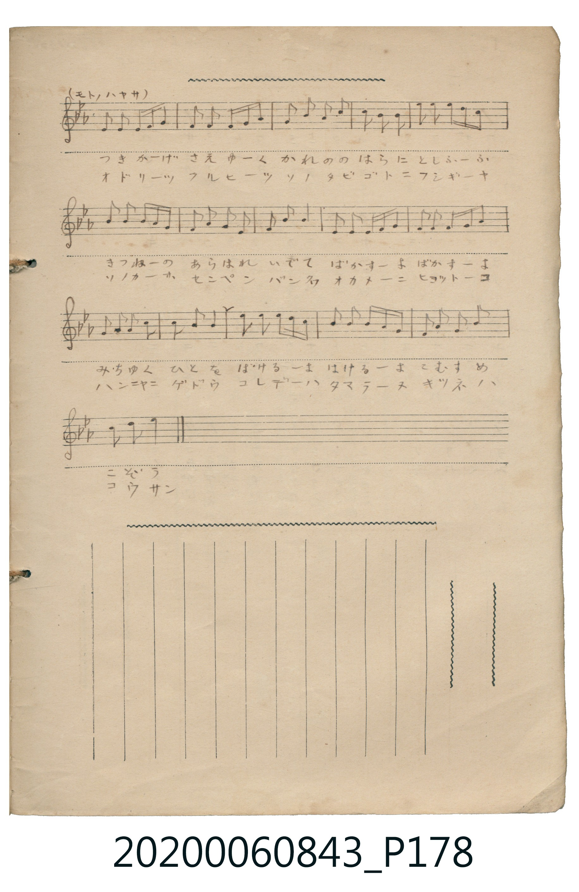

# 化くらべ （滑稽歌） (變身比賽（滑稽歌）)

> Re:Shōka 使用 AI 協助辨識與重建樂譜，可能會有錯誤。歡迎[回報](https://github.com/TMDLang/reshoka/issues)。

- **鋼琴伴奏版**：<br><audio controls src="bake_kurabe.mp3"></audio>
- **NEUTRINO 歌聲合成版**：<br><audio controls src="bake_kurabe_neutrino.mp3"></audio>

- 詞曲作者：未在 TMD metadata 中提供

## 說明


- 出處：《唱歌帳》（國立臺灣歷史博物館典藏號 2020.006.0843）第 P177.jpg–P178.jpg 頁。
- 標註：14.12.2.K 抄（大正 14 年 12 月 2 日抄錄）。
- 調性與拍號：變ホ調（E♭ 大調），2/4 拍，速度 != 112。


## 歌詞

```text
（TMD 檔案未包含歌詞註解）
```

## ABC

<div class="abc-score" data-abc-src="bake_kurabe.abc" aria-label="五線譜載入中"></div>

[下載 ABC 原始檔](bake_kurabe.abc)

## TMD 檔案連結

- [主旋律 TMD 檔案](bake_kurabe.tmd) [[在 TMD Studio 編輯](https://tmdlang.github.io/Tmd-TS/#tmd=s7IKdvYPcrWy4qpTUCpJTLdSSM7PyUlNLsnMz7MqzsjPTkzOyFeCS5bl55TmploBqXgDQ4RwcX5pUXJqfEFieqpVgKG5OU4ZC3QZuB3xefklqUn5-dkIFQVF-WWpeYl5QFW5iXmlxclFmQUl8cn5BZUINallmSmpIBWpKZkl-UWZiTlIjk0tKgZ7A-KGkqLEPIgZQEGEKqCm9Mw8q9I8kEElmWmZqSnIkiUZ-elFiQUZlVYZmcUgG5ITc-KzE_MSEYpKMlKBYZKaUpqcCDFaS0vhac-0x439j5s6HzfuVHi_p-PZ7onPV-x9trbn_Z5OBY0X67pe7Fr9bP2UF5v3oklqKmhpcSnaKhgaGnHZ2yq46nDZGOmb2HFx6Wsp2FILcCkoKDxumPBs9qbns9e9WLXq2Yy-xw0TwaLNu5-273oxc-r7PbMeN3Q9nbIR6KynOzY_bugGOvTpnO7nq7tftO963rj42drtT_s3Pe2d9bxz5cslK5627ngxvf_FzPkKRgZGBnoGBmZ6BhYmxkAfPV-zRgGUKPSyCtIfNUwGpQIQU-HlgsbHDU1QS5-tmPlixW6gpYYmeoZGekZ63grPulpAVi5Z_mztYgVDE4WnO7coGBopPJvToQAkpy8Fyr_sASrpRJjyYtX-Zw3LX3S0P-vuBToFaBwwpB83zwaKA41yfTRzrQLQPDCv8_2eHmDAKgBVAlkvG-Y_3bVMARLuUPMoD2YoUNDS5-LyTQQmsoDMxLx8hxqDmmqQBQo2hmZadmBWjYKxgi4QGyuYAmkQhIgYQXkQEUMgaRqPImQGJM2AmkA0SHEN2DgfwxoFZHUQtcSIPG7qB9KPm3oUHjeuB-INIF7jRITJRmSb3LweZFbzGiDuB9qwGmwPyPwaLmgYgPxuAMUgNsR7IBYsLCBhAMIgNSAaqAZkF5gA8cEMRCg8bpwP5IPEQPhx4wqIWxq7wLY3gcW2gskdUJmVcBmIjk1QcZBOUJiAyFVgEuQDRKg8bgbphNvUtB0ankvAvm4Hk2B201poeLSAxXrhOjZDxcE2NU8Ci4Ftau5BCSVY2FISTKhpBeI7EIT4uRtXKDV1Qn01Ge5isI5mqNvBIhAeMhsplMDhArepuQPq5wlgHRvBJCSdgEITJDMTzJsC19EMFQeJwEiQGIQNDyVQUMACCZSvIEECEjUHmUNQCBSc4MBFBBLYYQinA7MHMHJxeRrEAjkTPShApoD0wpMGhm7kJAXyEsLGZrAIwvMIb4NIEB9PwGDTBUmKsCADpSLUdEVakIHSFDitIYIM7C24B-ApHDNQgAEGZOEOTHCAQUoQjGDDGWDwnEaT4IKV1IgiDhQARmASUo7jEoFlVVCA4yuwHzeCvdrYC82Sjxs7gI5og8qBC2qgOKiwBrHWgTFEDhJQoMwKKaagBR-eIhxW1HQCMYTVAk3xoKAAmwEskh4374HL7YXK9YHt2g8WhxQLW9CDCbkqg4ggl1gQEVAdZgqEEBHkYEIvq6aDPQQpj0DBAgssUEkKCzJQTCGCA1yCAYMDXKeB6zagBxqXQ2WXgZ0O8RiCRE5VoFLqcTM4CpqnIgUZqCx73ASyBaYTZDtIBhQ4oKAB1XPABgiQ3g1LrUB6FlgWkoLBJR80HUODDFzPQzEiZRkSkbJwZENoNQ5JQ6ACFeYBsMeAsqhyIB3g-GxcCE1voNSGVhU2gSsorA0EWOUOTkdgNqwJsBAakNDqrXk5NIPBAxlcEIBTNijbg4McJLcYEQFNIFeA0ilSgMFSCyLAEGnMGChrSDCNoWZFSLqCBg84ZmHBgvAushqQDCTpN4AD8XFTI1gdSAwkNw9uzuNGUHCCTUMKLnAKhJZoa5CCC9JqgLTI9gNZ84B4JRD3gCMPnMZBWRHYhoCpgtXDSGm6CZRTIDYiZUlYBkRyCrjAhnkWXjIgZQNYYY6Qq-Xi0rVTALVto30MYxXgbCMwW5kLAA)]
- [鋼琴伴奏 TMD 檔案](bake_kurabe_piano.tmd) [[在 TMD Studio 編輯](https://tmdlang.github.io/Tmd-TS/#tmd=s7IKdvYPcrWy4qpTUCpJTLdSyC8qychPL0osyKi0ysgsLskvykxOzInPTsxLVIIrKs4vLUpOjS9ITE-1CjA0N9cFEhYI6ZKM1NxUq9SU0uTEksz8PCUuLS2Fpz3THjf2P27qfNy4U-H9no5nuyc-X7H32dqe93s6FTRerOt6sWv1s_VTXmzeiyapqfCoYYpCQGZiXr6CY3Jyfm5BYl5mbmpeiYKWFpeirYKhoRGXva2Cqw6XjZG-iR0Xl74Wl4ICDewDmRoM9riVwtMpG4Gqn-6YpqBhZGBkoGdgYKZnYGFirKmjAAoPvayC9EcNk0GhAmKCdPomFqVn5iXmZCZaKRia6Bka6RnpeStoPF2y_NnaxYYmT3duMTR6NqfD6Nn0pZpcWvpcXL6JmXlWYGc41BjUVIPMULAxNNOyA7NqFIwVdIHYWMEUSIMgRMQIyoOIGAJJ03gUITMgaQbUBKJBimugxoGMMYBiEBuiEsSCGQsxDoRBakA0UA3IcDAB4oMZcANh9lJiIrILQbpg5oE8DtENEjUHKScoBLIZ7A6oeSDXoLqPNPNAbgO7GSkEkWENWIURmIREEy4RWJiAXIRsGnKEQkSQQxAiAopJUyCEiCCbhhx24IQAxQi3GRLhNmw-hdmCMA3hNmOgrCFBt6H7FOYvsGlctcipP8iD2PRvqG2sDeKZx2sbgRlIGUEbnALitUFyKDLE5weQ8SBVMGsgZkINBKV3bUh2A1OIBG0crw1Ozkg0OAVBufDUHa-NJcdQyU4ziAKYPliiABuGmqWgRiGFF8lSMLci5zVDbROwP1B9RwXLoF6CisGsw0gBkLiGKjaCMWDpnJA4UtAbgr2B8BZGpKAmRZi_UeMPIY-aQ7DYhxZlCL_D1MC9CdduSKL3CAUk3EWIIMX0ICLjE-019KDEHmJYSgQf5BLBAl4gGIKSCDgPgdnQ3ITKNgIxwARSNWUATpIYBgARRBxRJaHUbURogogjuw-rJlQ2mIBpMiFSE7qf4AUzkkIMNoqfcLgDhY1kArIuTFlMNoqvkGXx2oXuQmBwQA0CpghdO2CrKjNPAYlW5gIA)]

## 分析

```text
================================================================================
📊 TMD Song Profile: [ 化くらべ （滑稽歌） 變身比賽（滑稽歌） ]
================================================================================
⏱  Duration:       1:19 (79.3s), 74 measures total
🎼 Key & Tempo:    首調基準 E,, != 112.0 BPM, <2/4>
   - 分析範圍：      由實際發聲的音符與和弦推測調性；播放脈絡另行呈現
🎤 人聲音域:    A#3 (MIDI 58) – C5 (MIDI 72) [跨度: 14 個半音 / 1.2 個八度, 難度: moderate]
   - 最低音:  A#3 in [Main[L1] #1 @ m.3, 0:02]
   - 最高音: C5 in [Main[L1] #1 @ m.4, 0:03]
   - 適合: soprano, mezzo-soprano, contralto, tenor, baritone, bass
🏛  結構:      Main[L1] (39.6s) -> Main[L2] (39.6s)
⚡ 編曲密度:        Peak 1 軌道同時演奏
🗝  調性診斷：       A# 大調（純淨自然大調，未偵測到可信轉調）
   - 風格氣質:    純淨自然大調（陽光明朗、易唱易記，無明顯調外色彩）
   - 轉調歷程:    全曲維持單一推測調性（未偵測到可信轉調）
   - 核心骨幹音:  A#, G, F, D#, C
   - 調性數值:    A# 大調 [相關度: 0.88, 穩定度: High, 自然音純度: 100.0%]
   - 候選調性 (K-S): A# 大調 (0.88), G 小調 (0.72), D# 大調 (0.71)
   - 五度圈歷程:   -2 -> -2
   - 各段落調性細節:
     • [Main[L1] #1]: A# 大調 (r: 0.88, 自然音純度: 100.0%)
     • [Main[L2] #1]: A# 大調 (r: 0.88, 自然音純度: 100.0%)

  [ 五度圈游移軌跡 ]
               C  
         F            G  
     [Bb]*              D  
      Eb               A  
         Ab           E  
            Db       B  
               F# 
     (* = active key center)

  [ 十二半音累積音高分佈 ]
     C  : █████████                 12.4%
     C# :                            0.0%
     D  : ██                         2.8%
     D# : ██████████                13.5%
     E  :                            0.0%
     F  : ██████████████            19.1%
     F# :                            0.0%
     G  : ███████████████           20.2%
     G# :                            0.0%
     A  :                            0.0%
     A# : ████████████████████████  31.9%
     B  :                            0.0%
--------------------------------------------------------------------------------
Assignment 軌道音域：
  - Piano         : A#3 – C5 (14 個半音 / 1.2 個八度, 286 個音符)
================================================================================
```


## 原書掃描頁





