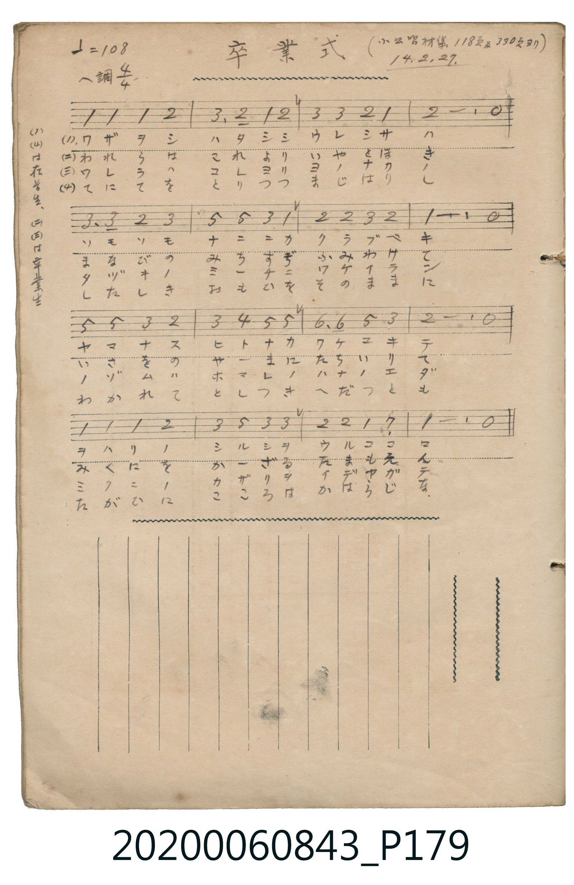

# 卒業式 (畢業典禮)

<audio controls src="sotsugyoshiki.mp3"></audio>

- 詞曲作者：未在 TMD metadata 中提供

## 說明

卒業式 (畢業典禮)
Source: 唱歌帖 (2020.006.0843), P179.jpg
Marginalia: （小公唱材集 118頁及330頁ヨリ） 14.2.27.
(1)(4)ハ在学生、(2)(3)ハ卒業生

## 跨冊／重複收錄參照

> 同名異曲（各冊收錄之不同詞曲版本）

- **[同名異曲]** 《新定兒童唱歌》尋常科第一學年用（2020.006.0847.0001）：[**〈卒業式歌〉**](../../../shintei_jido_shoka/grade_1_2020.006.0847.0001/0_08_sotsugyoshiki_uta/index.md)（`F` / `4/4` — [原始 TMD](../../../shintei_jido_shoka/grade_1_2020.006.0847.0001/0_08_sotsugyoshiki_uta/sotsugyoshiki_uta.tmd)）
- 總表：[跨冊重複與同名歌曲總索引](../../../duplicate_songs.md)

## 歌詞

```text
1. （在学生）
ウララカニ テルヒカゲ ノドカニ カヲルハナ
イザイハヘ イザウタヘ ソツギョウ ノ コノシキヲ

2. （卒業生）
としひさしく おしへうけし わがまなび の このまどを
いでてゆく けふのひは うれしさも かぎりなし

3. （卒業生）
オソレ多キ オホミコト フカクモ 心ニシメ
ワレワレガ ユク道ヲ 一スヂニ ススミ行カン

4. （在学生）
さらばきみよ わかれても こころは かはらずに
もろともに はげみつつ みくにのため つくさまし
```

## ABC

```abc
X:1
T:卒業式 畢業典禮
M:4/4
L:1/16
Q:1/4=108
K:F
V:V1 name="Vocal" snm="Voc"
[V:V1]
F4 F4 F4 G4 | A6 G2 F4 G4 | A4 A4 G4 F4 | G12 z4 |
A6 A2 G4 A4 | c4 c4 A4 F4 | G4 G4 A4 G4 | F12 z4 |
c4 c4 A4 G4 | A4 B4 c4 c4 | d6 d2 c4 A4 | G12 z4 |
F4 F4 F4 G4 | A4 c4 A4 A4 | G4 G4 F4 _E4 | F12 z4 |
```

## TMD 檔案連結

- [主旋律 TMD 檔案](sotsugyoshiki.tmd) [[在 TMD Studio 編輯](https://tmdlang.github.io/Tmd-TS/#tmd=s7IKdvYPcrWy4qpTUCpJTLdSSM7PyUlNLsnMz7MqzsjPTkzOyFeCS5bl55TmploBqXgDQ4RwcX5pUXJqfEFieqpVgKG5JboM3KT4vPyS1KT8_GyEioKi_LLUvMQ8oKrcxLzS4uSizIKS-OT8gkqEmtSyzJRUkIrUlMyS_KLMxBwkJ6UWFYMdC3FDSVFiHsQMoKASl5aWwtPeSc-Wrn26p19B4_nURSBm647ny9ZpKmhpcSnaKhgaWHDZ2yq4cdmY6JvYcXHpa3EpKODUBJILhvhJ4emUjc_W9jzdMU1Bw8jAyEDPwMBMz8DCxFhTRwEUCHpZBekg5b6JRemZeYk5mYlWCu_3dDzd0P-0dQ1I79wJL2e3KRgaWrxc0Pi0v8vY2ADIeNy84nHzqvd7OhUMTfSM9IzM9UBmaBhqaphoPm7ufzpnxdO1y55Pmf-4oVHDSFPDGCwIdixQkAuk1qeyKDO52ArENNQD2wjTAzQVJPq4adnj5pUg1LT6cXO3wuPmtsfNQNYkEL9pE5Df97i5EyYJojaB5fsfN3dB9C953LQNRIKEZsD5yx437Yfw9z5ubnnctO5x83KgKMg8oNhmkLFN2x83rQWaB3aoEcR1MMfDXNe44nHj9MeNmx43TgUz-oFCXWDWjseNbY8bJwLZQPP6Hzf2PG7c97hx1ePGzUAl64B4MpACiwG9NgliWMvjxuWPG4FOA-oEmQTUvRWsCmj-eiC_7XET0Big4VMfNzUB-d2PG4HOBNoHNHY62JnG2J3ZtArszzVPl8wC-gnMb579uHk-2KcdQE8DDQQG5_rHzYsUnu5vBoYlyPfNC8Gam4HCa6Bk0xogH-jA9S-B7m_epPBkR8Pjpp2Pm5sgwb8TzJn_YmEPOCo2g91kgj1iQZ7ofNy44XFj7-PG_Y-bgM4AhRPQZqAfgVaAPAgMo8mPm4DyIN8DfbserGXW48bVEG81gSVXgBiNq4FK1j9unAQyrHEJEAH5QBbQyNXgMAR6thEoBJQBCgFjCxjy07m09Lm4fBMz86zC8pMTcxxqDGoUqkFGK9hYaNmBGTUKhgq6cGwExDUKxkASxEYVAWEQDyRaA2bBoAFIBGoaRK8xWB7ErlEwBZIgDOIh9MLkIeaDxLGZhqwX4RITqCgI1yiYgXWZwdXhdht2n8L0IfTCfGmuE4_DdbVcXLp2wNIkM08BSCtzAQA)]
- [鋼琴伴奏 TMD 檔案](sotsugyoshiki_piano.tmd) [[在 TMD Studio 編輯](https://tmdlang.github.io/Tmd-TS/#tmd=s7IKdvYPcrWy4tLSUnjaO-nZ0rVP9_QraDyfugjEbN3xfNk6TYVHDVMUAjIT8_IVHJOT83MLEvMyc1PzShS0tLgUbRUMDSy47G0V3LhsTPRN7Li49LW4FBRINgykJzi_tCg51Urh6ZSNz9b2PN0xTUHDyMDIQM_AwEzPwMLEWFNHIcDQ3FIvqyAdpNw3sSg9My8xJzPRSuH9no6nG_qftq4B6Z074eXsNgVDQ4uXCxqf9ncZGxsAGY-bVzxuXvV-T6eCoYmekZ6RuR7IDA1DTQ0TzcfN_U_nrHi6dtnzKfMfNzRqGGlqGIMFwZ4ACnJp6XNx-SZm5lmF5Scn5jjUGNQoVIP0K9hYaNmBGTUKhgq6cGwExDUKxkASxEYVAWEQDyRaA2bBoAFIBGoaRK8xWB7ErlEwBZIgDOIh9MLkIeaDxLGZhqwX4RITqCgI1yiYgXWZwdXhdht2n8L0IfTCfGmuE4_DdbXQYAWniCAP7AFrGq8N0olKAc3UhvpZGxbOOKQgJEwUqqgGWQALE8W_UBuM4XogImAZbZC_kWhkK8wgqqEUSDOyS1B8hqwRzW4sNqB70UgbFJfoakGyJtqweEU1gRT_ExUBqMbDLEENAYQJsCSBNwRQUocPjtRhCDLIFGwcEhMqDoKYomDCCM4CugIsi0yiRAHMJCRbMO2FCpuARYwwDMTUgGEFgkDRAgkqTDvgfiPeE7iCCUGYQYVJ9QYwqnTtgEVyZp4CkFbmAgA)]

## 分析

```text
================================================================================
📊 TMD Song Profile: [ 卒業式 畢業典禮 ]
================================================================================
⏱  Duration:       0:35 (35.6s), 16 measures total
🎼 Key & Tempo:    首調基準 F, != 108.0 BPM, <4/4>
   - 分析範圍：      由實際發聲的音符與和弦推測調性；播放脈絡另行呈現
🎤 人聲音域:    D#4 (MIDI 63) – D5 (MIDI 74) [跨度: 11 個半音 / 0.9 個八度, 難度: easy]
   - 最低音:  D#4 in [Main #1 @ m.15, 0:32]
   - 最高音: D5 in [Main #1 @ m.11, 0:22]
   - 適合: soprano, mezzo-soprano, contralto, tenor, baritone, bass
🏛  結構:      Main (35.6s)
⚡ 編曲密度:        Peak 1 軌道同時演奏
🗝  調性診斷：       F 大調（純淨自然大調，未偵測到可信轉調）
   - 風格氣質:    純淨自然大調（陽光明朗、易唱易記，無明顯調外色彩）
   - 轉調歷程:    全曲維持單一推測調性（未偵測到可信轉調）
   - 核心骨幹音:  G, F, A, C, D
   - 調性數值:    F 大調 [相關度: 0.71, 穩定度: Moderate, 自然音純度: 98.3%]
   - 候選調性 (K-S): F 大調 (0.71), C 大調 (0.62), A 小調 (0.50)
   - 五度圈歷程:   -1
   - 各段落調性細節:
     • [Main #1]: F 大調 (r: 0.71, 自然音純度: 98.3%, 調外音: D#)

  [ 五度圈游移軌跡 ]
               C  
        [F ]*          G  
      Bb               D  
      Eb               A  
         Ab           E  
            Db       B  
               F# 
     (* = active key center)

  [ 十二半音累積音高分佈 ]
     C  : ███████████               13.3%
     C# :                            0.0%
     D  : ███                        3.3%
     D# : █                          1.7%
     E  :                            0.0%
     F  : ██████████████████████    26.7%
     F# :                            0.0%
     G  : ████████████████████████  29.2%
     G# :                            0.0%
     A  : ████████████████████      24.2%
     A# : █                          1.7%
     B  :                            0.0%
--------------------------------------------------------------------------------
Assignment 軌道音域：
  - Vocal         : D#4 – D5 (11 個半音 / 0.9 個八度, 52 個音符)
================================================================================
```


## 原書掃描頁




