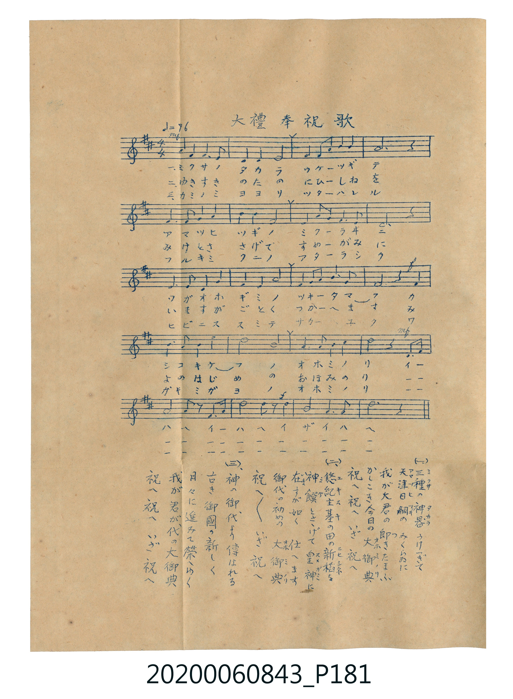

# 大禮奉祝歌

> Re:Shōka 使用 AI 協助辨識與重建樂譜，可能會有錯誤。歡迎回報。

<audio controls src="tairei_hoshukuka.mp3"></audio>

- 詞：高田耕一（文部省選定）
- 曲：平岡均之（文部省選定）
- 唱歌筆記帖（臺灣子供世界社發行，2020.006.0843）P181.jpg（謄寫版五線譜）

## 說明

原書資訊與歌詞全文（對應 P181.jpg 謄寫版五線譜，同 P184.jpg 印刷譜）：
調性與拍號：ニ長調 4/4 拍子，♩= 96


## 歌詞

```text
（一）
三種（ミクサ）の神器（タカラ）　受けつぎて
天津日嗣（アマツヒツギ）の　高御座（ミクラヰ）に
我が大君の　即きたまふ
かしこき今日の　大御典（オホミノリ）
祝へ祝へ　いざ祝へ

（二）
悠紀主基（ユキスキ）の田の　新稲（にひしね）を
神饌（みけ）とささげて　皇神（すめがみ）に
在（いま）すが如く　つかへます
御代の初めの　大御典（おほみのり）
祝へ祝へ　いざ祝へ

（三）
神の御代より　傳はれる
古き御國の　新しく
日々に進みて　榮えゆく
我が君が代の　大御典（オホミノリ）
祝へ祝へ　いざ祝へ
```

## ABC

```abc
X:1
T:大禮奉祝歌
C:曲：平岡均之（文部省選定）
M:4/4
L:1/16
Q:1/4=96
K:D
V:V1 name="Vocal" snm="Voc"
[V:V1]
!mf! A4 F4 E6 D2 | D4 E4 F8 | G4 G2 B2 A4 G4 | F12 z4 |
w: 1.~ミ ク サ ノ | タ カ ラ | ウ ケ _ ツ ギ | テ
w: 2.~ゆ き す き | の た の | に ひ _ し ね | を
w: 3.~カ ミ ノ ミ | ヨ ヨ リ | ツ タ _ ハ レ | ル
F6 F2 G4 A4 | B4 B4 A8 | G4 B2 A2 F6 E2 | D12 z4 |
w: 1.~ア マ ツ ヒ | ツ ギ ノ | ミ ク _ ラ ヰ | ニ
w: 2.~み け と さ | さ げ て | す め _ が み | に
w: 3.~フ ル キ ミ | ク ニ ノ | ア タ _ ラ シ | ク
E6 E2 D4 F4 | F4 E4 A8 | F4 G2 A2 B6 G2 | !f! F8 z4 F4 |
w: 1.~ワ ガ オ ホ | ギ ミ ノ | ツ キ _ タ マ | フ カ
w: 2.~い ま す が | ご と く | つ か _ へ ま | す み
w: 3.~ヒ ビ ニ ス | ス ミ テ | サ カ _ ヘ ユ | ク ワ
B6 A2 B4 d4 | c8 B8 | A6 A2 B4 c4 | !mf! d8 z4 D3 F |
w: 1.~シ コ キ ケ | フ ノ | オ ホ ミ ノ | リ イ _
w: 2.~よ の は じ | め の | お ほ み の | り い _
w: 3.~ガ キ ミ ガ | ヨ ノ | オ ホ ミ ノ | リ イ _
A8 A2 z2 F3 A | !f! d8 d2 z2 d4 | B8 A6 A2 | d12 z4 |
w: 1.~ハ ヘ イ _ | ハ ヘ イ | ザ イ ハ | ヘ
w: 2.~は へ い _ | は へ い | ざ い は | へ
w: 3.~ハ ヘ イ _ | ハ ヘ イ | ザ イ ハ | ヘ
```

## TMD 檔案連結

- [主旋律 TMD 檔案](tairei_hoshukuka.tmd) [[在 TMD Studio 編輯](https://tmdlang.github.io/Tmd-TS/#tmd=s7IKdvYPcrWy4qpTUCpJTLdSSM7PyUlNLsnMz7MqzsjPTkzOyFeCS5bl55TmploBqXgDQ4RwcX5pUXJqfEFieqpVgKEFhgzcpPi8_JLUpPz8bISKgqL8stS8xDygqtzEvNLi5KLMgpL45PyCSoSa1LLMlFSQiuLkxLz4stSizLTM1BQkZ6UWFYMdDHFHSVFiHsQcoCBCVUlGKtDtmbkFQP2JOejiyalFqbn5eSgy-UWZ6Zl5VkDhpFKgF5S4tLQUni5Z_nzZuqdLO58vnftsbY-ClhaXoq2CpRmXva2CC5eNib6JHUj_i5Xz3u-Z9XL1jOdTNrxomPpkR8P7PR3PprW_bF7xfE7jy8YdT9fNer-nE2zXs9mbgGqf7tz8dNPCp3Pbn-zsxq326ZSNQFufr217sWLG0x3TgApftO963rj46doJT_bNfrJj2vOpPc-X7Hs-c8-LhT3v9_QYGRgZ6BkYmOkZWJgYAw0BRY9eVkE6SOOalqfrVz_v7Hiya8rz7bNerJ0DtoRLX0vBllqAS0FB4Wnf_Gezd7zY3P5iRdeLjnag84GB87R1BdCHQFc83dD7rL1TAeYuBWyu6nk6oQekwgSs4mnvhqcd2yHOBYYbyIoXq_Y_a1gOMry798XM-UDRx83dL6duB4orAGNEASgMDCCgQY9mrgRHFkgT0HJwtHSCOE92dD5fsQ4o9Lh5_uOm9Y-btgIlHjeue7503tOZK0DiTfsfN61-3LwSJN7Q8LR_-uPGiY8blzxu7HvcuAzszyUrn21Z-mz60qfTF4M1LHrcPO9xc8vj5kkgsgloOshEoGZgsni6b-HTXcsR9jWvfNy8AaxgNcisZx1As3uAae3phNkQPU97Nz9u7H3cOP9x477HjVtBih43dj9uBDpjMlDiye4uoM1QpUBtQONbd4Bdsepx82yQJc19j5tXQX0LTLuPG3dASKCGx40tjxunQbjwoNkFTD5gxc-aFjzf0vBkx-6n83eBHbzscdPax007gSQ0jKZsgFj8bNqG5yuAabkD6IvHjZvAjgOraZoEsXXey6VAU4HS-4GBB9a84nHjVDCaBAxFoBHPZ7UDlYHVzHzc1AgMBKBiRLg8nQOOC5B794FFZ4KCaVnT48Z-sD-A0QEMkx3gMJoJ1rBv4ZPdi4HOe9oxF2weRgA1dj1u3A120brHTV0kBNAOYOqDKp4HsgBiUxMwyLtAdjQB4wuYjnoeN3WDHdIPdFsvyNo5QBdCQwscQv3gQAZGXkMr0JcvG4DhBnQMKDCeLVv3uBFoXhtMESRVgJJED8RXFMc2UJryXA4FClr6XFy-icASMyw_OTHHocagRqEaZIOCjaGZlh2Yha1wUXi-Zg0wJwILLAUThacb-p-vb9BBFAj6iJyP1UaQqdW5abVgRo2CqYIuGBpDaSMoDYKGQFwDJpFlYCphsAboCggLRJsBMcxMmHgNhh4YNICpALvGx7BGARgZUDFgNoeztiLpAcYV2ExgCQOXXw2XW4nhusdNy-DqNsLVtcDF1iFUNrfhcGc8qjuNQKbC1AKTKZw1E9mdYHGgykaYDcDSCM6CiSG5sxHui8ZNcNZ0OGstko8mEedOY5BaRNjAbQeHINydYHGQ71fARRCsVZjuRAo7eAw098NZa5BUwuzG7U78qXxXDwWpHDXZgdiwBAlLoDXg5AqCMBomg_AuTA8sYSObCcoSiAyCDrEk7qZFSPLA6g5MwoOzGRatqIEMTz4o0QZThyW7oGQCYD0JVdmNw51YEncjLGLBJjROBJPwRNE4FWE_nA2skuAsWIZDcic8awBrFbi6HhRbQHYiZwMC7gQl7maY7RCfgnQCq1k4HxY2oJBHhA4sHLCGJzyGkBM3Sng2bUczEbc7CRThnRQlbuSSGsSGJUNYAkUkf5hKzMQNUwFK5CBZWDaAiWGW3LBEXZ1Wi7AJqfRGDpTHTaCyAFjJwvjNs-E2Iydr7OUSVB1SRlgLZ6EkT3A2Qk8MIAiLCEQZiJzEYeaCVTTuA5PwRApPmiCVU-CiiCwAK--QXNq4BC4LT2KNOzBsQc4MGC6FZzzkRI5c2j9ungwm4TY07US4AM5GDlP0Og2kDlafItcOM1BsAWVhbIkc7lJ4TBNI5k9nz6YomSMnSeQkahgH9485mhuRtUBUIKd8ZENgOoGFOMw4GIQndGBbCZq3jFGKclAxAA-vps1gci2cD2tpYEuX2Ase5JoWklOw5QyQeeh1MiKdw1IgcjulA9lccLsD2NCG82GxDlIJK5hRVaO5s7ELRcVuMAkvKuE6QOYhq0RxJzzvIbdTYO0GiE_Wgkikyg25VQHLhXDVdAhPAu2UKRSlcfSCGcQHpT9IAWuKLXmCBUBqQAUxUl5AT_voKR-LUTCIrTGOXsxBiglQACEFDvHqmrahq4PLQnSBzAGZh1wYIUNsbRX0IgpS6ILtRiQ0EtRNw1CHWlWAzAGpQy7a8bgRXIQP3nCs5eLStVMAdUMVgLQyFwA)]
- [鋼琴伴奏 TMD 檔案](tairei_hoshukuka_piano.tmd) [[在 TMD Studio 編輯](https://tmdlang.github.io/Tmd-TS/#tmd=s7IKdvYPcrWy4tLSUni6ZPnzZeueLu18vnTus7U97_d0vFjT8nT96uedHY-bd7_s3vN8wpYne7Y8XdoPFHm_p1NBS4tL0VbB0ozL3lbBhcvGRN_EjqtOQenFynnv98x6uXrG8ykbXjRMfbKjAWjUs2ntL5tXPJ_T-LJxx9N1s4DalUBqn83eBFT7dOfmp5sWPp3b_mRnN261T6dsBDrr-dq2FytmPN0xDeS-9l3PGxc_XTvhyb7ZT3ZMez615_mSfc9n7nmxEOj6HiMDIwM9AwMzPQMLE2OgIQGGFoZ6WQXpQI0QbzybPEsBKGgCElR42rvhacf2F2vngK3j8k3MzLMKy09OzHGoMahRqOZSAAIbQzMtOzCrOjetFsyoUTBV0AVDYyhtBKVB0BCIa8AksgxMJQzWKJhAWSDaDIhhZsLEazD0wKABTAXYNT6GNQqPm-dDxR43rYeztiLpedzcBzbzcdN-uPxquNxKDNc9bloGV7cRrq4FLrYOobK5DYc741HdaQQyFab2cWMvnDUT2Z1gcaDKRpgNjxvhfoOLIbmzEe6Lxk1w1nQ4ay2SjyYR505jkFpE2MBtB4cg3J1gcZDvV8BFEKxVmO5ECjt4DDT3w1lrkFTC7MbvTtT0AWLDUg4sJdWA0xUIwmiYDMJdMD2wFIhsJijtIlIyOsSSCpsWIck_bp4HJuH-boaFP2powOMZJXxh6rCka5TU-rh5A1RlNw53YkmFjbAYAJvQOBFMwmOvcSrCfjj7cSPM9Y8bYTkDyZ3wNPy4qRGurgfFFpCdyOmVgDtBqbAZZjvEpyCdj5vWwvmwsAGFPCJ0YOGANTzhMYScClHCs2k7mon43VmDUvaB2LD0AktJiHQKU4mZCmEqQKkRJAtLrzAxzLIQlvqq02oRNiGVh8iuf9wEyl2Pm2C58nHzbLjNyOkPe06HqkNKsWvhLJR0BE7v6LEGgrAQQ5QqyGkRZi5YReM-MAlPTfA0BFI5BS6KSKuwEgTJpY1L4LLwtNC4A8MW5FSL4VJ4DkFOjcjl5-PmyWASbkPTToQL4GzkMEWvJUDqYDUUcnk7A8UWUF7DlhrhLoXHNCw9Iqcd5LRkGAe32BzNMGQtEBXISRTZEJhOYLEIMw4G4SkS2EyAZgJjlMIRlLHgHmvaDCbXwvmwShZbAsKelZErGUiSxpaEQeahV0eIBAlLKshVdAeyueAq93EjvHhphEUPSCWsqENVjebOxi4UFbvBJLzwgesAmYesEsWd8EyCXEXDqkyIT9aCSKTqArlChWUXuGo6hSdqOgJBEB-UUCBFlim2dAQWAKkBFW1IiRY9kaInUSxGwSC2BiN6wQHJeCCfIPmCeHVN29DVwWUhukDmgMxDzt7IEFs1jZ7pIcUY2G5EiiBB3TQMdaiFL8gckDrkwhKPG8GF4uANx1pojyYgMzEvP8gDa58GWLFqwxKSoTasIjWP10au1U3jtSGdGjMIA00JQh8MAhsF2rCGJYRlog1Kvgi7EPLAZAvXDzIcZCqsMQuiwY1QqFtRbYLwECYhTAfZD8suCBZQPVwFNpciuxHVJqhnEW1hU1AogzggVWD1sEwLz_jx2pihCBVBCkaEPci-Qw1cLI5GKIU4H6IG4gEYhMgA1arDFZuBnG0Odrs6SAWYgXABrEGHYowh2GiEmIk2UplkpG2qjV6ZAu1FMQDuYhR_wPjIqpFNA-kAyiAsg0FYWYZaw2JagGwJaokLFMM0Fi4IVousAiUxqeNMTcA4gwjgdDm6D9ByqA9KDjWBZ1DDeBAyjYdgYI8NyoKIg1IanA9RAJGASqMYgkULASMMkBI0Tj1gProzjYEkDGOaAvIECGMTQTcJi2OQheA6QRjEN4oHxhOaARCXQowAhrqunQIo4KN9DGMV4GwjJLYxmK3MBQA)]

## 分析

```text
================================================================================
📊 TMD Song Profile: [ 大禮奉祝歌 ]
================================================================================
⏱  Duration:       0:50 (50.0s), 20 measures total
🎼 Key & Tempo:    首調基準 D, != 96.0 BPM, <4/4>
   - 分析範圍：      由實際發聲的音符與和弦推測調性；播放脈絡另行呈現
🎤 人聲音域:    D4 (MIDI 62) – D5 (MIDI 74) [跨度: 12 個半音 / 1.0 個八度, 難度: easy]
   - 最低音:  D4 in [Main #1 @ m.1, 0:02]
   - 最高音: D5 in [Main #1 @ m.13, 0:31]
   - 適合: soprano, mezzo-soprano, contralto, tenor, baritone, bass
🏛  結構:      Main (50.0s)
⚡ 編曲密度:        Peak 1 軌道同時演奏
🗝  調性診斷：       D 大調（純淨自然大調，未偵測到可信轉調）
   - 風格氣質:    純淨自然大調（陽光明朗、易唱易記，無明顯調外色彩）
   - 轉調歷程:    全曲維持單一推測調性（未偵測到可信轉調）
   - 核心骨幹音:  F#, D, A, B, E
   - 調性數值:    D 大調 [相關度: 0.90, 穩定度: High, 自然音純度: 100.0%]
   - 候選調性 (K-S): D 大調 (0.90), B 小調 (0.76), F# 小調 (0.73)
   - 五度圈歷程:   +2
   - 各段落調性細節:
     • [Main #1]: D 大調 (r: 0.90, 自然音純度: 100.0%)

  [ 五度圈游移軌跡 ]
               C  
         F            G  
      Bb              [D ]*
      Eb               A  
         Ab           E  
            Db       B  
               F# 
     (* = active key center)

  [ 十二半音累積音高分佈 ]
     C  :                            0.0%
     C# : ████                       4.1%
     D  : ███████████████████████   21.3%
     D# :                            0.0%
     E  : █████████                  8.1%
     F  :                            0.0%
     F# : ████████████████████████  22.3%
     G  : ████████                   7.4%
     G# :                            0.0%
     A  : ██████████████████████    20.6%
     A# :                            0.0%
     B  : █████████████████         16.2%
--------------------------------------------------------------------------------
Assignment 軌道音域：
  - Vocal         : D4 – D5 (12 個半音 / 1.0 個八度, 64 個音符)
================================================================================
```


## 原書掃描頁




