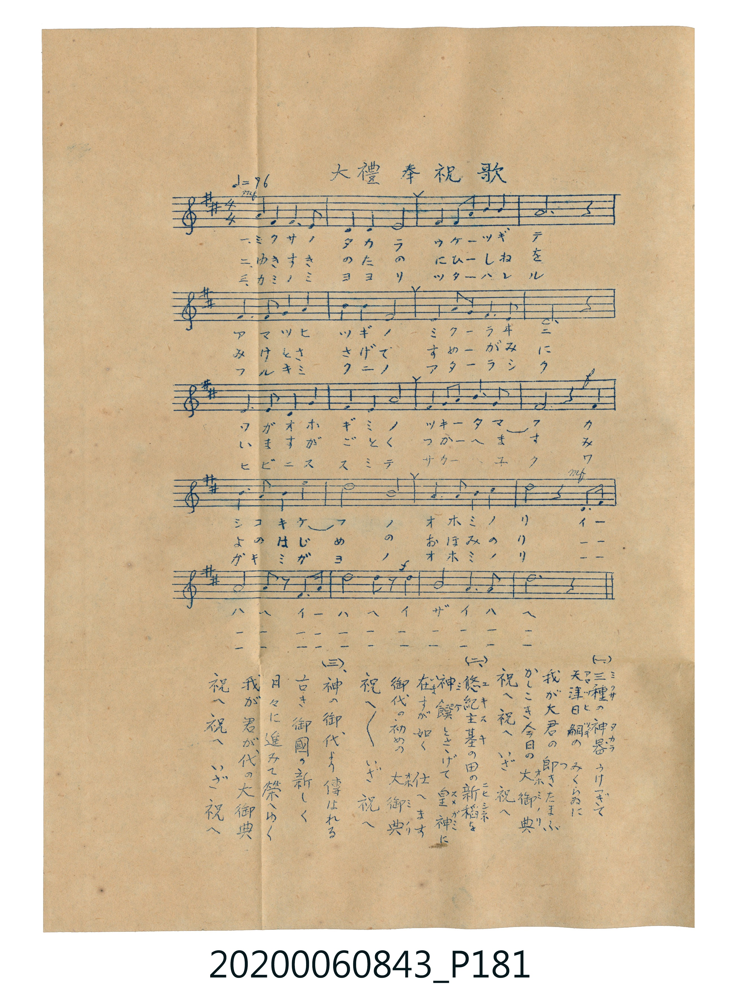

# 大禮奉祝歌 (大禮奉祝歌 — 謄寫版)

<audio controls src="tairei_hoshukuka.mp3"></audio>

- 詞曲作者：未在 TMD metadata 中提供

## 說明

大禮奉祝歌 (大禮奉祝歌 — 謄寫版)
Source: 唱歌帖 (2020.006.0843), P181.jpg
Composer: 平岡均之 / Lyricist: 高田耕一 (文部省選定)
Notes: Mimeographed (謄寫版) 5-line staff vocal score pasted on P181.jpg

## 跨冊／重複收錄參照

> 同曲（高田耕一作詞、平岡均之作曲〈大禮奉祝唱歌〉；《唱歌帖》P181 謄寫版與 P184 印刷伴奏譜）

- **[同曲]** 楊金土手抄《唱歌帖》第 1 冊（2020.006.0843）：[**〈文部省選定 大禮奉祝唱歌 (文部省選定 大禮奉祝唱歌 — 印刷譜)〉**](../p184_tairei_hoshuku_shoka/index.md)（`D` / `4/4` — [原始 TMD](../p184_tairei_hoshuku_shoka/tairei_hoshuku_shoka.tmd)）
- 總表：[跨冊重複與同名歌曲總索引](../../../duplicate_songs.md)

## 歌詞

```text
1.
みくさのたから うけつぎて あまつひつぎの みくらゐに
わがおほきみの つきたまふ かしこきけふの おほみのり
いざいはへ いざいはへ

2.
ゆきすきのたの にひしねを みけとささげて すめがみに
いますがごとく つかへます みよのはじめの おほみのり
いざいはへ いざいはへ

3.
かみのみよより つたはれる ふるきみくにの あたらしく
のびにすすみて さかへゆく わがきみがよの おほみのり
いざいはへ いざいはへ
```

## ABC

```abc
X:1
T:大禮奉祝歌 大禮奉祝歌 — 謄寫版
M:4/4
L:1/16
Q:1/4=96
K:D
V:V1 name="Vocal" snm="Voc"
[V:V1]
D4 E2 F2 E4 D4 | B,4 A,4 B,4 D4 | E4 E2 F2 A4 F4 | E12 z4 |
E4 A2 F2 E4 D4 | B,4 D4 E8 | F4 D2 E2 F4 ^A4 | B12 z4 |
B4 F2 A2 B4 A4 | F4 E4 D4 B,4 | E4 F2 A2 B4 d2 B2 | A12 F4 |
E4 A4 F4 D2 B,2 | A,4 B,4 D8 | E4 F4 A4 B2 A2 | F12 E4 |
D8 B,2 A,2 B,2 D2 | E4 B4 B4 A4 | F8 E4 F2 E2 | D12 z4 |
```

## TMD 檔案連結

- [主旋律 TMD 檔案](tairei_hoshukuka.tmd) [[在 TMD Studio 編輯](https://tmdlang.github.io/Tmd-TS/#tmd=s7IKdvYPcrWy4tLSUni6ZPnzZeueLu18vnTus7U9ChroAo8apii8WNPydP3q550dmgpaWlyKtgqWZlz2tgouXDYm-iZ2XFz6WlwKCqQaBdISnF9alJxqpfB0ykaggqc7piloGBkYGegZGJjpGViYGGvqKAQYWhjqZRWkg5Q75-cW5BenFgE17Nz8dNPCp3Pbn-zsVtBX8KksykzOLC6xUni5esbzKRteNEx9sqNBQePZtPaXzSuez2l82bjj6bpZYDv98ktSi60UfDNzU_PTixILMlJTFDSQfGiqm5OZl6pQXJKYlqZQlp-cmKNQnJxflKpQkFhcAlSbn4dwE8g8sN3FViCmoR6IfNy4_3Fj_-PGqY8b1z1unP-4sftxUydQtO1x48THjUseN_Y9blwG5Dc9btwH5m-Cia6D6W3qfNw04XHjarBxTUCzeh43dj1u3P24sResAqQQqAXIARoPNGQrkN_9uHH648bJYFGgPVshqiC6QFoeN3VBXNfyuHEamFz_uHEHOh_sJSOIP5qALgYaNhNMQrwCMnI12MVAu9Y-bpoEcTHQvhVgDwPRJIjvZj5uagS7GygN8QfICqBbgcYBRaeAdfRD_AF0-g6IHNi4pg6wdUDnzAAbQrY_jKHxATQfrBNiNgh1QSwG-mj946aex03dQP5WIAULYGCQA70JshgYS_NB8QHycD_EOKBBm8HyQK8AEVA5yMNAr4P9AQo1oL-gsQYxDmgDyE_k-ENLn4vLNzEzzyoMlBQdagxqFKpB-hRsLLTswIwaBUMFXQUjBWMg1gWzaxTM4oGUKYgAsyCCIGmQMlMgbQwXgUEDkAjUQJC4KaaBEHsgymvARhiCDQQqVoeowmEeSBxkL4gG2Q7RDDMdbDbEUpgiwzggVQNWC4NgF6O4DyJmCNIPVIriWYgLISZClJoBSYi1MAiShRkI0wM0AGgQkDSEagc5BtXVMK2g0EFoRPi4lotL104BFGUKQFqZCwA)]
- [鋼琴伴奏 TMD 檔案](tairei_hoshukuka_piano.tmd) [[在 TMD Studio 編輯](https://tmdlang.github.io/Tmd-TS/#tmd=s7IKdvYPcrWy4tLSUni6ZPnzZeueLu18vnTus7U9ChroAo8apii8WNPydP3q550dmmBuQGZiXr6CY3Jyfm5BYl5mbmpeiYKWFpeirYKlGZe9rYILl42JvokdF5e-FpeCArWsABkVnF9alJxqpfB0ykagxqc7piloGBkYGegZGJjpGViYGGvqKAQYWhjqZRWkK2gkojgwrSg_V6GgKDOvJDVFISc1MS0ntQSk2ASkWBNkuDNQdX5xahHQ-J2bn25a-HRu-5Od3Qr6Cj6VRZnJmcUlVgovV894PmXDi4apT3Y0KGg8m9b-snnF8zmNLxt3PF03S5NLS5-LyzcxM88qLD85McehxqBGoRpksoKNhZYdmFGjYKigq2CkYAzEumB2jYJZPJAyBRFgFkQQJA1SZgqkjeEiMGgAEoEaCBI3xTQQYg9EeQ3YCEOwgUDF6hBVOMwDiYPsBdEg2yGaYaaDzYZYClNkGAekasBqYRDsYhT3QcQMQfqBSlE8C3EhxESIUjMgCbEWBkGyMANheoAGAA0CkoZQ7SDHoLoaphUUOgiNCB_XQuMLnNyCPLDHmGm8NizSgEywdyAiQDvitcHeANJgP8H4ZjAFQAYsJs11gIqgmrUhUQpkgkQRcQ3yuDHco0jSIGFclkMtQ1INCVGQONgiUMSDpEBssBJtaBIASmsjotscEu6wUEaSg7FBNCRw4WYj2Qp2D9gpMJfB_Y9iCCS5QB0CjRywC-ABg-l_hGp48EHTEnrQg_lgV8BDAZw2YNoQJkFSGdw8WFpC8RPMKaimoqQ8qAWG2ibwMALRCHuQ7ABB5BADJ0uE2dhYWBKqD46EagjyPwjCGUDX6cDYCBYwt8CYpmBBsHqgM-EqECx4XMBFsBqOpAFJ1JiAO2AlDm6zIeZidTqyINwiTMOxOhzMhKhFEgUbjWwvkmLsoQKWwuFGE4TxEBUwPyEJIVkAjQkwCY9zXTsFULQrAGllLgA)]

## 分析

```text
================================================================================
📊 TMD Song Profile: [ 大禮奉祝歌 大禮奉祝歌 — 謄寫版 ]
================================================================================
⏱  Duration:       0:50 (50.0s), 20 measures total
🎼 Key & Tempo:    首調基準 D, != 96.0 BPM, <4/4>
   - 分析範圍：      由實際發聲的音符與和弦推測調性；播放脈絡另行呈現
🎤 人聲音域:    A3 (MIDI 57) – D5 (MIDI 74) [跨度: 17 個半音 / 1.4 個八度, 難度: challenging]
   - 最低音:  A3 in [Main #1 @ m.2, 0:03]
   - 最高音: D5 in [Main #1 @ m.11, 0:26]
   - 適合: soprano, mezzo-soprano, contralto, tenor, baritone, bass
🏛  結構:      Main (50.0s)
⚡ 編曲密度:        Peak 1 軌道同時演奏
🗝  調性診斷：       B 調性不明確（純淨自然大調，未偵測到可信轉調）
   - 風格氣質:    純淨自然大調（陽光明朗、易唱易記，無明顯調外色彩）
   - 轉調歷程:    全曲維持單一推測調性（未偵測到可信轉調）
   - 核心骨幹音:  E, B, D, F#, A
   - 調性數值:    B 調性不明確 [相關度: 0.70, 穩定度: Ambiguous, 自然音純度: 98.7%]
   - 候選調性 (K-S): B 小調 (0.70), D 大調 (0.70), A 大調 (0.68)
   - 五度圈歷程:   +5
   - 各段落調性細節:
     • [Main #1]: B 調性不明確 (r: 0.70, 自然音純度: 98.7%, 調外音: A#)

  [ 五度圈游移軌跡 ]
               C  
         F            G  
      Bb               D  
      Eb               A  
         Ab           E  
            Db      [B ]*
               F# 
     (* = active key center)

  [ 十二半音累積音高分佈 ]
     C  :                            0.0%
     C# :                            0.0%
     D  : ████████████████████      19.5%
     D# :                            0.0%
     E  : ████████████████████████  23.4%
     F  :                            0.0%
     F# : ████████████████████      19.5%
     G  :                            0.0%
     G# :                            0.0%
     A  : █████████████████         16.2%
     A# : █                          1.3%
     B  : █████████████████████     20.1%
--------------------------------------------------------------------------------
Assignment 軌道音域：
  - Vocal         : A3 – D5 (17 個半音 / 1.4 個八度, 75 個音符)
================================================================================
```


## 原書掃描頁




