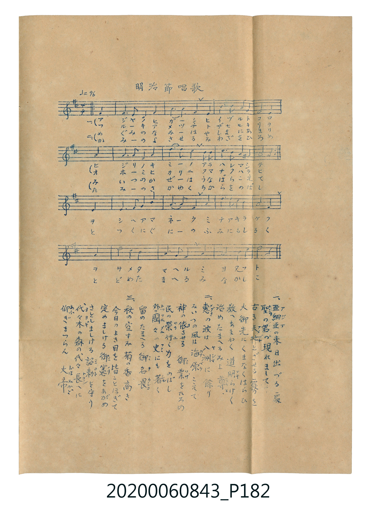

# 明治節唱歌

> Re:Shōka 使用 AI 協助辨識與重建樂譜，可能會有錯誤。歡迎回報。

<audio controls src="meijisetsu_shoka.mp3"></audio>

- 詞：堀澤周安
- 曲：杉江秀
- 唱歌筆記帖（臺灣子供世界社發行，2020.006.0843）P182.jpg（謄寫版五線譜）

## 說明

原書資訊與歌詞全文（對應 P182.jpg 謄寫版五線譜，同 P185.jpg 印刷譜）：
調性與拍號：ニ長調 4/4 拍子，♩= 96（前兩行反覆）


## 歌詞

```text
一、亜細亜の東　日出づる處
聖の君の　現れまして
古き天地　とざせる霧を
大御光に　隈なくはらひ
教あまねく　道明らけく
治め給へる　御代尊

二、恵の波は　八洲に餘り
御稜威の風は　海原越えて
神の依させる　御業を弘め
民の榮行く　力を展ばし
外つ國國の　史にも著く
留め給へる　御名畏

三、秋の空すみ　菊の香高き
今日のよき日を　皆ことほぎて
定めましける　御憲を崇め
諭しましける　詔勅を守り
代代木の森の　代代長へに
仰ぎ奉らん　大帝
```

## ABC

```abc
X:1
T:明治節唱歌
C:曲：杉江秀
M:4/4
L:1/16
Q:1/4=96
K:D
V:V1 name="Vocal" snm="Voc"
[V:V1]
z4 z4 z4 F4 | F6 E2 D4 F4 | A6 A2 F4 E4 | B6 B2 A4 G4 |
w: 1.~ア | ジ ヤ ノ ヒ | ガ _ シ ヒ | イ ヅ ル ト
w: 2.~フ | ル キ _ ア | メ ツ チ ト | ザ セ ル キ
w: 3.~め | ぐ み の な | み _ は や | し ま に あ
w: 4.~か | み の _ よ | さ せ る み | わ ざ を ひ
w: 5.~ア | キ _ ノ ソ | ラ ス ミ キ | ク ノ カ タ
w: 6.~サ | ダ _ メ マ | シ ケ ル ミ | ノ リ ヲ ア
F8 E4 A4 | A6 A2 F4 A4 | d6 d2 c4 B2 B2 | c6 B2 A4 G4 |
w: 1.~コ ロ ヒ | ジ リ ノ キ | ミ _ ノ ア ラ | ハ レ マ シ
w: 2.~リ ヲ オ | ホ ミ ヒ カ | リ _ ニ ク マ | ナ ク ハ ラ
w: 3.~ま り み | い つ の か | ぜ _ は う な | ば ら こ え
w: 4.~ろ め た | み の _ さ | か ゆ く ち か | ら を の ば
w: 5.~カ キ ケ | フ _ ノ ヨ | キ ヒ ヲ ミ ナ | コ ト ホ ギ
w: 6.~ガ メ サ | ト _ シ マ | シ ケ ル ミ コ | ト ヲ マ モ
A8 z4 E4 | E6 F2 G4 B4 | A6 A2 F4 A4 | d6 d2 c4 B4 |
w: 1.~テ ヲ | シ ヘ ア マ | ネ _ ク ミ | チ ア キ ラ
w: 2.~ヒ と | つ く に ぐ | に _ の ふ | み に も し
w: 3.~て ヨ | ヨ _ ギ ノ | モ リ ノ ヨ | ヨ ト コ シ
w: 4.~し * | * * * * | * * * * | * * * *
w: 5.~テ * | * * * * | * * * * | * * * *
w: 6.~リ * | * * * * | * * * * | * * * *
A8 F4 A4 | d8 c4 B4 | A6 B2 F4 A4 | A8 B4 c4 |
w: 1.~ケ ク ヲ | サ メ タ | マ ヘ ル ミ | ヨ タ フ
w: 2.~る く と | ど め た | ま へ る み | な か し
w: 3.~ヘ ニ ア | フ ギ マ | ツ ラ ン オ | ホ ミ カ
d8 z4 z4 |
w: 1.~ト
w: 2.~こ
w: 3.~ド
```

## TMD 檔案連結

- [主旋律 TMD 檔案](meijisetsu_shoka.tmd) [[在 TMD Studio 編輯](https://tmdlang.github.io/Tmd-TS/#tmd=s7IKdvYPcrWy4qpTUCpJTLdSSM7PyUlNLsnMz7MqzsjPTkzOyFeCS5bl55TmploBqXgDQ4RwcX5pUXJqfEFieqpVgKGFEboM3KT4vPyS1KT8_GyEioKi_LLUvMQ8oKrcxLzS4uSizIKS-OT8gkqEmtSyzJRUkIri5MS8-LLUosy0zNQUJGelFhWDHQxxR0lRYh7EHKAgQlVJRirQ7Zm5BUD9iTno4smpRam5-XkoMvlFmemZeVZA4aRSoBcwJEoSM4HC8UBcnhifm5iZl5OYB3SWlpbCsxl9zzbtfr6-4emUjc_W9ihoaXEp2ipYmnHZ2yq4cNmY6JvYgQx7sXLe-z2zni5oeLZvydOJK56u6wTb8Wz2JqDws7mdzzbOf768ASwGMej52rYXK2Y83THt_Z6OF-27njcufrp2wpN9s5_smPZ8as_zJfuez9zzYmHP-z09RgZGBnoGBmZ6BhYmxu_3dILiRS-rIB2kcU3L0_Wrn3d2PNk15fn2WS_WzgHKK3Fx6Wsp2FILcCkoKDztm_9s9o4Xm9tfrOh60dEOdD7Qv09bVzyb1g50xdMNvc_aOxVg7lLA5qqepxN6QCpMwSqe9m542rEd4lxg-ICseLFq_7OG5SDDu3tfzJwPFH3c3P1y6naguAIwkBWAwsAAAhr0aOZKUPiD7O3sfdq6EhhIT_t7XyxrA5rFBTLpyY6Gxw2NT3bNeb5lA5B83Lju2dyNjxsank1f-rR91-PGpY-bul_MnApSCgIvGqcBlTydMBtIAlU979_3uKnnceO-x43THzcug6l62r_kcWPv0yUrn87ZAFT1uHHFY5C-2UCzXs5Z_rhpElzhkuVP9y182tr5uHE1UOHLWR2PG1c9bux_3Lj-cRNQcBNM4bOpMx83NoEtWguSB6ptnAxMbWBVE4EicIWbdj9uany-ddnjxh1A64AKgRY82b346YYuiH939QD9-6xxK8inmxeBLAIqaV39bMsmoBteLpnxuKkL7rp9C5-vmPN0RSNQ7ctFQD-A1D7buh0YwS-2dT1uBDoW7uXnS-cBVT3ZN_dx41SITyFWP1u6Fujfp3uA5jbC3bgB6OJ1z5atA8YGxDNPu4A6Jj3dCNS6ARiUiOABhtqSp3O6gQgS4E_7Qc583NT0YiIwwOG-fg4MHgxfP53Q-3xqPzSWO4G-fr4cZMrzlcBoBYbmfqCqF_1Ab6x7uWzmy9UzgDEGM-7J7i5g_INsbAL6sRfEbpoEiu5ZbY8bJ4Ojc_fjxj7kGF83C-gAWEKYiPB-2yaQx7a0I3n_xWpgFAJVoah9sXLK0-5WkNp1HUhRAIw5IHo2B2jjumeL10ECASIITO4g3zauRqgFhl3f06WdoETRNBnkAGDy2jEXJE95zoYCBS19Li5HQ6uw_OTEHIcaXcOaarD9NiZadmBGjYIBGBor1ID5PoY1CvFg-LhpEUzMCC7WPBUmZoxQ1wgTM4GLNXbDxEyxmGeGENsKFIM6RMNYQRcIjTRVNXR1NRUMQW5S0DAFC5pCBY0VjJAcqvG4aQdY-nHzEk0g0QfEk0CaHjetAYsDdTxu2g4RhXtF43HzaoiuprWaYAroMJDoQqhZLSCzGoG4A8mzGo8bJ0DkG_cD5RvXAfEqsL7G_XC7GtcDTWtBCg64LFADxC6gmSDRqVDR2SAXdoMMRQowoPvXws0E-appL8SFK6Hu3gkSnw_yAFKQAuUbELoWAvE8SFhsh-raCBJfDdaJCHQzsKQZNHxNFUyAgqCIMAKyUUJ6CTR0WmGmgHzyuGkzWHAtRhg3bYPauhuqHuRWIGsVWP0mIB8YesihOx0aIvtA4QhU39gEUt-4D2xIF3IIgcO1qR-qfhooBCcBGZvA7ukFqwfGXiPIl0ghuh7q_j6QepB7gOaBWeCEAAoe1LDsg6pfBXI_yL2gVAJJWODQRUm66KkUGHYKGoZxYFHDOKiwOSi0wSGtiT0Rg60CRTcoqIBOmI-cCIDqFgEZK-F6IUl5NlTvfJAqYDAAPQQWB4UzVG83xPvA9ADXCwnyFmgQgjIPOEEDcy1IfA5yggby20BpHa4XW7IGpmewaDc00ttAevtBIsCQauyG6wVHBbAQQU7czSsgyRSS5IGegAQ42P-Pm7vgeiHR0gHXC87Y2JM4RG_TZpBeWBSZY0nooGgDlX7IsdEMTVjNa0BmzQPbA0q4bUBBUJmFEvpdUHvXg9T2g6IHrHYSqlpIaG-Aqu0Ehc1kIAZnoMZlqGohibsTqhYUFuCY2QBWC8ojSGohCRuUA0Hu7QC5YTZQ0zps7kUOPWDwQv3WDE7U4MQCUVsLrC6MCFcXyKUwrGoA5j_06qIRGLXo1QUouuGRYgR2jzE0UkwUzHBkJuTcAo3r5hmgNADKEpA00AzK-dCUAUrs8OwPjqlGaPHV2A8rXiZAUiykKgCndVA4gzI1Is6AboWbCZQFplaw6CK0_IriJcxcD_IUyE_oPgHWMZBYXgQyH1SEglMPsCACJym0IEXKc6tB6pvA6QGkHpTpQLkNNbjhroekDGAygaXkGWBBYKUDrpGh7gY7G-JWaATAsgqqs0HlHqwEBJWgQGvmIUUIvH6BOftxI6jSgpfIIG-AinSQi3dg1H1AZ0NKB0hwQyMWWkyBir7HzSBvgGoOqLNBTjUDuhvqAdTMDAkBkDvBDRdwnYWeiUG1OMgxIHeAgxOYNdEzL6SUhZQpoOL1cTMof8IzjK6dgqOhAogEJmc7BWUuAA)]
- [鋼琴伴奏 TMD 檔案](meijisetsu_shoka_piano.tmd) [[在 TMD Studio 編輯](https://tmdlang.github.io/Tmd-TS/#tmd=s7IKdvYPcrWy4tLSUng2o-_Zpt3P1zc8nbLx2dqe93s6Xqxpebp-9fPOjsfNu19273k-YcuTPVueLu0Hirzf06mgpcWlaKtgacZlb6vgwmVjom9ix1WnoPRi5bz3e2Y9XdDwbN-SpxNXPF3XqQQSfjZ7E1D42dzOZxvnP1_eABaD2PR8bduLFTOe7pgGsrJ91_PGxU_XTniyb_aTHdOeT-15vmTf85l7XiwEOqjHyMDIQM_AwEzPwMLEGOiEAEMLI72sgnSgRojLnk2epQAUNAUJKjzt3fC0Y_uLtXOAKpW4uBwNrQIyE_PygzwcanQNa6q5FIDAxkTLDsyoUTAAQ2OFGjDfx7BGIR4MHzctgokZwcWap8LEjBHqGmFiJnCxxm6YmCkW88wQYluBYlCHaBgr6AKhkaaqhq6upoIhyE0KGqZgQVOooLGCEZJDNR437QBLP25eogkk-oB4EkjT46Y1YHGgjsdN2yGicK9oPG5eDdHVtFYTTAEdBhJdCDWrBWRWIxB3IHlW43HjBIh8436gfOM6IF4F1te4H25X43qgaS1IwQGXBWqA2AU0EyQ6FSo6G-TCbpChSAEGdP9auJkgXzXthbhwJdTdO0Hi80EeQApSoHwDQtdCIJ4HCYvtUF0bQeKrwToRgW4GljSDhq-pgglQEBQRRkA2SkgvgYZOK8wUkE8eN20GC67FCOOmbVBbd0PVg9wKZK0Cq98E5ANDDzl0p0NDZB8oHIHqG5tA6hv3gQ3pQg4hcLg29UPVTwOF4CQgYxPYPb1g9cDYawT5EilE10Pd3wdSD3IP0DwwC5wQQMGDGpZ9UPWrQO4HuReUSiAJCxy6KEkXPZUCw05BwzAOLGoYBxU2B4U2OKQ1sSdisFWg6AYFFdAJ85ETAVDdIiBjJVwvJCnPhuqdD1IFDAagh8DioHCG6u2GeB-YHuB6IUHeAg1CUOYBJ2hgrgWJz0FO0EB-Gyitw_ViS9bA9AwW7YZGehtIbz9IBBhSjd1wveCoABYiyIm7eQUkmUKSPNATkAAH-_9xcxdcLyRaOuB6wRkbexKH6G3aDNILiyJzLAkdFG2g0g85NpqhCat5DciseWB7QAm3DSgIKrNQQr8Lau96kNp-UPSA1U5CVQsJ7Q1QtZ2gsJkMxOAM1LgMVS0kcXdC1YLCAhwzG8BqQXkESS0kYYNyIMi9HSA3zAZqWofNvcihBwxeqN-awYkanFggamsRFYYP3goDFmg1CobxCtGGsTAKgw9VZQLkmsTCKLgq03ggbRqPUIdumhlIgVl8LkIrVCFcJ8IIJM0g54H8YkRM5Ydcp8AqOmBpgl75NQITKnrlB0q88CRmBA5dY2gSM1Eww1E0IOd9aMptngFK0aAMDknRzaByDJrOQVkXXpiB010jtDBu7IcVlhMg-Q9SsYFzLijVgIooRAoEuhVuJlAWmPfAoovQSh8UL2GWYSBPgfyE7hNgjQlJs4tA5oMqBHBeABar4AyCFqRIJchqkPomcOoGqQcVIaCyAzW44a6HpHNgooflyxlgQWAVCm5fwFIRyNkQt0IjAJbxUZ0NKsVh5TmoPgBaMw8pQuC1JczZjxtBVTC8fgF5A1RBgVy8A6MmBzobUtZBghsasdBCF1SQP24GeQNUD8LSNMihQHdDPYBaNEFCAOROcDMMXAOjF0mgNgnIMSB3gIMTWNCgF0WQOgNSQoIqi8fNoNIGkf2hWYbY7I8_HxJRBKCpgnIJqCIq9-vaKTgaRvsAxaAsIwjLCCQGNggqbgxXAbQSqsIIRYUpXIUZXIUxXIUyFwA)]

## 分析

```text
================================================================================
📊 TMD Song Profile: [ 明治節唱歌 ]
================================================================================
⏱  Duration:       0:40 (40.0s), 16 measures total
🎼 Key & Tempo:    首調基準 D, != 96.0 BPM, <4/4>
   - 分析範圍：      由實際發聲的音符與和弦推測調性；播放脈絡另行呈現
🎤 人聲音域:    D4 (MIDI 62) – D5 (MIDI 74) [跨度: 12 個半音 / 1.0 個八度, 難度: easy]
   - 最低音:  D4 in [A1 #1 @ m.2, 0:03]
   - 最高音: D5 in [A1 #1 @ m.7, 0:15]
   - 適合: soprano, mezzo-soprano, contralto, tenor, baritone, bass
🏛  結構:      A1 (20.0s) -> A2 (20.0s)
⚡ 編曲密度:        Peak 1 軌道同時演奏
🗝  調性診斷：       A 大調（推測轉調經歷 1 次）
   - 風格氣質:    純淨自然大調（陽光明朗、易唱易記，無明顯調外色彩）
   - 轉調歷程:    A 大調起奏 ➔ [A2] 轉至 A 大調 (+3 半音 / 五度圈 -3 步)
   - 核心骨幹音:  A, F#, D, B, C#
   - 調性數值:    A 大調 [相關度: 0.84, 穩定度: Moderate, 自然音純度: 95.2%]
   - 候選調性 (K-S): A 大調 (0.84), F# 小調 (0.78), D 大調 (0.78)
   - 五度圈歷程:   +6 -> +3
   - 各段落調性細節:
     • [A1 #1]: F# 小調 (r: 0.88, 自然音純度: 93.1%, 調外音: G)
     • [A2 #1]: A 大調 (r: 0.86, 自然音純度: 96.8%, 調外音: G)

  [ 五度圈游移軌跡 ]
               C  
         F            G  
      Bb               D  
      Eb              [A ]*
         Ab           E  
            Db       B  
              [F#]*
     (* = active key center)

  [ 十二半音累積音高分佈 ]
     C  :                            0.0%
     C# : ██████                     8.9%
     D  : ███████████               14.5%
     D# :                            0.0%
     E  : ██████                     8.1%
     F  :                            0.0%
     F# : █████████████             17.7%
     G  : ████                       4.8%
     G# :                            0.0%
     A  : ████████████████████████  33.1%
     A# :                            0.0%
     B  : █████████                 12.9%
--------------------------------------------------------------------------------
Assignment 軌道音域：
  - Vocal         : D4 – D5 (12 個半音 / 1.0 個八度, 57 個音符)
================================================================================
```


## 原書掃描頁




