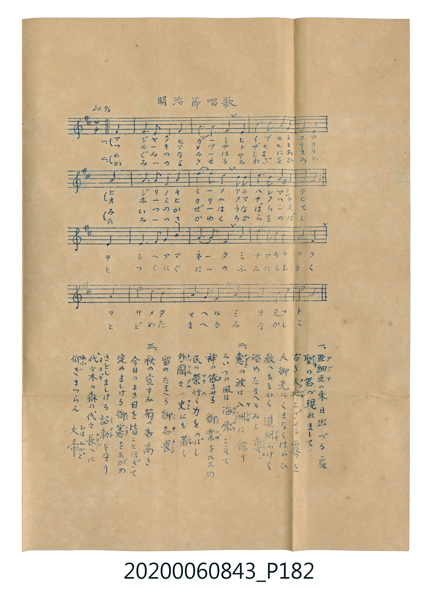

# 明治節唱歌 (明治節唱歌 — 謄寫版)

<audio controls src="meijisetsu_shoka.mp3"></audio>

- 詞曲作者：未在 TMD metadata 中提供

## 說明

明治節唱歌 (明治節唱歌 — 謄寫版)
Source: 唱歌帖 (2020.006.0843), P182.jpg
Composer: 杉江秀 / Lyricist: 堀澤周安 (文部省選定)
Notes: Mimeographed (謄寫版) 5-line staff vocal score pasted on P182.jpg

## 跨冊／重複收錄參照

> 同曲（堀澤周安作詞、杉江秀作曲〈明治節〉；收錄於《新定兒童唱歌》卷首及《唱歌帖》P182 謄寫版、P185 印刷伴奏譜）

- **[同曲]** 《新定兒童唱歌》尋常科第一學年用（2020.006.0847.0001）：[**〈明治節〉**](../../../shintei_jido_shoka/grade_1_2020.006.0847.0001/0_06_meijisetsu/index.md)（`D` / `4/4` — [原始 TMD](../../../shintei_jido_shoka/grade_1_2020.006.0847.0001/0_06_meijisetsu/meijisetsu.tmd)）
- **[同曲]** 楊金土手抄《唱歌帖》第 1 冊（2020.006.0843）：[**〈明治節唱歌 (明治節唱歌 — 印刷譜)〉**](../p185_meijisetsu_shoka_printed/index.md)（`D` / `4/4` — [原始 TMD](../p185_meijisetsu_shoka_printed/meijisetsu_shoka_printed.tmd)）
- 總表：[跨冊重複與同名歌曲總索引](../../../duplicate_songs.md)

## 歌詞

```text
1.
あじやのひがし ひいづるところ ひじりのきみの あらはれまして
ふるきあめつち とざせるきりを おほみひかりに くまなくはらひ
をしへあまねく みちあきらかに をさめたまへる みよたふと

2.
めぐみのなみは やしまにあまり みいつのかぜは うなばらこえて
かみのよさせる みわざをひろめ たみのさかゆく ちからをのばし
とつくにぐにの ふみにもしるく さだめたまへる みよかしこ

3.
あきのそらすみ きくのかたかき けふのよきひを みなことほぎて
さだめましける みのりをあがめ さとし給ひし みことをまもり
よよぎのもりの みやしろたかく あふぎまつらん おほみかげ
```

## ABC

```abc
X:1
T:明治節唱歌 明治節唱歌 — 謄寫版
M:4/4
L:1/16
Q:1/4=96
K:D
V:V1 name="Vocal" snm="Voc"
[V:V1]
D3 E F2 A10 | B3 B A12 | F2 A2 E2 D B,9 | A,16 |
B,3 D E2 B,10 | D3 E F12 | A2 F2 E D E F9 | D6 z10 |
D3 E F2 A10 | B3 B A12 | F2 A2 E2 D B,9 | A,16 |
B,3 D E2 B,10 | D3 E F12 | F2 E2 F A B ^A9 | B6 z10 |
A3 A B2 F10 | A3 E F12 | A2 B2 d B A F9 | E6 z10 |
d3 c B2 A10 | B3 A F12 | E2 A2 F3 E9 | D6 z10 |
```

## TMD 檔案連結

- [主旋律 TMD 檔案](meijisetsu_shoka.tmd) [[在 TMD Studio 編輯](https://tmdlang.github.io/Tmd-TS/#tmd=s7IKdvYPcrWy4tLSUng2o-_Zpt3P1zc8nbLx2doeBQ10gUcNUxRerGl5un71884OTQUtLS5FWwVLMy57WwUXLhsTfRM7Li59LS4FBVKNAmkJzi8tSk61UoAoeLpjmoKGkYGRgZ6BgZmegYWJsaaOQoChhZFeVkE6SLlzfm5BfnFqkZXCs7mdzzbOf768QUFfwaeyKDM5s7gEaMyChmf7ljyduOLpuk6g9dPaXzaveD6n8WXjjqfrZoEt9MsvSS22UvDNzE3NTy9KLMhITVHQQPKeqW5OZl6qQnFJYlqaQll-cmKOQnFyflGqQkFicQlQbX4ewkEg88B2F1uBmIZ6IPJxY9PjxhmPm1oeN6573LjpcWPP48bpQFEgCyi09HFT9-PGFY8bJz9u6oWIAtV2gdX2Pm7cD2SATWjqfNy4_nETUO8-oPbHjcsgRm8FawcqBKpofNy45HHjQqAo0LhpjxtnQ-WApjVNAooCDd0NNhFoRzfYjtVA0X6wiavADKAFQGs2gY1umgS2ZwfY-UAVa4EqgMqB2heChYDmAtUCLQAaAlI7FeyA-WC1O4A2g9U2dYCFtgKdBA4cI0iIgFROgHgObDWQsR4oCgwOoI1A_auhljZ1QWwESgB9BlQLtG4OWG1jG1jjBrAjJj9uBNoDDRGgErC5IKunQgIB4hSg_6aBXboJGNJAJwBFgU6DuAGoEBgiQDNBXgT6D8jpBKsFym0AugpiNDBYgc4AmgN0H9D5QBIUN0DPAQ1Z_bgJ6OTp4CAHGQI0cQGuEAEqAfpzMjhEjBFpBBiLQOvmgr00E6gWKAoUAloH8TjQIFB0AkUngi2FeBGoAugfUPQCHQEMEWBYAJ0JjOc-eIjAnQJJORNhTgGZAEoaYMt7ICECVAvUPv351mXgZAJKp0CFYENBCoFRAkxoXZBI7AA7AGgP0ByQKCQ4gF4ExyMwjKFOBgUH0Aagk4FqgW5YAg7cycgpEqhqEpeWPheXb2JmnlUYKJc51BjUKFSDbFKwMTTTsgOzahQMFXSB0EjBGEiagtmosEbBDEybYZWFqIDpNQJiQwWzeCxKTDEF0ZRA3QPVbQg2DItRIMOQ3YzdRSDXgGSNwAZhqoOZAYEGeNwzPMMHEjagMDIFuVwdixKItyAQXwBBvA0yBhLkWPxG0DkgFSD9hnHgcMQWXyDXEuMcoBEgrjnYPHwRhs0aZMtgSQgSUOgqCCefWi4uXTsFUP5TANLKXAA)]
- [鋼琴伴奏 TMD 檔案](meijisetsu_shoka_piano.tmd) [[在 TMD Studio 編輯](https://tmdlang.github.io/Tmd-TS/#tmd=s7IKdvYPcrWy4tLSUng2o-_Zpt3P1zc8nbLx2doeBQ10gUcNUxRerGl5un71884OTTA3IDMxL1_BMTk5P7cgMS8zNzWvREFLi0vRVsHSjMveVsGFy8ZE38SOi0tfi0tBgVpWgIwKzi8tSk61UoBofLpjmoKGkYGRgZ6BgZmegYWJsaaOQoChhZFeVkG6gkYiigPTivJzFQqKMvNKUlMUclIT03JSS0CKTUGKNUGGOwNV5xenFlkpPJvb-Wzj_OfLGxT0FXwqizKTM4tLgJYuaHi2b8nTiSuerusEemJa-8vmFc_nNL5s3PF03SxNLi19Li7fxMw8q7D85MQchxqDGoVqkLEKNoZmWnZgVo2CoYIuEBopGANJUzAbFdYomIFpM6yyEBUwvUZAbKhgFo9FiSmmIJoSqHugug3BhmExCmQYspuxuwjkGpCsEdggTHUwMyDQAI97hmf4QMIGFEamIJerY1EC8RYE4gsgiLdBxkCCHIvfCDoHpAKk3zAOHI7Y4gvkWmKcAzQCxDUHm4cvwrBZg2wZLAlBAgpdBeHkUwvNfOCCI8gDR_YzjdeGxRaIqQ2yEUhqY3e5obaJNiy54VIF9SPMMHOdeG0jsEKg-WAOyAbsidA4XhueDpHZmJ6DOB6oBp4cgRaCTDaBC6Ebjs2n2N2O4mSIQrjbcWVnsHOhFkAg3jQ7EkMd7jgCboeaCXI1qHgwBPodxMZaSICCg9iCAhEmoMwF04nTVagaCCYaWMTAzAVFGrg4gUhgSzNIUUOM-0EGwUsXWJogJtWYEnI7UoijpXuU9IOujdg0j1IS-eAqiQxhCQjOwLTRRIcIRWZgRaZIJHZ1RFgIq_PgphiBGAhXkGwg1EFgBUS5DQTxJorhE2oI9bhcBzbHmJAqGMRbAMNV4rMVoQpPwIGlIKZAvIhVLbJhhBwHMcyYsJFERSw40AgmO6KSHDAj69opgPKyApBW5gIA)]

## 分析

```text
================================================================================
📊 TMD Song Profile: [ 明治節唱歌 明治節唱歌 — 謄寫版 ]
================================================================================
⏱  Duration:       1:00 (60.0s), 24 measures total
🎼 Key & Tempo:    首調基準 D, != 96.0 BPM, <4/4>
   - 分析範圍：      由實際發聲的音符與和弦推測調性；播放脈絡另行呈現
🎤 人聲音域:    A3 (MIDI 57) – D5 (MIDI 74) [跨度: 17 個半音 / 1.4 個八度, 難度: challenging]
   - 最低音:  A3 in [Main #1 @ m.4, 0:07]
   - 最高音: D5 in [Main #1 @ m.19, 0:45]
   - 適合: soprano, mezzo-soprano, contralto, tenor, baritone, bass
🏛  結構:      Main (60.0s)
⚡ 編曲密度:        Peak 1 軌道同時演奏
🗝  調性診斷：       F# 小調（純淨自然小調，未偵測到可信轉調）
   - 風格氣質:    純淨自然小調（陰鬱抒情、旋律集中，無明顯調外色彩）
   - 轉調歷程:    全曲維持單一推測調性（未偵測到可信轉調）
   - 核心骨幹音:  A, F#, B, E, D
   - 調性數值:    F# 小調 [相關度: 0.76, 穩定度: Moderate, 自然音純度: 97.4%]
   - 候選調性 (K-S): F# 小調 (0.76), A 大調 (0.68), D 大調 (0.63)
   - 五度圈歷程:   +6
   - 各段落調性細節:
     • [Main #1]: F# 小調 (r: 0.76, 自然音純度: 97.4%, 調外音: A#)

  [ 五度圈游移軌跡 ]
               C  
         F            G  
      Bb               D  
      Eb               A  
         Ab           E  
            Db       B  
              [F#]*
     (* = active key center)

  [ 十二半音累積音高分佈 ]
     C  :                            0.0%
     C# :                            0.3%
     D  : ███████                    9.6%
     D# :                            0.0%
     E  : ████████                   9.9%
     F  :                            0.0%
     F# : █████████████████████     26.7%
     G  :                            0.0%
     G# :                            0.0%
     A  : ████████████████████████  30.8%
     A# : ██                         2.6%
     B  : ████████████████          20.1%
--------------------------------------------------------------------------------
Assignment 軌道音域：
  - Vocal         : A3 – D5 (17 個半音 / 1.4 個八度, 80 個音符)
================================================================================
```


## 原書掃描頁




