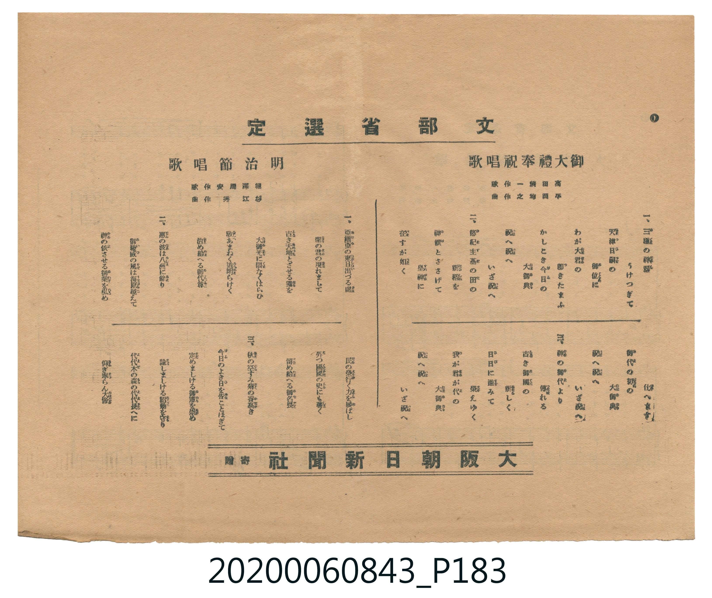
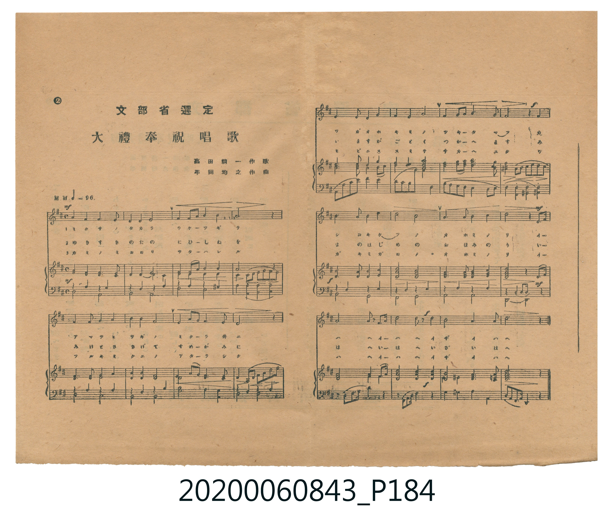

# 文部省選定 大禮奉祝唱歌

> Re:Shōka 使用 AI 協助辨識與重建樂譜，可能會有錯誤。歡迎回報。

<audio controls src="tairei_hoshuku_shoka.mp3"></audio>

- 詞：高田耕一（文部省選定）
- 曲：平岡均之（文部省選定）
- 唱歌筆記帖（臺灣子供世界社發行，2020.006.0843）P184.jpg（大阪朝日新聞社寄贈印刷伴奏譜）

## 說明

原書資訊與歌詞全文（對應 P184.jpg 印刷伴奏譜，歌詞亦見 P183.jpg）：
調性與拍號：ニ長調 4/4 拍子，M.M. ♩= 96


## 歌詞

```text
（一）
三種（ミクサ）の神器（タカラ）　受けつぎて
天津日嗣（アマツヒツギ）の　高御座（ミクラヰ）に
我が大君の　即きたまふ
かしこき今日の　大御典（オホミノリ）
祝へ祝へ　いざ祝へ

（二）
悠紀主基（ユキスキ）の田の　新稲（にひしね）を
神饌（みけ）とささげて　皇神（すめがみ）に
在（いま）すが如く　つかへます
御代の初めの　大御典（おほみのり）
祝へ祝へ　いざ祝へ

（三）
神の御代より　傳はれる
古き御國の　新しく
日々に進みて　榮えゆく
我が君が代の　大御典（オホミノリ）
祝へ祝へ　いざ祝へ
```

## ABC

```abc
X:1
T:文部省選定 大禮奉祝唱歌
C:曲：平岡均之（文部省選定）
M:4/4
L:1/16
Q:1/4=96
K:D
V:V1 name="Vocal" snm="Voc"
[V:V1]
!mf! A4 F4 E6 D2 | D4 E4 F8 | G4 G2 B2 A4 G4 | F12 z4 |
w: 1.~ミ ク サ ノ | タ カ ラ | ウ ケ _ ツ ギ | テ
w: 2.~ゆ き す き | の た の | に ひ _ し ね | を
w: 3.~カ ミ ノ ミ | ヨ ヨ リ | ツ タ _ ハ レ | ル
F6 F2 G4 A4 | B4 B4 A8 | G4 B2 A2 F6 E2 | D12 z4 |
w: 1.~ア マ ツ ヒ | ツ ギ ノ | ミ ク _ ラ ヰ | ニ
w: 2.~み け と さ | さ げ て | す め _ が み | に
w: 3.~フ ル キ ミ | ク ニ ノ | ア タ _ ラ シ | ク
E6 E2 D4 F4 | F4 E4 A8 | F4 G2 A2 B6 G2 | !f! F8 z4 F4 |
w: 1.~ワ ガ オ ホ | ギ ミ ノ | ツ キ _ タ マ | フ カ
w: 2.~い ま す が | ご と く | つ か _ へ ま | す み
w: 3.~ヒ ビ ニ ス | ス ミ テ | サ カ _ ヘ ユ | ク ワ
B6 A2 B4 d4 | c8 B8 | A6 A2 B4 c4 | !mf! d8 z4 D3 F |
w: 1.~シ コ キ ケ | フ ノ | オ ホ ミ ノ | リ イ _
w: 2.~よ の は じ | め の | お ほ み の | り い _
w: 3.~ガ キ ミ ガ | ヨ ノ | オ ホ ミ ノ | リ イ _
A8 A2 z2 F3 A | !f! d8 d2 z2 d4 | B8 A6 A2 | d12 z4 |
w: 1.~ハ ヘ イ _ | ハ ヘ イ | ザ イ ハ | ヘ
w: 2.~は へ い _ | は へ い | ざ い は | へ
w: 3.~ハ ヘ イ _ | ハ ヘ イ | ザ イ ハ | ヘ
```

## TMD 檔案連結

- [主旋律 TMD 檔案](tairei_hoshuku_shoka.tmd) [[在 TMD Studio 編輯](https://tmdlang.github.io/Tmd-TS/#tmd=s7IKdvYPcrWy4qpTUCpJTLdSSM7PyUlNLsnMz7MqzsjPTkzOyFeCS5bl55TmploBqXgDQ4RwcX5pUXJqfEFieqpVgKGFCboM3KT4vPyS1KT8_GyEioKi_LLUvMQ8oKqCosy8ktSU-My84tQikAsQqlLLMlNSQWqKkxPz4stSizLTMlNTkByWWlQMdjLEJSVFiXnFyUWZBaimlGSkAl2fmVsA1J-Ygy6enFqUmpufhyKTX5SZnplnBRROKgV6QolLS0vh2bT2l80rns9pfNm44-m6WQpPlyx_vmzd06Wdz5fOfTpl47O1PQpaWlyKtgqWZlz2tgouXDYm-iZ2ICNfrJz3fs-sl6tnPJ-y4UXD1Cc7Gt7v6UAz7v2eTrD1z2ZvAqp9unPz000Ln85tf7KzG7daiK3P17a9WDHj6Y5pQIUv2nc9b1z8dO2EJ_tmP9kx7fnUnudL9j2fuefFwp73e3qMDIwM9AwMzPQMLEyMgYaA4kwvqyAdqBHomZczVj2bM_fZ9KXPpm140TgPqPHp-pYXWzqe9m542rH9yZ4tT5f2v1g7B2w5l76Wgi21AJeCgsLTvvnPZu94sbn9xYquFx3tQG8BA-1p6wqgz0Gu29D7rL1TAeZeBQwn9UA0PNm17MWybpA6Y4i_OoFhCTL-xar9zxqWgwzu7n0xcz5Q9HFz98up24HiCsBYUgAKAwMNaI6vnq-ewqOZK8GxCNIJtB0cX50gzpMdnc9XrAMKPW6e_7hp_eOmrUCJx43rni-d93TmCpB40_7HTasfN68EiTc0PO2f_rhx4uPGJY8b-x43LgN7dMnKZ1uWAkP56fTFYA2LHjfPe9zc8rh5EohsApoOMhGoGZhenu5b-HTXcoR9zSsfN28AK1gNMutZB9DsHmDUPZ0wG6Lnae_mx429jxvnP27c97hxK0jR48bux41AZ0wGSjzZ3QW0GaoUqA1ofOsOsCtWPW6eDbKkue9x8yqob4Hp-nHjDggJ1PC4seVx4zQIFx40u4DpCqz4WdOC51sanuzY_XT-LrCDlz1uWvu4aSeQhIbRlA0Qi4HJ6_kKYCLvAPriceMmsOPAapomQWyd93Ip0FSg9H5g4IE1r3jcOBWMJgFDEWjE81ntQGVgNTMfNzUCAwGoGBEuT-eA4wLk3n1g0ZmgYFrW9LixH-wPYHQAw2QHOIxmgjXsW_hk92Kg8552zAWbhxFAjV2PG3eDXbTucVMXCQG0A5gEoYrngSyA2NQEDPIukB1NwPgCpqOex03dYIf0A93WC7J2DtCF0NACh1A_OJCBkdfQCvTlywZguAEdAwqMZ8vWPW4EmtcGUwRJFaAk0QPxFcWxDZSmPJtDgYKWPheXbyKwdA3LT07McagxqFGoBtmgYGNopmUHZmErXRSer1kDzInAkkzBROHphv7n6xt0ECUCVmtARlXnptWCGTUKpgq6YGgMpY2gNAgaAnENmESWgamEwRqg1RAWiDYDYpiZMPEaDD0waABTAXaNj2GNAjAGoGLAvA1nbUXSA4wgsJnAYgUuvxoutxLDdY-blsHVbYSra4GLrUOobG7D4c54VHcagUyFqQWmTThrJrI7weJAlY0wG4BFEJwFE0NyZyPcF42b4KzpcNZaJB9NIs6dxiC1iLCB2w4OQbg7weIg36-AiyBYqzDdiRR28Bho7oez1iCphNmN2534k_auHlKTNmpaA7FhqRCWKmvAaRQEYTRMBuFHmB5YakY2E5QPELkCHWJJ0U2LkOSBFRuYhIdhMywuUUMWnmZQ4gqmDkseQUn5wBoRqrIbhzuxpOhGWGyCTWicCCbhKaFxKsJ-OBtY-cBZsFyG5E54fgDWH3B1PSi2gOxETvsE3AlK0c0w2yE-BekEVqhwPixsQCGPCB1YOGANT3gMIadolPBs2o5mIm53EiisO0lP0chlMogNS3uwVIlI8zCVmCkapgKUskGysLQPE8Mso2EpuTqtFmETUjmNHBKPm0C5HliHwvjNs-E2I6dl7CUQVB1S6l8LZ6GkSXDeQU8BIAgLfURph5yuYeaCVTTuA5PwlAlPjyCVU-CiiHQPK9mQXNq4BC4LT1eNOzBsQc4BGC6F5zbklI1crj9ungwm4TY07US4AM5GDlP02gukDlZzItcDM1BsAeVbbCkb7lJ4TBNI209nzyY9bSOnQ-R0aRgH94Q5msOQtUBUICd3ZENgOoHFNcw4GISnbmBTCJqhjFEKbVCGhwdS02YwuRbOhzUksCVG7EUMckUKyR7YsgPIPPQqF5G4YckOuRnSgWwuuFkBbDzD-bCoBqmEFcGoqtHc2diFomI3mIQXinAdIPOQVaK4E57hkJshsGYBxCdrQSRSNYbcaIBlPbhqOoQngWbIFNITNnoRDOKDEh2kKDXFlibBAiA1oCIXKQOgJ3j05I7FKBjE1sBGL9AgBQIoVJBChHh1TdvQ1cFlIbpA5oDMQy52kCG2pgh6YQQpXsF2I1IXCeqmYahDrRRA5oDUIRfieNwILqwHbzjWcnHp2imA-pMKQFqZCwA)]
- [鋼琴伴奏 TMD 檔案](tairei_hoshuku_shoka_piano.tmd) [[在 TMD Studio 編輯](https://tmdlang.github.io/Tmd-TS/#tmd=s7IKdvYPcrWy4tLSUng2rf1l84rncxpfNu54um6WwtMly58vW_d0aefzpXOfTtn4bG3P-z0dT3s3PO3Y_mTPlqdL-1-snfN-T6eClhaXoq2CpRmXva2CC5eNib6JHVedgtKLlfPe75n1cvWM51M2vGiY-mRHA1A7mh1A7Uogtc9mbwKqfbpz89NNC5_ObX-ysxu3WohTnq9te7FixtMd04AKX7Tvet64-OnaCU_2zX6yY9rzqT3Pl-x7PnPPi4VAF_cYGRgZ6BkYmOkZWJgYAw0JMLQw0csqSAd5ZsnylzNWPZsz99n0pc-mbXjROA-o8en6lhdbsPhTiYvLNzEzzyosPzkxx6HGoEahmksBCGwMzbTswKzq3LRaMKNGwVRBFwyNobQRlAZBQyCuAZPIMjCVMFijYAJlgWgzIIaZCROvwdADgwYwFWDX-BjWKDxung8Ve9y0Hs7aiqTncXMf2MzHTfvh8qvhcisxXPe4aRlc3Ua4uha42DqEyuY2HO6MR3WnEchUmNrHjb1w1kxkd4LFgSobYTY8boT7DS6G5M5GuC8aN8FZ0-GstUg-mkScO41BahFhA7cdHIJwd4LFQb5fARdBsFZhuhMp7OAx0NwPZ61BUgmzG787UdMHiA1LObCUVANOVyAIo2EyCHfB9MBSILKZoLSLSMnoEEsqbFqEJP-4eR6YhPu7GRb-qKEBj2eU8IWpw5KuUVLr4-YNUJXdONyJJRU2wmIAbELjRDAJj73GqQj74ezHjTDXP26E5Qwkd8LT8OOmRri6HhRbQHYip1cC7gSlwmaY7RCfgnQ-bloL58PCBhTyiNCBhQPW8ITHEHIqRAnPpu1oJuJ3Zw1K2Qdiw9ILLCUh0ilMJWYqhKkApUaQLCy9wsQwy0JY6qtOq0XYhFQeIrv-cRModz1uguXKx82z4TYjpz_sOR2qDinFroWzUNIROL2jxxoIwkIMUaogp0WYuWAVjfvAJDw1wdMQSOUUuCgircJKECSXNi6By8LTQuMODFuQUy2GS-E5BDk1Ipefj5sng0m4DU07ES6As5HDFL2WAKmD1VDI5e0MFFtAeQ1baoS7FB7TsPSInHaQ05JhHNxiczTDkLVAVCAnUWRDYDqBxSLMOBiEp0hgMwGaCYxRCkdQxoJ7rGkzmFwL58MqWWwJCHtWRq5kIEkaWxIGmYdeHSESJCypIFfRHcjmgqvcx43w4qURFj0glbCiDlU1mjsbu1BU7AaT8MIHrgNkHrJKFHfCMwlyFQ2rMiE-WQsikaoL5AoVll3gqukUnqjpCARBfFBCgRRZptjSEVgApAZUtCElWvREip5EsRgFg9gajOgFByTjgXyC5Avi1TVtQ1cHl4XoApkDMg85eyNDbNU0eqaHFGNguxEpggR10zDUoRa-IHNA6pALSzxuBBeKgzcca6E9moDMxLz8IA-sfRpgxaoNS0iG2rCK1DxeG7lWN43XhnRqzCAMNCUIfTAIbBRowxqWEJaJNij5IuxCyAOTLVw_yHCQqbDGLIgGN0KhbkW1CcJDmIQwHWQ_LLsgWED1cBXYXIrsRlSboJ5FtIVNQaEM4oBUgdXDMi0848drY4YiVAQpGBH2IPsONXCxOBqhFOJ8iBqIB2AQIgNUqw5XbAZytjnY7eogFWAGwgWwBh2KMYZgoxFiJtpIZZKRtqk2emUKtBfFALiLUfwB4yOrRjYNpAMog7AMBmFlGWoNi2kBsiWoJS5QDNNYuCBYLbIKlMSkjjM1AeMMIoDT5eg-QMuhPig51ASeQQ3jQcg0HoKBPTYoCyIOSmlwPkQBRAIqjWIIFi0EjDBAStA49YD56M40BpIwjGkKyBMgjE0E3SQsjkEWgusEYRDfKB4YT2gGQFwKMQIY6rp2CqCAj_YxjFWAs42Q2MZgtjIXAA)]

## 分析

```text
================================================================================
📊 TMD Song Profile: [ 文部省選定 大禮奉祝唱歌 ]
================================================================================
⏱  Duration:       0:50 (50.0s), 20 measures total
🎼 Key & Tempo:    首調基準 D, != 96.0 BPM, <4/4>
   - 分析範圍：      由實際發聲的音符與和弦推測調性；播放脈絡另行呈現
🎤 人聲音域:    D4 (MIDI 62) – D5 (MIDI 74) [跨度: 12 個半音 / 1.0 個八度, 難度: easy]
   - 最低音:  D4 in [Main #1 @ m.1, 0:02]
   - 最高音: D5 in [Main #1 @ m.13, 0:31]
   - 適合: soprano, mezzo-soprano, contralto, tenor, baritone, bass
🏛  結構:      Main (50.0s)
⚡ 編曲密度:        Peak 1 軌道同時演奏
🗝  調性診斷：       D 大調（純淨自然大調，未偵測到可信轉調）
   - 風格氣質:    純淨自然大調（陽光明朗、易唱易記，無明顯調外色彩）
   - 轉調歷程:    全曲維持單一推測調性（未偵測到可信轉調）
   - 核心骨幹音:  F#, D, A, B, E
   - 調性數值:    D 大調 [相關度: 0.90, 穩定度: High, 自然音純度: 100.0%]
   - 候選調性 (K-S): D 大調 (0.90), B 小調 (0.76), F# 小調 (0.73)
   - 五度圈歷程:   +2
   - 各段落調性細節:
     • [Main #1]: D 大調 (r: 0.90, 自然音純度: 100.0%)

  [ 五度圈游移軌跡 ]
               C  
         F            G  
      Bb              [D ]*
      Eb               A  
         Ab           E  
            Db       B  
               F# 
     (* = active key center)

  [ 十二半音累積音高分佈 ]
     C  :                            0.0%
     C# : ████                       4.1%
     D  : ███████████████████████   21.3%
     D# :                            0.0%
     E  : █████████                  8.1%
     F  :                            0.0%
     F# : ████████████████████████  22.3%
     G  : ████████                   7.4%
     G# :                            0.0%
     A  : ██████████████████████    20.6%
     A# :                            0.0%
     B  : █████████████████         16.2%
--------------------------------------------------------------------------------
Assignment 軌道音域：
  - Vocal         : D4 – D5 (12 個半音 / 1.0 個八度, 64 個音符)
================================================================================
```


## 原書掃描頁






