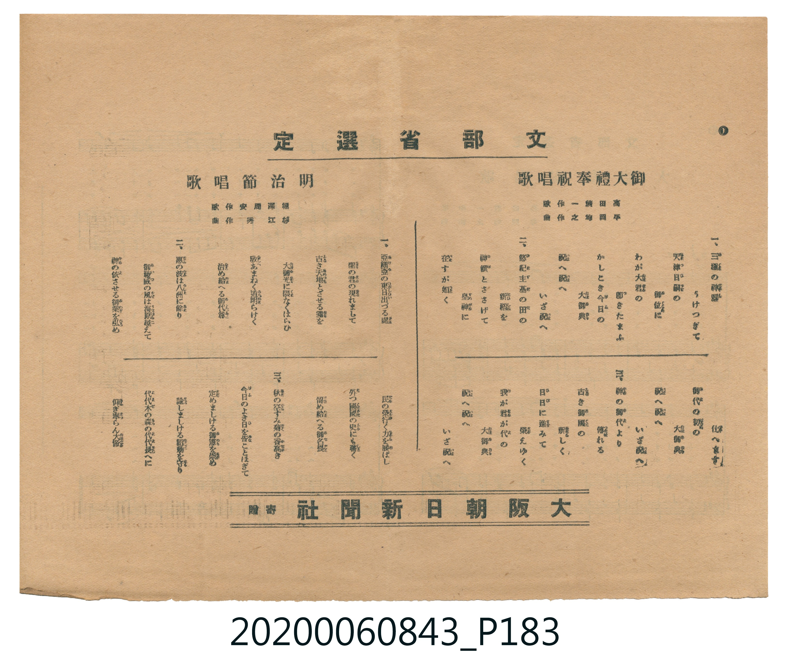
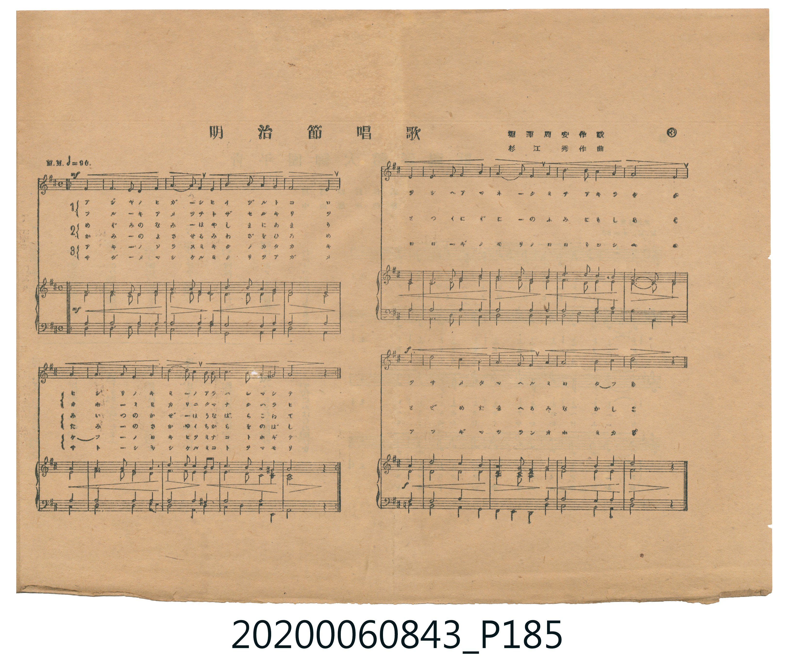

# 明治節唱歌 (明治節唱歌 — 印刷譜)

> Re:Shoka 使用 AI 協助辨識與重建樂譜，可能會有錯誤。歡迎回報。

<audio controls src="meijisetsu_shoka_printed.mp3"></audio>

- 詞曲作者：未在 TMD metadata 中提供

## 說明

明治節唱歌 (明治節唱歌 — 印刷譜)
Source: 唱歌帖 (2020.006.0843), P185.jpg (lyrics also on P183.jpg)
Credits: 堀澤周安 作歌 / 杉江秀 作曲 / 大阪朝日新聞社寄贈

## 跨冊／重複收錄參照

> 同曲（堀澤周安作詞、杉江秀作曲〈明治節〉；收錄於《新定兒童唱歌》卷首及《唱歌帖》P182 謄寫版、P185 印刷伴奏譜）

- **[同曲]** 《新定兒童唱歌》尋常科第一學年用（2020.006.0847.0001）：[**〈明治節〉**](../../../shintei_jido_shoka/grade_1_2020.006.0847.0001/0_06_meijisetsu/index.md)（`D` / `4/4` — [原始 TMD](../../../shintei_jido_shoka/grade_1_2020.006.0847.0001/0_06_meijisetsu/meijisetsu.tmd)）
- **[同曲]** 楊金土手抄《唱歌帖》第 1 冊（2020.006.0843）：[**〈明治節唱歌 (明治節唱歌 — 謄寫版)〉**](../p182_meijisetsu_shoka/index.md)（`D` / `4/4` — [原始 TMD](../p182_meijisetsu_shoka/meijisetsu_shoka.tmd)）
- 總表：[跨冊重複與同名歌曲總索引](../../../duplicate_songs.md)

## 歌詞

```text
1.
アジヤノヒガシ ヒイヅルトコロ ヒジリノキミノ アラハレマシテ
フルキアメツチ トザセルキリヲ オホミヒカリニ クマナクハラヒ
ヲシヘアマネク ミチアキラカニ ヲサメタマヘル ミヨタフト

2.
めぐみのなみは やしまにあまり みいつのかぜは うなばらこえて
かみのよさせる みわざをひろめ たみのさかゆく ちからをのばし
とつくにぐにの ふみにもしるく さだめたまへる みよかしこ

3.
アキノソラスミ キクノカタカキ ケフノヨキヒヲ ミナコトホギテ
サダメマシケル ミノリヲアガメ サトシタマヒシ ミコトヲマモリ
ヨヨギノモリノ ミヤシロタカク アフギマツラン オホミカゲ
```

## ABC

```abc
X:1
T:明治節唱歌 明治節唱歌 — 印刷譜
M:4/4
L:1/16
Q:1/4=96
K:D
V:V1 name="Vocal" snm="Voc"
[V:V1]
D3 E F2 A10 | B3 B A12 | F2 A2 E2 D B,9 | A,16 |
B,3 D E2 B,10 | D3 E F12 | A2 F2 E D E F9 | D6 z10 |
D3 E F2 A10 | B3 B A12 | F2 A2 E2 D B,9 | A,16 |
B,3 D E2 B,10 | D3 E F12 | F2 E2 F A B ^A9 | B6 z10 |
A3 A B2 F10 | A3 E F12 | A2 B2 d B A F9 | E6 z10 |
d3 c B2 A10 | B3 A F12 | E2 A2 F3 E9 | D6 z10 |
D3 E F2 A10 | B3 B A12 | F2 A2 E2 D B,9 | A,16 |
B,3 D E2 B,10 | D3 E F12 | A2 F2 E D E F9 | D6 z10 |
D3 E F2 A10 | B3 B A12 | F2 A2 E2 D B,9 | A,16 |
B,3 D E2 B,10 | D3 E F12 | F2 E2 F A B ^A9 | B6 z10 |
A3 A B2 F10 | A3 E F12 | A2 B2 d B A F9 | E6 z10 |
d3 c B2 A10 | B3 A F12 | E2 A2 F3 E9 | D6 z10 |
D3 E F2 A10 | B3 B A12 | F2 A2 E2 D B,9 | A,16 |
B,3 D E2 B,10 | D3 E F12 | A2 F2 E D E F9 | D6 z10 |
D3 E F2 A10 | B3 B A12 | F2 A2 E2 D B,9 | A,16 |
B,3 D E2 B,10 | D3 E F12 | F2 E2 F A B ^A9 | B6 z10 |
A3 A B2 F10 | A3 E F12 | A2 B2 d B A F9 | E6 z10 |
d3 c B2 A10 | B3 A F12 | E2 A2 F3 E9 | D6 z10 |
```

## TMD 檔案連結

- [主旋律 TMD 檔案](meijisetsu_shoka_printed.tmd) [[在 TMD Studio 編輯](https://tmdlang.github.io/Tmd-TS/#tmd=s7IKdvYPcrWy4qpTUCpJTLdSSM7PyUlNLsnMz7MqzsjPTkzOyFeCS5bl55TmploBqXgDQ4RwcX5pUXJqfEFieqpVgKGFKboM3KT4vPyS1KT8_GyEioKi_LLUvMQ8oKrcxLzS4uSizIKS-OT8gkqEmtSyzJRUkIrUlMyS_KLMxBwkJ6UWFYMdC3FDSVFiHsQMoCBCVUlGKtDdmbkFqai6IeLJqUWpufl5YBktLYVnM_qebdr9fH3D0ykbn63tUdBAF3jUMEXhae-Gpx3bX6ydo6mgpcWlaKtgacZlb6vgwmVjom9ix8Wlr8WloECqUSAtwZAgU4AoeLpjmoKGkYGRgZ6BgZmegYWJsaaOAiiM9bIK0hU0ciqLMpOLFRJzivMV8vNAEsYgCbBBzkWg4CoGmrSg4dm-JU8nrni6rlPhyd45IHv1FZ7N7Xy2cf7z5Q1godmbgEJPlyx_OWPVszlzn01f-mzahheN854v2fd0fcuLLR1cIBN9wLZZgZiGeiDycdOix007Hjcvedzc97h50uOmNY-btiuAWUCh1sfNqx83dzxu2vy4eS1EFKh2FUht09rHzfOBDLAJzSsfN_c_bl7zuHkeUPvj5jaw0c1TQdqBCkEqFj5ubnnc3AgUBRq37XHTbqgcyLRNQEOA1GywiUA7gHYCud1A0fUgE5u7wAygBUBrJkGM3gS2ZwbYaKCKXqAKoChQeyPYR0BzV4LNARoCUrsV5ICm_WC1M4A2Q9SuAAsBXQkJHCNoiDQ-bpzwuHH_48Z1jxtXgRlAs5taHjdOf9y473Hj6seNTSBGU5cCWBIosQSstvtx4xyw2sY2sMYNj5s6HzdOftzY8bhxGdhokBKwuU1AoamPG2c_bgI6ECjU1P-4cdrjpkmPG4GOBXoGGE6N82FuACrsftwENLMfKLoQzOkEqwXKbQC6CmL0CrAzgOYA3Qd0PpBcBxTdCjYEGNJAJ08H2gYxBGjiArA_gXYAfbQD7gygs4BKgP6cDA4RY0QaAYYoMNL3gsN1JzD0gKLAiAVGC1AUaDxQLyg6gaIbwSEKTEzA0AVqmgSOXlBoA2MRmIw6QPHctA6WRkAx0wBOHeCUA9INjRygCaCkAbYcmLAWQtQCEw9QFSQigSkFlFTnw8zdBBYFJohVkDSyAuwGoFVAo0Ci4NQKMnoJOPEAnQ9xNSh2gfJTwWqBJgDTKTChbUZKlCBVm7i09Lm4fBMz86zC8pMTcxxqDGoUqkE2KdgYmmnZgVk1CoYKukBopGAMJE3BbFRYo2AGps2wykJUwPQaAbGhglk8FiWmmIJoSqDugeo2BBuGxSiQYchuxu4ikGtAskZggzDVwcyAQAM87hme4QMJG1AYmYJcro5FCcRbEIgvgCDeBhkDCXIsfiPoHJAKkH7DOHA4YosvkGuJcQ7QCBDXHGwevgjDZg2yZbAkBAkodBWEk08tF5eunQIo_ylgoZW5AA)]
- [鋼琴伴奏 TMD 檔案](meijisetsu_shoka_printed_piano.tmd) [[在 TMD Studio 編輯](https://tmdlang.github.io/Tmd-TS/#tmd=s7IKdvYPcrWy4tLSUng2o-_Zpt3P1zc8nbLx2doeBQ10gUcNUxSe9m542rH9yZ4tT5f2v1g7R1NBS4tL0VbB0ozL3lbBhcvGRN_EjotLX4tLQYE8A0Eag_NLi5JTrRQgyp7umKagYWRgZKBnYGCmZ2BhYqypoxBgaGGql1WQrqCRU1mUmVyskJhTnK-QnweSMAZJgA1yLkpNySwpBpq0oOHZviVPJ654uq5T4cneOSDb9RWeze18tnH-8-UNYKHZm4BCT5csfzlj1bM5c59NX_ps2oYXjfOeL9n3dH3Liy0dXFr6XFy-iZl5VmH5yYk5DjUGNQrVIFsUbAzNtOzArBoFQwVdIDRSMAaSpmA2KqxRMAPTZlhlISpgeo2A2FDBLB6LElNMQTQlUPdAdRuCDcNiFMgwZDdjdxHINSBZI7BBmOpgZkCgAR73DM_wgYQNKIxMQS5Xx6IE4i0IxBdAEG-DjIEEORa_EXQOSAVIv2EcOByxxRfItcQ4B2gEiGsONg9fhGGzBtkyWBKCBBS6CsLJpxaa-QIyE_PygzxwZD_TeG1YbIGY2iAbgaQ2dpcbaptow5IbLlVQP8IMM9eJ1zYCKwSaD-aAbMCeCI3jteHpEJmN6TmI44Fq4MkRaCHIZBO4ELrh2HyK3e0oToYohLsdV3YGOxdqAQTiTbMjMdThjiPgdqiZIFeDigdDoN9BbKyFBCg4iC0oEGECylwwnThdhaqBYKKBRQzMXFCkgYsTiAS2NIMUNcS4H2QQvHSBpQliUo0pIbcjhThaukdJP-jaiE3zKCWRD66SyBCWgOAMTBtNdIhQZAZWZIpEYldHhIWwOg9uihGIgXAFyQZCHQRWQJTbQBBvohg-oYZQj8t1YHOMCamCQbwFMFwlPlsRqvAEHFgKYgrEi1jVIhtGyHEQw4wJG0lUxIIDjWCyIyrJATOyrp0CKC8rYKGVuQA)]

## 分析

```text
================================================================================
📊 TMD Song Profile: [ 明治節唱歌 明治節唱歌 — 印刷譜 ]
================================================================================
⏱  Duration:       3:00 (180.0s), 72 measures total
🎼 Key & Tempo:    首調基準 D, != 96.0 BPM, <4/4>
   - 分析範圍：      由實際發聲的音符與和弦推測調性；播放脈絡另行呈現
🎤 人聲音域:    A3 (MIDI 57) – D5 (MIDI 74) [跨度: 17 個半音 / 1.4 個八度, 難度: challenging]
   - 最低音:  A3 in [Main #1 @ m.4, 0:07]
   - 最高音: D5 in [Main #1 @ m.19, 0:45]
   - 適合: soprano, mezzo-soprano, contralto, tenor, baritone, bass
🏛  結構:      Main (60.0s) -> Main (60.0s) -> Main (60.0s)
⚡ 編曲密度:        Peak 1 軌道同時演奏
🗝  調性診斷：       F# 小調（純淨自然小調，未偵測到可信轉調）
   - 風格氣質:    純淨自然小調（陰鬱抒情、旋律集中，無明顯調外色彩）
   - 轉調歷程:    全曲維持單一推測調性（未偵測到可信轉調）
   - 核心骨幹音:  A, F#, B, E, D
   - 調性數值:    F# 小調 [相關度: 0.76, 穩定度: Moderate, 自然音純度: 97.4%]
   - 候選調性 (K-S): F# 小調 (0.76), A 大調 (0.68), D 大調 (0.63)
   - 五度圈歷程:   +6 -> +6 -> +6
   - 各段落調性細節:
     • [Main #1]: F# 小調 (r: 0.76, 自然音純度: 97.4%, 調外音: A#)
     • [Main #2]: F# 小調 (r: 0.76, 自然音純度: 97.4%, 調外音: A#)
     • [Main #3]: F# 小調 (r: 0.76, 自然音純度: 97.4%, 調外音: A#)

  [ 五度圈游移軌跡 ]
               C  
         F            G  
      Bb               D  
      Eb               A  
         Ab           E  
            Db       B  
              [F#]*
     (* = active key center)

  [ 十二半音累積音高分佈 ]
     C  :                            0.0%
     C# :                            0.3%
     D  : ███████                    9.6%
     D# :                            0.0%
     E  : ████████                   9.9%
     F  :                            0.0%
     F# : █████████████████████     26.7%
     G  :                            0.0%
     G# :                            0.0%
     A  : ████████████████████████  30.8%
     A# : ██                         2.6%
     B  : ████████████████          20.1%
--------------------------------------------------------------------------------
Assignment 軌道音域：
  - Vocal         : A3 – D5 (17 個半音 / 1.4 個八度, 240 個音符)
================================================================================
```


## 原書掃描頁






