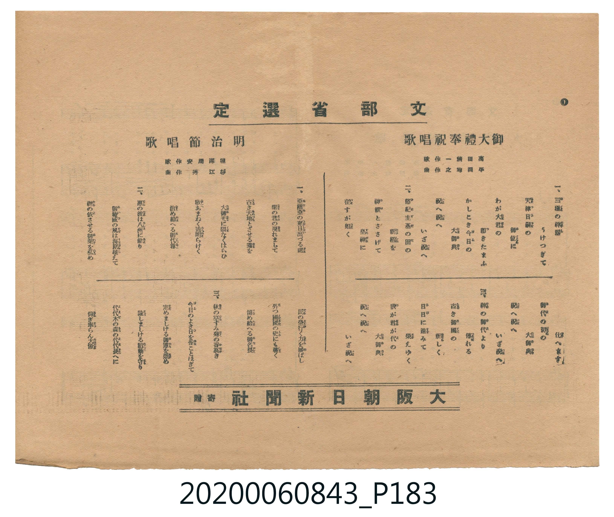
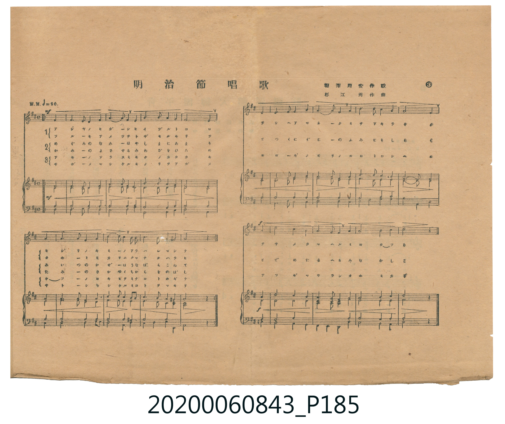

# 明治節唱歌（印刷譜）

> Re:Shōka 使用 AI 協助辨識與重建樂譜，可能會有錯誤。歡迎回報。

- **鋼琴伴奏版**：<br><audio controls src="meijisetsu_shoka_printed.mp3"></audio>

- 詞：堀澤周安（文部省選定）
- 曲：杉江秀（文部省選定）
- 唱歌筆記帖（臺灣子供世界社發行，2020.006.0843）P185.jpg（印刷伴奏譜）

## 說明

原書資訊與歌詞全文（對應 P185.jpg 印刷伴奏譜，歌詞亦見 P183.jpg）：
調性與拍號：ニ長調 4/4 拍子，M.M. ♩= 96（前兩行反覆）


## 歌詞

```text
一、亜細亜の東　日出づる處
聖の君の　現れまして
古き天地　とざせる霧を
大御光に　隈なくはらひ
教あまねく　道明らけく
治め給へる　御代尊

二、恵の波は　八洲に餘り
御稜威の風は　海原越えて
神の依させる　御業を弘め
民の榮行く　力を展ばし
外つ國國の　史にも著く
留め給へる　御名畏

三、秋の空すみ　菊の香高き
今日のよき日を　皆ことほぎて
定めましける　御憲を崇め
諭しましける　詔勅を守り
代代木の森の　代代長へに
仰ぎ奉らん　大帝
```

## ABC

```abc
X:1
T:明治節唱歌（印刷譜）
C:曲：杉江秀（文部省選定）
M:4/4
L:1/16
Q:1/4=96
K:D
V:V1 name="Vocal" snm="Voc"
[V:V1]
z4 z4 z4 F4 | F6 E2 D4 F4 | A6 A2 F4 E4 | B6 B2 A4 G4 |
w: 1.~ア | ジ ヤ ノ ヒ | ガ _ シ ヒ | イ ヅ ル ト
w: 2.~フ | ル キ _ ア | メ ツ チ ト | ザ セ ル キ
w: 3.~め | ぐ み の な | み _ は や | し ま に あ
w: 4.~か | み の _ よ | さ せ る み | わ ざ を ひ
w: 5.~ア | キ _ ノ ソ | ラ ス ミ キ | ク ノ カ タ
w: 6.~サ | ダ _ メ マ | シ ケ ル ミ | ノ リ ヲ ア
F8 E4 A4 | A6 A2 F4 A4 | d6 d2 c4 B2 B2 | c6 B2 A4 G4 |
w: 1.~コ ロ ヒ | ジ リ ノ キ | ミ _ ノ ア ラ | ハ レ マ シ
w: 2.~リ ヲ オ | ホ ミ ヒ カ | リ _ ニ ク マ | ナ ク ハ ラ
w: 3.~ま り み | い つ の か | ぜ _ は う な | ば ら こ え
w: 4.~ろ め た | み の _ さ | か ゆ く ち か | ら を の ば
w: 5.~カ キ ケ | フ _ ノ ヨ | キ ヒ ヲ ミ ナ | コ ト ホ ギ
w: 6.~ガ メ サ | ト _ シ マ | シ ケ ル ミ コ | ト ヲ マ モ
A8 z4 E4 | E6 F2 G4 B4 | A6 A2 F4 A4 | d6 d2 c4 B4 |
w: 1.~テ ヲ | シ ヘ ア マ | ネ _ ク ミ | チ ア キ ラ
w: 2.~ヒ と | つ く に ぐ | に _ の ふ | み に も し
w: 3.~て ヨ | ヨ _ ギ ノ | モ リ ノ ヨ | ヨ ト コ シ
w: 4.~し * | * * * * | * * * * | * * * *
w: 5.~テ * | * * * * | * * * * | * * * *
w: 6.~リ * | * * * * | * * * * | * * * *
A8 F4 A4 | d8 c4 B4 | A6 B2 F4 A4 | A8 B4 c4 |
w: 1.~ケ ク ヲ | サ メ タ | マ ヘ ル ミ | ヨ タ フ
w: 2.~る く と | ど め た | ま へ る み | な か し
w: 3.~ヘ ニ ア | フ ギ マ | ツ ラ ン オ | ホ ミ カ
d8 z4 z4 |
w: 1.~ト
w: 2.~こ
w: 3.~ド
```

## TMD 檔案連結

- [主旋律 TMD 檔案](meijisetsu_shoka_printed.tmd) [[在 TMD Studio 編輯](https://tmdlang.github.io/Tmd-TS/#tmd=s7IKdvYPcrWy4qpTUCpJTLdSSM7PyUlNLsnMz7MqzsjPTkzOyFeCS5bl55TmploBqXgDQ4RwcX5pUXJqfEFieqpVgKGFKboM3KT4vPyS1KT8_GyEioKi_LLUvMQ8oKqCosy8ktSU-My84tQikAsQqlLLMlNSQWqKkxPz4stSizLTMlNTkByWWlQMdjLEJSVFiXnFyUWZBaimlGSkAl2fmVsA1J-Ygy6enFqUmpufhyKTX5SZnplnBRROKgV6AkOiJDETKBwPxOWJ8bmJmXk5iXlAZ2lpKTyb0fds0-7n6xueTtn4bG3P-z0dT3s3PO3Y_mLtnPd7OhW0tLgUbRUszbjsbRVcuGxM9E3sQGa_WDnv_Z5ZTxc0PNu35OnEFU_XdQI1PpvW_rJ5xfM5jS8bdzxdNwuoHeyOZ7M3AdU-m9v5bOP858sbcCuEuOD52rYXK2Y83TENqPBF-67njYufrp3wZN_sJzumPZ_a83zJvucz97xYCHRoj5GBkYGegYGZnoGFiTHQEFCU6mUVpMP98GTPlqdL-yE-UeLi0tdSsKUW4FJQUHjaN__Z7B0vNre_WNH1oqMd6HZgsDxtXQH0HsgJG3qftXcqwBylgOGkHoiGJ7uWvVjWDVJnDHE8MChngYx_sWr_s4blIIO7e1_MnA8Ufdzc_XLqdqC4AjAeFIDCwJABmuOr56un8GjmSlA8gSzu7H3auhIYRE_7e18sawMayAUy7smOhscNjU92zXm-ZQOQfNy47tncjY8bGp5NX_q0fdfjxqWPm7pfzJwKUgoCLxqnAZU8nTAbSAJVPe_f97ip53HjvseN0x83LoOpetq_5HFj79MlK5_O2QBU9bhxxWOQvtlAs17OWf64aRJc4ZLlT_ctfNra-bhxNVDhy1kdjxtXPW7sf9y4_nETUHATTOGzqTMfNzaBLVoLkgeqbZwMTKRgVROBInCFm3Y_bmp8vnXZ48YdQOuACoEWPNm9-OmGLoh_d_UA_fuscSvIp5sXgSwCKmld_WzLJqAbXi6Z8bipC-66fQufr5jzdEUjUO3LRUA_gNQ-27odGMMvtnU9bgQ6Fu7l50vnAVU92Tf3ceNUiE8hVj9buhbo36d7gOY2wt24Aejidc-WrQPGBsQzT7uAOiY93QjUugEYlIjgAYbakqdzuoEIEuBP-0HOfNzU9GIiMMDhvn4ODB4MXz-d0Pt8aj80ljuBvn6-HGTK85XAaAWG5n6gqhf9QG-se7ls5svVM4AxBjPuye4uYPyDbGwC-rEXxG6aBIruWW2PGyeDo3P348Y-5BhfNwvoAFhCmIjwftsmkMe2tCN5_8VqYBQCVaGofbFyytPuVpDadR1IUQCMOSB6Ngdo47pni9dBAgEiCEzzIN82rkaoBYZd39OlnaBE0TQZ5ABg8toxFyRPedaGAgUtfS4uR0OrsPzkxByHGl3Dmmqw_TYmWnZgRo2CARgaK9SA-T6GNQrxYPi4aRFMzAgu1jwVJmaMUNcIEzOBizV2w8RMsZhnhhDbChSDOkTDWEEXCI00VTV0dTUVDEFuUtAwBQuaQgWNFYyQHKrxuGkHWPpx8xJNINEHxJNAmh43rQGLA3U8btoOEYV7ReNx82qIrqa1mmAK6DCQ6EKoWS0gsxqBuAPJsxqPGydA5Bv3A-Ub1wHxKrC-xv1wuxrXA01rQQoOuCxQA8QuoJkg0alQ0dkgF3aDDEUKMKD718LNBPmqaS_EhSuh7t4JEp8P8gBSkALlGxC6FgLxPEhYbIfq2ggSXw3WiQh0M7CkGTR8TRVMgIKgiDACslFCegk0dFphpoB88rhpM1hwLUYYN22D2robqh7kViBrFVj9JiAfGHrIoTsdGiL7QOEIVN_YBFLfuA9sSBdyCIHDtakfqn4aKAQnARmbwO7pBasHxl4jyJdIIboe6v4-kHqQe4DmgVnghAAKHtSw7IOqXwVyP8i9oFQCSVjg0EVJuuipFBh2ChqGcWBRwziosDkotMEhrYk9EYOtAkU3KKiATpiPnAiA6hYBGSvheiFJeTZU73yQKmAwAD0EFgeFM1RvN8T7wPQA1wsJ8hZoEIIyDzhBA3MtSHwOcoIG8ttAaR2uF1uyBqZnsGg3NNLbQHr7QSLAkGrshusFRwWwEEFO3M0rIMkUkuSBnoAEONj_j5u74Hoh0dIB1wvO2NiTOERv02aQXlgUmWNJ6KBoA5V-yLHRDE1YzWtAZs0D2wNKuG1AQVCZhRL6XVB714PU9oOiB6x2EqpaSGhvgKrtBIXNZCAGZ6DGZahqIYm7E6oWFBbgmNkAVgvKI0hqIQkblANB7u0AuWE2UNM6bO5FDj1g8EL91gxO1ODEAlFbC6wujAhXF8ilMKxqAOY_9OqiERi16NUFKLrhkWIEdo8xNFJMFMxwZCbk3AKN6-YZoDQAyhKQNNAMyvnQlAFK7PDsD46pRmjx1dgPK14mQFIspCoAp3VQOIMyNSLOgG6FmwmUBaZWsOgitPyK4iXMXA_yFMhP6D4B1jGQWF4EMh9UhIJTD7AgAicptCBFynOrQeqbwOkBpB6U6UC5DTW44a6HpAxgMoGl5BlgQWClA66Roe4GOxviVmgEwLIKqrNB5R6sBASVoEBr5iFFCLx-gTn7cSOo0oKXyCBvgIp0kIt3YNR9QGdDSgdIcEMjFlpMgYq-x80gb4BqDqizQU41A7ob6gHUzAwJAZA7wQ0XcJ2FnolBtTjIMSB3gIMTmDXRMy-klIWUKaDi9XEzKH_CM4yunYKjoQKIBCZnOwVlLgA)]
- [鋼琴伴奏 TMD 檔案](meijisetsu_shoka_printed_piano.tmd) [[在 TMD Studio 編輯](https://tmdlang.github.io/Tmd-TS/#tmd=s7IKdvYPcrWy4tLSUng2o-_Zpt3P1zc8nbLx2dqe93s6nvZueNqx_cmeLU-X9r9YO-f9nk4FLS0uRVsFSzMue1sFFy4bE30TO646BaUXK-e93zPr6YKGZ_uWPJ244um6TqD2Z9PaXzaveD6n8WXjjqfrZgG1K4HUPpu9Caj22dzOZxvnP1_egFshxB3P17a9WDHj6Y5pQIUv2nc9b1z8dO2EJ_tmP9kx7fnUnudL9j2fuefFQqBze4wMjAz0DAzM9AwsTIyBhgQYWpjqZRWkY_WJEheXo6FVQGZiXn6Qh0ONrmFNNZcCENiYaNmBGTUKBmBorFAD5vsY1ijEg-HjpkUwMSO4WPNUmJgxQl0jTMwELtbYDRMzxWKeGUJsK1AM6hANYwVdIDTSVNXQ1dVUMAS5SUHDFCxoChU0VjBCcqjG46YdYOnHzUs0gUQfEE8CaXrctAYsDtTxuGk7RBTuFY3HzashuprWaoIpoMNAoguhZrWAzGoE4g4kz2o8bpwAkW_cD5RvXAfEq8D6GvfD7WpcDzStBSk44LJADRC7gGaCRKdCRWeDXNgNMhQpwIDuXws3E-Srpr0QF66EunsnSHw-yANIQQqUb0DoWgjE8yBhsR2qayNIfDVYJyLQzcCSZtDwNVUwAQqCIsIIyEYJ6SXQ0GmFmQLyyeOmzWDBtRhh3LQNautuqHqQW4GsVWD1m4B8YOghh-50aIjsA4UjUH1jE0h94z6wIV3IIQQO16Z-qPppoBCcBGRsArunF6weGHuNIF8iheh6qPv7QOpB7gGaB2aBEwIoeFDDsg-qfhXI_SD3glIJJGGBQxcl6aKnUmDYKWgYxoFFDeOgwuag0AaHtCb2RAy2ChTdoKACOmE-ciIAqlsEZKyE64Uk5dlQvfNBqoDBAPQQWBwUzlC93RDvA9MDXC8kyFugQQjKPOAEDcy1IPE5yAkayG8DpXW4XmzJGpiewaLd0EhvA-ntB4kAQ6qxG64XHBXAQgQ5cTevgCRTSJIHegIS4GD_P27uguuFREsHXC84Y2NP4hC9TZtBemFRZI4loYOiDVT6IcdGMzRhNa8BmTUPbA8o4bYBBUFlFkrod0HtXQ9S2w-KHrDaSahqIaG9Aaq2ExQ2k4EYnIEal6GqhSTuTqhaUFiAY2YDWC0ojyCphSRsUA4EubcD5IbZQE3rsLkXOfSAwQv1WzM4UYMTC0RtLaLC8MFbYcACrUbBMF4h2jAWRmHwoapMgFyTWBgFV2UaD6RN4xHq0E0zAykwi89FaIUqhOtEGIGkGeQ8kF-MiKn8kOsUWEUHLE3QK79GYEJFr_xAiReexIzAoWsMTWImCmY4igbkvA9Nuc0zQCkalMEhKboZVI5B0zko68ILM3C6a4QWxo39sMJyAiT_QSo2cM4FpRpQEYVIgUC3ws0EygLzHlh0EVrpg-IlzDIM5CmQn9B9AqwxIWl2Ech8UIUAzgvAYhWcQdCCFKkEWQ1S3wRO3SD1oCIEVHagBjfc9ZB0Dkz0sHw5AywIrELB7QtYKgI5G-JWaATAMj6qs0GlOKw8B9UHQGvmIUUIvLaEOftxI6gKhtcvIG-AKiiQi3dg1ORAZ0PKOkhwQyMWWuiCCvLHzSBvgOpBWJoGORTobqgHUIsmSAiA3AluhoFrYPQiCdQmATkG5A5wcAILGvSiCFJnQEpIUGXxuBlU2iCyPzTLEJv98edDIooANFVQLgFVROV-XTsFR8NoH6AYlGUEYRmBxMAGQcWN4SqAVkJVGKGoMIWrMIOrMIarUOYCAA)]

## 分析

```text
================================================================================
📊 TMD Song Profile: [ 明治節唱歌（印刷譜） ]
================================================================================
⏱  Duration:       0:40 (40.0s), 16 measures total
🎼 Key & Tempo:    首調基準 D, != 96.0 BPM, <4/4>
   - 分析範圍：      由實際發聲的音符與和弦推測調性；播放脈絡另行呈現
🎤 人聲音域:    D4 (MIDI 62) – D5 (MIDI 74) [跨度: 12 個半音 / 1.0 個八度, 難度: easy]
   - 最低音:  D4 in [A1 #1 @ m.2, 0:03]
   - 最高音: D5 in [A1 #1 @ m.7, 0:15]
   - 適合: soprano, mezzo-soprano, contralto, tenor, baritone, bass
🏛  結構:      A1 (20.0s) -> A2 (20.0s)
⚡ 編曲密度:        Peak 1 軌道同時演奏
🗝  調性診斷：       A 大調（推測轉調經歷 1 次）
   - 風格氣質:    純淨自然大調（陽光明朗、易唱易記，無明顯調外色彩）
   - 轉調歷程:    A 大調起奏 ➔ [A2] 轉至 A 大調 (+3 半音 / 五度圈 -3 步)
   - 核心骨幹音:  A, F#, D, B, C#
   - 調性數值:    A 大調 [相關度: 0.84, 穩定度: Moderate, 自然音純度: 95.2%]
   - 候選調性 (K-S): A 大調 (0.84), F# 小調 (0.78), D 大調 (0.78)
   - 五度圈歷程:   +6 -> +3
   - 各段落調性細節:
     • [A1 #1]: F# 小調 (r: 0.88, 自然音純度: 93.1%, 調外音: G)
     • [A2 #1]: A 大調 (r: 0.86, 自然音純度: 96.8%, 調外音: G)

  [ 五度圈游移軌跡 ]
               C  
         F            G  
      Bb               D  
      Eb              [A ]*
         Ab           E  
            Db       B  
              [F#]*
     (* = active key center)

  [ 十二半音累積音高分佈 ]
     C  :                            0.0%
     C# : ██████                     8.9%
     D  : ███████████               14.5%
     D# :                            0.0%
     E  : ██████                     8.1%
     F  :                            0.0%
     F# : █████████████             17.7%
     G  : ████                       4.8%
     G# :                            0.0%
     A  : ████████████████████████  33.1%
     A# :                            0.0%
     B  : █████████                 12.9%
--------------------------------------------------------------------------------
Assignment 軌道音域：
  - Vocal         : D4 – D5 (12 個半音 / 1.0 個八度, 57 個音符)
================================================================================
```


## 原書掃描頁






