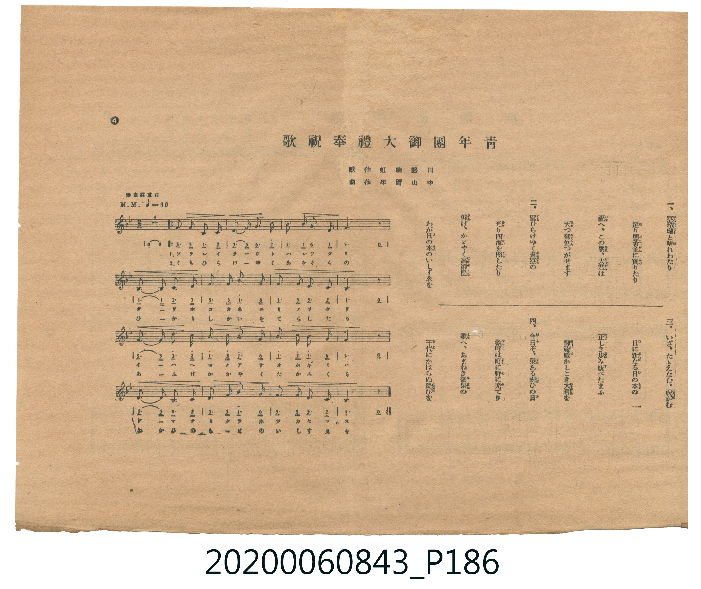

# 青年團御大禮奉祝歌

> Re:Shōka 使用 AI 協助辨識與重建樂譜，可能會有錯誤。歡迎回報。

<audio controls src="seinendan_gotairei_hoshukuka.mp3"></audio>

- 詞：川路柳虹
- 曲：中山晉平
- 唱歌筆記帖（臺灣子供世界社發行，2020.006.0843）P186.jpg（大阪朝日新聞社寄贈印刷譜）

## 說明

原書資訊與歌詞全文（對應 P186.jpg 印刷五線譜＋簡譜對照及右側四節歌詞）：
調性與拍號：變ロ長調（Bb 大調）2/4 拍子，「嚴肅莊重に M.M. ♩=80」


## 歌詞

```text
一、空（そら）玲瓏（れいろう）と晴（は）れわたり
足（た）り穗（ほ）黃金（こがね）に實（みの）りたり
祝（いは）へ、この朝（あさ）、大君（おほぎみ）は
天（あま）つ御位（みくらゐ）つがせます

二、雲（くも）ひらけゆく蒼空（あをぞら）の
光（ひか）り四海（しかい）を照（てら）したり
仰（あふ）げ、かゞやく高御座（たかみくら）
わが日（ひ）の本（もと）のいしずゑを

三、いざ、たゝえなむ、祝（ほ）がむ
日（ひ）に新（あらた）なる日（ひ）の本（もと）の
正（ただ）しき歩（あゆ）み統（す）べたまふ
御稜威（みいづ）かしこき大君（おほぎみ）を

四、今日（けふ）ぞ、榮（はえ）ある祝（いは）ひの日（ひ）
歡呼（かんこ）は町（まち）に野（の）に充（み）てり
歌（うた）へ、あまねき御榮（みさかえ）の
千代（ちよ）にかはらぬ慶（よろこ）びを
```

## ABC

```abc
X:1
T:青年團御大禮奉祝歌
C:曲：中山晉平
M:2/4
L:1/16
Q:1/4=80
K:Bb
V:V1 name="Vocal" snm="Voc"
[V:V1]
d3 d B3 c | d3 f g3 c' | b3 b g3 d | f6 z2 |
w: 1.~ソ ラ レ イ | ロ ウ ト ハ | レ ワ タ リ | _
w: 2.~く も ひ ら | け ゆ く あ | を ぞ ら の | _
w: 3.~い ざ た た | え な む ほ | が _ _ む | _
w: 4.~け ふ ぞ は | え あ る い | は ひ の ひ | _
B3 B c3 d | f3 f b3 g | f3 f d3 c | B6 z2 |
w: 1.~タ リ ホ コ | ガ ネ ニ ミ | ノ リ タ リ | _
w: 2.~ひ か り し | か い を て | ら し た り | _
w: 3.~ひ に あ ら | た な る ひ | の も と の | _
w: 4.~か ん こ は | ま ち に の | に み て り | _
f3 f d'3 c' | b3 c' b3 g | b3 c' b3 g | f6 z2 |
w: 1.~イ ハ ヘ コ | ノ ア サ オ | ホ ギ ミ ハ | _
w: 2.~あ ふ げ か | が や く た | か み く ら | _
w: 3.~た だ し き | あ ゆ み す | べ た ま ふ | _
w: 4.~う た へ あ | ま ね き み | さ か え の | _
d3 d B3 c | d3 f b3 g | f3 d d3 c | B6 z2 |
w: 1.~ア マ ツ ミ | ク ラ ヰ ツ | ガ セ マ ス | _
w: 2.~わ が ひ の | も と の い | し ず ゑ を | _
w: 3.~み い づ か | し こ き お | ほ ぎ み を | _
w: 4.~ち よ に か | は ら ぬ よ | ろ こ び を | _
```

## TMD 檔案連結

- [主旋律 TMD 檔案](seinendan_gotairei_hoshukuka.tmd) [[在 TMD Studio 編輯](https://tmdlang.github.io/Tmd-TS/#tmd=s7IKdvYPcrWy4qpTUCpJTLdSSM7PyUlNLsnMz7MqzsjPTkzOyFeCS5bl55TmploBqXgDQ4RwcX5pUXJqfEFieqpVgKGFGboM3KT4vPyS1KT8_GyEioKi_LLUvMQ8oKqCosy8ktSU-My84tQikAsQqlLLMlNSQWqKkxPz4stSizLTMlNTkByWWlQMdjLEJSVFiXnFyUWZBaimlGSkAl2fmVsA1J-Ygy6enFqUmpufhyKTX5SZnplnVZKYCfRCPBCXJ8bnJmbm5STmAW3X0lJ4OXfS051bns6Z8XTfwqdLlj9ftu7p0s7nS-c-W9ujoKXFpWirYGHAZW-r4JTEZWOkb2IHMvnFynnv98x6un3ui-3rn83f_GLmTrCFz2ZvAgo_2bH26caNz2Z2Pt25GSz8dMpGoGHP17a9WDHj6Y5p7_d0vGjf9bxx8dO1E57sm_1kx7TnU3ueL9n3fOaeFwt73u_pMTIwMtAzMDDTM7AwMX6_pxMUIXpZBelAjUAHvpyx6tmcuc-mL302bcOLxnlAjU_Xt7zY0vG0d8PTju0v1s4B6lDi4tLXUrClFuBSUFB42jf_2ewdLza3v1jR9aKjHeghYCA8bV3xbFo7yF0bep-1dyrAXKoAccyTXVOeb58FdlL38w0LgQyguuety5_2dz3t3_y0ccvT2bOfr2-AmAV0NjDwQFa9WLX_WcNykCXdvS9mzgeKvljX9bh57cup24FSQNuckhSAAQFmdwKjRAGoDhiWwJB73NDzdNaWF02tL_q6Xrb3Pm5creCr56un8GjmSlsLg8cNvVwg85_saHjc0Ph85S6gUY8b5z5uAlrc-bxv0_PJ_SCRpp7HjS2Pm4C624DijxtXPJu5BaxyPYgLlG3qf9w4_3FTF8gsEHixbTNYHuhSoHzX85XTwdzdQO7L3c0v2yeCuZMfNwINXgs2cvXT9cvAgvsfN66D6EI1Epj-wPItUFsbdwBdDDZjHTDywVJNjxungqQaGoFh8XTCbLAg0Jjdjxv7gAaDda2Hmfd0yUqYpn1gmSXA1P5kby_MEf3AQHjcBAxCkBTYobOBKh83zoQE2C5gyDa-BKVuoHKg2iawwk0gTY0THze1AQVfTNoDC9Gmx02THjfOg4Qr0MVwR7QCBYDymx43dkM8DYz_Z1u3gwWnAwWB_gWLTwKmEbDgMpgZQFnk4HmyewPMO1vB8pPAwdP9uAloKzDM-l-uBmfnXRBj5oPNhnoTqB5mDDgme4BZCeIsiGufzVkDTgVAs1dARMDRAHTBrMdNQM9OgqYhUMiDZaaBGUDnzX3cCDRm1eMmcPKCxiAoFYACtKkBZiuqfauB2RgWakAuOA2BzOgm6Cy4eWsXw3y5ABZYvc_WwiK8CZKK9z_fuhEsMhPM3QlWD4zhrfDY2bfw-Yo5T1c0wtIE0GtAFwDVAsMOaCQw7fXiTGnQUAHGJ9DrT3Z3wRw_ERZB84Diz5YB0zooHwHDCSwIdFw3RkoHpo51yH5HeHPh04l7wMLAeAa6ZjIkiT-fAkl1QL8shIToy_Y-sAg4ZwHzWmsrxEtgLjBJwZMRsOABywDTLyTcIbkMlEmAORXk330LYY4GBshUcFBAnI5I1L3NT3ZDImDh4yaI5GqwwvXgCF3zrHUbOOKACFikQBy9GRRgQM2UF81QoKClz8XlC6zWrMLykxNzHGoMahSqwU60MTTTsgOzsNUICs_XrAEWh8B6R8FE4emGfmBprIMoxbFaAzKqRsFYQRcIjRUMwbQRXMRUwQwiEgcUMowDs4EURNAYKGYKZkGgARDXgA30MawB5sa9YNHHzSuBeA2E3bQEqAdY9kN5y4DsDqiqfrAMVF3zeqDsfih7FVAmHskeEBtqjxFQT2M_1LQmIHsTlN0JMq1xIpTXhlDV2ASSaZoE5c0Dq4Ww1-G2xxhkWgtU3TQgng9lzwfbA_VD4yqgaQ1Q9m6wTA-SeSCXNOC2wwTJxY1bwW6DsNej2AH0ZVM3lN0CllkP5W0C-wHGxmYP_oSzq4f0hANJMIbAJIOaIkxhqcUMSQiSpkCpC6INe7JBRPvj5tnQYNsMjjRY4ugFYmgQNIMjoLkPoYfoZANNKo3dQD1dUPZ0cIAigheRUJaBXQBLKtMRSQCoF3-ygdmzGhx5yMkTlohArobZCYo4eDSCk_QKqAye5AlOOlATmiYD2ZOheiBJZx-UtxDsCoRpCN5-sA_x-YdAmdNJetKBpwpIQkEuYoBspOSDVRBfwbME4hNgkfK4eQbUV-AUBEsnTYuAeCuUDUoniJS2DpymYPrxpyBobIIzKyyddCNle2DjBanggRQVsHgGhTis4AKlBnwpCJZOFoBTHoTdCzYNlp5ABRw03TfOBMvshNuKiP-tBFJQG5KeHVA2uLiEm7AWbDPMByCZqXB_I4oo7CkVbwoCNjWoWWthJBRjIgufRRAvNAPrhWZoeQ8pYpqgpSy4NtsAZYPLX1ix1LQbrA_C3ok_6TTBEkUPUgEBzpLALA_hrUAUA9ByHhb1s4CqYDXbJAJJB5YoQAlxKZQNSaIw00DFBSxKQVkfVHNBeH0I_fjsASedhVB1HUiFCsQeaLgBEzmw9QRXBfIpzFaQCzbjtaeWi0vXTgHUIFIA0spcAA)]
- [鋼琴伴奏 TMD 檔案](seinendan_gotairei_hoshukuka_piano.tmd) [[在 TMD Studio 編輯](https://tmdlang.github.io/Tmd-TS/#tmd=s7IKdvYPcrWy4tLSUng5d9LTnVuezpnxdN_Cp0uWP1-27unSzudL5z5b2_N-T8fL7j3PJ2x5smfL06X9zzs73u_pVNDS4lK0VbAw4LK3VXBK4rIx0jex46pTUHqxct77PbOebp_7Yvv6Z_M3v5i5Uwkk_Gz2JqDwkx1rn27c-Gxm59Odm8HCT6dsBNrwfG3bixUznu6YBrTqRfuu542Ln66d8GTf7Cc7pj2f2vN8yb7nM_e8WAh0SI-RgZGBnoGBmZ6BhYkx0BkBhhZmelkF6UCNQFe_nLHq2Zy5z6YvfTZtw4vGeUCNT9e3vNjS8bR3w9OO7S_WzgHqUOLi8k3MzLMKy09OzHGoMahRqOZSAAIbQzMtOzCrRsFYQRcIjRUMwbQRXMRUwQwiEgcUMowDs4EURNAYKGYKZkGgARDXgA30MaxReNy0Fyz6uHklEK-BsJuWAPU8bl4L5S0DsjugqvrBMlB1zeuBsvuh7FVAmXgke0BsqD1GQD2N_VDTmoDsTVB2J8i0xolQXhtCVWMTSKZpEpQ3D6wWwl6H2x5jkGktUHXTgHg-lD0fbA_UD42rgKY1QNm7wTI9SOaBXNKA2w4TJBc3bgW7DcJej2IH0JdN3VB2C1hmPZS3CewHGBuXPcB4BIsYAqMZNRZNYTFshiQESQegFAHRhj2qEVH1uHk21KubwQENi9BeIIY6uxkcaM19CD1ERzU0ehu7gXq6oOzp4EBABAkicpeBXQCL3umIaAPqxR_VMHtWgwMcOUnBIh7kapidoMCGBz04Ga6AyuBJUuDohprQNBnIngzVA4nufVDeQrArEKYhePvBPiTkH6SYhEQuclYGspGiHKsgvgy-BGI7MOs-bp4BdQk41mFx27QIiLdC2aC4RaSOdeB0ANOPP9ahMQDOFLC47UbKXo-bgLEOz-CQLAmLG1AowQoIUAzii3VY3C4ApxYIuxdsGiwNgAoSaFptnAmW2Qm3FRFnWwnEehuSnh1QNrhYgpuwFmwzzAcgmalwfyOKAtypC1-JjhG5xkRm8kUQa5uBZWYztCyEZOUmaAkELuk3QNngsgmW_Zt2g_VB2DvxR3cTLCJ7kDIiOOkDsxaEtwKR3aBlICy6ZgFVwUr9SQSiGxaRoMSzFMqGJCuYaaBsCYsGUBYDleoQXh9CPz57wNG9EKquAynzQuyBhhswYT5uhIVUB9inMFtBLtiM155aaPUekJmYlx_kgaOCN9SGJQjTeG1EmoAJA1OFtok2Ul1vrG2qjajvgcqgkqDawjxe20gbe7kATFIw4w3B6uCaQEbASyKE4eByB0kKqAeRGOFmYVqDrMdUG7loQzIcyEezCq8kXn8RDECcnjImwlMokeiDEokmiDiMByEwbQKizeLjwRhkZjzQILhT48ECYAZCHi6ETyGKDhSFMJtxGAj0gK6dAsgP0T6GsQpwthES2xiJbQJmK3MBAA)]

## 分析

```text
================================================================================
📊 TMD Song Profile: [ 青年團御大禮奉祝歌 ]
================================================================================
⏱  Duration:       0:24 (24.0s), 16 measures total
🎼 Key & Tempo:    首調基準 B,, != 80.0 BPM, <2/4>
   - 分析範圍：      由實際發聲的音符與和弦推測調性；播放脈絡另行呈現
🎤 人聲音域:    A#4 (MIDI 70) – D6 (MIDI 86) [跨度: 16 個半音 / 1.3 個八度, 難度: moderate]
   - 最低音:  A#4 in [Main #1 @ m.1, 0:00]
   - 最高音: D6 in [Main #1 @ m.9, 0:12]
   - 適合: soprano, tenor
🏛  結構:      Main (24.0s)
⚡ 編曲密度:        Peak 1 軌道同時演奏
🗝  調性診斷：       A# 大調（純淨自然大調，未偵測到可信轉調）
   - 風格氣質:    純淨自然大調（陽光明朗、易唱易記，無明顯調外色彩）
   - 轉調歷程:    全曲維持單一推測調性（未偵測到可信轉調）
   - 核心骨幹音:  A#, F, D, C, G
   - 調性數值:    A# 大調 [相關度: 0.92, 穩定度: High, 自然音純度: 100.0%]
   - 候選調性 (K-S): A# 大調 (0.92), D 小調 (0.62), F 大調 (0.61)
   - 五度圈歷程:   -2
   - 各段落調性細節:
     • [Main #1]: A# 大調 (r: 0.92, 自然音純度: 100.0%)

  [ 五度圈游移軌跡 ]
               C  
         F            G  
     [Bb]*              D  
      Eb               A  
         Ab           E  
            Db       B  
               F# 
     (* = active key center)

  [ 十二半音累積音高分佈 ]
     C  : ██████                     9.2%
     C# :                            0.0%
     D  : ██████████████            21.7%
     D# :                            0.0%
     E  :                            0.0%
     F  : ████████████████          24.2%
     F# :                            0.0%
     G  : █████                      8.3%
     G# :                            0.0%
     A  :                            0.0%
     A# : ████████████████████████  36.7%
     B  :                            0.0%
--------------------------------------------------------------------------------
Assignment 軌道音域：
  - Vocal         : A#4 – D6 (16 個半音 / 1.3 個八度, 52 個音符)
================================================================================
```


## 原書掃描頁




