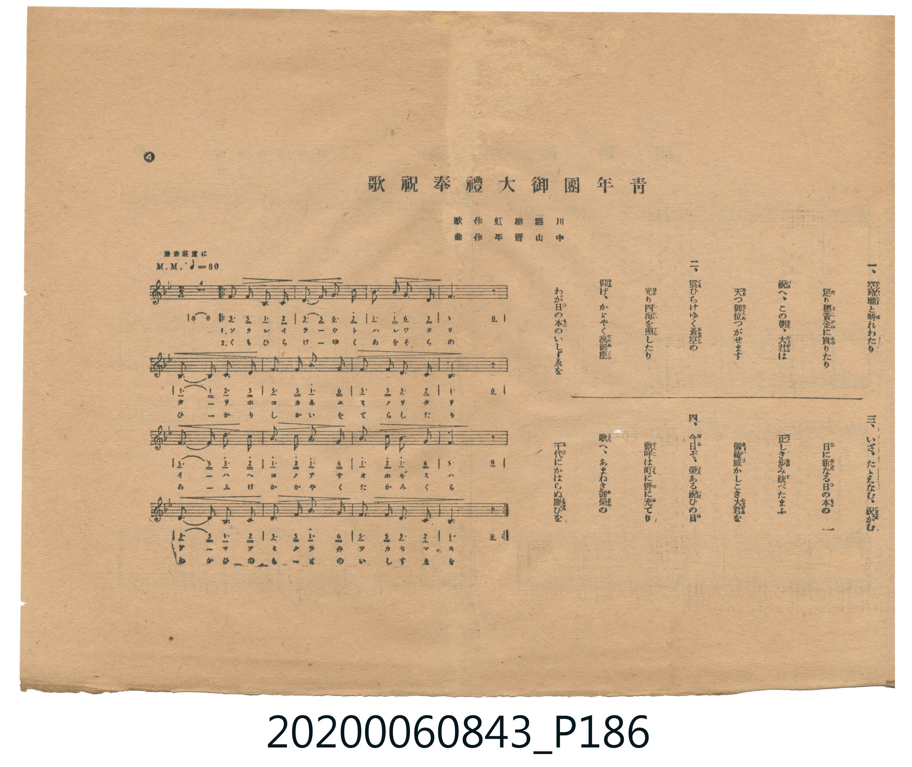

# 青年團御大禮奉祝歌

> Re:Shōka 使用 AI 協助辨識與重建樂譜，可能會有錯誤。歡迎回報。

- **鋼琴伴奏版**：<br><audio controls src="seinendan_gotairei_hoshukuka.mp3"></audio>

- 詞：川路柳虹
- 曲：中山晉平
- 唱歌筆記帖（臺灣子供世界社發行，2020.006.0843）P186.jpg（大阪朝日新聞社寄贈印刷譜）

## 說明

原書資訊與歌詞全文（對應 P186.jpg 印刷五線譜＋簡譜對照及右側四節歌詞）：
調性與拍號：變ロ長調（Bb 大調）2/4 拍子，「嚴肅莊重に M.M. ♩=80」


## 歌詞

```text
一、空（そら）玲瓏（れいろう）と晴（は）れわたり
足（た）り穗（ほ）黃金（こがね）に實（みの）りたり
祝（いは）へ、この朝（あさ）、大君（おほぎみ）は
天（あま）つ御位（みくらゐ）つがせます

二、雲（くも）ひらけゆく蒼空（あをぞら）の
光（ひか）り四海（しかい）を照（てら）したり
仰（あふ）げ、かゞやく高御座（たかみくら）
わが日（ひ）の本（もと）のいしずゑを

三、いざ、たゝえなむ、祝（ほ）がむ
日（ひ）に新（あらた）なる日（ひ）の本（もと）の
正（ただ）しき歩（あゆ）み統（す）べたまふ
御稜威（みいづ）かしこき大君（おほぎみ）を

四、今日（けふ）ぞ、榮（はえ）ある祝（いは）ひの日（ひ）
歡呼（かんこ）は町（まち）に野（の）に充（み）てり
歌（うた）へ、あまねき御榮（みさかえ）の
千代（ちよ）にかはらぬ慶（よろこ）びを
```

## ABC

<div class="abc-score" data-abc-src="seinendan_gotairei_hoshukuka.abc" aria-label="五線譜載入中"></div>

[下載 ABC 原始檔](seinendan_gotairei_hoshukuka.abc)

## TMD 檔案連結

- [主旋律 TMD 檔案](seinendan_gotairei_hoshukuka.tmd) [[在 TMD Studio 編輯](https://tmdlang.github.io/Tmd-TS/#tmd=s7IKdvYPcrWy4qpTUCpJTLdSSM7PyUlNLsnMz7MqzsjPTkzOyFeCS5bl55TmploBqXgDQ4RwcX5pUXJqfEFieqpVgKGFGboM3KT4vPyS1KT8_GyEioKi_LLUvMQ8oKqCosy8ktSU-My84tQikAsQqlLLMlNSQWqKkxPz4stSizLTMlNTkByWWlQMdjLEJSVFiXnFyUWZBaimlGSkAl2fmVsA1J-Ygy6enFqUmpufhyKTX5SZnplnVZKYCfRCPBCXJ8bnJmbm5STmIdmeX1SSkZ9elFiQUWmVkVlcAtSVnJgTn52Yl6jEpaWl8HLupKc7tzydM-PpvoVPlyx_vmzd06Wdz5fOfba2R0FLi0vRVsHCgMveVsFJh8vGSN_EDmTwi5Xz3u-Z9XT73Bfb1z-bv_nFzJ1g-57N3gQUfrJj7dONG5_N7Hy6czNY-OmUjUDDnq9te7FixtMd097v6XjRvut54-Knayc82Tf7yY5pz6f2PF-y7_nMPS8W9rzf02NkYGSgZ2BgpmdgYWL8fk8nKNb0sgrSgRqBDnw5Y9WzOXOfTV_6bNqGF43zgBqfrm95saXjae-Gpx3bX6ydA9ShxMWlr6VgSy3ApaCg8LRv_rPZO15sbn-xoutFRzvQQ8BAeNq64tm0dpC7NvQ-a-9UgLlUAeKYJ7umPN8-C-yk7ucbFgIZQHXPW5c_7e962r_5aeOWp7NnP1_fADEL6Gxg4IGserFq_7OG5SBLuntfzJwPFH2xrutx89qXU7cDpYC2OSUpAAMCzO4ERokCUB0wLIEh97ih5-msLS-aWl_0db1s733cuFrBV89XT-HRzJW2FgaPG3q5QOY_2dHwuKHx-cpdQKMeN8593AS0uPN536bnk_tBIk09jxtbHjcBdbcBxR83rng2cwtY5XoQFyjb1P-4cf7jpi6QWSDwYttmsDzQpUD5rucrp4O5u4Hcl7ubX7ZPBHMnP24EGrwWbOTqp-uXgQX3P25cB9GFaiQw_YHlW6C2Nu4Auhhsxjpg5IOlmh43TgVJNTQCw-LphNlgQaAxux839gENButaDzPv6ZKVME37wDJLgKn9yd5emCP6gYHwuAkYhCApsENnA1U-bpwJCbBdwJBtfAlK3UDlQLVNYIWbQJoaJz5uagMKvpi0BxaiTY-bJj1unAcJV6CL4Y5oBQoA5Tc9buyGeBoY_8-2bgcLTgcKAv0LFp8ETCNgwWUwM4CyyMHzZPcGmHe2guUngYOn-3ET0FZgmPW_XA3OzrsgxswHmw31JlA9zBhwTPYAsxLEWRDXPpuzBpwKgGavgIiAowHoglmPm4CenQRNQ6CQB8tMAzOAzpv7uBFozKrHTeDkBY1BUCoABWhTA8xWVPtWA7MxLNSAXHAaApnRTdBZcPPWLob5cgEssHqfrYVFeBMkFe9_vnUjWGQmmLsTrB4Yw1vhsbNv4fMVc56uaISlCaDXgC4AqgWGHdBIYNrrxZnSoKECjE-g15_s7oI5fiIsguYBxZ8tA6Z1UD4ChhNYEOi4boyUDkwd65D9jvDmwqcT94CFgfEMdM1kSBJ_PgWS6oB-WQgJ0ZftfWARcM4C5rXWVoiXwFxgkoInI2DBA5YBpl9IuENyGSiTAHMqyL_7FsIcDQyQqeCggDgdkah7m5_shkTAwsdNEMnVYIXrwRG65lnrNnDEARGwSIE4ejMowICaKS-aoUBBS5-LyxdY91kFZCbm5TvUGNRUg11oY2imZQdmYasQFJ6vWQMsDYHVjoKJwtMN_cDCWAdRiGO1BWRUjYJxvIIuEAIpQwjLKB4hahqvYAYVBQoaglmGMCGgmhqQChAbAg2AuAZsro9hDTBP7gWLPm5eCcRrIOymJUBNwBoAylsGZHdAVfWDZaDqmtcDZfdD2auAMsj2gNhQe4yAehr7oaY1AdmboOxOkGmNE6G8NoSqxiaQTNMkKG8eWC2EvQ63PcYg01qg6qYB8Xwoez7YHqgfGlcBTWuAsneDZXqQzAO5pAG3HSZILm7cCnYbhL0exQ6gL5u6oewWsMx6KG8T2A8wNjZ78KefXT2kpx9oqgFSwISDniyAFCTRAJMMsiA0eYGTGtQA7CkIkQIeN8-GhuBmcPzB0kkvEENDoxkcF819CD1EpyBoqmnsBurpgrKng8MWEdKINLMM7AJYqpmOSA1AvfhTEMye1eB4RE6psPQEcjXMTlAcwmMUnLpXQGXwpFRwKoKa0DQZyJ4M1QNJRfugvIVgVyBMQ_D2g32Izz8ESqFO0lMRUtIAMxDFjRFyCsIihLcAWgLxBrBoedw8A-olcPKBJZKmRUC8FcoGJRJEMlsHTlAw_fiTDzQqwZkWlki6kbI_sCmDVABBigxYJIOCG1aAgZICvuQDSyQLwMkOwu4FmwZLTKCCDproG2eCZXbCbUVE_lYCyacNSc8OKBtcbMJNWAu2GeYDkMxUuL8RRRX2ZIo3-QAbHtSvxDDTC1CO6EJoEcQ3zcCqohlaBUCKmiZowQuu4DZA2eAiGVY8Ne0G64Owd-JPRU2w9NGDVFCAsyYw60N4KxDFAbToh6WCWUBVsMpuEoFUBEsfoDS5FMqGpFaYaaBiAxa7oCIAVJlBeH0I_fjsAaeihVB1HUiFC8QeaLgB0zuwWQVXBfIpzFaQCzbjtaeWi0vXTgHUUlIA0spcAA)]
- [鋼琴伴奏 TMD 檔案](seinendan_gotairei_hoshukuka_piano.tmd) [[在 TMD Studio 編輯](https://tmdlang.github.io/Tmd-TS/#tmd=s7IKdvYPcrWy4qpTUCpJTLdSyC8qychPL0osyKi0ysgsLskvykxOzInPTsxLVIIrKs4vLUpOjS9ITE-1CjC0MEPIlGSk5qZaJacWpebm52Um5ihxaWkpvJw76enOLU_nzHi6b-HTJcufL1v3dGnn86Vzn63teb-n42X3nucTtjzZs-Xp0v7nnR3v93QqaGlxKdoqWBhw2dsqOOlw2Rjpm9iBrHixct77PbOebp_7Yvv6Z_M3v5i5E2zzs9mbgMJPdqx9unHjs5mdT3duBgs_nbIRaMPztW0vVsx4umMa0KoX7bueNy5-unbCk32zn-yY9nxqz_Ml-57P3PNiIdAhPUYGRgZ6BgZmegYWJsZAZ4B8ppdVkA7UCHT1yxmrns2Z-2z60mfTNrxonAfU-HR9y4stHU97Nzzt2P5i7RygDiUuLt_EzDyrgMzEvPwgD4cag5pqLgUgsDE007IDs2oUjOMVdIEQSBlCWEbxCFHTeAUzqChQ0BDMMoQJAdXUgFSA2BBoAMQ1UHOhpgEpoIHoyoEUxDCgUciCUGvBToAagGkyknI0pxkhm4pFCKdjCQUCphlAOQKOrUUOfR_k0LeABz5QW7RhLIyC802AlAkSH10e6AYD5IAmxgygnmhTVDNxmwHVDDcDnU99dwBDS9dOARRgCnhoZS4A)]

## 分析

```text
================================================================================
📊 TMD Song Profile: [ 青年團御大禮奉祝歌 ]
================================================================================
⏱  Duration:       0:24 (24.0s), 16 measures total
🎼 Key & Tempo:    首調基準 B,, != 80.0 BPM, <2/4>
   - 分析範圍：      由實際發聲的音符與和弦推測調性；播放脈絡另行呈現
🎤 人聲音域:    A#3 (MIDI 58) – D5 (MIDI 74) [跨度: 16 個半音 / 1.3 個八度, 難度: moderate]
   - 最低音:  A#3 in [Main #1 @ m.1, 0:00]
   - 最高音: D5 in [Main #1 @ m.9, 0:12]
   - 適合: soprano, mezzo-soprano, contralto, tenor, baritone, bass
🏛  結構:      Main (24.0s)
⚡ 編曲密度:        Peak 1 軌道同時演奏
🗝  調性診斷：       A# 大調（純淨自然大調，未偵測到可信轉調）
   - 風格氣質:    純淨自然大調（陽光明朗、易唱易記，無明顯調外色彩）
   - 轉調歷程:    全曲維持單一推測調性（未偵測到可信轉調）
   - 核心骨幹音:  A#, F, D, C, G
   - 調性數值:    A# 大調 [相關度: 0.92, 穩定度: High, 自然音純度: 100.0%]
   - 候選調性 (K-S): A# 大調 (0.92), D 小調 (0.62), F 大調 (0.61)
   - 五度圈歷程:   -2
   - 各段落調性細節:
     • [Main #1]: A# 大調 (r: 0.92, 自然音純度: 100.0%)

  [ 五度圈游移軌跡 ]
               C  
         F            G  
     [Bb]*              D  
      Eb               A  
         Ab           E  
            Db       B  
               F# 
     (* = active key center)

  [ 十二半音累積音高分佈 ]
     C  : ██████                     9.2%
     C# :                            0.0%
     D  : ██████████████            21.7%
     D# :                            0.0%
     E  :                            0.0%
     F  : ████████████████          24.2%
     F# :                            0.0%
     G  : █████                      8.3%
     G# :                            0.0%
     A  :                            0.0%
     A# : ████████████████████████  36.7%
     B  :                            0.0%
--------------------------------------------------------------------------------
Assignment 軌道音域：
  - Piano         : A#3 – D5 (16 個半音 / 1.3 個八度, 52 個音符)
================================================================================
```


## 原書掃描頁




