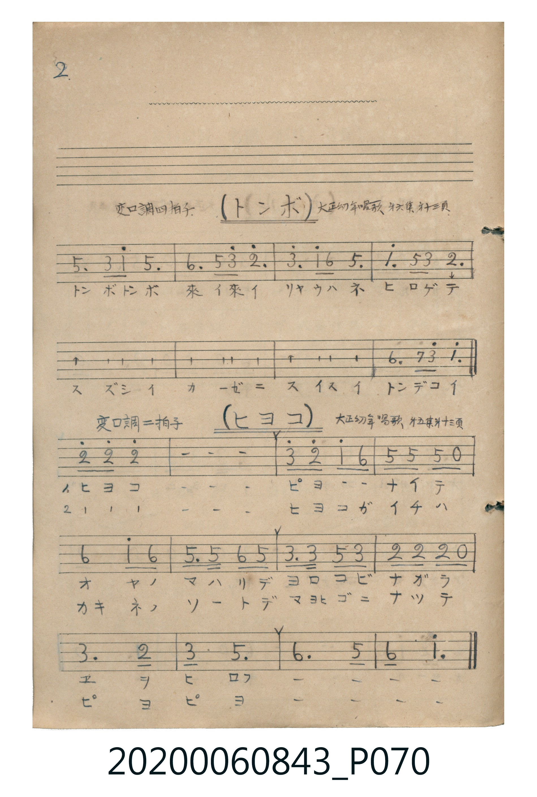

# トンボ

> Re:Shoka 使用 AI 辨識樂譜，可能會有錯誤。歡迎回報。

<audio controls src="tonbo.mp3"></audio>

- 曲：大正幼年唱歌 第六集

## 說明

トンボ (Tonbo)
Source: 唱歌帖 (Shōkachō, NMTH 2020.006.0843) — P070.jpg top (Notebook 2, p.2)
Notation: Handwritten numbered notation (Jianpu)
Annotations: 変ロ調 四拍子, 大正幼年唱歌 第六集 廿三頁

## 歌詞

```text
（TMD 檔案未包含歌詞註解）
```

## ABC

```abc
X:1
T:トンボ
C:曲：大正幼年唱歌 第六集
M:4/4
L:1/16
Q:1/4=104
K:Bb
V:V1 name="Vocal" snm="Voc"
[V:V1]
!mf! F4 d2 b2 f6 z2 | g4 f2 d'2 c'6 z2 | d'4 b2 g2 f6 z2 | b4 f2 d2 c6 z2 |
F4 d2 b2 f6 z2 | g4 f2 d'2 c'6 z2 | d'4 b2 g2 f6 z2 | g4 a2 c'2 b6 z2 |
```

## TMD 檔案連結

- [主旋律 TMD 檔案](tonbo.tmd) [[在 TMD Studio 編輯](https://tmdlang.github.io/Tmd-TS/#tmd=s7IKdvYPcrWy4qpTUCpJTLdSSM7PyUlNLsnMz7MqzsjPTkzOyFeCS5bl55TmploBqXgDI4RwcX5pUXJqfEFieqpVgIG5QSK6FNyo-Lz8ktSk_PxshIqCovyy1LzEPKCq3MS80uLkosyCkvjk_IJKhJrUssyUVJCK1JTMkvyizMQcJDelFhWDXQtxRElRYh7EDKCgEpeWlsLj5o7HzZsfN89R0NLiUrRVMDQw4bK3VXDS4bIx0TexAxn0bPam93tmPV2y_NnaxU937nm6c8vTKRufre1ReL5mzdPWtS9ntylxcelrKdhSC3ApKCC5SyMkPy8pXxMkGAwJLwWI_U93TFPQCM442gsKvKO9Ogp-viEeCkYGRgZ6BgZmegYWJsaaCo8apiiAQl0vqyBdoSS_QEHDDxrICkY6CgV6RmCDgWKJ4FhV8EjMSykvyiwpSc1TyCvNTUotSk1RAMYLWFpBwyszMa-gFKzHMQ8mXAx00ZLOx81rX6zar_B09uxn3b1P107QAQriDjKFp7v3P9nR-XJBI8gsysMMChS09Lm4wAFmFZafnJjjUGNQo1ANskLBxtBMyw7MAsYV0C0vVs6zAimHisADHBHyT_a1PW5aAiGB8qseNy9-3LTscXP_4-ZeIH8S0MePmzY9bm5DNqZp5-OmXY-btoP1NK1-3LzncdOex83dEJklEBJuW_vjps0gPtQAoFtz02oVTOMVdMHQGIgN44CEKVQABA2AuEbBDMoDyRiDlBiBCFQ1YHEQBJsB0oFpDlgKbhDIHHQlMK85gEPUCup2IDUHmQkNJnho7UGEGJDVD8SwMAOGxCYgEx5qNXT1L8wcc5gR8ADA7eGmnUC8C4i3AzEsWoEUyI-wiIWqgkUtkGoHcoE0JHZrubh07RTAKVMByFDmAgA)]
- [鋼琴伴奏 TMD 檔案](tonbo_piano.tmd) [[在 TMD Studio 編輯](https://tmdlang.github.io/Tmd-TS/#tmd=s7IKdvYPcrWy4tLSUnjc3PG4efPj5jkKGo-bpzxuWvS4ue_Jni1Pl_Y_2T1DU0FLi0vRVsHQwITL3lbBSYfLxkTfxI6rTkHp2exN7_fMerpk-bO1i5_u3PN055anUzY-W9uj8HzNmqeta1_OblPi4tLXUrClFuBSUEB2bEh-XlK-psKjhikKAZmJefkKjsnJ-bkFiXmZual5JSDFwfmlRcmpVgoQdz3dMU1BIzjjaG92YjKQ1FHw8w3xUDAyMDLQMzAw0zOwMDGGmmZgbqCXVZCuUJJfoKDhl1-SmpSfn61gpKNQoGekCTKYcr9AgYKWPhcX2CNWYfnJiTkONQY1CtUgKxRsDM207MAsoEhuWq2CabyCLhgaA7FhHJAwhQqAoAEQ1yiYQXkgGWOQEiMQgaoGLA6CYDNAOjDNAUvBDQKZg64E7DJg7DqA3W0FjxogNQeZ-WRf2-OmJTDqcfMeIF71uHnx46ZlQFY_EPcC8aTHzWsVHjdtAjLbQGEC8TY9fQwzxxxmBDwIEF6uhcUVOL0FeeCMrQJQbGkbaoPcDXYcMgfI0obZDzIXBIEhrm2iDXMDsgojbVNtkJtQVQPlteEOxKUV2XCEKLrDzOO1YZEL1wAP_0HlB4QKZANRjEH4ADWufHDFlSHMFFhSg6c5hM0mMCGYYixqYFIYajGV4LEKS6Zq2gnEu4B4OxADM1DTanAeagLlo26QNEQUpAqUvaD5rh3IBdJAIXhmoqNP4VJw7RhqQPGja6cAjiIFIEOZCwA)]

## 分析

```text
================================================================================
📊 TMD Song Profile: [ トンボ ]
================================================================================
⏱  Duration:       0:18 (18.5s), 8 measures total
🎼 Key & Tempo:    首調基準 B,, != 104.0 BPM, <4/4>
   - 分析範圍：      由實際發聲的音符與和弦推測調性；播放脈絡另行呈現
🎤 人聲音域:    F4 (MIDI 65) – D6 (MIDI 86) [跨度: 21 個半音 / 1.8 個八度, 難度: difficult]
   - 最低音:  F4 in [Tonbo #1 @ m.1, 0:00]
   - 最高音: D6 in [Tonbo #1 @ m.2, 0:03]
   - 適合: soprano, tenor
🏛  結構:      Tonbo (18.5s)
⚡ 編曲密度:        Peak 1 軌道同時演奏
🗝  調性診斷：       F 大調（純淨自然大調，未偵測到可信轉調）
   - 風格氣質:    純淨自然大調（陽光明朗、易唱易記，無明顯調外色彩）
   - 轉調歷程:    全曲維持單一推測調性（未偵測到可信轉調）
   - 核心骨幹音:  F, C, D, A#, G
   - 調性數值:    F 大調 [相關度: 0.88, 穩定度: High, 自然音純度: 100.0%]
   - 候選調性 (K-S): F 大調 (0.88), A# 大調 (0.74), D 小調 (0.65)
   - 五度圈歷程:   -1
   - 各段落調性細節:
     • [Tonbo #1]: F 大調 (r: 0.88, 自然音純度: 100.0%)

  [ 五度圈游移軌跡 ]
               C  
        [F ]*          G  
      Bb               D  
      Eb               A  
         Ab           E  
            Db       B  
               F# 
     (* = active key center)

  [ 十二半音累積音高分佈 ]
     C  : █████████████             17.9%
     C# :                            0.0%
     D  : ███████████               16.1%
     D# :                            0.0%
     E  :                            0.0%
     F  : ████████████████████████  33.9%
     F# :                            0.0%
     G  : ██████████                14.3%
     G# :                            0.0%
     A  : █                          1.8%
     A# : ███████████               16.1%
     B  :                            0.0%
--------------------------------------------------------------------------------
Assignment 軌道音域：
  - Vocal         : F4 – D6 (21 個半音 / 1.8 個八度, 32 個音符)
================================================================================
```


## 原書掃描頁




