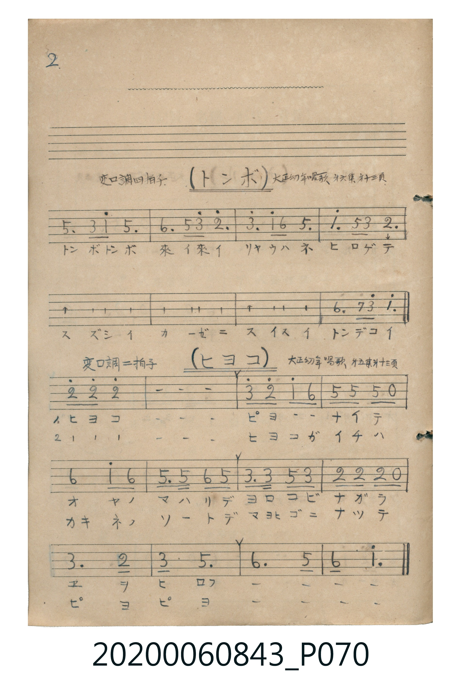

# トンボ

> Re:Shōka 使用 AI 協助辨識與重建樂譜，可能會有錯誤。歡迎回報。

- **鋼琴伴奏版**：<br><audio controls src="tonbo.mp3"></audio>

- 曲：大正幼年唱歌 第六集

## 說明

トンボ (Tonbo)
Source: 唱歌帖 (Shōkachō, NMTH 2020.006.0843) — P070.jpg top (Notebook 2, p.2)
Notation: Handwritten numbered notation (Jianpu)
Annotations: 変ロ調 四拍子, 大正幼年唱歌 第六集 廿三頁
- Reference Audio: [大正幼年唱歌チャンネル (YouTube)](https://www.youtube.com/@%E5%A4%A7%E6%AD%A3%E5%B9%BC%E5%B9%B4%E5%94%B1%E6%AD%8C%E3%83%81%E3%83%A3%E3%83%B3%E3%83%8D%E3%83%AB/videos)


## 歌詞

```text
（TMD 檔案未包含歌詞註解）
```

## ABC

<div class="abc-score" data-abc-src="tonbo.abc" aria-label="五線譜載入中"></div>

[下載 ABC 原始檔](tonbo.abc)

## TMD 檔案連結

- [主旋律 TMD 檔案](tonbo.tmd) [[在 TMD Studio 編輯](https://tmdlang.github.io/Tmd-TS/#tmd=s7IKdvYPcrWy4qpTUCpJTLdSSM7PyUlNLsnMz7MqzsjPTkzOyFeCS5bl55TmploBqXgDI4RwcX5pUXJqfEFieqpVgIG5QSK6FNyo-Lz8ktSk_PxshIqCovyy1LzEPKCq3MS80uLkosyCkvjk_IJKhJrUssyUVJCK1JTMkvyizMQcJDelFhWDXQtxRElRYh7EDKAgQhVQU3pmnlVuamZWZnxJakUJqiOg0iWJmUCXxgNxeWJ8bmJmXk5iXgqyqpKM_PSixIKMSquMzGKQS5ITc-KzE_OQfFySkQoMotSU0uREiBO0tBQeN3c8bt78uHmOgpYWl6KtgqGBCZe9rYKTDpeNib6JHUjvs9mb3u-Z9XTJ8mdrFz_duefpzi1Pp2x8trZH4fmaNU9b176c3abExaWvpWBLLcCloIDkLo2Q_LykfE2QYDAkyhQg9j_dMU1BIzjjaC8o_o726ij4-YZ4KBgZGBnoGRiY6RlYmBhrKjxqmKIAini9rIJ0hZL8AgUNP2g8KxjpKBToGYENBoqBg8RKwQMYrOVFmSUlqXkKeaW5SalFqSkKwKQBllbQ8MpMzCsoBetxzIMJFwNdtKTzcfPaF6v2KzydPftZd-_TtRN0gIK4g0zh6e79T3Z0vlzQCPHt7qDUNKBdwJSk4FiakplvpRCNqf1xc-Pj5sXgcOl93LxaQSMyvzSkNClVM1Yjo6SkoNhKX7-8vFyvMr-0BCiql5yfq--g6mqq6mii6miu6mqm6uii6mgMEnGyVHVyhjFMQAxLE1UnQ6gaC6CUsaoFEAFFwAyQLjDDCcawcIFJOemD8kB-sSYXyCuURz8UKGjpc3GB494qLB-YmB1qDGqqQTYo2BiaadmBWcBUBwyWFyvnWYFUQ0XgSQeRhp7sa3vctARCAuVXgUKxadnj5n5gQAL5k4Bx97hp0-PmNmRjmnY-btr1uGk7WE_T6sfNex437Xnc3A2RWQIh4ba1P27aDOJDDahRqM5Nq1UwjVfQBUNjIDaMAxKmUAEQNADiGgUzKA8kYwxSYgQiUNWAxUEQbAZIB6Y5YCm4QSBz0JXAvOYADlArqNuB1BxkJjSY4KG1BxFiQFY_EMPCDBgSm4BMeKjV0NW_MHPMYUbAAwC3h5t2AvEuIN4OxLBoBVIgP8IiFqoKFrVAqh3IBdKQ2K3l4tK1UwAnTAUgQ5kLAA)]
- [鋼琴伴奏 TMD 檔案](tonbo_piano.tmd) [[在 TMD Studio 編輯](https://tmdlang.github.io/Tmd-TS/#tmd=s7IKdvYPcrWy4qpTUCpJTLdSyC8qychPL0osyKi0ysgsLskvykxOzInPTsxLVIIrKs4vLUpOjS9ITE-1CjAwN0DIlGSk5qZapaaUJieWZObnKXFpaSk8bu543Lz5cfMcBY3HzVMeNy163Nz3ZM-Wp0v7n-yeoamgpcWlaKtgaGDCZW-r4KTDZWOib2IHMvDZ7E3v98x6umT5s7WLn-7c83TnlqdTNj5b26PwfM2ap61rX85uU-Li0tdSsKUW4FJQQHZsSH5eUr6mwqOGKQoBmYl5-QqOycn5uQWJeZm5qXklIMXB4HCwUoC46-mOaQoawRlHe7MTk4GkjoKfb4iHgpGBkYGegYGZnoGFiTHUNGCQ6WUVpCuU5BcoaPjll6Qm5ednKxjpKBToGWlCXLE7KDUttSg1LzlVwbE0JTPfSiEaMyQeNzc-bl4Mdm_v4-bVChqR-aUhpUmpmrEaGSUlBcVW-vrl5eV6lfmlJUBRPaDr9R1UXU1VHU1UHc1VXc1UHV1UHY1BIk6Wqk7OMIYJiGFpoupkCFVjAZQyVrUAIqAImAHSBWY4wRgWLjApJ_2yzJTU_GJNLpBXKI8WKFDQ0ufiAseJVVg-ME061BjUVINsULAxNNOyA7NqFKpz02oVTOMVdMHQGIgN44CEKVQABA2AuEbBDMoDyRiDlBiBCFQ1YHEQBJsB0oFpDlgKbhDIHHQlYJcB06kD2NlW8EQGpOYgM5_sa3vctARGPW7eA8SrQPHbtAzI6gfiXiCe9Lh5rcLjpk1AZhsoSCDepqePYeaYw4yABwHCy7WwqALnnCAPXJFVAIosbUNtkLPBbkPmAFnaMOtBxoIgMMC1TbRhTkBWYaRtqg1yEqpqoLw23H24tCIbjhBFd5h5vDYsbuEa4ME_qPyAUIFsIIoxCB-gRpUPclSZwGPKUME4HpTIDIBsk3ggF8o2hPAgTLgSLCm-aScQ7wLi7UAMTN1Nq8EJvAmUyLtB0hBRkCpQ2odminYgF0gDheApnQiXABlAQTAb5DtdOwWwBxWADGUuAA)]

## 分析

```text
================================================================================
📊 TMD Song Profile: [ トンボ ]
================================================================================
⏱  Duration:       0:18 (18.5s), 8 measures total
🎼 Key & Tempo:    首調基準 B,, != 104.0 BPM, <4/4>
   - 分析範圍：      由實際發聲的音符與和弦推測調性；播放脈絡另行呈現
🎤 人聲音域:    F4 (MIDI 65) – D6 (MIDI 86) [跨度: 21 個半音 / 1.8 個八度, 難度: difficult]
   - 最低音:  F4 in [Tonbo #1 @ m.1, 0:00]
   - 最高音: D6 in [Tonbo #1 @ m.2, 0:03]
   - 適合: soprano, tenor
🏛  結構:      Tonbo (18.5s)
⚡ 編曲密度:        Peak 1 軌道同時演奏
🗝  調性診斷：       F 大調（純淨自然大調，未偵測到可信轉調）
   - 風格氣質:    純淨自然大調（陽光明朗、易唱易記，無明顯調外色彩）
   - 轉調歷程:    全曲維持單一推測調性（未偵測到可信轉調）
   - 核心骨幹音:  F, C, D, A#, G
   - 調性數值:    F 大調 [相關度: 0.88, 穩定度: High, 自然音純度: 100.0%]
   - 候選調性 (K-S): F 大調 (0.88), A# 大調 (0.74), D 小調 (0.65)
   - 五度圈歷程:   -1
   - 各段落調性細節:
     • [Tonbo #1]: F 大調 (r: 0.88, 自然音純度: 100.0%)

  [ 五度圈游移軌跡 ]
               C  
        [F ]*          G  
      Bb               D  
      Eb               A  
         Ab           E  
            Db       B  
               F# 
     (* = active key center)

  [ 十二半音累積音高分佈 ]
     C  : █████████████             17.9%
     C# :                            0.0%
     D  : ███████████               16.1%
     D# :                            0.0%
     E  :                            0.0%
     F  : ████████████████████████  33.9%
     F# :                            0.0%
     G  : ██████████                14.3%
     G# :                            0.0%
     A  : █                          1.8%
     A# : ███████████               16.1%
     B  :                            0.0%
--------------------------------------------------------------------------------
Assignment 軌道音域：
  - Vocal         : F4 – D6 (21 個半音 / 1.8 個八度, 32 個音符)
================================================================================
```


## 原書掃描頁




