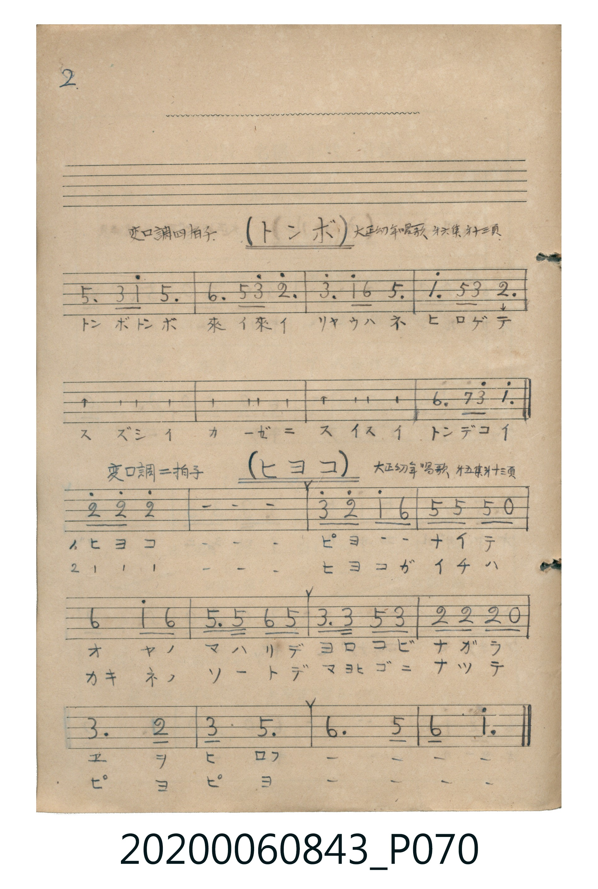

# ヒヨコ

> Re:Shōka 使用 AI 協助辨識與重建樂譜，可能會有錯誤。歡迎回報。

- **鋼琴伴奏版**：<br><audio controls src="hiyoko.mp3"></audio>

- 曲：大正幼年唱歌 第五集

## 說明

ヒヨコ (Hiyoko)
Source: 唱歌帖 (Shōkachō, NMTH 2020.006.0843) — P070.jpg bottom (Notebook 2, p.2)
Notation: Handwritten numbered notation (Jianpu)
Annotations: 変ロ調 二拍子, 大正幼年唱歌 第五集 廿三頁


## 歌詞

```text
（TMD 檔案未包含歌詞註解）
```

## ABC

<div class="abc-score" data-abc-src="hiyoko.abc" aria-label="五線譜載入中"></div>

[下載 ABC 原始檔](hiyoko.abc)

## TMD 檔案連結

- [主旋律 TMD 檔案](hiyoko.tmd) [[在 TMD Studio 編輯](https://tmdlang.github.io/Tmd-TS/#tmd=s7IKdvYPcrWy4qpTUCpJTLdSSM7PyUlNLsnMz7MqzsjPTkzOyFeCS5bl55TmploBqXgDI4RwcX5pUXJqfEFieqpVgIG5QRK6FNyo-Lz8ktSk_PxshIqCovyy1LzEPKCq3MS80uLkosyCkvjk_IJKhJrUssyUVJCK1JTMkvyizMQcJDelFhWDXQtxRElRYh7EDKAgQlVJRirQ4Yl5mbnIeoFGpWfmWeWmZmZlxpekVpSgOg0qXZKYCXR_PBCXJ8bnJmbm5STmpShxaWkpPG6e9Lh5xeOmzQpaWlyKtgqGBiZc9rYKTjpcNkb6JnYgg57N3vR-z6ynS5Y_W7v46c49T3dueTpl47O1PQrP16x5smvKy9ltSlxc-loKttQCXAoKSO7S8MiszM_O1wSJBkPiQgHigKc7piloBGcc7QVFzNFeHQU_3xAPBSMDIwM9AwMzPQMLE2NNhUcNUxRAMaqXVZCukJRfUpKfq6DhB41DBSMdhQI9I7DZQLFEcKJR8AAGTnlRZklJap5CXmluUmpRaooCMNrB0goaXpmJeQWlYD2OeTDhYqCjlnQ-bl77YtV-hSe7ep519z5dO0EHKIg72BSe7t7_ZEfnywWNILMoDzcoUNDS5-KCBJpVWH5yYo5DjUFNNcgKBRtDMy07MAsYX0C3vFg5zwqkHCpiqIcU7sisKSAWmARyuh43LXnc3Kagr_C4adXjZiC7Dyg673Fz_-NmIL8dyAEqXgvU-bh5MkT9msfNK8HqgRKbICavfdw8FdVkhDuMcLkDygIaCDQLaHEj0FKwuasfNwEN7AU7pWnv4-Y9j5s7IE4BugtowaTHTVseN3eDXdPcDHU9zENIFKpTahSqc9NqFYziFHSRCBCswS5oDOcbgggzsKApkIRhA5AIzJsO4NixAvkLFGZAl4P9iMSeAmHD6S6Qt4F0G1JgETYFiQ0JOCC_EYj7Ef4EuRQE0ZwNcjSIB2IDfQcWMQbzQGxgIIC8C8XYvda0CmgRyEJwGgFbCkwlQAxOJkC8FupIcEqBOBCYVrB4r2k1EANVN_dCTANHM5DZATUMZDjIQKBvm7ZADGtuRg4rmAcgEORkhAjEsyARWEjARCEiIM-BwwasCNNtIIvBCRviI0jSRok8bBGGHr0g72DoquXi0rVTgORnBSBLmQsA)]
- [鋼琴伴奏 TMD 檔案](hiyoko_piano.tmd) [[在 TMD Studio 編輯](https://tmdlang.github.io/Tmd-TS/#tmd=s7IKdvYPcrWy4tLSUnjcPOlx84rHTZsVNB43T3nctOhxc9-TPVueLu1_snuGpoKWFpeirYKhgQmXva2Ckw6XjZG-iR1XnYLSs9mb3u-Z9XTJ8mdrFz_duefpzi1Pp2x8trZH4fmaNU92TXk5u02Ji0tfS8GWWoBLQQHZsR6ZlfnZ-ZoKjxqmKARkJublKzgmJ-fnFiTmZeam5pWAVAfnlxYlp1opQBz2dMc0BY3gjKO92YnJQFJHwc83xEPByMDIQM_AwEzPwMLEGGqagbmBXlZBukJSfklJfq6Chl9-SWpSfn62gpGOQoGekSbIbMr9AwUKWvpcXBDPWIXlJyfmONQY1FSDrFCwMTTTsgOzahSqc9NqFYziFHSRCBCswS5oDOcbgggzsKApkIRhA5AI2GxgHDmALbaCBDAQr1AABTEqewqEDae7gOJLgHQbyAMkmIPEbloDNaMRiPth5tSAXQuCaE4HORzEA7GBPgSLGIN5IDYwIEBehmKE92AqIRAkhxCBmAoSgVkJE4WIgEwBOwKsiKsWHlHgBBfkgSuqCoBRpW2qbQ6zFIkNdCZOGWMgD26dobaJNsxVNUAeUBIug2DD_IismkidCqbx2kABmKeROWA583htUGiBICgckG1D14mkFE0S1UZUV-KSQQkGjFD3QQ51E3igm8aDEII2VDCBUCAelvTZtAqY5kBprw-I54HT3-NmkFg7NH2vhabXydC0DkyrzSuxp_Wm1UAMVN_cCzGvae_j5j1AZgfUOJDxICOBSb9pC8S45mbkrFMDciySe4GUMdQzBthdDzJuEzQ3gWyeipFDsedK9FwMciZWfehOAbrOEE6B4kTXTgESLQpAljIXAA)]

## 分析

```text
================================================================================
📊 TMD Song Profile: [ ヒヨコ ]
================================================================================
⏱  Duration:       0:13 (13.8s), 12 measures total
🎼 Key & Tempo:    首調基準 B,, != 104.0 BPM, <2/4>
   - 分析範圍：      由實際發聲的音符與和弦推測調性；播放脈絡另行呈現
🎤 人聲音域:    C5 (MIDI 72) – D6 (MIDI 86) [跨度: 14 個半音 / 1.2 個八度, 難度: moderate]
   - 最低音:  C5 in [Hiyoko #1 @ m.8, 0:08]
   - 最高音: D6 in [Hiyoko #1 @ m.3, 0:02]
   - 適合: soprano, tenor
🏛  結構:      Hiyoko (13.8s)
⚡ 編曲密度:        Peak 1 軌道同時演奏
🗝  調性診斷：       F 調性不明確（純淨自然大調，未偵測到可信轉調）
   - 風格氣質:    純淨自然大調（陽光明朗、易唱易記，無明顯調外色彩）
   - 轉調歷程:    全曲維持單一推測調性（未偵測到可信轉調）
   - 核心骨幹音:  C, F, D, G, A#
   - 調性數值:    F 調性不明確 [相關度: 0.75, 穩定度: Ambiguous, 自然音純度: 100.0%]
   - 候選調性 (K-S): F 大調 (0.75), C 大調 (0.74), C 小調 (0.58)
   - 五度圈歷程:   -1
   - 各段落調性細節:
     • [Hiyoko #1]: F 調性不明確 (r: 0.75, 自然音純度: 100.0%)

  [ 五度圈游移軌跡 ]
               C  
        [F ]*          G  
      Bb               D  
      Eb               A  
         Ab           E  
            Db       B  
               F# 
     (* = active key center)

  [ 十二半音累積音高分佈 ]
     C  : ████████████████████████  28.9%
     C# :                            0.0%
     D  : █████████████████         20.0%
     D# :                            0.0%
     E  :                            0.0%
     F  : ██████████████████        22.2%
     F# :                            0.0%
     G  : █████████████████         20.0%
     G# :                            0.0%
     A  :                            0.0%
     A# : ███████                    8.9%
     B  :                            0.0%
--------------------------------------------------------------------------------
Assignment 軌道音域：
  - Vocal         : C5 – D6 (14 個半音 / 1.2 個八度, 35 個音符)
================================================================================
```


## 原書掃描頁




