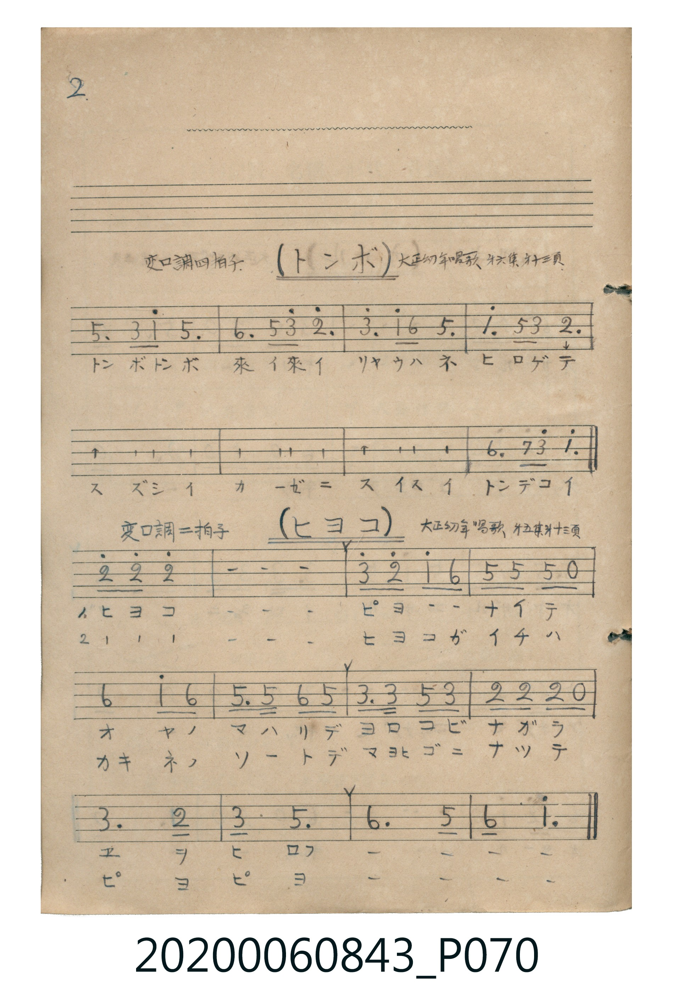

# ヒヨコ

> Re:Shōka 使用 AI 協助辨識與重建樂譜，可能會有錯誤。歡迎回報。

- **鋼琴伴奏版**：<br><audio controls src="hiyoko.mp3"></audio>

- 曲：大正幼年唱歌 第五集 廿三頁
- 唱歌帳（2020.006.0843）P070.jpg 下半（第 2 頁）

## 說明

> [!NOTE]
> **原頁資訊與校勘記**（對應 `P070.jpg` 下半頁，手抄簡譜第 2 頁）：
> - **調性、拍號與出處註記**：題首左標「変ロ調二拍子」（B♭ 大調 `?= B,`、`<2/4>`），中題「（ヒヨコ）」，右註「大正幼年唱歌 才五集 廿三頁」（《大正幼年唱歌》第五集第 23 頁）。第 2、6、10 小節末小節線上標有換氣記號 `v`。
> - **八度基準校訂**：在 `TmdSwift` 中 `?= B,` 以 `1 = B♭4` 為基準，故原簡譜不加點之中音域 `2, 3, 5, 6`（`C4, D4, F4, G4`）對應 `2_, 3_, 5_, 6_`，上加一點之高音域 `1̇, 2̇, 3̇`（`B♭4, C5, D5`）對應 `1, 2, 3`，全曲實音音域為 `C4–D5`。
> - **手抄筆誤與省略記號校勘（依 Policy A 校訂）**：
>   1. **第 9 小節末音底線筆誤**：原抄作 `3. 2=`（附點四分音符 `3.` 後將八分音符 `2_` 誤畫雙底線作十六分音符 `2=`，致全小節少半拍之半），依節拍律動與第 11 小節平行句型（`6. 5_`）校訂為八分音符 `| 3_ - - - - - 2_ - |`。
>   2. **第 10、12 小節切分節奏**：原抄第 10 小節作 `3_ 5.`（八分音符接附點四分音符）、第 12 小節作 `6_ 1̇.`（八分音符接高音附點四分音符），先前版本誤讀為對稱二分或插入休止符，今據原抄底線與附點精確還原。
>   3. **同型反覆與疊字省略記號展開**：原抄第 1 小節第二節歌詞以 `1 1 1`（同上點號 `〃`）省寫「ヒヨコ」；第 2 小節譜與詞均以 `- - -` 省寫重複第 1 小節之 `2̇_ 2̇_ 2̇`（「ヒヨコ」）；第 3 小節第一節後半以 `- -` 省寫疊字「ピヨ」；第 11–12 小節兩節歌詞均以 `- - | - -` 省寫回聲「ピヨ｜ピヨ」，今於 `L1|`、`L2|` 依實際演唱完整展開並於此備載原貌。
>
> **1.**
> ヒヨコ　ヒヨコ（原抄作 `- - -`）　ピヨピヨ（原抄作 `ピヨ - -`）　ナイテ
> オヤノ　マハリデ　ヨロコビ　ナガラ
> エヲ　ヒロフ　ピヨ（`- -`）　ピヨ（`- -`）
>
> **2.**
> ヒヨコ（`〃〃〃`）　ヒヨコ（`- - -`）　ヒヨコガ　イチハ
> カキネノ　ソートデ　マヨヒゴニ　ナツテ
> ピヨ　ピヨ　ピヨ（`- -`）　ピヨ（`- -`）


## 歌詞

```text
（TMD 檔案未包含歌詞註解）
```

## ABC

<div class="abc-score" data-abc-src="hiyoko.abc" aria-label="五線譜載入中"></div>

[下載 ABC 原始檔](hiyoko.abc)

## TMD 檔案連結

- [主旋律 TMD 檔案](hiyoko.tmd) [[在 TMD Studio 編輯](https://tmdlang.github.io/Tmd-TS/#tmd=s7IKdvYPcrWy4qpTUCpJTLdSSM7PyUlNLsnMz7MqzsjPTkzOyFeCS5bl55TmploBqXgDI4RwcX5pUXJqfEFieqpVgIG5QRK6FNyo-Lz8ktSk_PxshIqCovyy1LzEPKCq3MS80uLkosyCkvjk_IJKhJrUssyUVJCK4uTEvPiy1KLMtMzUFCR3pRYVg10McUhJUWIexBygIEJVflFJRn56UWJBRqVVRmZxSX5RZnJiTnx2Yl4iQlFJRirQh4l5mbmJOchaM9Mz86xyUzOzMuNLUitKUP0AlS5JzAR6NB6IyxPjcxMz83IS84Cu1NJSeNw86XHzisdNmxW0tLgUbRUMDUy47G0VnHS4bIz0TexABj2bven9nllPlyx_tnbx0517nu7c8nTKxmdrexSer1nzZNeUl7PbFJ7u3v9kR-fLBY1gmyHST3dsfr-nw8jAyEDPwMBMz8DCxPj9nk5QLOhlFaQrPNnR_bS3C6gCaIqCkQJQL1BWiYtLX0vBllqAS0FBwU4hWtHPP8Q1FsLR0nraNx9o2YvN7S9WdL3oaH-2YOHT7hkvVszQ0gI65umG3mftnQoJMGcmQN0Jdl7Ps87uZ10tzzcsfLF2DrKzgcEDMV0XaP6LVfufNSx_3ND4rLv3xcz5QCuetu96MXPqixW7obbMermw5-WyaU-3L3u2Yubjhp6nSzofN68F6nuyqweo6enaCY8beoGOcXo0c60CMNyBMgoJ4EhJABqbAI6YBLC1PU92rAUaBjQDqBwelUApsAE9T_s3A20F24ARec86e9EjD2Lr44YuTOWPG7rhsQ32uTHU648bmsB8oMPMgNjQQOHphv7n6xuezVkNYTzfPuvJji6gR5_N6XzWP_vZhsXAUACGi0JCGdA3TYhwe9q6-umuZU_n73q2axowUl6saAKH1dM5KxQSQnJTgssz00pA0bEWFhYKT3YvVUgwVABygAFlkqDwvGkXRDsoqqa2AiMaElVPdvQ-7Vrwcve8Jzu7QQE2f_PT-UD7jXQUjHUUTHUUzICB2ZHgbKKj4ALEbkDsbgIKX1hiMIoHqgRiUyA2iwfKAIO9C2jikx0NEENfrp4BM9TwTLuOghGIMD7TDjYX7DgdBWegRS6myMYaAhUClYHMe9q6ApjLnq5fBjQGYhLQLwpAJz1qmAzUhBJO0ES4tu3FqiXAxPV8TuPzqUshYQpJy0BLn-ybqxCQn5OZXKngqAAJTKDF4PCEGKSgYKgHNAsUdZaIGANZvWsqMMYgpkPCv28-0Lone-coJBjrKRjZgvz0cmYL0ONPZ89-2tEG1PN8zTKQZILC0309Tze0gyISIW4Un6AANOv51NUvZ8-EmA407Glv49PWtcjKQAb3vGjfAgwKiHuebpgIzHjA_AAMYHBJAU7v--aCnArMJPu6n3ZPBfkf6AVDQ6gfnu7c_GIhMNkvfTqvGxT2ZnrASAOFOSQMQAkExXE1wHgFBioMGoE4NYjgVlAwgoWSoQEodRvB7AFm6o42EGNpP1IoQRRC1UCCLF7BVA8UZMj2PutbihmC4LzUCDYBZgvYBLN4BWCawmoGONVhNQmcpDqedvY-7-x4NmcNKKWsawD5fkPv8xUbgcUMUPGzjmnP-ic9bV36ZM_EZ2sXgTX2PNnd9Wwy1DeQyAIGMcSK55v2PV-062VTC1AWKYSAiQKYdyf0AEP8aX_vi2VtoDiZ1vV07XTklPl049SX07rRgwrqT3DJ0gOK17U9L1bOg2ZrIAR7egIotwHtB5cZjxuaQdEJNPrp-tXAgg1e5oHLrtmQQhliKjDjA50CNO_p3HawkeA4BpYSYL0v23tfLIEkHlho7-wGJsMz7fGg7AsmQNZj2AEMW7A1xkiO39EASgrAxN_bBbMJZg8kKMCmTAGZAnemoSEwbyMSVOtKuP-R3VuD7Oans-e9aNwEN-v93jlIhoKjbtoehQQfQ1AKbkzwMaoBFpH75oJKlVmzn-2ZAizJn64DFoxbIJHxZMcyoPpna5c8bZr5Algq9c1_sQlYzkMiFlZZGuoBmwVgNlIoNCDVNB1I5QMkgMEJGagE7DKIQ1FUQcRQlHY9blryuLkNalHTqsfNQG4fWGre4-b-x81AkXYwF2jiWpAbmifDNK553LwSphEoCwweiPPWPm6eCncHqCxAdxuSGIqXjTC9DFIKTHkQBDcESRLV57CAAroNyAV5rRHoC5gjVz9uArqtF-rBpr2Pm_c8bgZW3hAPAv0L9MWkx01bHjd3Q_3Y3IIIHGiEw8KXBA9S3pyCAgUtfS4uj8zK_Ox8q7B8YEPVocagphpkhYKNoZkWOCAVqnPTasEMbO05cMtxRwOwqFbQAOcFYFYwgeYEHQVY20sTi0ag1SBDa4C5HFhcQzEko2CKGEN5hkAMLEZBQqYgCkEYgATBJgJzDSi-gXxI4gS1iGHm4BafghBHYoNkusBql4DF2oAk2HqITUbk2IQuDkxcEBmoHY1gsh9uE_6w39UDD3tTYNhbkBb24LAEQfSABYcqWADMhdeuoFoQxAJzgTEFohAEWiQ0rYKaDiwFwGQfNAjmQUX7gRikBphloDLg0gRIr4UFTvNklGgABRWwmMCMBnBmhFvXi2xd0164eAeKZTBngLIpUNkWMKcb2b7mFjCJiHYCGaETHhmWyHUCkbGBpQUDEYNGCSwNwWMNGk9wMVAswpUhxQMkVGGBsAnqQ0hCBJWuKKZD0j9COSwfIHIFmhXgXEC0HpLMr-Xi0rVTgJRQ0T6GsQpIPCMwT5kLAA)]
- [鋼琴伴奏 TMD 檔案](hiyoko_piano.tmd) [[在 TMD Studio 編輯](https://tmdlang.github.io/Tmd-TS/#tmd=s7IKdvYPcrWy4qpTUCpJTLdSSM7PyUlNLsnMz7MqzsjPTkzOyFeCS5bl55TmploBqXgDI4RwcX5pUXJqfEFieqpVgIG5QRK6FNyo-Lz8ktSk_PxshIqCovyy1LzEPKCq3MS80uLkosyCkvjk_IJKhJrUssyUVJCK4uTEvPiy1KLMtMzUFCR3pRYVg10McUhJUWIexBygIEJVflFJRn56UWJBRqVVRmZxSX5RZnJiTnx2Yl4iQlFiEVBzempual6JVUFmYl5-fGJycn5uQWJeJkgMobAkA6jIKjWlNDkRYo2WlsLj5kmPm1c8btr8fk_Hy-49zydsebJny9Ol_c87O97v6VTQ0uJStFUwNDDhsrdVcNLhsjHSN7EDGfhs9qb3e2Y9XbL82drFT3fuebpzy9MpG5-t7VF4vmbNk11TXs5uU3i6e_-THZ0vFzSCXQCRfroDZJGRgZGBnoGBmZ6BhYkx0BpQDOhlFaQrPNnR_bS3C6gCaIqCkQJQL1BWiYvLI7MyPzvfKiwf6HuHGoOaai4FILAxNNOyA7Oqc9NqwYwaoC5dOAZBbCLGUJ4hEJvFg4VMQRSCMAAJgk30MawBBRKQDwwnENm0GW4ObvEpCHEkNkimC6x2CVisDUiCrYfYZESOTejij5vWQGSgdjSCyX64TdBgAnsbBNHDABwAYAEwFxhYEFEgBRYAc4GBCqIQBFp4Na2Cmv64GeKKPqhr50FF-4EYpOZxcztUBuQDEH8tzB_Nk1FCDOSrx80rMUOsafXjprVw63qRrWvaCxfvQLEM5owVoPB73LQFzOlGtq-5BUwiYggabtDQgECw16Fi0MCDRQw8fKEhChcDhTdcGVKIQfwPc-4mqFsgsbv2cfNUFNMhiQqhHJa4EEkNzQpw0iJaD0nm18KzZwCo8AnywJ5BC2AZ1DRe2zxeG5YZUXlEyBpqg3IvCJrEa5sB-XBJw3ht43hteDygcSEBAVYF1kieIUAXAFWDBPEpMAdicNoAQVDWQHYAugkYGoiwBM0ThOTBkghPokeZD3KUmcBiDCnCQFk_HoVlGA8MOSgDLAJVCxJElQAxjOG6DZDiASEPRBCtKAyQM3XtFCAujfYxjFVA4hmBecpcAA)]

## 分析

```text
================================================================================
📊 TMD Song Profile: [ ヒヨコ ]
================================================================================
⏱  Duration:       0:27 (27.7s), 24 measures total
🎼 Key & Tempo:    首調基準 B,, != 104.0 BPM, <2/4>
   - 分析範圍：      由實際發聲的音符與和弦推測調性；播放脈絡另行呈現
🎤 人聲音域:    C4 (MIDI 60) – D5 (MIDI 74) [跨度: 14 個半音 / 1.2 個八度, 難度: moderate]
   - 最低音:  C4 in [Hiyoko[L1] #1 @ m.8, 0:08]
   - 最高音: D5 in [Hiyoko[L1] #1 @ m.3, 0:02]
   - 適合: soprano, mezzo-soprano, contralto, tenor, baritone, bass
🏛  結構:      Hiyoko[L1] (13.8s) -> Hiyoko[L2] (13.8s)
⚡ 編曲密度:        Peak 1 軌道同時演奏
🗝  調性診斷：       F 大調（純淨自然大調，未偵測到可信轉調）
   - 風格氣質:    純淨自然大調（陽光明朗、易唱易記，無明顯調外色彩）
   - 轉調歷程:    全曲維持單一推測調性（未偵測到可信轉調）
   - 核心骨幹音:  C, F, G, D, A#
   - 調性數值:    F 大調 [相關度: 0.79, 穩定度: Moderate, 自然音純度: 100.0%]
   - 候選調性 (K-S): F 大調 (0.79), C 大調 (0.72), A# 大調 (0.57)
   - 五度圈歷程:   -1 -> -1
   - 各段落調性細節:
     • [Hiyoko[L1] #1]: F 大調 (r: 0.79, 自然音純度: 100.0%)
     • [Hiyoko[L2] #1]: F 大調 (r: 0.79, 自然音純度: 100.0%)

  [ 五度圈游移軌跡 ]
               C  
        [F ]*          G  
      Bb               D  
      Eb               A  
         Ab           E  
            Db       B  
               F# 
     (* = active key center)

  [ 十二半音累積音高分佈 ]
     C  : ████████████████████████  28.3%
     C# :                            0.0%
     D  : ███████████████           17.4%
     D# :                            0.0%
     E  :                            0.0%
     F  : ████████████████████      23.9%
     F# :                            0.0%
     G  : █████████████████         19.6%
     G# :                            0.0%
     A  :                            0.0%
     A# : █████████                 10.9%
     B  :                            0.0%
--------------------------------------------------------------------------------
Assignment 軌道音域：
  - Vocal         : C4 – D5 (14 個半音 / 1.2 個八度, 70 個音符)
================================================================================
```


## 原書掃描頁




