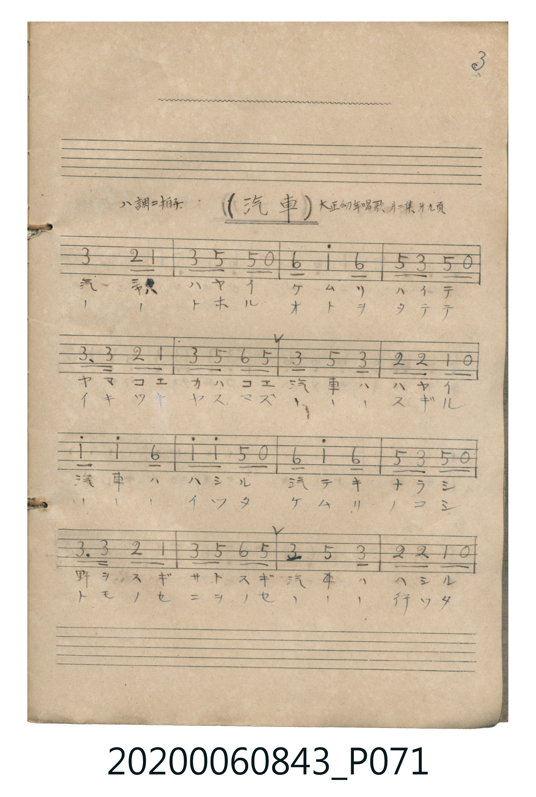

# 汽車

> Re:Shōka 使用 AI 協助辨識與重建樂譜，可能會有錯誤。歡迎回報。

- **鋼琴伴奏版**：<br><audio controls src="kisha.mp3"></audio>

- 曲：大正幼年唱歌 第二集

## 說明

汽車 (Kisha)
Source: 唱歌帖 (Shōkachō, NMTH 2020.006.0843) — P071.jpg (Notebook 2, p.3)
Notation: Handwritten numbered notation (Jianpu)
Annotations: ハ調 二拍子, 大正幼年唱歌 第二集 十九頁


## 歌詞

```text
（TMD 檔案未包含歌詞註解）
```

## ABC

<div class="abc-score" data-abc-src="kisha.abc" aria-label="五線譜載入中"></div>

[下載 ABC 原始檔](kisha.abc)

## TMD 檔案連結

- [主旋律 TMD 檔案](kisha.tmd) [[在 TMD Studio 編輯](https://tmdlang.github.io/Tmd-TS/#tmd=s7IKdvYPcrWy4qpTUCpJTLdSSM7PyUlNLsnMz7MqzsjPTkzOyFeCS5bl55TmploBqXgDI4RwcX5pUXJqfEFieqpVgIG5IboM3KT4vPyS1KT8_GyEioKi_LLUvMQ8oKrcxLzS4uSizIKS-OT8gkqEmtSyzJRUkIrUlMyS_KLMxBwkJ6UWFYMdC3FDSVFiHsQMoCBCVUlGKtDdYMmC_KIShATQtPTMPKvc1MyszPiS1IoSVNdBpUsSM4FeiAfi8sT43MTMvJzEvBQlLi0thWcb977Y3aWgpcWlaKtgaGjEZW-r4MxlY6RvYgcy5NnsTe_3zHq6ZPmztYuf7tzzdOeWp1M2Plvbo_B8zZonu3pezm5T4uLS11KwpRbgUlCAuUnDG-joRE2QSDAkGhQglj_dMU1BIzjjaC8oTo726ij4-YZ4KBgZGBnoGRiY6RlYmBhrKjxqmKIAiku9rIJ0BQ0_aLwpGOkoFOgZgw0FiiWC04mCBzA0yosyS0pS8xTySnOTUotSUxSAUQ2WVtDwykzMKygF63HMgwkXWyk8bu5_sWq_AjAcnnX3Pl07QUcBX0ApPO1tfLJz7ssFjSCDKA8pKFDQ0ufiAoeUVVh-cmKOQ41BTTXIBgUbQzMtOzALGEFAp7xYOc8KpBoqYqgHC2igPx43L3nctEThcdPGx80LHjevAos1LXnc3KagD2QDGfMeN21-3LQCqGQ1WA7MgRgA5COZoY8m2rT9cfNqkBjQsMdNa4FiQKmVQGGgypftfY-bNz1u2vm4aR3Q5K2PmzugHGxmINxuhOT2jsfNs0Gyj5tWgTmbgKz9ILsgbgd6omnt4-YWiNVAzk6wX3Yh2wC2EmQGittB3m8GmoUSKn1gn4PcDrZsEVhkN5DTDfIIhIMw48XCHqgZULfXKFTnptUqGCvogqEREBsCcQ1YxBSKDcAiZiC5OKhCEKcGLAlTCFYECw8HcNQDUyTIk6DAWgwJOVCMAnHzHpAfgPQCIAbHLVS8DSlMsZnRAVQzG4iBoQs2A6QXJAYOY7B-JDMgngC5ENNbIPeDaIQIRCVIBKQapgO7r0D-aJ4HtHMzEIOTINQPMD7MxRBhJK9j8x5IBpQWWqA0iL8TasEuDMNAUqDEiUh_NZBoQYsbhBi1ohDhGWB6g-YhUHhDMxEQrwRL4YtCpLhuhsQZJB1AEzM0COFm0CwKgRkdmmygwdm0FZKU4HycvsbiPXAaXAT1ADjzQQyH8XF7H2hYLReXrp0CuMRUADKUuQA)]
- [鋼琴伴奏 TMD 檔案](kisha_piano.tmd) [[在 TMD Studio 編輯](https://tmdlang.github.io/Tmd-TS/#tmd=s7IKdvYPcrWy4tLSUni2ce-L3V0KGo-bpzxuWvS4ue_Jni1Pl_Y_2T1DU0FLi0vRVsHQ0IjL3lbBmcvGSN_EjqtOQenZ7E3v98x6umT5s7WLn-7c83TnlqdTNj5b26PwfM2aJ7t6Xs5uU-Li0tdSsKUW4FJQgDvUO7M4I1FT4VHDFIWAzMS8fAXH5OT83ILEvMzc1LwSkMrg_NKi5FQrBYijnu6YpqARnHG0NzsxGUjqKPj5hngoGBkYGegZGJjpGViYGENNMzA31MsqSFfQ8MsvSU3Kz89WMNJRKNAz1gQZSrknoEBBS5-LC-wJq7D85MQchxqDmmqQDQo2hmZadmBWjUJ1blqtgrGCLhgaAbEhENeARUyh2AAsYgaSi4MqBHFqwJIwhWBFYDOB8eEAttAKyHnctBaItz9uXvy4uV_hcfMSIA-Im_cA6Y1AegEQrwJioBxYvA3karymdABVzQbi1VBTQLpBYpuA7P1gE5BMgXgE5EpMr4H8AKIRIhCVIBGQapgOhM9qIAGAFgoIMTICi3oOrIVFNjixBnngiu6CWgXTeG1DbVicAznm8dogs0AQ6E5kSSBLG2Yx0KfaJtogR0FkEGyQDEIdyDlgUaiV6LaBnEzQKgxNcA5YDsnFxvHayIbCQlXbVBseAahuRZMach5EjWgf5Ig2gcezIdAQMGUMokziQQjENcCaSUHZsnkeMANtBuIVQAzKXKAsCePDsh9EGCknY8-tIDmgluYWKA3i74RasQvDOJBU0zpwloZnW7j7we4Gsg2hFJCLr3xAOLBpO9hEYGkOKhAg7ugC4pVgKfylDFKB1AwpViCFFaSs6oMGDNwUuDuJC-6X7UATwOUV1ONNWyFlGJyP0zdYnQ0u_hZBHbYbSHdDjIfxcXuLuOAGJjhdOwVwmlMAMpS5AA)]

## 分析

```text
================================================================================
📊 TMD Song Profile: [ 汽車 ]
================================================================================
⏱  Duration:       0:17 (17.1s), 16 measures total
🎼 Key & Tempo:    首調基準 C, != 112.0 BPM, <2/4>
   - 分析範圍：      由實際發聲的音符與和弦推測調性；播放脈絡另行呈現
🎤 人聲音域:    C4 (MIDI 60) – C5 (MIDI 72) [跨度: 12 個半音 / 1.0 個八度, 難度: easy]
   - 最低音:  C4 in [Kisha #1 @ m.1, 0:00]
   - 最高音: C5 in [Kisha #1 @ m.3, 0:02]
   - 適合: soprano, mezzo-soprano, contralto, tenor, baritone, bass
🏛  結構:      Kisha (17.1s)
⚡ 編曲密度:        Peak 1 軌道同時演奏
🗝  調性診斷：       C 大調（純淨自然大調，未偵測到可信轉調）
   - 風格氣質:    純淨自然大調（陽光明朗、易唱易記，無明顯調外色彩）
   - 轉調歷程:    全曲維持單一推測調性（未偵測到可信轉調）
   - 核心骨幹音:  E, G, C, D, A
   - 調性數值:    C 大調 [相關度: 0.85, 穩定度: Moderate, 自然音純度: 100.0%]
   - 候選調性 (K-S): C 大調 (0.85), E 小調 (0.75), G 大調 (0.70)
   - 五度圈歷程:   +0
   - 各段落調性細節:
     • [Kisha #1]: C 大調 (r: 0.85, 自然音純度: 100.0%)

  [ 五度圈游移軌跡 ]
              [C ]*
         F            G  
      Bb               D  
      Eb               A  
         Ab           E  
            Db       B  
               F# 
     (* = active key center)

  [ 十二半音累積音高分佈 ]
     C  : ██████████████████████    24.1%
     C# :                            0.0%
     D  : ███████████               12.1%
     D# :                            0.0%
     E  : ████████████████████████  25.9%
     F  :                            0.0%
     F# :                            0.0%
     G  : ████████████████████████  25.9%
     G# :                            0.0%
     A  : ███████████               12.1%
     A# :                            0.0%
     B  :                            0.0%
--------------------------------------------------------------------------------
Assignment 軌道音域：
  - Vocal         : C4 – C5 (12 個半音 / 1.0 個八度, 52 個音符)
================================================================================
```


## 原書掃描頁




