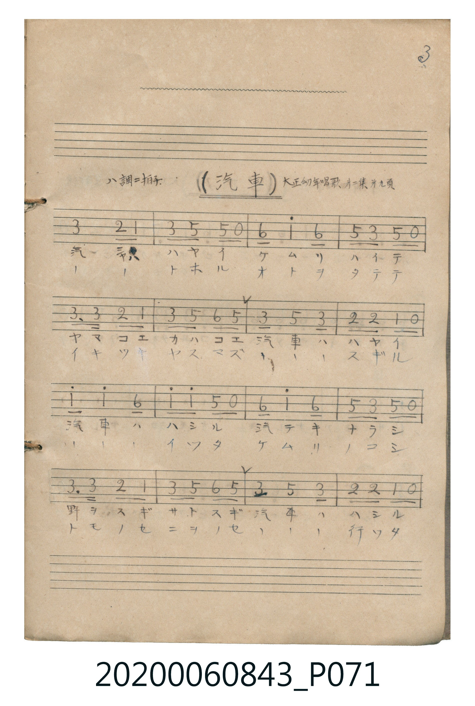

# 汽車

> Re:Shōka 使用 AI 協助辨識與重建樂譜，可能會有錯誤。歡迎回報。

- **鋼琴伴奏版**：<br><audio controls src="kisha.mp3"></audio>

- 曲：大正幼年唱歌 第二集 十九頁
- 唱歌帳（2020.006.0843）P071.jpg（第 3 頁）

## 說明

> [!NOTE]
> **原頁資訊與校勘記**（對應 `P071.jpg`，手抄簡譜第 3 頁）：
> - **調性、拍號與出處註記**：題首左標「ハ調二拍子」（C 大調 `?= C`、`<2/4>`），中題「（汽車）」，右註「大正幼年唱歌 才二集 十九頁」（《大正幼年唱歌》第二集第 19 頁）。第 6、14 小節末小節線上標有換氣記號 `v`。
> - **歷史假名與漢字混寫保留**：保留原抄歷史假名遣與大字促音「トホル」「カハコエ」「イツタ」「行ツタ」，以及「汽車」「汽テキ」「野ヲスギ」等漢假混寫原貌。
> - **手抄筆誤與同上記號校勘（依 Policy A 校訂）**：
>   1. **第 13 小節第二節首二字筆誤**：原母本《大正幼年唱歌》作「ヒトノセ　ニヲノセ」（人乗せ　荷を乗せ），原抄將「ヒトノセ」筆誤寫作「トモノセ」（形近誤抄），今依 Policy A 於 `L2|` 校訂還原為「ヒ ト ノ セ」並備載原抄字形。
>   2. **同上反覆點號展開**：原抄第 1 小節第二節「汽車」及第 7、9、15 小節第二節「汽車ハ」均以直點號 `'`（同上符號 `〃`）省寫，今於 `L2|` 展開為實際演唱字音。
>
> **1.**
> 汽車　ハヤイ　ケムリ　ハイテ
> ヤマコエ　カハコエ　汽車ハ　ハヤイ
> 汽車ハ　ハシル　汽テキ　ナラシ
> 野ヲスギ　サトスギ　汽車ハ　ハシル
>
> **2.**
> 汽車（`〃`）　トホル　オトヲ　タテテ
> イキツキ　ヤスマズ　汽車ハ（`〃〃〃`）　スギル
> 汽車ハ（`〃〃〃`）　イツタ　ケムリ　ノコシ
> ヒトノセ（原抄筆誤作「トモノセ」）　ニヲノセ　汽車ハ（`〃〃〃`）　行ツタ


## 歌詞

```text
（TMD 檔案未包含歌詞註解）
```

## ABC

<div class="abc-score" data-abc-src="kisha.abc" aria-label="五線譜載入中"></div>

[下載 ABC 原始檔](kisha.abc)

## TMD 檔案連結

- [主旋律 TMD 檔案](kisha.tmd) [[在 TMD Studio 編輯](https://tmdlang.github.io/Tmd-TS/#tmd=s7IKdvYPcrWy4qpTUCpJTLdSSM7PyUlNLsnMz7MqzsjPTkzOyFeCS5bl55TmploBqXgDI4RwcX5pUXJqfEFieqpVgIG5IboM3KT4vPyS1KT8_GyEioKi_LLUvMQ8oKrcxLzS4uSizIKS-OT8gkqEmtSyzJRUkIri5MS8-LLUosy0zNQUJGelFhWDHQxxR0lRYh7EHKAgQlV-UUlGfnpRYkFGpVVGZnFJflFmcmJOfHZiXiJCUUlGKtCDYBMKgBqQdWemZ-ZZ5aZmZmXGl6RWlKB6AypdkpgJ9Gs8EJcnxucmZublJOYBHaqlpfBs494Xu7sUtLS4FG0VDA2NuOxtFZy5bIz0TexAhjybven9nllPlyx_tnbx0517nu7c8nTKxmdrexSer1nzZFfPy9ltCk97G5_snPtyQSPYVoj00x2b3-_pMDIwMtAzMDDTM7AwMX6_pxMUB3pZBelAKaB2BWMFoCagsBIXl76Wgi21AJeCgoKdQrSin3-IayyEo6X1tG8-0LIXm9tfrOh60dH-bMHCp90zXqyYoaUFdMzTDb3P2jsVEmDuS3i_p-dZZ_ezrpbnGxa-WDsH2bHA0ICYqQs09cWq_c8alj9uaHzW3fti5nygwU_bd72YOfXFit1Qs2e9XNjzctm0p9uXPVsx83FDz-PmfqAmYMgBdTxdO-FxQy_QfmcFYAADhRUSQIGfADQvARwBQHcA7et5smMt0BSgZqBSSHQBxcE6e572bwbaBZTCEkPPOnvRYwhi3eOGLkzljxu64VEK8q-hJdTDjxuaQHwzoKsMTRSebuh_vr7h2ZzVEMbz7bOe7OgCeu3ZnM5n_bOfbVgM9DcwJBQSyoDeaEKE1LO125_2b3ra2P50Qi8o_Pcserp2-rPt25-uX_1k_9znU2eCAwvCBMYVMOiRdbxsXAwK2yXLgZqe7G9-OX8zOCg7HjfPfty8GugrELdpNTBwHzdtfty0Aiay5HFzy-Om_RDuC2AYwrigUN299Gl_F1AcEqQQNUD24-a2x01rIdyX7X2Pmzc9btr5uGkdUOT52k6QwxvbIQ4HuvPFJmDAIXsTkmrWtr1YtQTk4gnAyOuCBAkkyQGD_8m-uQoB-TmZyZUKjgpA0RcrmoDBDPY_xCAFBUM9oFngWDCGhjgkboAMYGICMoDhALEErA0UYOt7n81Zgytmn-ydAw6wSeAw63vcBEwyDY-bu0Geg3JBCePJrl1Pdk5_3DgbKPuid_vjpkkQLiQZQqLl6YZ2DKOAAQNyCyguoRYBpRYhm_x076IX-ycC1QBNgCbq3V2oATFtj0KCj1FNAjRIXja1AC183rQLYpsC0Ewg7lOAGPlkx7KnTTNf7OmEOmrtdKAN8JhQUDACBSAk9J_2975Y1vZy9zxgHDzdOPXltG54mAFjChTG6EGMnCaASQSkxhyY-i1BOcAUt2Jg4gOqn9sOTFjPZ2-BWKiQoA7MxB0Qlzxfswws9LihGZSzn89pBIYYJCgQvoc4Eejvp-uXvZw1-9meKcBYBPoPnOYh_oOVaYZ6wFIbzIY5Fxin_Y-bl4ASPpDdtPFx84LHzaug4qDc0AZRD1LTPA-WV4AqkbNOA5J_EAaiWASXatoOzn8gLbB8AxQHKlgJlIJoQc1DQLu2gpIHjIvVQBRfGqH5EhicsBAE64EXAkCjV4G5m8Ds_SAHwT0M9DzQcaDsD3EikLsTHATA9IVwBNRsCILZAHEq1FWIEMCuFl7ioAU_MCsAQxcaJMi5B5Q6IEkRnIdwZCCIV5HzK35Hw8s6kIWUV6lQoKClz8XlDWxJJFqF5QPbKA41BjXVIBsUbAzNtMAxplCdm1YLZmCr0sGthh0g1ylogLPeo4bJsDpFRwFW_Wpi0Qi0GWRoDbAe1gVDIyA2BGKIiCkUG4BFzEBycVCFIE4NWBKmEKwIbJyPYQ0oQqEqQe0gCKsGGEX9QBqYTkBkE4iMh4g3bQSLL4CqBMYvsnqwSmCqg6mH2GKE25YOsPrZYHI1ki0gUyGyEFs2QcX3w81HtgV_gO8CVX2QADcFBrgFOQFujCXAQSELohEiEJUgEZBqmA7U8IaEKcj984D-2QwOtRVQ34FCABaSyDKQ0EOEHEQNzliChzpEDCS3FqiqBcqC6ITo2Ql1CYi9C79dELVN61DjikDY7-iEh70lMOwNjUgLfHAqRkvKCDGKUjzO0GzajupDqHpIeoOFJkQ9yARgWQ_XhS3NYwtJSC6BxAcoRRPKW31glZAUgbAHb8g_nT0bUcwYg4LebGDTPbAehPpqE0paAvl7K1gcXBagyJAYU4h0D2wwQdRDGk0gtbuhOruhbgCRyDK47AKFIpbY4qrl4tK1UwDXBtE-hrEKCI4RmKPMBQA)]
- [鋼琴伴奏 TMD 檔案](kisha_piano.tmd) [[在 TMD Studio 編輯](https://tmdlang.github.io/Tmd-TS/#tmd=s7IKdvYPcrWy4qpTUCpJTLdSSM7PyUlNLsnMz7MqzsjPTkzOyFeCS5bl55TmploBqXgDI4RwcX5pUXJqfEFieqpVgIG5IboM3KT4vPyS1KT8_GyEioKi_LLUvMQ8oKrcxLzS4uSizIKS-OT8gkqEmtSyzJRUkIri5MS8-LLUosy0zNQUJGelFhWDHQxxR0lRYh7EHKAgQlV-UUlGfnpRYkFGpVVGZnFJflFmcmJOfHZiXiJCUWIRUHN6am5qXolVQWZiXn58YnJyfm5BYl4mSEyJS0tL4dnGvS92d73f0_Gye8_zCVue7NnydGn_886O93s6FbS0uBRtFQwNjbjsbRWcuWyM9E3sQIY_m73p_Z5ZT5csf7Z28dOde57u3PJ0ysZna3sUnq9Z82RXz8vZbQpPexuf7Jz7ckEj2DUQ6ac7NgPtMTIwMtAzMDDTM7AwMQbaAgpjvayCdKAUULuCsQJQE1BYiYvLO7M4I9EqLB_oMYcag5pqLgUgsDE007IDs6pz02rBjBqgJl0wNAJiQyCGiJhCsQFYxAwkFwdVCOLUgCVhCsGKwMb5GNaAQgWqEhg4UFaNwuPmfiD9uHkJiGwCkfEQ8aaNYPEFUJWPm1chqwerfNzcBlMPscUIty0dYPWzweRqJFtApkJkIbZsgorvh5uPbAtK2BhjCRtQIIBohAhEJUgEpBqmAzVoIN4HWTUPaPVmsAdXQB0CcizM08gyEI8iPAlRgzNA4QEEEQPJrQWqaoGyIDohenZCXQJi78JvF0Rt0zrUYIUFEzhpoKUPhBhFyQinv5u2o7oFqh4SiTB_Q9SDTHjcvBKuC1tCwuZnSNKDhBwomRBKsH1glZC4Q9hDo6T0sh1kHSQlI0cPyIFbweLgnIAiQ2KQIpJS8ySo-g64N3dDdXZD3QAikWVw2fViYQ-2YOWqhZVZAaDCNsgDe6lVACu1TOO1DbVhRReQYx6vDQonSCmAIglkacMCFZgstU20QQEOkUGwQTIIdaCgBotSaBu6PgQHLIdkjHG8NkgezV6gWdrwDIPqXDSpoehH1Cj3QY5yE1iMwyPcMB5oWjyEYQxmmABJEAYLGcD9gawQiECOQGMgFMK1U2oi0Cu6dgpg30T7GMYqIDhGYI4yFwA)]

## 分析

```text
================================================================================
📊 TMD Song Profile: [ 汽車 ]
================================================================================
⏱  Duration:       0:34 (34.3s), 32 measures total
🎼 Key & Tempo:    首調基準 C, != 112.0 BPM, <2/4>
   - 分析範圍：      由實際發聲的音符與和弦推測調性；播放脈絡另行呈現
🎤 人聲音域:    C4 (MIDI 60) – C5 (MIDI 72) [跨度: 12 個半音 / 1.0 個八度, 難度: easy]
   - 最低音:  C4 in [Kisha[L1] #1 @ m.1, 0:00]
   - 最高音: C5 in [Kisha[L1] #1 @ m.3, 0:02]
   - 適合: soprano, mezzo-soprano, contralto, tenor, baritone, bass
🏛  結構:      Kisha[L1] (17.1s) -> Kisha[L2] (17.1s)
⚡ 編曲密度:        Peak 1 軌道同時演奏
🗝  調性診斷：       C 大調（純淨自然大調，未偵測到可信轉調）
   - 風格氣質:    純淨自然大調（陽光明朗、易唱易記，無明顯調外色彩）
   - 轉調歷程:    全曲維持單一推測調性（未偵測到可信轉調）
   - 核心骨幹音:  E, G, C, D, A
   - 調性數值:    C 大調 [相關度: 0.85, 穩定度: Moderate, 自然音純度: 100.0%]
   - 候選調性 (K-S): C 大調 (0.85), E 小調 (0.75), G 大調 (0.70)
   - 五度圈歷程:   +0 -> +0
   - 各段落調性細節:
     • [Kisha[L1] #1]: C 大調 (r: 0.85, 自然音純度: 100.0%)
     • [Kisha[L2] #1]: C 大調 (r: 0.85, 自然音純度: 100.0%)

  [ 五度圈游移軌跡 ]
              [C ]*
         F            G  
      Bb               D  
      Eb               A  
         Ab           E  
            Db       B  
               F# 
     (* = active key center)

  [ 十二半音累積音高分佈 ]
     C  : ██████████████████████    24.1%
     C# :                            0.0%
     D  : ███████████               12.1%
     D# :                            0.0%
     E  : ████████████████████████  25.9%
     F  :                            0.0%
     F# :                            0.0%
     G  : ████████████████████████  25.9%
     G# :                            0.0%
     A  : ███████████               12.1%
     A# :                            0.0%
     B  :                            0.0%
--------------------------------------------------------------------------------
Assignment 軌道音域：
  - Vocal         : C4 – C5 (12 個半音 / 1.0 個八度, 104 個音符)
================================================================================
```


## 原書掃描頁




