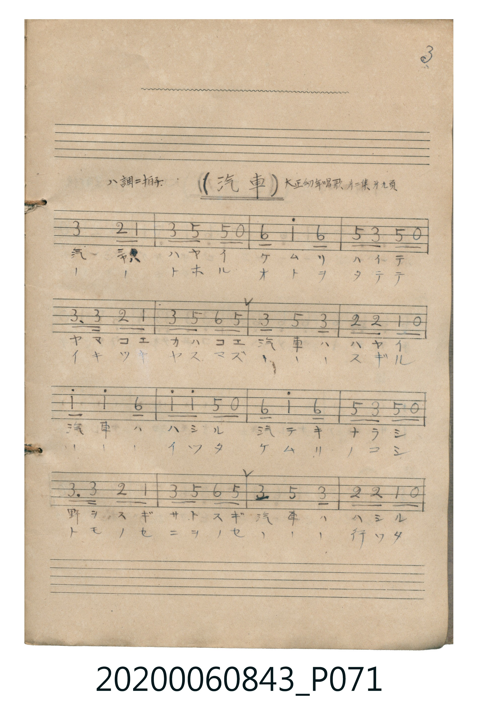

# 汽車

<audio controls src="kisha.mp3"></audio>

- 曲：大正幼年唱歌 第二集

## 說明

汽車 (Kisha)
Source: 唱歌帖 (Shōkachō, NMTH 2020.006.0843) — P071.jpg (Notebook 2, p.3)
Notation: Handwritten numbered notation (Jianpu)
Annotations: ハ調 二拍子, 大正幼年唱歌 第二集 十九頁

## 跨冊／重複收錄參照

> 同曲＋同名異曲（《公學校唱歌》第三學年與《新定兒童唱歌》三年級為大和田愛羅作曲同曲；《唱歌帖》P071 為《大正幼年唱歌》同名異曲）

- **[同名異曲]** 《公學校唱歌》第三學年（昭和10年／1935）：[**〈きしゃ（火車）〉**](../../../kogakko_shoka/grade_3/11_kisha/index.md)（`G` / `2/4` — [原始 TMD](../../../kogakko_shoka/grade_3/11_kisha/kisha.tmd)）
- **[同名異曲]** 《新定兒童唱歌》尋常科第三學年用（2020.006.0847.0003）：[**〈汽車（火車）〉**](../../../shintei_jido_shoka/grade_3_2020.006.0847.0003/2_10_kisha/index.md)（`G` / `2/4` — [原始 TMD](../../../shintei_jido_shoka/grade_3_2020.006.0847.0003/2_10_kisha/kisha.tmd)）
- 總表：[跨冊重複與同名歌曲總索引](../../../duplicate_songs.md)

## 歌詞

```text
（TMD 檔案未包含歌詞註解）
```

## ABC

```abc
X:1
T:汽車
C:曲：大正幼年唱歌 第二集
M:2/4
L:1/16
Q:1/4=112
K:C
V:V1 name="Vocal" snm="Voc"
[V:V1]
!mf! E4 D2 C2 | E2 G2 G2 z2 | A2 c4 A2 | G2 E2 G2 z2 |
E3 E D2 C2 | E2 G2 A2 G2 | E2 G4 E2 | D2 D2 C2 z2 |
c2 c4 A2 | c2 c2 G2 z2 | A2 c4 A2 | G2 E2 G2 z2 |
E3 E D2 C2 | E2 G2 A2 G2 | E2 G4 E2 | D2 D2 C2 z2 |
```

## TMD 檔案連結

- [主旋律 TMD 檔案](kisha.tmd) [[在 TMD Studio 編輯](https://tmdlang.github.io/Tmd-TS/#tmd=s7IKdvYPcrWy4qpTUCpJTLdSSM7PyUlNLsnMz7MqzsjPTkzOyFeCS5bl55TmploBqXgDI4RwcX5pUXJqfEFieqpVgIG5IboM3KT4vPyS1KT8_GyEioKi_LLUvMQ8oKrcxLzS4uSizIKS-OT8gkqEmtSyzJRUkIrUlMyS_KLMxBwkJ6UWFYMdC3FDSVFiHsQMoCBCVUlGKtDdYMmC_KISJS4tLYVnG_e-2N2loKXFpWirYGhoxGVvq-DMZWOkb2IH0vds9qb3e2Y9XbL82drFT3fuebpzy9MpG5-t7VF4vmbNk109L2e3KXFx6Wsp2FILcCkowNyk4Z1ZnJGoCRIJhoSgAsTypzumKWgEZxztBQXn0V4dBT_fEA8FIwMjAz0DAzM9AwsTY02FRw1TFEDRoJdVkK6g4QcNcgUjHYUCPWOwoUCxRHAUK3gk5qWUF2WWlKTmKeSV5ialFqWmKABjCSytoOGVmZhXUArW45gHEy62Unjc3P9i1X4FYDg86-59unaCjgK-gFJ42tv4ZOfclwsaQQZRHlJQoKClz8UFDimrsPzkxByHGoMahWqQFQo2hmZadmAWMIaAbnmxcp4VSDlUxFAPFtJAjzxuXvK4aYnC46aNj5sXPG5eBRZrWvK4uU1BH8gGMuY9btr8uGkFUMlqsByYAzEAyEcyQx9NtGn74-bVIDGgYY-b1gLFgFIrgcJAlS_b-x43b3rctPNx0zqgyVsfN3dAOdjMQLjdCMntHY-bZ4NkHzetAnM2AVn7QXZB3A70RNPax80tEKuBnJ1gv-xCtgFsJcgMFLeDvN8MNAslVPrAPge5HWzZIrDIbiCnG-QRCAdhxouFPVAzoG4Hxk1uWq2CsYIuGBoBsSEQ14BFTKHYACxiBpKLgyoEcWrAkjCFYEWw8HAAxz0wSYI8CQqsxZCQA8UoEDfvAfkBSC8AYnDcQsXbkMIUmxkdQDWzgRgYumAzQHpBYuAwButHMgPiCZALMb0Fcj-IRohAVIJEQKphOrD7CuSP5nlAOzcDMTgJQv0A48NcDBFG8jo274FkQGmhBUqD-DuhFuzCMAwkBUqciPRXA4kWtLhBiFErChGeAaY3aB4ChTc0EwHxSrAUvihEiutmSJxB0gE0MUODEG4GzaIQmNGhyQYanE1bIUkJzsfpayzeA6fBRVAPgDMfxHAYH7f3gYbVcnHp2imAi0wFIEOZCwA)]
- [鋼琴伴奏 TMD 檔案](kisha_piano.tmd) [[在 TMD Studio 編輯](https://tmdlang.github.io/Tmd-TS/#tmd=s7IKdvYPcrWy4tLSUni2ce-L3V0KGo-bpzxuWvS4ue_Jni1Pl_Y_2T1DU0FLi0vRVsHQ0IjL3lbBmcvGSN_EjqtOQenZ7E3v98x6umT5s7WLn-7c83TnlqdTNj5b26PwfM2aJ7t6Xs5uU-Li0tdSsKUW4FJQgDvUO7M4I1FT4VHDFIWAzMS8fAXH5OT83ILEvMzc1LwSkMrg_NKi5FQrBYijnu6YpqARnHG0NzsxGUjqKPj5hngoGBkYGegZGJjpGViYGENNMzA31MsqSFfQ8MsvSU3Kz89WMNJRKNAz1gQZSrknoEBBS5-LC-wJq7D85MQchxqDGoVqkBUKNoZmWnZgFlAkN61WwVhBFwyNgNgQiGvAIqZQbAAWMQPJxUEVgjg1YEmYQrAisJnACHEA22gF5DxuWgvE2x83L37c3K_wuHkJkAfEzXuA9EYgvQCIVwExUA4s3gZyNl5TOoCqZgPxaqgpIN0gsU1A9n6wCUimQDwCciWm10B-ANEIEYhKkAhINUwHwmc1kABACwWEGBmBRT0H1sJiG5xagzxwxndBrYJpvLahNizSgRzzeG2QYSAIdCiyJJClDbMZ6FVtE22QqyAyCDZIBqEO5B6wKNRKdNtAbiZoFYYmOAcsh-Ri43htZENhwaptqg2PAVS3okkNOQ-ixrQPrpiGaTCNR3gCbiJcyATGhDMQylD9iZojQTm5eR4wz20G4hVADMqPoFwM48NyLEQYKfNjz-AgOaCW5hYoDeLvhFqxC8M4kFTTOnApAM_pePyL5De4LHIkwYTgyvAVQQgPNW0HuwBYY4DKHIi7u4B4JVgKf0GGVOY1Q0ouSHkIKQ77oAEJNwWrX6gXnS_bgTaCi1BowDZthRSrcD5O32P1JrhEXgT1yG4g3Q0xHsbHHQy0iU5gltG1UwDnGgUgQ5kLAA)]

## 分析

```text
================================================================================
📊 TMD Song Profile: [ 汽車 ]
================================================================================
⏱  Duration:       0:17 (17.1s), 16 measures total
🎼 Key & Tempo:    首調基準 C, != 112.0 BPM, <2/4>
   - 分析範圍：      由實際發聲的音符與和弦推測調性；播放脈絡另行呈現
🎤 人聲音域:    C4 (MIDI 60) – C5 (MIDI 72) [跨度: 12 個半音 / 1.0 個八度, 難度: easy]
   - 最低音:  C4 in [Kisha #1 @ m.1, 0:00]
   - 最高音: C5 in [Kisha #1 @ m.3, 0:02]
   - 適合: soprano, mezzo-soprano, contralto, tenor, baritone, bass
🏛  結構:      Kisha (17.1s)
⚡ 編曲密度:        Peak 1 軌道同時演奏
🗝  調性診斷：       C 大調（純淨自然大調，未偵測到可信轉調）
   - 風格氣質:    純淨自然大調（陽光明朗、易唱易記，無明顯調外色彩）
   - 轉調歷程:    全曲維持單一推測調性（未偵測到可信轉調）
   - 核心骨幹音:  E, G, C, D, A
   - 調性數值:    C 大調 [相關度: 0.85, 穩定度: Moderate, 自然音純度: 100.0%]
   - 候選調性 (K-S): C 大調 (0.85), E 小調 (0.75), G 大調 (0.70)
   - 五度圈歷程:   +0
   - 各段落調性細節:
     • [Kisha #1]: C 大調 (r: 0.85, 自然音純度: 100.0%)

  [ 五度圈游移軌跡 ]
              [C ]*
         F            G  
      Bb               D  
      Eb               A  
         Ab           E  
            Db       B  
               F# 
     (* = active key center)

  [ 十二半音累積音高分佈 ]
     C  : ██████████████████████    24.1%
     C# :                            0.0%
     D  : ███████████               12.1%
     D# :                            0.0%
     E  : ████████████████████████  25.9%
     F  :                            0.0%
     F# :                            0.0%
     G  : ████████████████████████  25.9%
     G# :                            0.0%
     A  : ███████████               12.1%
     A# :                            0.0%
     B  :                            0.0%
--------------------------------------------------------------------------------
Assignment 軌道音域：
  - Vocal         : C4 – C5 (12 個半音 / 1.0 個八度, 52 個音符)
================================================================================
```


## 原書掃描頁




