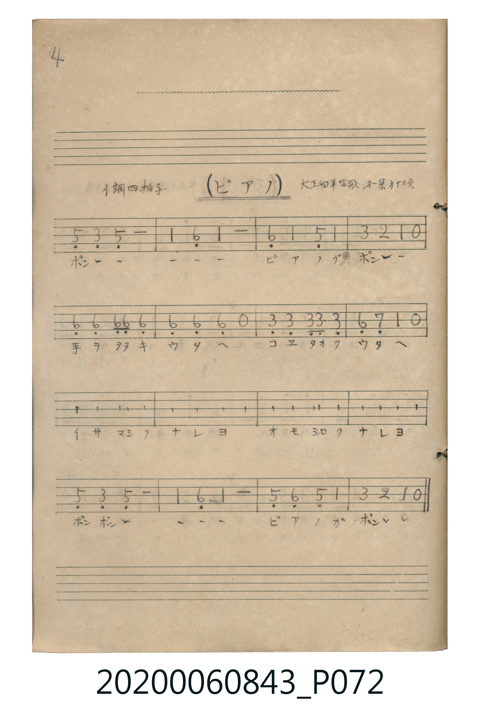

# ピアノ

> Re:Shōka 使用 AI 協助辨識與重建樂譜，可能會有錯誤。歡迎回報。

- **鋼琴伴奏版**：<br><audio controls src="piano.mp3"></audio>

- 曲：大正幼年唱歌 第二集

## 說明

ピアノ (Piano)
Source: 唱歌帖 (Shōkachō, NMTH 2020.006.0843) — P072.jpg (Notebook 2, p.4)
Notation: Handwritten numbered notation (Jianpu)
Annotations: イ調 四拍子, 大正幼年唱歌 第二集 廿頁
Reference Audio: 大正幼年唱歌チャンネル (YouTube)
https://www.youtube.com/@%E5%A4%A7%E6%AD%A3%E5%B9%BC%E5%B9%B4%E5%94%B1%E6%AD%8C%E3%83%81%E3%83%A3%E3%83%B3%E3%83%8D%E3%83%AB/videos


## 歌詞

```text
（TMD 檔案未包含歌詞註解）
```

## ABC

<div class="abc-score" data-abc-src="piano.abc" aria-label="五線譜載入中"></div>

[下載 ABC 原始檔](piano.abc)

## TMD 檔案連結

- [主旋律 TMD 檔案](piano.tmd) [[在 TMD Studio 編輯](https://tmdlang.github.io/Tmd-TS/#tmd=s7IKdvYPcrWy4qpTUCpJTLdSSM7PyUlNLsnMz7MqzsjPTkzOyFeCS5bl55TmploBqXgDI4RwcX5pUXJqfEFieqpVgIE5hgzcpPi8_JLUpPz8bISKgqL8stS8xDygqtzEvNLi5KLMgpL45PyCSoSa1LLMlFSQitSUzJL8oszEHCQnpRYVgx0LcUNJUWIexAygIEIVUFN6Zp5VbmpmVmZ8SWpFCaojoNIliZlAl8YDcXlifG5iZl5OYl4KsqqSjPz0osSCjEqrjMxikEuSE3PisxPzEhGKSjJSgSGUmlKanAhxgpaWwuPmKY-bFj1u7lPQ0uJStFUwNDDhsrdVcOSyMdE3sQNpfTZ70_s9s54uWf5s7eKnO_c83bnl6ZSNz9b2KDxfs-bJrp6Xs9uUuLj0tRRsqQW4FBSQnKURkJmYl68JEgyGxJgCxP6nO6YpaARnHO0FRd_RXh0FP98QDwUjAyMDPQMDMz0DCxNjTYVHDVMUQNGul1WQrqDhB41iBSMdhQI9E7ChQDFwaFgpeABDtLwos6QkNU8hrzQ3KbUoNUUBmCrA0goaXkB3FJSC9TjmwYSLrRQeNy15sWq_wtPZs5919z5dO0FHAV9YKTzdvf_lgkaQKUGpaUArgGlHwbE0JTMf6C8MfY-bGx83L37cvPlxc-_j5tUKGpH5pSGlSalgV2SUlBQUW-nrl5eX61Xml5YAxfWS83P1HVRdTVUdTVQdzVVdzVQdXVQdjUEiTpaqTs4whgmIYWmi6mQIVWMBlDJWtQAioAiYAdIFZjjBGBYuMCknfVCyzy_mArmD8hiHAgUtfS4ucHRbheUDk69DjUFNNcgGBRtDMy07MAuY0IDh8mLlPCuQaqjI4-a5wDDCRUFT0uOmNWhSCAOedXY_bt4EjMr9YLQWyFoGYjXPALKAgb8RIrX6cdN6JCkkBzQtedy09XHzvMdN28FqmrseN6953LwCKLPqcfMikHDzWlQZajm_RqE6N61WwTReQRcMjWEMuAgM1igYQllmMCmYAEIJhhTcGJhAjYIxlGWEJmMAUwHzmQM4HoF5pHkuEINdjoOeAgypRUC6D0iDPYoiD_cq3HWoDASB5glMBtyNiIBCZSAINLPM0QMCp3eByQnobHB6gmJwioKwIWkKSIMTFRCvBmJwsoLLDzHvAlM_EG8FOn0ekN4O8U5zFxCDYhKcB4A0MHZBcs2goECVh3uXWmkYrguuZpAk4louLl07BXARpwBkKHMBAA)]
- [鋼琴伴奏 TMD 檔案](piano_piano.tmd) [[在 TMD Studio 編輯](https://tmdlang.github.io/Tmd-TS/#tmd=s7IKdvYPcrWy4qpTUCpJTLdSyC8qychPL0osyKi0ysgsLskvykxOzInPTsxLVIIrKs4vLUpOjS9ITE-1CjAwN0LIlGSk5qZapaaUJieWZObnKXFpaSk8bp7yuGnR4-Y-BQ0488meLU-X9j_ZPUNTQUuLS9FWwdDAhMveVsGRy8ZE38QOZN6z2Zve75n1dMnyZ2sXP9255-nOLU-nbHy2tkfh-Zo1T3b1vJzdpsTFpa-lYEstwKWggOzWgMzEvHxNhUcNUxTATAXH5OT83ILEvMzc1LwSkOJgcDBYKUDc9XTHNAWN4IyjvdmJyUBSR8HPN8RDwcjAyEDPwMBMz8DCxBhqGjDE9LIK0hU0_PJLUpPy87MVjHQUCvRMNEGGBqWmpRal5iWnKjiWpmTmA03HCIHHzY2Pmxc_bt78uLn3cfNqBY3I_NKQ0qRUsP6MkpKCYit9_fLycr3K_NISoLge0N36DqqupqqOJqqO5qquZqqOLqqOxiARJ0tVJ2cYwwTEsDRRdTKEqrEAShmrWgARUATMAOkCM5xgDAsXmJSTfllmSmp-MRfIHZTHBxQoaOlzcYFjwCosH5gWHWoMaqpBNijYGJpp2YFZNQrVuWm1CqbxCrpgaAxjwEVgsEbBEMoyg0nBBBBKMKTgxsAEahSMoSwjNBkDmAqww4Dp0wHsaitw4poLxJvx0FMUgKkPSPcB6TUY8sCAgHgW7j5UBoJA8wYmA-5KRFChMhAEmlnm6EGB6uFB7jhqpRC4LrgaspJILSxlg8kgD1xpu6AW6GBthBXx2kgBghBHZtcomMRrm8VrwywF85DZqDJwHlQfVjlk802RtYA42jDvAjnm8dowT4P1wJWixwdQFm4XMWzidCASkHk8UlARyUG1A-wbZDtGil_olNqQTUHWRc20hprNfJCzmQk8lxmCsjCYAHkGyAITYDaYBQwDcL43jQfy4oGmYynhn3V2A0vqTcDSez8UrwXiZRB28wwgDSrNN0LlVgPxehR55BIeaB-EROIBLQWxgFEMo1AlsdQ5TUuAeCvQ9HlAejvExuYuIAbVLyuA_FVAGljngOSaQa5FlaeBi6hVC-KKMCgDS3wB04GuHbQ1B2QocwEA)]

## 分析

```text
================================================================================
📊 TMD Song Profile: [ ピアノ ]
================================================================================
⏱  Duration:       0:36 (36.9s), 16 measures total
🎼 Key & Tempo:    首調基準 A, != 104.0 BPM, <4/4>
   - 分析範圍：      由實際發聲的音符與和弦推測調性；播放脈絡另行呈現
🎤 人聲音域:    C#4 (MIDI 61) – C#5 (MIDI 73) [跨度: 12 個半音 / 1.0 個八度, 難度: easy]
   - 最低音:  C#4 in [Piano #1 @ m.1, 0:00]
   - 最高音: C#5 in [Piano #1 @ m.4, 0:06]
   - 適合: soprano, mezzo-soprano, contralto, tenor, baritone, bass
🏛  結構:      Piano (36.9s)
⚡ 編曲密度:        Peak 1 軌道同時演奏
🗝  調性診斷：       F# 小調（純淨自然小調，未偵測到可信轉調）
   - 風格氣質:    純淨自然小調（陰鬱抒情、旋律集中，無明顯調外色彩）
   - 轉調歷程:    全曲維持單一推測調性（未偵測到可信轉調）
   - 核心骨幹音:  F#, A, C#, E, G#
   - 調性數值:    F# 小調 [相關度: 0.90, 穩定度: High, 自然音純度: 100.0%]
   - 候選調性 (K-S): F# 小調 (0.90), A 大調 (0.66), F# 大調 (0.53)
   - 五度圈歷程:   +6
   - 各段落調性細節:
     • [Piano #1]: F# 小調 (r: 0.90, 自然音純度: 100.0%)

  [ 五度圈游移軌跡 ]
               C  
         F            G  
      Bb               D  
      Eb               A  
         Ab           E  
            Db       B  
              [F#]*
     (* = active key center)

  [ 十二半音累積音高分佈 ]
     C  :                            0.0%
     C# : ██████████████            20.7%
     D  :                            0.0%
     D# :                            0.0%
     E  : ███████████               15.5%
     F  :                            0.0%
     F# : ████████████████████████  34.5%
     G  :                            0.0%
     G# : ██                         3.4%
     A  : ████████████████          22.4%
     A# :                            0.0%
     B  : ██                         3.4%
--------------------------------------------------------------------------------
Assignment 軌道音域：
  - Vocal         : C#4 – C#5 (12 個半音 / 1.0 個八度, 58 個音符)
================================================================================
```


## 原書掃描頁




