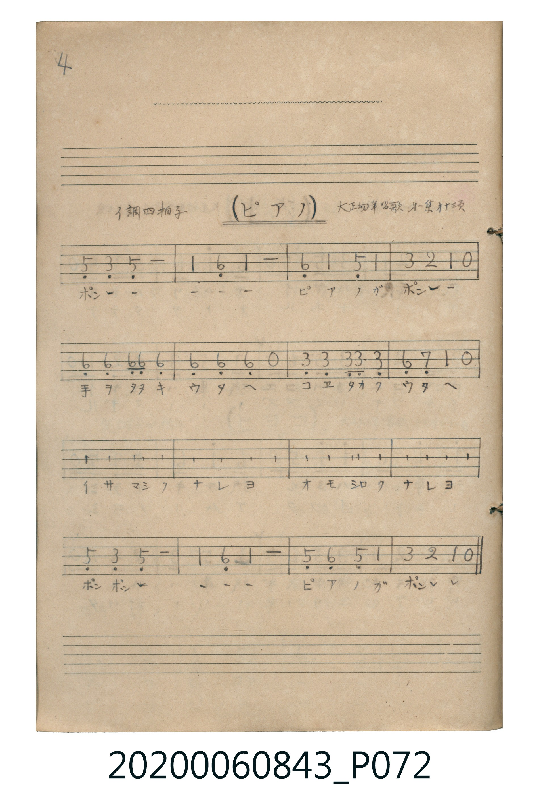

# ピアノ

> Re:Shoka 使用 AI 協助辨識與重建樂譜，可能會有錯誤。歡迎回報。

<audio controls src="piano.mp3"></audio>

- 曲：大正幼年唱歌 第二集

## 說明

ピアノ (Piano)
Source: 唱歌帖 (Shōkachō, NMTH 2020.006.0843) — P072.jpg (Notebook 2, p.4)
Notation: Handwritten numbered notation (Jianpu)
Annotations: イ調 四拍子, 大正幼年唱歌 第二集 廿頁

## 歌詞

```text
（TMD 檔案未包含歌詞註解）
```

## ABC

```abc
X:1
T:ピアノ
C:曲：大正幼年唱歌 第二集
M:4/4
L:1/16
Q:1/4=104
K:A
V:V1 name="Vocal" snm="Voc"
[V:V1]
!mf! E4 C4 E8 | A4 F4 A8 | F4 A4 E4 A4 | c4 B4 A4 z4 |
F4 F4 F2 F2 F4 | F4 F4 F4 z4 | C4 C4 C2 C2 C4 | F4 G4 A4 z4 |
F4 F4 F2 F2 F4 | F4 F4 F4 z4 | C4 C4 C2 C2 C4 | F4 G4 A4 z4 |
E4 C4 E8 | A4 F4 A8 | E4 F4 E4 A4 | c4 B4 A4 z4 |
```

## TMD 檔案連結

- [主旋律 TMD 檔案](piano.tmd) [[在 TMD Studio 編輯](https://tmdlang.github.io/Tmd-TS/#tmd=s7IKdvYPcrWy4qpTUCpJTLdSSM7PyUlNLsnMz7MqzsjPTkzOyFeCS5bl55TmploBqXgDI4RwcX5pUXJqfEFieqpVgIE5hgzcpPi8_JLUpPz8bISKgqL8stS8xDygqtzEvNLi5KLMgpL45PyCSoSa1LLMlFSQitSUzJL8oszEHCQnpRYVgx0LcUNJUWIexAygoBKXlpbC4-Ypj5sWPW7uU9DS4lK0VTA0MOGyt1Vw5LIx0TexA5nzbPam93tmPV2y_NnaxU937nm6c8vTKRufre1ReL5mzZNdPS9ntylxcelrKdhSC3ApKCA5SyMgMzEvXxMkGAwJLgWI_U93TFPQCM442gsKu6O9Ogp-viEeCkYGRgZ6BgZmegYWJsaaCo8apiiAwlwvqyBdQcMPGr4KRjoKBXomYEOBYong-FTwSMxLKS_KLClJzVPIK81NSi1KTVEARglYWkHDC-iOglKwHsc8mHCxlcLjpiUvVu1XeDp79rPu3qdrJ-go4Asrhae7979c0AgyhfKQggIFLX0uLnAwWYXlJyfmONQY1ChUg6xQsDE007IDs4AxBHTIi5XzrEDKoSKPm-c-bt6Mi4JGweOmNWhSCAOedXY_bt4EDIP9YLQWyFoGYjXPALI2P27eCJFa_bhpPZIUkgOaljxu2vq4ed7jpu1gNc1dj5vXPG5eAZRZ9bh5EUi4eS2qDLWcDwyj3LRaBdN4BV0wNIYx4CIwWKNgCGWZwaRgAgglGFJwY2ACNQrGUJYRmowBTAXMZw7giAQmrua5QAx2OQ56CjCkFgHpPiAN9iiKPNyrcNehMhAEmicwGXA3IgIKlYEg0MwyRw8InN4FJiegs8HpCYrBKQrChqQpIA1OVEC8GojByQouP8S8C0z9QLwV6PR5QHo7xDvNXUAMiklwHgDSwNgFyTWDggJVHu5daqVhuC64mkGSiGu5uHTtFMBlnAKQocwFAA)]
- [鋼琴伴奏 TMD 檔案](piano_piano.tmd) [[在 TMD Studio 編輯](https://tmdlang.github.io/Tmd-TS/#tmd=s7IKdvYPcrWy4tLSUnjcPOVx06LHzX0KGnDmkz1bni7tf7J7hqaClhaXoq2CoYEJl72tgiOXjYm-iR1XnYLSs9mb3u-Z9XTJ8mdrFz_duefpzi1Pp2x8trZH4fmaNU929byc3abExaWvpWBLLcCloIDs1oDMxLx8TYVHDVMUwEwFx-Tk_NyCxLzM3NS8EpDi4PzSouRUKwWIu57umKagEZxxtDc7MRlI6ij4-YZ4KBgZGBnoGRiY6RlYmBhDTTMwN9LLKkhX0PDLL0lNys_PVjDSUSjQM9EEGUq5P6BAQUufiwvscquw_OTEHIcagxqFapAVCjaGZlp2YBZQJDetVsE0XkEXDI1hDLgIDNYoGEJZZjApmABCCYYU3BiYQI2CMZRlhCZjAFMBdhgwYh3AzrYCx8pcIN6Mh56iAIw2IN0HpNdgyANDAuJZuPtQGQgCzRuYDLgrEUGFykAQaGaZowcFqocHueOolULguuBqyEoitbCkDSaDPHAm7oJaoIu1EXbEayOFCEIcmV2jYBKvbRavDbMVzENmo8rAeVB9WOWQzTdF1gLiaMP8C-SYx2vDfA3WA1eKHiFAWbhdxLCJ04FIQebxSEFFJAfVDrBvkO0YKX6hU2pDNgVZFzXTGmo-88GVz3AW9yjeRJPDEEBSgyGHFC9InkMENIbLMSqRZ53dwMpgE7CC2A_Fa4F4GYTdPANIgyqMjVC51UC8HkUesxKBuwlTBK8qLMU0MOmhK0cIEWcYlmqzaQkQbwW6fh6Q3g7xUXMXEIOqyBVA_iogDaw2QXLNoNBAlR-CPqZWQ4FaCRqnFMnpGZgTde2gLVEgQ5kLAA)]

## 分析

```text
================================================================================
📊 TMD Song Profile: [ ピアノ ]
================================================================================
⏱  Duration:       0:36 (36.9s), 16 measures total
🎼 Key & Tempo:    首調基準 A, != 104.0 BPM, <4/4>
   - 分析範圍：      由實際發聲的音符與和弦推測調性；播放脈絡另行呈現
🎤 人聲音域:    C#4 (MIDI 61) – C#5 (MIDI 73) [跨度: 12 個半音 / 1.0 個八度, 難度: easy]
   - 最低音:  C#4 in [Piano #1 @ m.1, 0:00]
   - 最高音: C#5 in [Piano #1 @ m.4, 0:06]
   - 適合: soprano, mezzo-soprano, contralto, tenor, baritone, bass
🏛  結構:      Piano (36.9s)
⚡ 編曲密度:        Peak 1 軌道同時演奏
🗝  調性診斷：       F# 小調（純淨自然小調，未偵測到可信轉調）
   - 風格氣質:    純淨自然小調（陰鬱抒情、旋律集中，無明顯調外色彩）
   - 轉調歷程:    全曲維持單一推測調性（未偵測到可信轉調）
   - 核心骨幹音:  F#, A, C#, E, G#
   - 調性數值:    F# 小調 [相關度: 0.90, 穩定度: High, 自然音純度: 100.0%]
   - 候選調性 (K-S): F# 小調 (0.90), A 大調 (0.66), F# 大調 (0.53)
   - 五度圈歷程:   +6
   - 各段落調性細節:
     • [Piano #1]: F# 小調 (r: 0.90, 自然音純度: 100.0%)

  [ 五度圈游移軌跡 ]
               C  
         F            G  
      Bb               D  
      Eb               A  
         Ab           E  
            Db       B  
              [F#]*
     (* = active key center)

  [ 十二半音累積音高分佈 ]
     C  :                            0.0%
     C# : ██████████████            20.7%
     D  :                            0.0%
     D# :                            0.0%
     E  : ███████████               15.5%
     F  :                            0.0%
     F# : ████████████████████████  34.5%
     G  :                            0.0%
     G# : ██                         3.4%
     A  : ████████████████          22.4%
     A# :                            0.0%
     B  : ██                         3.4%
--------------------------------------------------------------------------------
Assignment 軌道音域：
  - Vocal         : C#4 – C#5 (12 個半音 / 1.0 個八度, 58 個音符)
================================================================================
```


## 原書掃描頁




