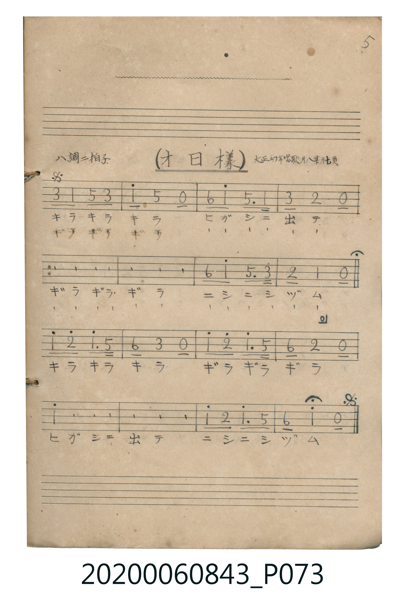

# オ日様

> Re:Shōka 使用 AI 協助辨識與重建樂譜，可能會有錯誤。歡迎[回報](https://github.com/TMDLang/reshoka/issues)。

- **鋼琴伴奏版**：<br><audio controls src="ohisama.mp3"></audio>

- 曲：大正幼年唱歌 第八集

## 說明

オ日様 (Ohisama)
Source: 唱歌帖 (Shōkachō, NMTH 2020.006.0843) — P073.jpg (Notebook 2, p.5)
Notation: Handwritten numbered notation (Jianpu)
Annotations: ハ調 二拍子, 大正幼年唱歌 第八集 廿七頁
Note: Score has Segno on bar 1, Fine at bar 8, and D.S. at bar 16 (total 24 bars).
- Reference Audio: [大正幼年唱歌チャンネル (YouTube)](https://www.youtube.com/@%E5%A4%A7%E6%AD%A3%E5%B9%BC%E5%B9%B4%E5%94%B1%E6%AD%8C%E3%83%81%E3%83%A3%E3%83%B3%E3%83%8D%E3%83%AB/videos)


## 歌詞

```text
（TMD 檔案未包含歌詞註解）
```

## ABC

<div class="abc-score" data-abc-src="ohisama.abc" aria-label="五線譜載入中"></div>

[下載 ABC 原始檔](ohisama.abc)

## TMD 檔案連結

- [主旋律 TMD 檔案](ohisama.tmd) [[在 TMD Studio 編輯](https://tmdlang.github.io/Tmd-TS/#tmd=s7IKdvYPcrWy4qpTUCpJTLdSSM7PyUlNLsnMz7MqzsjPTkzOyFeCS5bl55TmploBqXgDI4RwcX5pUXJqfEFieqpVgIG5MboM3KT4vPyS1KT8_GyEioKi_LLUvMQ8oKrcxLzS4uSizIKS-OT8gkqEmtSyzJRUkIrUlMyS_KLMxBwkJ6UWFYMdC3FDSVFiHsQMoCBCVUlGKtDdeYklpUWpCFGgUemZeVa5qZlZmfElqRUlqE6DSpckZgLdHw_E5YnxuYmZeTmJeSnIqkoy8tOLEgsyKq0yMotB7ktOzInPTsxLVOLS0lJ43LTq2fSlz5bPUNDS4lK0VTA0MOGyt1Vw5rIx0jexAxnzbPam93tmPV2y_NnaxU937nm6c8vTKRufre1ReL5mzdPW1S9ntylxcelrKdhSC3ApKCA5S8Mf6OzE3ERNkHAwJMIUIC54umOagkZwxtFeUOwd7dVR8PMN8VAwMjAy0DMwMNMzsDAx1lR41DBFARTrelkF6QoaftAYVjDSUSjQMwUbChRLBKcoBQ9g0JUXZZaUpOYp5JXmJqUWpaYoABMFWFpBwyszMa-gFKzHMQ8mXGyl8Li5_8Wq_QpPdvU86-59unaCjgK-0FJ4unv_kx3NLxc0Qi0H-ic4Ob8oVSEjsVghODU9L18BaFtSYpGCoY6CW2ZeqkJiCZhroaMAdKCCi16wHkzI0ExBowTokhwFIxOQQLGmHjj4mncHpaYBnQ9MlgqOpSmZ-VYK0ZiOetzc-Lh58ePmzY-bex83r1bQiMwvDSlNStWM1cgoKSkottLXLy8v16vMLy0Biuol5-fqO6i6mqo6mqg6mqu6mqk6uqg6GoNEnCxVnZxhDBMQw9JE1ckQqsYCKGWsagFEQBEwA6QLzHCCMSxcYFJO-qAMlV-syQXyCuXpCQoUtPS5uKCJKd7RKgAYmfkONQY11SBbFGwMzbTswCxgUgYGzYuV86xAOqAij5vWPm5eCSGhHGAgT3rctOZx0_bHzd0KT9t3PW5uU9AHSq4DqwSRUA5QZTdUGZhqfdy8gJDZWEwBmo3FRjLMpsjdGqAUqQmzokahOjetVsFYQVfBEIhNgRjErlEwjINyQdAALGQGUoQQNgQKgdQaISuCudshLB9YTAGzVtNaoCvATkelmycB2WtA7gK5EuQNIN2GcBY5LjIGCoFcA9KHx0XroC5BoyGhhES3AjE4LmoR6c4Jd7qDutAIRIBZIGdB3AjyAMLVOJWRF5I4_AMPSUpdBeXichaOiCQuOB3jg1KBlWYevlAdTZsEAlPXTgEengpIHCdkDiykQWLKXAA)]
- [鋼琴伴奏 TMD 檔案](ohisama_piano.tmd) [[在 TMD Studio 編輯](https://tmdlang.github.io/Tmd-TS/#tmd=s7IKdvYPcrWy4qpTUCpJTLdSyC8qychPL0osyKi0ysgsLskvykxOzInPTsxLVIIrKs4vLUpOjS9ITE-1CjAwN0bIlGSk5qZapaaUJieWZObnKXFpaSk8blr1bPrSZ8tnKGg8bp7yuGnR4-a-J3u2PF3a_2T3DE0FLS0uRVsFQwMTLntbBWcuGyN9EzuQec9mb3q_Z9bTJcufrV38dOeepzu3PJ2y8dnaHoXna9Y8bV39cnabEheXvpaCLbUAl4ICslv9gd5PzE3UVHjUMEUhIDMxL1_BMTk5P7cgMS8zNzWvBKQ8GBwQVgoQlz3dMU1BIzjjaG92YjKQ1FHw8w3xUDAyMDLQMzAw0zOwMDGGmgYMM72sgnQFDb_8ktSk_PxsBSMdhQI9U02wG5p3B6WmpRal5iWnKjiWpmTmWylEY4bD4-bGx82LHzdvftzc-7h5tYJGZH5pSGlSqmasRkZJSUGxlb5-eXm5XmV-aQlQVA_ocn0HVVdTVUcTVUdzVVczVUcXVUdjkIiTpaqTM4xhAmJYmqg6GULVWACljFUtgAgoAmaAdIEZTjCGhQtMykm_LDMlNb9YkwvkFcojBQoUtPS5uKAxEu9oBY4OhxqDmmqQLQo2hmZadmBWjUJ1blqtgrGCroIhEJsCMYhdo2AYB-WCoAFYyAykCCFsCBQCqTVCVgQ2FJjIHMLygdnACpxC1gJjaCUm3TwJyF4DxNuB7G6Fp-27gHQbyOEQh5HjJmOgEMg9IH0IN9ViBEWQB67AKKhVMI3XNtQG2Qj2pbaxNsxKoJu0TbXB1mFKGWqbaINcgymDYh6QYx6vDQszSHihKaGOlUi2GMdrgyyA24kZHj7I4WECDw5DoFawaeDINoFQQJ5pPFAYW1Svg0YxGg2MXlg0Q-hWIF6AiGpc9hiCrEFyrRO-hAwOJCMQAQ0uU2j6gIUrJMXgVEZuOsbhaYTnKHQXPPIxEjM0OHAlZiJTDkraI0UXlnRMUytRlGELCPypGJqsEDxgAsMWzzjKJWITMYY1QB5KjosPSi0pLcrDl5RHTnGMEhi4EvKIKpBRQmSQl8u6dgpwdysgcZyQOTAfgcSUuQA)]

## 分析

```text
================================================================================
📊 TMD Song Profile: [ オ日様 ]
================================================================================
⏱  Duration:       0:27 (27.7s), 24 measures total
🎼 Key & Tempo:    首調基準 C, != 104.0 BPM, <2/4>
   - 分析範圍：      由實際發聲的音符與和弦推測調性；播放脈絡另行呈現
🎤 人聲音域:    C4 (MIDI 60) – D5 (MIDI 74) [跨度: 14 個半音 / 1.2 個八度, 難度: moderate]
   - 最低音:  C4 in [Ohisama_A #1 @ m.1, 0:00]
   - 最高音: D5 in [Ohisama_B #1 @ m.9, 0:09]
   - 適合: soprano, mezzo-soprano, contralto, tenor, baritone, bass
🏛  結構:      Ohisama_A (9.2s) -> Ohisama_B (9.2s) -> Ohisama_A_Return (9.2s)
⚡ 編曲密度:        Peak 1 軌道同時演奏
🗝  調性診斷：       C 大調（純淨自然大調，未偵測到可信轉調）
   - 風格氣質:    純淨自然大調（陽光明朗、易唱易記，無明顯調外色彩）
   - 轉調歷程:    全曲維持單一推測調性（未偵測到可信轉調）
   - 核心骨幹音:  C, G, E, D, A
   - 調性數值:    C 大調 [相關度: 0.92, 穩定度: High, 自然音純度: 100.0%]
   - 候選調性 (K-S): C 大調 (0.92), G 大調 (0.68), A 小調 (0.57)
   - 五度圈歷程:   +0 -> +0 -> +0
   - 各段落調性細節:
     • [Ohisama_A #1]: C 大調 (r: 0.90, 自然音純度: 100.0%)
     • [Ohisama_B #1]: C 大調 (r: 0.78, 自然音純度: 100.0%)
     • [Ohisama_A_Return #1]: C 大調 (r: 0.90, 自然音純度: 100.0%)

  [ 五度圈游移軌跡 ]
              [C ]*
         F            G  
      Bb               D  
      Eb               A  
         Ab           E  
            Db       B  
               F# 
     (* = active key center)

  [ 十二半音累積音高分佈 ]
     C  : ████████████████████████  34.5%
     C# :                            0.0%
     D  : ██████████                14.3%
     D# :                            0.0%
     E  : ████████████              17.9%
     F  :                            0.0%
     F# :                            0.0%
     G  : █████████████████         23.8%
     G# :                            0.0%
     A  : ███████                    9.5%
     A# :                            0.0%
     B  :                            0.0%
--------------------------------------------------------------------------------
Assignment 軌道音域：
  - Piano         : C4 – D5 (14 個半音 / 1.2 個八度, 72 個音符)
================================================================================
```


## 原書掃描頁




