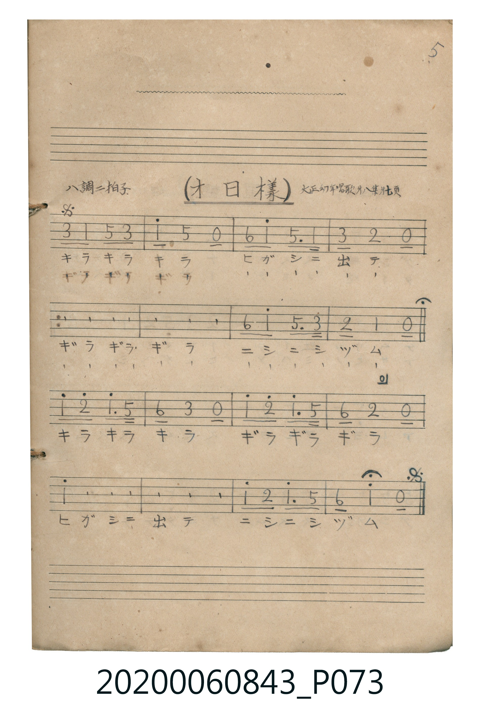

# オ日様

<audio controls src="ohisama.mp3"></audio>

- 曲：大正幼年唱歌 第八集

## 說明

オ日様 (Ohisama)
Source: 唱歌帖 (Shōkachō, NMTH 2020.006.0843) — P073.jpg (Notebook 2, p.5)
Notation: Handwritten numbered notation (Jianpu)
Annotations: ハ調 二拍子, 大正幼年唱歌 第八集 廿七頁
Note: Score has Segno on bar 1, Fine at bar 8, and D.S. at bar 16 (total 24 bars).

## 歌詞

```text
（TMD 檔案未包含歌詞註解）
```

## ABC

```abc
X:1
T:オ日様
C:曲：大正幼年唱歌 第八集
M:2/4
L:1/16
Q:1/4=104
K:C
V:V1 name="Vocal" snm="Voc"
[V:V1]
!mf! E2 C2 G2 E2 | c2 G4 z2 | A2 c2 G3 C | E2 D4 z2 |
E2 C2 G2 E2 | c2 G4 z2 | A2 c2 G3 E | D2 C4 z2 |
c2 d2 c3 G | A2 E4 z2 | c2 d2 c3 G | A2 D4 z2 |
c2 d2 c3 G | A2 E4 z2 | c2 d2 c3 G | A2 c4 z2 |
E2 C2 G2 E2 | c2 G4 z2 | A2 c2 G3 C | E2 D4 z2 |
E2 C2 G2 E2 | c2 G4 z2 | A2 c2 G3 E | D2 C4 z2 |
```

## TMD 檔案連結

- [主旋律 TMD 檔案](ohisama.tmd) [[在 TMD Studio 編輯](https://tmdlang.github.io/Tmd-TS/#tmd=s7IKdvYPcrWy4qpTUCpJTLdSSM7PyUlNLsnMz7MqzsjPTkzOyFeCS5bl55TmploBqXgDI4RwcX5pUXJqfEFieqpVgIG5MboM3KT4vPyS1KT8_GyEioKi_LLUvMQ8oKrcxLzS4uSizIKS-OT8gkqEmtSyzJRUkIrUlMyS_KLMxBwkJ6UWFYMdC3FDSVFiHsQMoCBCVUlGKtDdeYklpUWpSlxaWgqPm1Y9m7702fIZClpaXIq2CoYGJlz2tgrOXDZG-iZ2IH3PZm96v2fW0yXLn61d_HTnnqc7tzydsvHZ2h6F52vWPG1d_XJ2mxIXl76Wgi21AJeCApKzNPwzMosTcxM1QcLBkGBUgLjg6Y5pChrBGUd7QWF6tFdHwc83xEPByMDIQM_AwEzPwMLEWFPhUcMUBVBc6GUVpCto-EHDXcFIR6FAzxRsKFAsERzPCh6JeSnlRZklJal5CnmluUmpRakpCsCoAksraHhlJuYVlIL1OObBhIutFB43979YtV_hya6eZ929T9dO0FHAF1oKT3fvf7Kj-eWCRqjlQP8EJ-cXpSpkJBYrBKem5-UrAG1LSixSMNRRcMvMS1VILAFzLXQUgA5UcNEL1oMJGZopaJQAXZKjYGQCEijW1AOZSnkkQIGClj4XFzQG4h2twvKTE3McagxqFKpB1ijYGJpp2YFZwAQA9OWLlfOsQFqgIo-b1j5uXgkhoRxgYE163LTmcdP2x83dCk_bdz1ublPQB0quA6sEkVAOUGU3VBmYan3cvICQ2VhMAZqNxUYyzKbI3RqgeNSEWQEMvty0WgVjBV0FQyA2BWIQu0bBMA7KBUEDsJAZSBFC2BAoBFJrhKwI5m4HcPwAE2TTWqArwE5HpZsnAdlrQO4CuRLkDSDdhnAWOS4yBgqBXAPSh8dF66AuQaMhoYREtwIxOC5qEQnPCU_CgzrRCESAWSB3QRwJ8gHC2TiVkReUODwED0pKXQXl4nIWjpgkLjwd44NSgTVAHt5gHU2dBEJT104BHqAKSBwnZA4sqEFiylwA)]
- [鋼琴伴奏 TMD 檔案](ohisama_piano.tmd) [[在 TMD Studio 編輯](https://tmdlang.github.io/Tmd-TS/#tmd=s7IKdvYPcrWy4tLSUnjctOrZ9KXPls9Q0HjcPOVx06LHzX1P9mx5urT_ye4ZmgpaWlyKtgqGBiZc9rYKzlw2Rvomdlx1CkrPZm96v2fW0yXLn61d_HTnnqc7tzydsvHZ2h6F52vWPG1d_XJ2mxIXl76Wgi21AJeCArJb_TMyixNzEzUVHjVMUQjITMzLV3BMTs7PLUjMy8xNzSsBKQ_OLy1KTrVSgLjs6Y5pChrBGUd7sxOTgaSOgp9viIeCkYGRgZ6BgZmegYWJMdQ0A3NjvayCdAUNv_yS1KT8_GwFIx2FAj1TTZChlPsEChS09Lm4oN6Id7QKy09OzHGoMahRqAZZo2BjaKZlB2YBRXLTahWMFXQVDIHYFIhB7BoFwzgoFwQNwEJmIEUIYUOgEEitEbIisKHAqHEAW2kFDte1Co-bV2LSzZOA7DVAvB3I7lZ42r4LSLeBXA5xGDluMgYKgdwD0odwUy1yWIDjM8gDZ2gU1CqYxmsbaoOsBHtT21gbZifQUdqm2mD7MKUMtU20Qc7BlEExD8gxj9eGBRokwNCUUMdKJFuM47VBFsDtxAwQH1wBAtNkHI9kNsxKuJAJphBclWk8XCu21LEOmirQaGCKgKUMCN0KxAsQqYNydxkinIUUHk54Mws4HoxABDRGTKFpEBZ1kFSJUxm5eQVHKCFCg0J3wdMXRoZxIpBhiEydKOmbFF1Y8gpNrURRhi0kSMkpWJIfPlXwpIktaeAoLsnJKCQ6C3u5ER-UWlJalIc3u4ycagUWGvgzy4iqWFCCZMTXL7p2CvCQUUDiOCFzYGEGElPmAgA)]

## 分析

```text
================================================================================
📊 TMD Song Profile: [ オ日様 ]
================================================================================
⏱  Duration:       0:27 (27.7s), 24 measures total
🎼 Key & Tempo:    首調基準 C, != 104.0 BPM, <2/4>
   - 分析範圍：      由實際發聲的音符與和弦推測調性；播放脈絡另行呈現
🎤 人聲音域:    C4 (MIDI 60) – D5 (MIDI 74) [跨度: 14 個半音 / 1.2 個八度, 難度: moderate]
   - 最低音:  C4 in [Ohisama_A #1 @ m.1, 0:00]
   - 最高音: D5 in [Ohisama_B #1 @ m.9, 0:09]
   - 適合: soprano, mezzo-soprano, contralto, tenor, baritone, bass
🏛  結構:      Ohisama_A (9.2s) -> Ohisama_B (9.2s) -> Ohisama_A_Return (9.2s)
⚡ 編曲密度:        Peak 1 軌道同時演奏
🗝  調性診斷：       C 大調（純淨自然大調，未偵測到可信轉調）
   - 風格氣質:    純淨自然大調（陽光明朗、易唱易記，無明顯調外色彩）
   - 轉調歷程:    全曲維持單一推測調性（未偵測到可信轉調）
   - 核心骨幹音:  C, G, E, D, A
   - 調性數值:    C 大調 [相關度: 0.92, 穩定度: High, 自然音純度: 100.0%]
   - 候選調性 (K-S): C 大調 (0.92), G 大調 (0.68), A 小調 (0.57)
   - 五度圈歷程:   +0 -> +0 -> +0
   - 各段落調性細節:
     • [Ohisama_A #1]: C 大調 (r: 0.90, 自然音純度: 100.0%)
     • [Ohisama_B #1]: C 大調 (r: 0.78, 自然音純度: 100.0%)
     • [Ohisama_A_Return #1]: C 大調 (r: 0.90, 自然音純度: 100.0%)

  [ 五度圈游移軌跡 ]
              [C ]*
         F            G  
      Bb               D  
      Eb               A  
         Ab           E  
            Db       B  
               F# 
     (* = active key center)

  [ 十二半音累積音高分佈 ]
     C  : ████████████████████████  34.5%
     C# :                            0.0%
     D  : ██████████                14.3%
     D# :                            0.0%
     E  : ████████████              17.9%
     F  :                            0.0%
     F# :                            0.0%
     G  : █████████████████         23.8%
     G# :                            0.0%
     A  : ███████                    9.5%
     A# :                            0.0%
     B  :                            0.0%
--------------------------------------------------------------------------------
Assignment 軌道音域：
  - Vocal         : C4 – D5 (14 個半音 / 1.2 個八度, 72 個音符)
================================================================================
```


## 原書掃描頁




