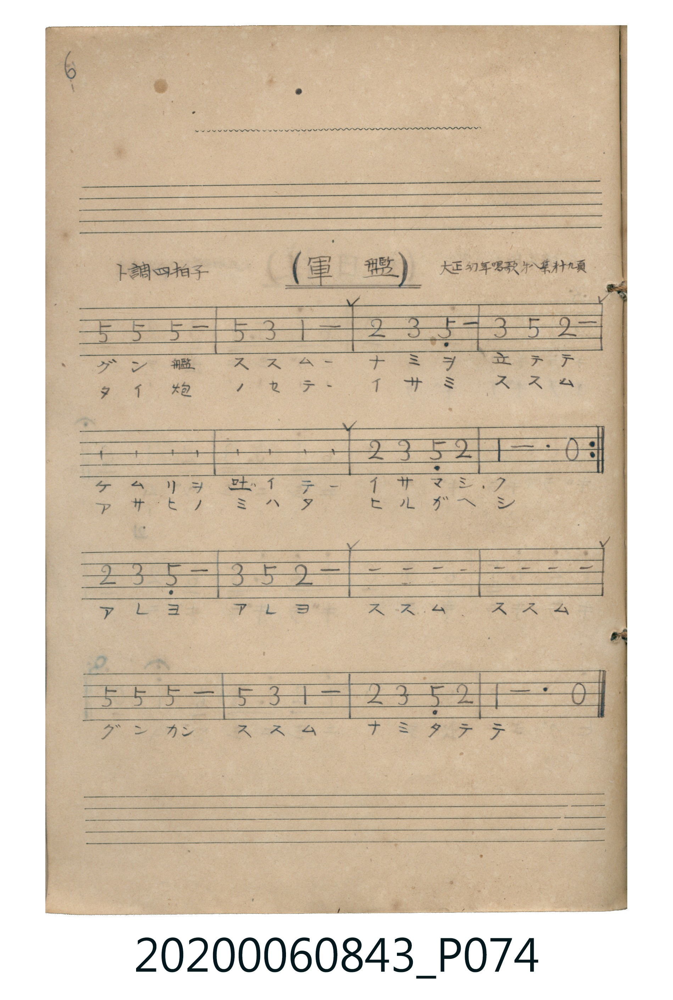

# 軍艦

> Re:Shoka 使用 AI 辨識樂譜，可能會有錯誤。歡迎回報。

<audio controls src="gunkan.mp3"></audio>

- 曲：大正幼年唱歌 第二集

## 說明

軍艦 (Gunkan)
Source: 唱歌帖 (Shōkachō, NMTH 2020.006.0843) — P074.jpg (Notebook 2, p.6)
Notation: Handwritten numbered notation (Jianpu)
Annotations: ト調 四拍子, 大正幼年唱歌 第二集 廿九頁

## 跨冊／重複收錄參照

> 同名異曲（各冊收錄之不同詞曲版本）

- **[同名異曲]** 《新定兒童唱歌》尋常科第五學年用（2020.006.0847.0005）：[**〈軍艦〉**](../../../shintei_jido_shoka/grade_5_2020.006.0847.0005/3_04_gunkan/index.md)（`G` / `3/4` — [原始 TMD](../../../shintei_jido_shoka/grade_5_2020.006.0847.0005/3_04_gunkan/gunkan.tmd)）
- **[同名異曲]** 楊金土手抄《唱歌帖》第 8 冊・VIII（2020.006.0843）：[**〈軍艦〉**](../../vol_08/p012_gunkan/index.md)（`G` / `3/4` — [原始 TMD](../../vol_08/p012_gunkan/gunkan.tmd)）
- **[同名異曲]** 《うたのほん》（唱歌課本）下卷（2006.006.0878）：[**〈ぐんかん（軍艦）〉**](../../../utanohon/ge_2006.006.0878/4_gunkan/index.md)（`G` / `2/4` — [原始 TMD](../../../utanohon/ge_2006.006.0878/4_gunkan/gunkan.tmd)）
- 總表：[跨冊重複與同名歌曲總索引](../../../duplicate_songs.md)

## 歌詞

```text
（TMD 檔案未包含歌詞註解）
```

## ABC

```abc
X:1
T:軍艦
C:曲：大正幼年唱歌 第二集
M:4/4
L:1/16
Q:1/4=108
K:G
V:V1 name="Vocal" snm="Voc"
[V:V1]
!f! D4 D4 D8 | D4 B,4 G,8 | A,4 B,4 D8 | B,4 D4 A,8 |
D4 D4 D8 | D4 B,4 G,8 | A,4 B,4 D4 A,4 | G,12 z4 |
A,4 B,4 D8 | B,4 D4 A,8 | A,4 B,4 D8 | B,4 D4 A,8 |
D4 D4 D8 | D4 B,4 G,8 | A,4 B,4 D4 A,4 | G,12 z4 |
```

## TMD 檔案連結

- [主旋律 TMD 檔案](gunkan.tmd) [[在 TMD Studio 編輯](https://tmdlang.github.io/Tmd-TS/#tmd=s7IKdvYPcrWy4qpTUCpJTLdSSM7PyUlNLsnMz7MqzsjPTkzOyFeCS5bl55TmploBqXgDI4RwcX5pUXJqfEFieqpVgIG5CboM3KT4vPyS1KT8_GyEioKi_LLUvMQ8oKrcxLzS4uSizIKS-OT8gkqEmtSyzJRUkIrUlMyS_KLMxBwkJ6UWFYMdC3FDSVFiHsQMoCBCVUlGKtDduZk5mSWJRUCTtbQUXuzufdG5TEFLi0vRVsHQwILL3lbBncvGRN_EDqTt2exN7_fMerpk-bO1i5_u3PN055anUzY-W9uj8HzNmie7el7OblPi4tLXUrClFuBSUIC5ScO9NC87MU8TJBQMCUEFiO1Pd0xT0AjOONoLCs6jvToKfr4hHgpGBkYGegYGZnoGFibGmgqPGqYogKJBL6sgXUHDDxrkCkY6CgV6ZmBDgWKJ4ChW8EjMSykvyiwpSc1TyCvNTUotSk1RAMYSWFpBwyszMa-gFKzHMQ8mXGyl8Li548Wq_QpPZ89-1t37dO0EHQV8IaXwdPf-JzvnvlzQCDKI8qCCAgUtfS4uSFBZheUnJ-Y41BjUKFSD7FCwMTTTsgOzgHEEdMyLlfOsQOqhIoZ6Co-bNjxu3gwK7sdNO0GoeQHQW12Pm-c_bt6k8Hx19-PmNiBS0AfKbwRKPm5eBZJ4OmHC46YlIAkQ1bT1cfO8x03bHzetRzLdCGT6fqD886Z1QDP7HjftRtYwH8lGkOmLwKKTgAqBioG29wM1A1lAgdWPm9Y8bp4BtADJdI2g1LSixMw8TbDWZqCCFSgsuGdQLAF59nHTaiCJ6V-gWyF-hVoCDMS0WgXTeAVdMMRkwGANQsgYxjDEVGSEoQiLSZhycG1wRbAgcABHNzAZNm0A-mGzAjgWm_eAfAbBYL8B-c1doCAF4k1gPjBWgTQwJsB4D1KgIkwEBn3TEgVIzIFMAEZK0264DpAcMLqgpmLaCA9BuoQeXKoGUyMMGuAOvI1QZ68CBxAwZUO8h-HVeUB6OxCvhwYJ9oBbBFU9CRJo4ADqhwQoWBdIfDWQvwZIz4CYiGoaFRMKLZMc0J_NID8A8xo4lND5aElwKCcQSO4CFhtQGkfuAkcxIldBvVnLxaVrpwApnxWALGUuAA)]
- [鋼琴伴奏 TMD 檔案](gunkan_piano.tmd) [[在 TMD Studio 編輯](https://tmdlang.github.io/Tmd-TS/#tmd=s7IKdvYPcrWy4tLSUnixu_dF5zIFjcfNUx43LXrc3Pdkz5anS_uf7J6hqaClxaVoq2BoYMFlb6vgzmVjom9ix1WnoPRs9qb3e2Y9XbL82drFT3fuebpzy9MpG5-t7VF4vmbNk109L2e3KXFx6Wsp2FILcCkowB3qXpqXnZinqfCoYYpCQGZiXr6CY3Jyfm5BYl5mbmpeCUhpcH5pUXKqlQLEVU93TFPQCM442pudmAwkdRT8fEM8FIwMjAz0DAzM9AwsTIyhphmYm-hlFaQraPjll6Qm5ednKxjpKBTomWmCDKXcF1CgoKXPxQXxhVVYfnJijkONQY1CNcgOBRtDMy07MAsoklarYBqvoAuGmAwYrEEIGcMYhpiKjDAUYTEJUw6uDa4I7Dpg5DqA3W4F5Dxu2qDwuHmzAih6HjfvAfJ3QnDzAgi_uQuI5wPxJjD_-epuIN0GxXtA4YHFzP1AvEThedM6qBl9QP5uuB6Q3OOmrVBzMe2EmokUOLQMQbhUDaZGGDRACUAqRgiVo3ZQBlktPMeAs3yQB648kwvMNMbx2kiuI8wGBQ6CZxivjeQl7GyQz7CbhSyOzEa1gygdUC8NTt-A9aNZg5OLmfRpHnijEUReBKFlNB9cGc0QqgNhIroANjUwhmk8QhVuE5CLCLjfcSvCVolshFYIq8CVz9MJEyAVB0YlMg9Ibwfi9dDKBleltAiqfhKkQgJXPv2QygqsDyS-GshfA6RnQMxENY8-IYesCotWQzgLNWdierYZ5JEV0MBC56PV8gRrYEojmLZJBdKGedwEjD4wjaMNA45qRNtlKEQtME_r2ilAsrUCkKXMBQA)]

## 分析

```text
================================================================================
📊 TMD Song Profile: [ 軍艦 ]
================================================================================
⏱  Duration:       0:35 (35.6s), 16 measures total
🎼 Key & Tempo:    首調基準 G, != 108.0 BPM, <4/4>
   - 分析範圍：      由實際發聲的音符與和弦推測調性；播放脈絡另行呈現
🎤 人聲音域:    G3 (MIDI 55) – D4 (MIDI 62) [跨度: 7 個半音 / 0.6 個八度, 難度: easy]
   - 最低音:  G3 in [Gunkan #1 @ m.2, 0:03]
   - 最高音: D4 in [Gunkan #1 @ m.1, 0:00]
   - 適合: mezzo-soprano, contralto, tenor, baritone, bass
🏛  結構:      Gunkan (35.6s)
⚡ 編曲密度:        Peak 1 軌道同時演奏
🗝  調性診斷：       D 大調（純淨自然大調，未偵測到可信轉調）
   - 風格氣質:    純淨自然大調（陽光明朗、易唱易記，無明顯調外色彩）
   - 轉調歷程:    全曲維持單一推測調性（未偵測到可信轉調）
   - 核心骨幹音:  D, A, G, B
   - 調性數值:    D 大調 [相關度: 0.86, 穩定度: High, 自然音純度: 100.0%]
   - 候選調性 (K-S): D 大調 (0.86), G 大調 (0.72), B 小調 (0.63)
   - 五度圈歷程:   +2
   - 各段落調性細節:
     • [Gunkan #1]: D 大調 (r: 0.86, 自然音純度: 100.0%)

  [ 五度圈游移軌跡 ]
               C  
         F            G  
      Bb              [D ]*
      Eb               A  
         Ab           E  
            Db       B  
               F# 
     (* = active key center)

  [ 十二半音累積音高分佈 ]
     C  :                            0.0%
     C# :                            0.0%
     D  : ████████████████████████  41.9%
     D# :                            0.0%
     E  :                            0.0%
     F  :                            0.0%
     F# :                            0.0%
     G  : ███████████               19.4%
     G# :                            0.0%
     A  : ████████████              21.0%
     A# :                            0.0%
     B  : ██████████                17.7%
--------------------------------------------------------------------------------
Assignment 軌道音域：
  - Vocal         : G3 – D4 (7 個半音 / 0.6 個八度, 46 個音符)
================================================================================
```


## 原書掃描頁




