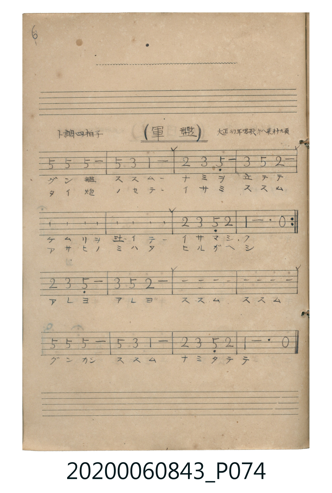

# 軍艦

> Re:Shōka 使用 AI 協助辨識與重建樂譜，可能會有錯誤。歡迎回報。

- **鋼琴伴奏版**：<br><audio controls src="gunkan.mp3"></audio>

- 曲：大正幼年唱歌 第二集 廿九頁
- 唱歌帳（2020.006.0843）P074.jpg（第 6 頁）

## 說明

> [!NOTE]
> **原頁資訊與校勘記**（對應 `P074.jpg`，手抄簡譜第 6 頁）：
> - **調性、拍號與出處註記**：題首左標「ト調四拍子」（G 大調 `?= G`、`<4/4>`），中題「（軍艦）」，右註「大正幼年唱歌 才二集 廿九頁」（《大正幼年唱歌》第二集第 29 頁）。第 2、4、6、10、12 小節末小節線上標有換氣記號 `v`。
> - **八度音域修正**：在 `TmdSwift` 中 `?= G` 以 `1 = G4` 為基準。原簡譜絕大多數音符 `1, 2, 3, 5`（`G4, A4, B4, D5`）均無低音點，**唯獨第 3、7、9、11（同上省寫）、15 小節之 `5̣` 下方明確點有低音點**（`5_` = `D4`），形成號角式五度／六度跳進（`A4–B4–D4` 接 `B4–D5–A4`）。先前版本誤將全曲音符一律降八度標成 `1_..5_`，今據原譜低音點精確還原（實音音域 `D4–D5`）。
> - **曲式結構與省寫記號展開（依 Policy A 校訂）**：
>   1. **前段反覆記號 `:||`（`PartA` 第 1–8 小節）**：第 8 小節末附反覆記號 `:||`，譜下並列上下兩排歌詞（第一遍「グン艦…」、第二遍「タイ炮…」），反覆演唱兩遍後進入後段（`PartB` 第 9–16 小節，「アレヨ　アレヨ…」），故編排為 `-> PartA[L1] -> PartA[L2] -> PartB -> #`。
>   2. **第 5–6 小節直點同上記號 `' ' ' '`**：第 1 小節為三字「グン艦」（`5 5 5 -`），第 5 小節兩節歌詞均為四字（「ケムリヲ」／「アサヒノ」），楊金土於第 5 小節四拍各畫一直點 `' ' ' '` 表示連奏四個四分音符 `| 5 5 5 5 |`；第 6 小節亦畫 `' ' ' '` 省寫重複第 2 小節之 `| 5 3 1 - |`。
>   3. **第 11–12 小節橫線省寫記號 `- - - -`**：原抄於音符欄連畫 `- - - - | - - - -` 省寫重複第 9–10 小節之 `| 2 3 5_ - | 3 5 2 - |`（「ススム　ススム」）。
>
> **前半段（第 1–8 小節，`:||` 反覆兩遍）**
> 1. グン艦　ススムー　ナミヲ　立テテ
>    ケムリヲ　吐イテー　イサマシク
> 2. タイ炮　ノセテー　イサミ　ススム
>    アサヒノ　ミハタ　ヒルガヘシ
>
> **後半段（第 9–16 小節）**
> アレヨ　アレヨ　ススム　ススム
> グンカン　ススム　ナミタテテ


## 歌詞

```text
（TMD 檔案未包含歌詞註解）
```

## ABC

<div class="abc-score" data-abc-src="gunkan.abc" aria-label="五線譜載入中"></div>

[下載 ABC 原始檔](gunkan.abc)

## TMD 檔案連結

- [主旋律 TMD 檔案](gunkan.tmd) [[在 TMD Studio 編輯](https://tmdlang.github.io/Tmd-TS/#tmd=s7IKdvYPcrWy4qpTUCpJTLdSSM7PyUlNLsnMz7MqzsjPTkzOyFeCS5bl55TmploBqXgDI4RwcX5pUXJqfEFieqpVgIG5CboM3KT4vPyS1KT8_GyEioKi_LLUvMQ8oKrcxLzS4uSizIKS-OT8gkqEmtSyzJRUkIri5MS8-LLUosy0zNQUJGelFhWDHQxxR0lRYh7EHKAgQlV-UUlGfnpRYkFGpVVGZnFJflFmcmJOfHZiXiJCUUlGKtCDuZk5mSWJRUhOACpOz8yzyk3NzMqML0mtKEH1BVS6JDET6NV4IC5PjM9NzMzLScwDulNLS-HF7t4XncsUtLS4FG0VDA0suOxtFdy5bEz0TexAhjybven9nllPlyx_tnbx0517nu7c8nTKxmdrexSer1nzZFfPy9ltCk9373-yc-7LBY1gWyHST3dsfr-nw8jAyEDPwMBMz8DCxPj9nk5QFOhlFaQDpYDaFcwUgJqAwkpcXPpaCrbUAlwKCgp2CtGKfv4hrrEQjpbW0775QMtebG5_saLrRUf7swULn3bPeLFihpYW0DFPN_Q-a-9USIC5L-H9np5nnd3Pulqeb1j4Yu0cZMcCQwNipi7Q1Ber9j9rWP64ofFZd--LmfOBBj9t3_Vi5tQXK3ZDzZ71cmHPy2XTnm5f9mzFzMcNPY-bO4Cans6eDdTxdO2Exw29QPvdFYABDBRWSAAFfgLQvARwBADdAbSv58mOtUBTgJqBSiHRBRQH6-x52r8ZaBdQCksMPevsRY8hiHWPG7owlT9u6IZHKci_RpZQDz9uaALzga4yAWIzIDY0ABFGCk839D9f3_BszmoI4_n2WU92dAH9-WxO57P-2c82LAYGAjBYFBLKgH5qQgTb09bVT3ctezl_89P585_sXwd0CTions5ZoZAQkpsSXJ6ZVpKgAPQ2NEAUnuxeqpBgqABkmyQoPG_a9XT-rme7pgHNBEYrNIq2TgX66emSWc-m7gAa_HzNMqAGHQUjHQVjHQVTYEB2JLib6Cg4ArETELuAhDqfzm1_3rLwyd4-oI6Xu-cBwxPotinrn_euAPnYGOhJcyC2BHnWEJRMJgCjouv5nMan61eDA6bR0BQaBk92diskmJ5ZDHJ197NpO5_N6Hu-aBfQTGBQwM0Hp7UE0_gEoEcSXEygsft076JnHRNAqWf5pKd7-p_smgIMm_d7-p-2rgUyXmzf_LIBmAU7EhxNHjVMdgIRQK0Kz_qAIQLhmQIJR7BpoABp7Xja2fu8s-PZnDUvVi15uqH9aesKYCaGhMmTHQ1P93W_nNkLiQFQVHVMAAZUvJ4e0FmgpLa769nkWcBQBQYp3N3PN-0DeaapBSgOCob1oKiDxB7IH2A3QK1HxDHQTqBvnm-d8Gx5NzBfQEINkh6ebpz6clo30KQn--YqBOTnZCZXKjgqALPkixVNQGPAaQFikIKCoR4ovXT2Plu39Wl_74tlbbAkZVVTA47VgMSiEkdgogBGmCHQJRbQCIGZAxKHiQET6suZLdiM6QF5d0f3kx3LnnZMB8YxkP20deWzvknAjPFiJTBhgMorYOC9bOwF5eGmDY-bNwOz4aOGZcAcBUwH0JwDld3_uGnJ86Z1EFloJIMtfbZnCjCzAU0Gqny6rwcYsU9blwIZQM_BvOIE8Yol0CuGZnC_gDL_46ZFj5vXPG5e8bihAc5GtuPZ1Nbn21cAHQ3MIAoJunYK4KCJ9jGMVUBwjOAcJxBDGZExFRSMQGENsh2UomCWP5-9BZgEIEkfFmjqCmCYAA9hQ5jipl1PdnQ-XTsdOZQghU6CqQII6kJTPdgaqC5ggIBiBxzUoCwJzN-zZwMNARdVQHM2Pm5e8Lh51ePmTWCj-qGB0bT1cfOkx819iABY2vWyfeLTOfOfTduDYj6ktJ3Q8nzqamAkQnyE8IXCi4Urni_Z9bJh8dOl_SCbG7pBZEcbrBypAbscBEFpZTakNoDm-13LgIYimQVJ5y_be18saQcXm8gFBMggY2Bg6QINQgp3Y1i4G4JSMKJcXbkaWKIiZxxgrAL1AiEk5IHZEVhFAT0LceizNS1AP4CdA1WmUAOldTEdBk5hBqiuMwK6zjQerA_IAHJBDoXFwk4QAkYEKPXB2aCQh_kEXtV29j7t7YKkacxs2QPOcgqQDAHJCuC8CtENzO5I6QbJpuY9IG5z1-Pm-eB00PB8dffj5jYggoUiUCNyQml4OmECMB-C1YD1AtmgFDPvcdP2x03rIbqAKR6eXcHm9z1u2o2hZT6yS5CsQ06CQL1Ah_WDTAOxgYKrHzcBc-gMoHWoobOvByV00HI6PCSwZnfUwEd3FCTkHjetBpFoKiEhB3QdPMwob2hBgYKWPhcXuHixCssHNlwdagxqqkE2KNiYaIH9rVCdVgumsTXzwC3JHQ3AUhRYhL5Y2KOggZ5oFIApRkcB1jjTxGIE0AUg42EZFZSA4TkNa6oGK_cxrAGFmQIwuBRAbWCQCmCIQXDzAgi_uQuI5wPxJjAfmOyA7DYwhptjBNK3H4iXABsn66D6-oD83TB1YDlgcgGbhcUeLhT3AwsaTPcbAZkgAV0FAxT3bwSbAUz2YDfWKADTPcQ2DJvnAentYJH1YHPiUdy_CKpqEtjtIB-AfN0P9hnERyCZ1UD-GiA9A2zOdrg5tZAk4ERBEgA1qIAFLzwJoOQMIuMfW1zjSQBQfzeDfLQCGlrofLT0gC_esKY7LPGGSHaQzIo_5YFSFjAuQSKgGIWHN5E1PBcA)]
- [鋼琴伴奏 TMD 檔案](gunkan_piano.tmd) [[在 TMD Studio 編輯](https://tmdlang.github.io/Tmd-TS/#tmd=s7IKdvYPcrWy4qpTUCpJTLdSSM7PyUlNLsnMz7MqzsjPTkzOyFeCS5bl55TmploBqXgDI4RwcX5pUXJqfEFieqpVgIG5CboM3KT4vPyS1KT8_GyEioKi_LLUvMQ8oKrcxLzS4uSizIKS-OT8gkqEmtSyzJRUkIri5MS8-LLUosy0zNQUJGelFhWDHQxxR0lRYh7EHKAgQlV-UUlGfnpRYkFGpVVGZnFJflFmcmJOfHZiXiJCUWIRUHN6am5qXolVQWZiXn58YnJyfm5BYl4mSEyJS0tL4cXu3hedy97v6XjZvef5hC1P9mx5urT_eWfH-z2dClpaXIq2CoYGFlz2tgruXDYm-iZ2IMOfzd70fs-sp0uWP1u7-OnOPU93bnk6ZeOztT0Kz9esebKr5-XsNoWnu_c_2Tn35YJGsGsg0k93bAbaY2RgZKBnYGCmZ2BhYgy0BRTGelkF6UApoHYFMwWgJqCwEhdXQGJRiaNVWD7QYw41BjXVXApAYGOiZQdmVKfVgukaBVMw1AWzjBUMwSwjIMs0HswEMoBcIAus3MewRuFx0waFx82bFYAeB6t43LQTgpsXQPjNXUA8H4g3gfnPV3cD2W1gDDfHCKRvPxAvUXjetA6qrw_I3w1TB5Z73LQVbBYWe7hQ3G-Kzf1GQCZIQFfBAMX9G8FmPG5eBXZjjcLTCRMgtmHYPA9IbweLrAebE4_i_kVQVZPAbgf5AOTrfrDPID4CyawG8tcA6Rlgc7bDzamFxVEAKHEFeWCLpVx4NBlqG2ubYiFhMqbx2kCGgnG8NogFp4GhEq9tHq9tBFNgBJKAkmBJkCDcCJhKMA3xKrWthpuOoQFGgyILNXB8sAdOATxwQMbGwyhMPhLHCKbAGMiAC5BuDroCJEc7EZHrsOUwPNkOmtqaQeloBTSNovPRciG-3II1t2PJLYjM_rhpNYjCm99B-RmYg0AioHyEksqdiEvlFCTWoZ3QoeFDKKETTMh0TOq6dgrgLBrtYxirgOAYwTlOIIYyFwA)]

## 分析

```text
================================================================================
📊 TMD Song Profile: [ 軍艦 ]
================================================================================
⏱  Duration:       0:53 (53.3s), 24 measures total
🎼 Key & Tempo:    首調基準 G, != 108.0 BPM, <4/4>
   - 分析範圍：      由實際發聲的音符與和弦推測調性；播放脈絡另行呈現
🎤 人聲音域:    D4 (MIDI 62) – D5 (MIDI 74) [跨度: 12 個半音 / 1.0 個八度, 難度: easy]
   - 最低音:  D4 in [PartA[L1] #1 @ m.3, 0:05]
   - 最高音: D5 in [PartA[L1] #1 @ m.1, 0:00]
   - 適合: soprano, mezzo-soprano, contralto, tenor, baritone, bass
🏛  結構:      PartA[L1] (17.8s) -> PartA[L2] (17.8s) -> PartB (17.8s)
⚡ 編曲密度:        Peak 1 軌道同時演奏
🗝  調性診斷：       D 大調（純淨自然大調，未偵測到可信轉調）
   - 風格氣質:    純淨自然大調（陽光明朗、易唱易記，無明顯調外色彩）
   - 轉調歷程:    全曲維持單一推測調性（未偵測到可信轉調）
   - 核心骨幹音:  D, G, A, B
   - 調性數值:    D 大調 [相關度: 0.86, 穩定度: Moderate, 自然音純度: 100.0%]
   - 候選調性 (K-S): D 大調 (0.86), G 大調 (0.73), B 小調 (0.63)
   - 五度圈歷程:   +2 -> +2 -> +2
   - 各段落調性細節:
     • [PartA[L1] #1]: D 大調 (r: 0.84, 自然音純度: 100.0%)
     • [PartA[L2] #1]: D 大調 (r: 0.84, 自然音純度: 100.0%)
     • [PartB #1]: D 大調 (r: 0.87, 自然音純度: 100.0%)

  [ 五度圈游移軌跡 ]
               C  
         F            G  
      Bb              [D ]*
      Eb               A  
         Ab           E  
            Db       B  
               F# 
     (* = active key center)

  [ 十二半音累積音高分佈 ]
     C  :                            0.0%
     C# :                            0.0%
     D  : ████████████████████████  43.0%
     D# :                            0.0%
     E  :                            0.0%
     F  :                            0.0%
     F# :                            0.0%
     G  : ███████████               20.4%
     G# :                            0.0%
     A  : ███████████               19.4%
     A# :                            0.0%
     B  : ██████████                17.2%
--------------------------------------------------------------------------------
Assignment 軌道音域：
  - Vocal         : D4 – D5 (12 個半音 / 1.0 個八度, 71 個音符)
================================================================================
```


## 原書掃描頁




