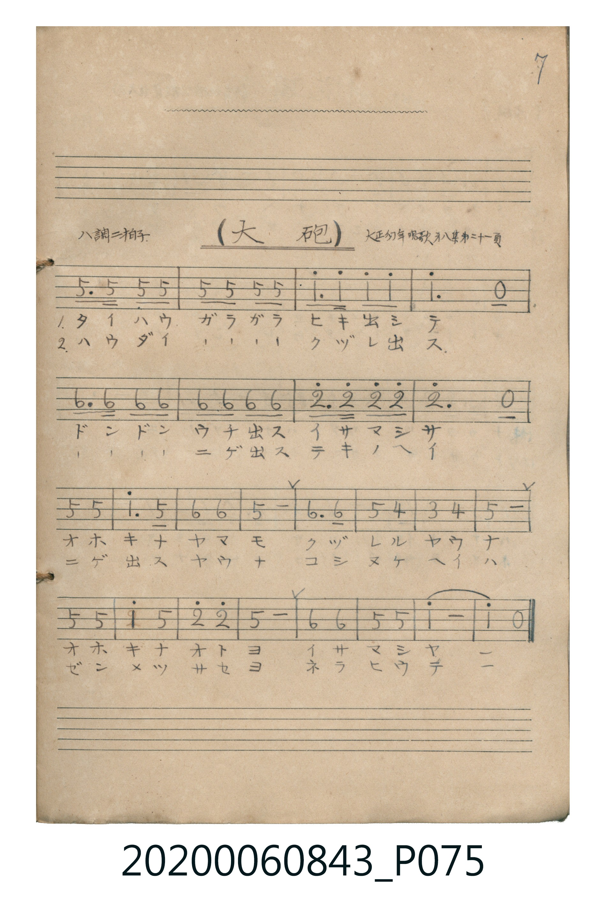

# 大砲

<audio controls src="taiho.mp3"></audio>

- 曲：大正幼年唱歌 第八集

## 說明

大砲 (Taihō)
Source: 唱歌帖 (Shōkachō, NMTH 2020.006.0843) — P075.jpg (Notebook 2, p.7)
Notation: Handwritten numbered notation (Jianpu)
Annotations: ハ調 二拍子, 大正幼年唱歌 第八集 第二十一頁

## 歌詞

```text
（TMD 檔案未包含歌詞註解）
```

## ABC

```abc
X:1
T:大砲
C:曲：大正幼年唱歌 第八集
M:2/4
L:1/16
Q:1/4=108
K:C
V:V1 name="Vocal" snm="Voc"
[V:V1]
!f! G3 G G2 G2 | G2 G2 G2 G2 | c2 c c c2 c2 | c6 z2 |
A3 A A2 A2 | A2 A2 A2 A2 | d3 d d2 d2 | d6 z2 |
G4 G4 | c6 G2 | A4 A4 | G8 |
A6 A2 | G4 F4 | E4 F4 | G8 |
G4 G4 | c4 G4 | d4 d4 | G8 |
A4 A4 | G4 G4 | c8 | c4 z4 |
```

## TMD 檔案連結

- [主旋律 TMD 檔案](taiho.tmd) [[在 TMD Studio 編輯](https://tmdlang.github.io/Tmd-TS/#tmd=s7IKdvYPcrWy4tLSUni6ZPnzBZsUtLS4FG0VDA0suOxtFZy5bIz0Tey46hSUns3e9H7PLKCiZ2sXP9255-nOLU-nbHy2tkfh-Zo1T1tXv5zdpsTFpa-lYEstwKWgAHOTRkhiZsbRXk2QUHB-aVFyqpUCxPanO6YpaAQD5bITk4GkjoKfb4iHgpGBkYGegYGZnoGFibGmwqOGKQoBBuamelkF6QoafvklqUn5-dkKRjoKBXrmYEOBYoklmfl5VgoeiXkp5UWZJSWpeQp5pblJqUWpKQp5UGkFDa_MxLyCUrAexzyYcLGVwuPm_her9is82dXzrLv36doJOiCn4wwpEAuo9Glv45MdDS8XNIKMozzAoEBBS5-LCxRg-VZh-cmJOQ41BjUK1SArFGwMzbTswCxgRAFd9GLlPCuQcqiIoZ7C46b9j5uWAH3zuGkZkLPmcfNKCAn04aTHTWuftu963LT9cXObgj5QpPNx82YICVS77HFzI1h6J5Cz5HHT1sfN80Bqm7YiWfG4adXj5tlAgx43dwENANo073HzIqDw-sfNrY-bgTatBguDTOsC2YGiHsTpeNy8AtWC5iVIFhgB_QB2_ePmBqAqND_ArIG6E90Pzd2PmzbB_NDcBra273HzDJBBSH5AVQZz7OOmzWDX9Dxu2ggUBmkCugTshz1gOxY-bm4BcrY-btoN9kNzL8hloGAF6m-DWQCMq7RaBVMFXSA0BdMgXANnIUQM44AUkIAgMBMuDIMGICGYwx3A6QGYWJv2g0IQFFCgeAOFEZANCh4o3TwJyF4LpBuAeA-QvR0UHEhBADcJZgJIJSS0UU1qWg-kW4EYxAeaBFa3E-FXM7ArzcA0CENEkHGNghHEQ0AKzAITcFF83mzuBGJQtEJpsEMb4Y6AOHgrkD8P4kWUlIrTlOZuoMpNCFOAAQMJrD5QrINNhXsPEo2QCANBtNiBxCMkDCC-hSiCKYdBhBqYOoQaE7gaYwwRDHMwU8IqoKNnQz0AzpGQ4ADlSXDMI8cfOGtCgxGkdg_W4EIPHlQdwFwCTU89QBqcURBpEWEi3qBDCMETAZyBL_AwAxhHvKAJgVIXccEH5ncAMSh7gzyLlsLAwQvKBliDrgkkA0phC4EYXFQA8W6Eac29kEwFzp6gIAWmPIRptVxcunYK4IJfAchQ5gIA)]
- [鋼琴伴奏 TMD 檔案](taiho_piano.tmd) [[在 TMD Studio 編輯](https://tmdlang.github.io/Tmd-TS/#tmd=s7IKdvYPcrWy4tLSUni6ZPnzBZsUNB43T3nctOhxc9-TPVueLu1_snuGpoKWFpeirYKhgQWXva2CM5eNkb6JHVedgtKz2Zve75kF1Pls7eKnO_c83bnl6ZSNz9b2KDxfs-Zp6-qXs9uUuLj0tRRsqQW4FBTgDg1JzMw42qup8KhhikJAZmJevoJjcnJ-bkFiXmZual4JSGlwfmlRcqqVAsRVT3dMU9AIBurJTkwGkjoKfr4hHgpGBkYGegYGZnoGFibGUNMMzE31sgrSFTT88ktSk_LzsxWMdBQK9Mw1QYZS7gsoUNDS5-IC-SLfKiw_OTHHocagRqEaZIWCjaGZlh2YBRRJq1UwVdAFQlMwDcI1cBZCxDAOSAEJCAIz4cIwaAASApsLjBUHsK1WQM7jpv1AvEThcXM_kF4GxGuA7JUIunkSkL0WSDcA8R4gezuQbgN5ANMsmBkgtSAz0c1qWg-kW4EYxAeaBVa3E2ZWjYIZ2KVmYBqEISLIuEbBCOIpIAVmgQm4KLpXIYEFCUAIjRYqkPCD2AuxAaIIphwGEWpg6hBqTOBqjDFEMMwh7CyEENxTcAY-h2E6Hoef0YRAoQVxWi0sTYLzVJAHrlSZC0yWhtrG2jDzkdlAg3HKANnacGtROGhyCCdBbDTUNtGGeQ-ZjU_GCGigOZSHzEaVwbSJKMej-xi383CHEjF6zOO1jbSRUlO8NlAWuxxOqyjxGe5ABNuO4kyy_EZR4kBNrz640qshVINpPMIduIWMMYVQEwlakdcJxJsRNLj4a4QXbZBicCuQPw9SdALZ2ItONHOau4FqNyHMARa5kGK4D4hngM2FF5smMCfDHIxVCO5XI4QP4WL4vNi0CmjlbKj1XUAMqi2A3mleBK0RkEv11RB5cDCA1O7B4V1076HqedwECkpQTdMDpDfCvQyuYRBmEhuR8NCAM7DqJFIZUUJEhCOY3wHEK6B-Rksq4HAG1ZI4wrAJJAdKKguBuAWit2k3wrzmXkitC67BQWELTEKo5hEbfniTjmk8_hDEqhCbvZhpEZjBde0UwHlcAchQ5gIA)]

## 分析

```text
================================================================================
📊 TMD Song Profile: [ 大砲 ]
================================================================================
⏱  Duration:       0:26 (26.7s), 24 measures total
🎼 Key & Tempo:    首調基準 C, != 108.0 BPM, <2/4>
   - 分析範圍：      由實際發聲的音符與和弦推測調性；播放脈絡另行呈現
🎤 人聲音域:    E4 (MIDI 64) – D5 (MIDI 74) [跨度: 10 個半音 / 0.8 個八度, 難度: easy]
   - 最低音:  E4 in [Taiho #1 @ m.15, 0:15]
   - 最高音: D5 in [Taiho #1 @ m.7, 0:06]
   - 適合: soprano, mezzo-soprano, contralto, tenor, baritone, bass
🏛  結構:      Taiho (26.7s)
⚡ 編曲密度:        Peak 1 軌道同時演奏
🗝  調性診斷：       G 大調（純淨自然大調，未偵測到可信轉調）
   - 風格氣質:    純淨自然大調（陽光明朗、易唱易記，無明顯調外色彩）
   - 轉調歷程:    全曲維持單一推測調性（未偵測到可信轉調）
   - 核心骨幹音:  G, A, C, D, F
   - 調性數值:    G 大調 [相關度: 0.77, 穩定度: Moderate, 自然音純度: 95.7%]
   - 候選調性 (K-S): G 大調 (0.77), C 大調 (0.72), G 小調 (0.63)
   - 五度圈歷程:   +1
   - 各段落調性細節:
     • [Taiho #1]: G 大調 (r: 0.77, 自然音純度: 95.7%, 調外音: F)

  [ 五度圈游移軌跡 ]
               C  
         F           [G ]*
      Bb               D  
      Eb               A  
         Ab           E  
            Db       B  
               F# 
     (* = active key center)

  [ 十二半音累積音高分佈 ]
     C  : ████████████              19.6%
     C# :                            0.0%
     D  : ███████                   12.0%
     D# :                            0.0%
     E  : █                          2.2%
     F  : ███                        4.3%
     F# :                            0.0%
     G  : ████████████████████████  40.2%
     G# :                            0.0%
     A  : █████████████             21.7%
     A# :                            0.0%
     B  :                            0.0%
--------------------------------------------------------------------------------
Assignment 軌道音域：
  - Vocal         : E4 – D5 (10 個半音 / 0.8 個八度, 54 個音符)
================================================================================
```


## 原書掃描頁




