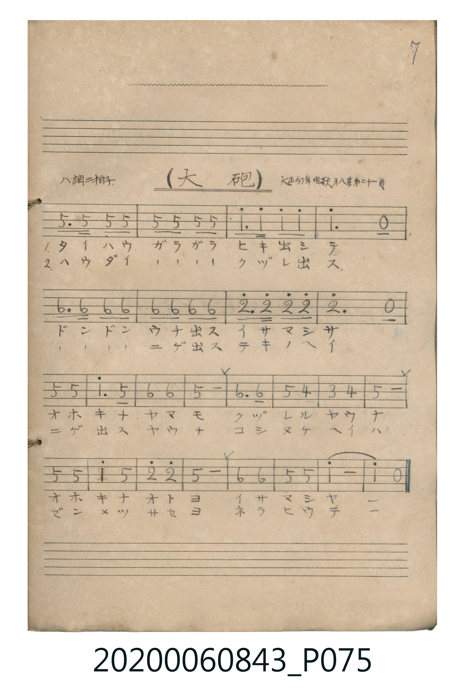

# 大砲

> Re:Shōka 使用 AI 協助辨識與重建樂譜，可能會有錯誤。歡迎回報。

- **鋼琴伴奏版**：<br><audio controls src="taiho.mp3"></audio>

- 曲：大正幼年唱歌 第八集

## 說明

大砲 (Taihō)
Source: 唱歌帖 (Shōkachō, NMTH 2020.006.0843) — P075.jpg (Notebook 2, p.7)
Notation: Handwritten numbered notation (Jianpu)
Annotations: ハ調 二拍子, 大正幼年唱歌 第八集 第二十一頁


## 歌詞

```text
（TMD 檔案未包含歌詞註解）
```

## ABC

<div class="abc-score" data-abc-src="taiho.abc" aria-label="五線譜載入中"></div>

[下載 ABC 原始檔](taiho.abc)

## TMD 檔案連結

- [主旋律 TMD 檔案](taiho.tmd) [[在 TMD Studio 編輯](https://tmdlang.github.io/Tmd-TS/#tmd=s7IKdvYPcrWy4qpTUCpJTLdSSM7PyUlNLsnMz7MqzsjPTkzOyFeCS5bl55TmploBqXgDI4RwcX5pUXJqfEFieqpVgIG5KboM3KT4vPyS1KT8_GyEioKi_LLUvMQ8oKrcxLzS4uSizIKS-OT8gkqEmtSyzJRUkIrUlMyS_KLMxBwkJ6UWFYMdC3FDSVFiHsQMoCBCVUlGKtDduZk5mSWJRUgmAw1Lz8yzyk3NzMqML0mtKEF1HFS6JDET6IN4IC5PjM9NzMzLScxLUeLS0lJ4umT58wWbFLS0uBRtFQwNLLjsbRWcuWyM9E3sQIY8m73p_Z5ZQEXP1i5-unPP051bnk7Z-Gxtj8LzNWuetq5-ObtNiYtLX0vBllqAS0EB5iaNkMTMjKO9miChYEg0KEBsf7pjmoJGMFAOFCdHe3UU_HxDPBSMDIwM9AwMzPQMLEyMNRUeNUxRAMWlXlZBuoKGHzTeFIx0FAr0zMGGAsUSwelEwQMYHOVFmSUlqXkKeaW5SalFqSkKwKgGSytoeGUm5hWUgvU45sGEi60UHjf3v1i1X-HJrp5n3b1P107QATkdZ0iBWEClT3sbn-xoeLmgEWQc5QEGBQpa-lxcoADLtwrLT07McagxqKkG2aBgY2imZQdmAeMJ6KAXK-dZgVRDRQz1FB437X_ctATomcdNy4CcNY-bV0JIoAcnPW5a-7R91-Om7Y-b2xT0gSKdj5s3Q0ig2mWPmxvB0juBnCWPm7Y-bp4HUtu0FcmKx02rHjfPBhr0uLkLaADQpnmPmxcBhdc_bm593Ay0aTVYGGRaF8gOFPUgTsfj5hWoFjQvQbLACOgHsOsfNzcAVaH5AWYN1J3ofmjufty0CeaH5jawtX2Pm2eADELyA6oymGMfN20Gu6bncdNGoDBIE9AlYD_sAdux8HFzC5Cz9XHTbrAfmntBLgMFK1B_G8yCGoXqtFoFUwVdIDQF0yBcA2chRAzjgBSQgCAwEy4MgwYgIZjDHcDJAZhWm_aDQhAUUKB4A4URkA0KHijdPAnIXgukG4B4D5C9HRQcSEEANwlmAkglJLRRTWpaD6RbgRjEB5oEVrcT4VczsCvNwDQIQ0SQcY2CEcRDQArMAhNwUXzebO4EYlC0QmmwQxvhjoA4eCuQPw_iRZSUitOU5m6gyk0IU4ABAwmsPlCsg02Few8SjZAIA0G02IHEIyQMIL6FKIIph0GEGpg6hBoTuBpjDBEMczBTwiqgo2dDPQDOkZDgAOVJcMwjxx84a0KDEaR2D9bgQg8eVB3AXAJNTz1AGpxREGkRYSLeoEMIwRMBnIEv8DADGEe8oAmBUhdxwQfmdwAxKHuDPIuWwsDBC8oGWIOuCSQDSmELgRhcVADxboRpzb2QTAXOnqAgBaY8hGm1XFy6dgrgcl8ByFDmAgA)]
- [鋼琴伴奏 TMD 檔案](taiho_piano.tmd) [[在 TMD Studio 編輯](https://tmdlang.github.io/Tmd-TS/#tmd=s7IKdvYPcrWy4tLSUni6ZPnzBZsUNB43T3nctOhxc9-TPVueLu1_snuGpoKWFpeirYKhgQWXva2CM5eNkb6JHVedgtKz2Zve75kF1Pls7eKnO_c83bnl6ZSNz9b2KDxfs-Zp6-qXs9uUuLj0tRRsqQW4FBTgDg1JzMw42qup8KhhikJAZmJevoJjcnJ-bkFiXmZual4JSGlwfmlRcqqVAsRVT3dMU9AIBurJTkwGkjoKfr4hHgpGBkYGegYGZnoGFibGUNMMzE31sgrSFTT88ktSk_LzsxWMdBQK9Mw1QYZS7gsoUNDS5-IC-SLfKiw_OTHHocagphpkg4KNoZmWHZhVo1CdVqtgqqALhKZgGoRr4CyEiGEckAISEARmwoVh0AAkBDYXGCkOYEutgJzHTfuBeInC4-Z-IL0MiNcA2SsRdPMkIHstkG4A4j1A9nYg3QZyP6ZZMDNAakFmopvVtB5ItwIxiA80C6xuJ8ysGgUzsEvNwDQIQ0SQcY2CEcRTQArMAhNwUXSvQgILEoAQGi1UIOEHsRdiA0QRTDkMItTA1CHUmMDVGGOIYJhD2FkIIbin4Ax8DsN0PA4_owmBQgvitFpYkgRnqSAPHIkyF5gqDbWNtWHGI7OB5uKUAbK14baicNDkEC6C2GiobaIN8x0yG5-MEdBAcygPmY0qg2kTUY5H9zFu5-EOJWL0mMdrG2kjJaZ4baAsdjmcVlHiM9yBCLYdxZlk-Y2ixIGaXH2Qk6sJPLUaAkMNmTKGUAZYy8LmTiDejKDBZVkjvJyClGlbgfx5kHIQyMZeDqKZ09wNVLsJYQ6w_ISUqX1APANsLrwMNIkHOg9OAV1tBHIxkMbu5KZVQCNmQ43rAmJQUQ50XvMiaHGNXOSuhsiDvQVSuweH89Gdi6rncRMoaEDVQA-Q3gj3Arj4R5iJHuhAHwERXBSNi0IR4U8wvwOIV0DdhBY14HAAVTE4_NgEkgNFzUIgboHobdqNMK-5F1Jlgas_kN-BUYZqHrr_kKLKNB7Zh3ABmHpIXAKTr66dAjgFKwAZylwA)]

## 分析

```text
================================================================================
📊 TMD Song Profile: [ 大砲 ]
================================================================================
⏱  Duration:       0:26 (26.7s), 24 measures total
🎼 Key & Tempo:    首調基準 C, != 108.0 BPM, <2/4>
   - 分析範圍：      由實際發聲的音符與和弦推測調性；播放脈絡另行呈現
🎤 人聲音域:    E4 (MIDI 64) – D5 (MIDI 74) [跨度: 10 個半音 / 0.8 個八度, 難度: easy]
   - 最低音:  E4 in [Taiho #1 @ m.15, 0:15]
   - 最高音: D5 in [Taiho #1 @ m.7, 0:06]
   - 適合: soprano, mezzo-soprano, contralto, tenor, baritone, bass
🏛  結構:      Taiho (26.7s)
⚡ 編曲密度:        Peak 1 軌道同時演奏
🗝  調性診斷：       G 大調（純淨自然大調，未偵測到可信轉調）
   - 風格氣質:    純淨自然大調（陽光明朗、易唱易記，無明顯調外色彩）
   - 轉調歷程:    全曲維持單一推測調性（未偵測到可信轉調）
   - 核心骨幹音:  G, A, C, D, F
   - 調性數值:    G 大調 [相關度: 0.77, 穩定度: Moderate, 自然音純度: 95.7%]
   - 候選調性 (K-S): G 大調 (0.77), C 大調 (0.72), G 小調 (0.63)
   - 五度圈歷程:   +1
   - 各段落調性細節:
     • [Taiho #1]: G 大調 (r: 0.77, 自然音純度: 95.7%, 調外音: F)

  [ 五度圈游移軌跡 ]
               C  
         F           [G ]*
      Bb               D  
      Eb               A  
         Ab           E  
            Db       B  
               F# 
     (* = active key center)

  [ 十二半音累積音高分佈 ]
     C  : ████████████              19.6%
     C# :                            0.0%
     D  : ███████                   12.0%
     D# :                            0.0%
     E  : █                          2.2%
     F  : ███                        4.3%
     F# :                            0.0%
     G  : ████████████████████████  40.2%
     G# :                            0.0%
     A  : █████████████             21.7%
     A# :                            0.0%
     B  :                            0.0%
--------------------------------------------------------------------------------
Assignment 軌道音域：
  - Vocal         : E4 – D5 (10 個半音 / 0.8 個八度, 54 個音符)
================================================================================
```


## 原書掃描頁




