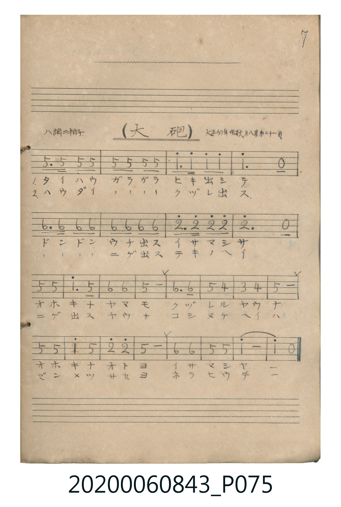

# 大砲

> Re:Shōka 使用 AI 協助辨識與重建樂譜，可能會有錯誤。歡迎回報。

- **鋼琴伴奏版**：<br><audio controls src="taiho.mp3"></audio>

- 曲：大正幼年唱歌 第八集

## 說明

大砲 (Taihō)
Source: 唱歌帖 (Shōkachō, NMTH 2020.006.0843) — P075.jpg (Notebook 2, p.7)
Notation: Handwritten numbered notation (Jianpu)
Annotations: ハ調 二拍子, 大正幼年唱歌 第八集 第二十一頁
Reference Audio: 大正幼年唱歌チャンネル (YouTube)
https://www.youtube.com/@%E5%A4%A7%E6%AD%A3%E5%B9%BC%E5%B9%B4%E5%94%B1%E6%AD%8C%E3%83%81%E3%83%A3%E3%83%B3%E3%83%8D%E3%83%AB/videos


## 歌詞

```text
（TMD 檔案未包含歌詞註解）
```

## ABC

<div class="abc-score" data-abc-src="taiho.abc" aria-label="五線譜載入中"></div>

[下載 ABC 原始檔](taiho.abc)

## TMD 檔案連結

- [主旋律 TMD 檔案](taiho.tmd) [[在 TMD Studio 編輯](https://tmdlang.github.io/Tmd-TS/#tmd=s7IKdvYPcrWy4qpTUCpJTLdSSM7PyUlNLsnMz7MqzsjPTkzOyFeCS5bl55TmploBqXgDI4RwcX5pUXJqfEFieqpVgIG5KboM3KT4vPyS1KT8_GyEioKi_LLUvMQ8oKrcxLzS4uSizIKS-OT8gkqEmtSyzJRUkIrUlMyS_KLMxBwkJ6UWFYMdC3FDSVFiHsQMoCBCVUlGKtDduZk5mSWJRUgmAw1Lz8yzyk3NzMqML0mtKEF1HFS6JDET6IN4IC5PjM9NzMzLScxLQVZVkpGfXpRYkFFplZFZDHJhcmJOfHZiXqISl5aWwtMly58v2KSgpcWlaKtgaGDBZW-r4MxlY6RvYgcy49nsTe_3zAIqerZ28dOde57u3PJ0ysZna3sUnq9Z87R19cvZbUpcXPpaCrbUAlwKCjA3aYQkZmYc7dUECQVD4koBYvvTHdMUNIKBcqCIO9qro-DnG-KhYGRgZKBnYGCmZ2BhYqyp8KhhigIowvWyCtIVNPygkatgpKNQoGcONhQolghOTAoewDArL8osKUnNU8grzU1KLUpNUQCmB7C0goZXZmJeQSlYj2MeTLjYSuFxc_-LVfsVnuzqedbd-3TtBB2Q03GGFIgFVPq0t_HJjoaXCxpBxgWlpgHtAiYfBcfSlMx8oAcxDHjc3Pi4efHj5s2Pm3sfN69W0IjMLw0pTUoFOyejpKSg2Epfv7y8XK8yv7QEKK6XnJ-r76DqaqrqaKLqaK7qaqbq6KLqaAwScbJUdXKGMUxADEsTVSdDqBoLoJSxqgUQAUXADJAuMMMJxrBwgUk56YNSfn4xF8gdlEc8FCho6XNxgSI-3yosH5hSHWoMaqpBNijYGJpp2YFZwPQGDJcXK-dZgVRDRQz1FB437X_ctAQYKY-blgE5ax43r4SQwIia9Lhp7dP2XY-btj9ublPQB4p0goMURALVLgOGMlh6J5Cz5HHT1sfN80Bqm7YiWfG4adXj5tlAgx43dwENANo073HzIqDw-sfNrY-bgTatBguDTOsC2YGiHsTpeNy8AtWC5iVIFhgB_QB2_ePmBqAqND_ArIG6E90Pzd2PmzbB_NDcBra273HzDJBBSH5AVQZz7OOmzWDX9Dxu2ggUBmkCugTshz1gOxY-bm4BcrY-btoN9gMoLa4EBytQfxvMghqF6rRaBVMFXSA0BdMgXANnIUQM44AUkIAgMBMuDIMGICGYwx3AyQGY55r2g0IQFFCgeAOFEZANCh4o3TwJyF4LpBuAeA-QvR0UHEhBADcJZgJIJSS0UU1qWg-kW4EYxAeaBFa3E-FXM7ArzcA0CENEkHGNghHEQ0AKzAITcFF83mzuBGJQtEJpsEMb4Y6AOHgrkD8P4kWUlIrTlOZuoMpNCFOAAQMJrD5QrINNhXsPEo2QCANBtNiBxCMkDCC-hSiCKYdBhBqYOoQaE7gaYwwRDHMwU8IqoKNnQz0AzpGQ4ADlSXDMI8cfOGtCgxGkdg_W4EIPHlQdwFwCTU89QBqcURBpEWEi3qBDCMETAZyBL_AwAxhHvKAJgVIXccEH5ncAMSh7gzyLlsLAwQvKBliDrgkkA0phC4EYXFQA8W6Eac29kEwFzp6gIAWmPIRptVxcunYK4HJfAchQ5gIA)]
- [鋼琴伴奏 TMD 檔案](taiho_piano.tmd) [[在 TMD Studio 編輯](https://tmdlang.github.io/Tmd-TS/#tmd=s7IKdvYPcrWy4qpTUCpJTLdSyC8qychPL0osyKi0ysgsLskvykxOzInPTsxLVIIrKs4vLUpOjS9ITE-1CjAwN0XIlGSk5qZapaaUJieWZObnKXFpaSk8XbL8-YJNChqPm6c8blr0uLnvyZ4tT5f2P9k9Q1NBS4tL0VbB0MCCy95WwZnLxkjfxA5k2LPZm97vmQXU-Wzt4qc79zzdueXplI3P1vYoPF-z5mnr6pez25S4uPS1FGypBbgUFOAODUnMzDjaq6nwqGGKQkBmYl6-gmNycn5uQWJeZm5qXglIaTA4BKwUIK56umOagkYwUE92YjKQ1FHw8w3xUDAyMDLQMzAw0zOwMDGGmgYMLL2sgnQFDb_8ktSk_PxsBSMdhQI9c02QoUGpaalFqXnJqQqOpSmZ-UDTMfz_uLnxcfPix82bHzf3Pm5eraARmV8aUpqUCtafUVJSUGylr19eXq5XmV9aAhTXA7pb30HV1VTV0UTV0VzV1UzV0UXV0Rgk4mSp6uQMY5iAGJYmqk6GUDUWQCljVQsgAoqAGSBdYIYTjGHhApNy0i_LTEnNL-YCuYPy2IACBS19Li5QbORbheUDk6FDjUFNNcgGBRtDMy07MKtGoTqtVsFUQRcITcE0CNfAWQgRwzggBSQgCMyEC8OgAUgIbC4wcTmALbUCch437QfiJQqPm_uB9DIgXgNkr0TQzZOA7LVAugGI9wDZ24F0G8j9mGbBzACpBZmJblbTeiDdCsQgPtAssLqdMLNqFMzALjUD0yAMEUHGNQpGEE8BKTALTMBF0b0KCSxIAEJotFCBhB_EXogNEEUw5TCIUANTh1BjAldjjCGCYQ5hZyGE4J6CM_A5DNPxOPyMJgQKLYjTamFJElw0BHngSJS5wFRpqG2sDTMemQ00F6cMkK0NtxWFgyaHcBHERkNtE22Y75DZ-GSMgAaaQ3nIbFQZTJuIcjy6j3E7D3coEaPHPF7bSBspMcVrA2Wxy-G0ihKf4Q5EsO0oziTLbxQlDtTk6oOcXE3gqdUQGGrIlDGEMsBaFjZ3AvFmBA0uyxrh5RSkTNsK5M-DlINANvZyEM2c5m6g2k0Ic4DlJ6RM7QPiGWBz4WWgSTzQeXAK6GojkIuBNHYnN60CGjEbalwXEIOKcqDzmhdBi2vkInc1RB7sLZDaPTicj-5cVD2Pm0BBA6oGeoD0RrgXwMU_wkz0QAf6CIjgomhcFIoIf4L5HUC8AuomtKgBhwOoisHhxyaQHChqFgJxC0Rv026Eec29kCoLXP2B_A6MMlTz0P2HFFWm8cg-hAvA1EPiEph8de0UwClYAchQ5gIA)]

## 分析

```text
================================================================================
📊 TMD Song Profile: [ 大砲 ]
================================================================================
⏱  Duration:       0:26 (26.7s), 24 measures total
🎼 Key & Tempo:    首調基準 C, != 108.0 BPM, <2/4>
   - 分析範圍：      由實際發聲的音符與和弦推測調性；播放脈絡另行呈現
🎤 人聲音域:    E4 (MIDI 64) – D5 (MIDI 74) [跨度: 10 個半音 / 0.8 個八度, 難度: easy]
   - 最低音:  E4 in [Taiho #1 @ m.15, 0:15]
   - 最高音: D5 in [Taiho #1 @ m.7, 0:06]
   - 適合: soprano, mezzo-soprano, contralto, tenor, baritone, bass
🏛  結構:      Taiho (26.7s)
⚡ 編曲密度:        Peak 1 軌道同時演奏
🗝  調性診斷：       G 大調（純淨自然大調，未偵測到可信轉調）
   - 風格氣質:    純淨自然大調（陽光明朗、易唱易記，無明顯調外色彩）
   - 轉調歷程:    全曲維持單一推測調性（未偵測到可信轉調）
   - 核心骨幹音:  G, A, C, D, F
   - 調性數值:    G 大調 [相關度: 0.77, 穩定度: Moderate, 自然音純度: 95.7%]
   - 候選調性 (K-S): G 大調 (0.77), C 大調 (0.72), G 小調 (0.63)
   - 五度圈歷程:   +1
   - 各段落調性細節:
     • [Taiho #1]: G 大調 (r: 0.77, 自然音純度: 95.7%, 調外音: F)

  [ 五度圈游移軌跡 ]
               C  
         F           [G ]*
      Bb               D  
      Eb               A  
         Ab           E  
            Db       B  
               F# 
     (* = active key center)

  [ 十二半音累積音高分佈 ]
     C  : ████████████              19.6%
     C# :                            0.0%
     D  : ███████                   12.0%
     D# :                            0.0%
     E  : █                          2.2%
     F  : ███                        4.3%
     F# :                            0.0%
     G  : ████████████████████████  40.2%
     G# :                            0.0%
     A  : █████████████             21.7%
     A# :                            0.0%
     B  :                            0.0%
--------------------------------------------------------------------------------
Assignment 軌道音域：
  - Vocal         : E4 – D5 (10 個半音 / 0.8 個八度, 54 個音符)
================================================================================
```


## 原書掃描頁




